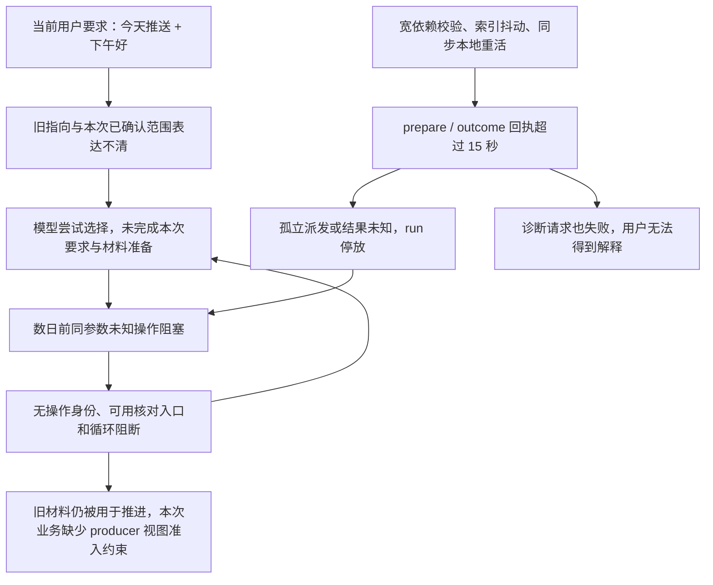

# 常驻助手故障复核与专项修复说明（已修订）

日期：2026-11-17。状态：**原方案已修订并归入专项说明；不是独立实施入口；源码及本机隔离验收已完成，生产操作未执行。**

唯一实施主方案为[工作连续性与执行准备闭环重设计](resident-assistant-work-continuity-redesign-2026-11-17.md)，从第 11.1 节开始。本文保留已核对的证据、源码索引和专项恢复 / 性能细节；涉及工具与数据契约、分批顺序、就绪及执行准入时均按主方案实施，不拼接两套优先级。本文与原复盘的错误判断已直接回写修正，不只依赖顶部声明。

范围：保存最新助手原始对话的复核证据及专项修复依据。本文保留分析阶段的证据；用户授权后的源码实现、隔离验证和生产只读观察见[实施与验证记录](../docs/verification/resident-work-continuity-implementation-2026-11-17.md)。分析快照与当前现场分开记录，不据此恢复或重跑推送。

## 1. 结论

本次故障由两条链相互放大：

1. **恢复链失去闭环**：本地请求准备延迟或回执丢失，留下未知操作；上下文选择又被按不可自动重试的写操作处理；旧操作按整个 Session 的相同参数阻塞新调用，系统却没有向模型提供可执行的核对路径。
2. **工作准备到执行的闭环不完整**：当前输入暂未归属、保留旧前台指向都可以是正常状态；但系统没有可靠确认本次工作范围、记录新要求、准备材料并约束后续业务准入，助手在选择失败后仍围绕旧实例推进。

模型确有行为错误：重复提交已经被拒绝的操作、没有回执却宣称「当前 sel 已生效」、把错误归因到不存在的本次重复委派。系统需要把这些错误限制在一次可解释、可恢复的失败内，不能允许它们消耗整轮对话。

当前方向：**保留稳定前台指向、助手语义判断和现有 ContextView / Runtime；按产生调用的实际模型请求核验工作准备与执行资格。** 同分支可包含多次执行，不按日期强制建分支；恢复失败时保留原话和阻塞事实，旧视图不能替当前目标取得资格。完整契约见主方案。

## 2. 证据范围与已确认事实

### 2.1 复核材料及限制

| 材料 | 本轮核对内容 |
| --- | --- |
| `analysis/resident-assistant-architecture-postmortem-2026-11-17.md` | 全文；作为待复核的分析，而非所有结论的独立证据 |
| `C:/Users/dotty/.phaneris/workspaces/Work/assistant/sessions/261105-copper-cloud/session.jsonl` | 2,122 条逻辑消息；重点为 11 月 17 日 13:07–14:16；核对用户、助手、工具及错误原文 |
| 同目录 `.pi-sessions/*.jsonl` | 两份 Pi 原始日志；核对实际 `select` 参数、上下文重建记录与最后一次本地超时 |
| `runtime/runtime.db` | 使用 SQLite `mode=ro`、`query_only=ON`，查询 T1/T2、未知操作、模型请求时间戳 |
| 工作区 `context.db` | 同样只读；查询 pointer、ContextView、命令幂等表 |
| 当前工作树源码及 11 月 13 日稳定性报告 | 核对上下文准备、来源索引、恢复守卫、回执等待、记忆及委派实现 |
| `automations.json` | 只读确认确有「每日双联知识推送 8:40」，标识 `cb4925`；没有触发任何动作 |

源码基线为 `43ee16f7b` 上的当前工作树。工作区已有多项未提交修改，包括 `packages/pi-agent-server/src/index.ts` 和系统提示词，本文不修改它们。当前根包版本为 `0.6.5`；**未建立故障时安装二进制与当前源码的精确映射**，实施前仍须补齐构建来源。11 月 13 日报告中“修复尚未进入安装版”的描述属于当日状态，不能直接延用为今天的部署结论。

原始会话文件本轮读取时为 23,544,783 字节，SHA-256：

`d666782089e4a45d9f9cd54a7c5c75b24d8b725ec5d8019c3010c7292eccadd9`

数据库处于其他工作可能继续写入的环境；每次查询只代表各自读快照，不声明跨数据库、文件的全局事务一致性。本文不复制私人画像或与故障无关的消息。

### 2.2 最新对话实际发生了什么

以下时间均为北京时间；行号为 `session.jsonl` 的物理行号，包含首行 header。

| 时间 / 行号 | 原始事实 | 判断 |
| --- | --- | --- |
| 13:24:41 / 2036 | 用户要求「手动触发今日的双联知识推送任务，注意招呼语改成下午好」 | 本次执行目标明确；“下午好”是本次覆盖项，不能据此改写长期定时配置 |
| 13:24:51–13:25:21 | 5 次 `assistant_context select` 被拒绝 | Pi 原文显示参数均为同一个 Day 72 分支，无 `requestId` |
| 13:30:36 / 2050 | 用户质疑助手正在做什么 | 应恢复原指令并说明阻塞，不能重新引入旧任务目标 |
| 13:32:38–13:33:56 | 又有 17 次同参数 `select` 被拒绝 | 11 月 17 日合计 22 次；没有有效的循环阻断 |
| 13:33:27 / 2078 | 助手称「先看清 Day 72……当前 sel 已生效」 | 与本轮成功回执不符；工具拒绝没有被转化为可靠的行动约束 |
| 同轮 / 2075、2080 | `assistant_work` 返回历史 Day 72 委派，状态为 `cancelled` | 历史执行实例进一步强化了旧任务锚点；取消状态不是新任务授权 |
| 13:34:36 / 2102 | 助手解释为同一 requestId / 委派意图重复，并让用户重新选择是否派发 | 本次被拦的是 `select`，不是本次委派；它没有 requestId。解释有机制基础，但对象、身份口径和行动建议错了 |
| 13:36:25 / 2103 | 用户明确表示已自行启动，不再需要执行，改为要求分析意图混乱 | 从这里开始，原执行目标已经撤销，后续只能诊断 |
| 13:40:26、13:56:38、14:16:48 | 三次顶层 `Runtime receipt unavailable or execution cancelled` | 最新诊断请求最终没有得到完整回答 |

从 13:24 的指令到会话结束，没有看到新的 `assistant_delegate` 调用。应将结果描述为“助手未完成本次触发”，不能描述为“本次任务已经运行但回执未展示”。具体当天 Day 编号未从权威业务状态独立确认，本文不沿用复盘中未经本轮证实的 Day 75。

### 2.3 旧未知操作确实是直接阻塞源

| 字段 | 只读查询结果 |
| --- | --- |
| operation | `toolop_37330ca9e29d637a2c2030e42998d118` |
| 工具 / 动作 | `mcp__session__assistant_context` / `select` |
| 参数 | `branchIds=[f3d5568d-c4a8-4a9e-9465-e97d5bacf804]` |
| T1 提交 | 11 月 13 日 14:11 左右，Runtime seq `284330` |
| recovery mode | `never_auto_retry` |
| 工具状态 / run 状态 | `effect_pending` / `recovery_parked` |
| T2 | 查询不到对应 outcome |
| canonical args hash | `dedc86da6697e5e7064e4c4a00d3fa56766b367c8f5b556ba6f121ac518e693f` |

守卫按 Session、工具名和参数哈希查未结算操作，不区分本次输入与数日前的输入。因此，今天新的工具调用身份并不能解除旧阻塞。

**T1 只能证明派发意图已持久化，不能证明上下文状态已经变更。** 当前 pointer 的值也不能单独证明是哪次命令造成的。不能据此直接给旧操作补“成功”回执。

另有一个 `get_session_info` 操作没有 T2，模式为 `safe_replay`。工作区总共 234 条 `effect_pending`，其中 107 条 `safe_replay`、127 条 `never_auto_retry`。这证明恢复积压具有系统性，但不等于 234 次业务副作用均已执行、重复执行或不可恢复。

### 2.4 最新失败已定位到本地模型准备边界

从 `model_dispatch_committed` 中的 `contextSnapshot.capturedAt` 与事件 `created_at` 得到：

| 请求 | Pi 快照生成 | Host T1 提交 | 间隔 |
| --- | --- | --- | ---: |
| provider request 43 | 13:39:31.187 | 13:40:25.850 | 54,663 ms |
| provider request 47 | 13:56:17.872 | 13:56:37.944 | 20,072 ms |
| provider request 3，最后一轮 | 14:12:32.481 | 14:16:48.813 | 256,332 ms |

Pi 对 prepare 和 outcome 等待使用同一 `PendingReplies` 默认 15,000 ms。最后一次 Pi 原生日志在 **14:12:47.667** 已记录错误，`durationMs=15,155`，Host 到 14:16:48 才写入 T1。

这直接支持“**本地准备 / 回执链路晚于等待期限，产生了孤立派发记录**”。尤其不能把这三次一概称为工具 T2 超时；最后一次明确涉及模型 **T1 prepare**。`model_dispatch_committed` 也不等于已向模型供应商发出 HTTP 请求。

尚不确定：这 256 秒分别有多少花在来源验证、SQLite、磁盘、IPC 排队或其他主进程任务。没有对应 CPU profile、事件循环延迟及分阶段 span，不能将全部时长归给 SourceReader 一个函数。

## 3. 已回写原复盘的修正记录

原复盘对“旧未知操作持续封锁选择”的证据成立。下表记录历史表述及其修正，原复盘正文现已同步更新；左栏不是当前判断。

| 原分析中的表述 | 复核结果 | 对方案的影响 |
| --- | --- | --- |
| 扫描 60–100 MB，真正进入模型的上下文为 0 字符 | `reading.selectedCharacters` 在 `session-context.ts:135` 只累计分支 `materials`。当前输入、recent mainline、检查点文字及 collaboration profile 不在此指标里；Pi 原文也确有近期对话 | 必须修正计量，不能把 `materials=[]` 当成模型看不到当前输入 |
| 文件每轮追加导致索引重建；已有持久索引 | 当前 `writeSessionJsonl` 使用原子重写，并发布同进程内存索引；`source-index.ts` 与 SourceReader 均有 8 槽上限。它不是磁盘持久索引 | 应处理重写世代、冷启动和缓存抖动；不能假定追加尾索引就能覆盖当前写入机制 |
| 上下文扫描直接证明打穿回执期限 | 重扫描与同步调用链确有证据；快照到 T1 的分钟级延迟也已证实，但各函数耗时未完整归因 | 先补完整链路观测，同时消除同步重活，不能只改一个缓存大小就宣布根治 |
| worker 目录只返回 modelCount，没有模型 ID | `worker-options.ts` 的 `kind=connections` 返回计数，`kind=models` 已返回具体 ID 与 thinking 能力 | 修发现流程、提示和默认解析，不重复建设模型目录 |
| 项目记忆必须来自当前直属用户输入，后台完全无路可走 | `project-memory.ts:109` 已支持同项目的历史直接用户证据及 Host 验证的非记忆工具观察；当前输入限制主要用于显式授权及跨项目写入 | 保留所有权与授权边界，定位维护 project scope / source grant / 路由问题，不能无条件放行 |
| temporary 残留证明后台事件覆盖了前台工作 | `prepare()` 会核对 `temporary.inputId`；`temporary select` 也专门保留前台 focus。旧 temporary 留存本身不能证明前台被选中了该分支 | 已证实的问题是旧 focus 仍被注入、有效绑定表达不一致。需测试后台竞态，不能先判定全部隔离机制失效 |
| 加上 select requestId 就能恢复幂等 | 守卫先于命令执行；当前参数哈希查重跨输入。现有 `context_commands` 也只记录部分命令的 fingerprint / result_id，重放返回当前 `get()` | 需要动作语义、输入作用域、可核验命令回执共同修正；单加随机 ID 可能只是绕开保护 |
| 83,651 条待维护说明“永远追不上” | 后续原始工具回执已到 83,661。现有后台预算为每天 8 个 run，每个 Runtime run 选一个最多 6,000 字符片段，确与积压严重失配；严格稳定性仍要测到达率与服务率 | 维护应做增量与价值筛选；不能简单加并发，更不能把片段字符预算与消息数混为一谈 |
| 2,811 个 Pi user 事件等于用户输入被错误复制 | 日志包含 canonical context 重投影和注入；不能与 96 次真实输入直接一一比较 | 优化投影写放大之前，要核对有效 projection 和原文保存要求，不能删掉审计事件消除数字 |
| 暂未绑定、旧 focus 或今日沿用旧分支本身就是错误 | 三者均可能是正常状态；分支按工作范围划分，前台指向跨轮保留 | 完成理解、要求、材料与准入闭环；不清空 HEAD、不强制每天建分支 |

还有一个应补进主因分析的放大点：`DerivedMemory.profile()` 最多取 128 条候选，**先逐条通过 `owner.record()` 展开和校验来源，再排序，最后只保留最多 8 条、6,000 字符**。因此即使没有选中业务分支，普通对话也可能为了少量协作偏好触发很宽的依赖读取。优化必须覆盖召回选择顺序，不能只盯分支 material。

## 4. 故障如何形成闭环

其中应分别处理四个问题，不能混为一个“上下文太长”：

- **正确性**：本次目标和历史实例的边界；没有成功回执不得宣称选择生效。
- **活性**：未知操作必须能被核对；局部失败不能永久阻塞无关新输入。
- **性能**：准备成本应随实际工作集增长，避免对宽依赖图反复同步扫描。
- **反馈**：错误应给出稳定代码、被阻塞操作及可执行恢复动作；诊断回答要能独立完成。

## 5. 修复后必须成立的约束

1. 当前用户输入的身份、原文目标、最新修正及撤销状态有明确绑定，不由旧 focus label 推断。
2. `focus` 保留稳定的前台指向；本轮已确认工作范围、准备世代及实际请求视图另作明确表达，不因新 inputId 清空 HEAD。
3. 分支按工作范围划分；任务定义、执行实例与本次覆盖项分别表达，同一分支可有多次执行，读到 Day 72 不等于授权重跑它。
4. 读查询、可幂等的本地状态设置、外部业务副作用采用不同的恢复语义。
5. 结果未知保持未知，直到出现可核验证据；超时、重启、取消均不能充当“没有执行”的证明。
6. 新输入可以开展独立工作；旧未知副作用不能借新 ID 被悄悄重放。
7. 已过期或被撤销的 prepare 不得在很久以后取得执行资格；已提交的结果必须可重复查询。
8. 后台事件按原始授权处理，不能改变前台目标，不能在用户撤销后恢复旧业务。
9. 所有真正进入模型的派生材料仍检查编辑、删除、遗忘和撤权；性能优化不得旁路这些校验。
10. 分支恢复失败时，助手仍能解释、查询和停止相关工作；旧视图不能补本次业务准备资格。业务调用核验其 producer 实际使用的就绪视图，不仅查看最新 pointer。

## 6. 优先修复设计

### P0-A：打通未知操作核对，修正上下文动作恢复语义

主要位置：`session-tools-core/src/tool-defs.ts`、`resident-context-contracts.ts`、`server-core/src/context/metadata-store.ts`、`durable-runtime/{coordinator,store}.ts`、`pi-agent-server/src/index.ts`。

**按 action 定义恢复能力，不能把整个 `assistant_context` 标记为 readOnly。**

| 动作类别 | 例子 | 恢复规则 |
| --- | --- | --- |
| 只读查询 | `get`、`branches`、操作状态查询 | 可安全重读；失败不能永久封锁同参数查询 |
| 本地目标状态设置 | `select`、`hibernate` | 绑定输入及预期世代；同一逻辑命令可返回原回执，旧命令不能覆盖更新的输入 |
| 本地持久创建 / 修订 | `create`、`associate`、`checkpoint` | 使用稳定命令身份、内容指纹及 revision 校验；根据权威命令记录核对是否提交 |
| 外部业务副作用 | 委派触发执行、发消息、写外部系统 | 保留未知效果保护；只通过外部幂等键或可验证事实收敛，不自动当作 select 重试 |

具体方案：

1. 由 Host 在首次接收动作时固定 `inputId + command identity`，关联 Runtime operation。命令身份区分“同一命令的恢复”和“同轮中有意再次选择”：例如 A→B→A 的第三次选择是新的逻辑命令，不能仅因参数相同就返回第一次 A 的旧结果。模型可携带稳定 requestId，但不能独自决定恢复身份。新 requestId 不得成为绕过业务副作用保护的方法。
2. 为本地状态命令保存可核验的命令回执：所属输入、规范化参数指纹、前后世代、应用结果、关联操作 ID。复用并扩展 `context_commands`，不能把它当前返回的最新 `get()` 视为历史命令完成证据。
3. 每次 context.db 状态提交与对应命令进度引用在同一个短事务内完成；完整 prepare 依主方案采用“记录要求 → 事务外组装 → 发布 ready”两个短事务。再通过现有 receipt journal / adapter 可恢复地补交 Runtime T2；两个数据库不承诺跨库原子提交。已提交 T2 保持不变，未完成命令通过显式恢复及预期进度世代继续。
4. 旧输入的 `select` 即使迟到，也只能返回其命令结果或过期状态，不能修改新输入的焦点。新的独立输入可提交符合当前世代的目标状态；同时保留旧未知操作的审计事实，不伪造其成功。
5. 接通现有 `getRecoveryEvidence` / `reconcileTool`：提供有范围限制的只读核对工具；自动核对由 Host adapter 执行。模型不能自行生成“已执行”证据或冒充人工 actor。
6. 核对结果区分：已完成、确定未执行、仍未知、人工放弃。`manual_abandon` 只表示停止追踪该意图，不表示副作用没有发生。

拒绝结果采用结构化错误，例如 `effect_outcome_unknown`，至少包含：阻塞操作 ID、动作、原输入与时间、可用的安全查询入口、是否允许独立工作。面向用户只表达“某次上下文切换未完成核对，正在恢复”，详细字段留在诊断记录。

**验收重点**：重现 11 月 13 日 T1 无 T2，再在 11 月 17 日提交同分支选择；系统能识别旧操作并恢复或明确降级，不能出现永久封锁或盲目重放。

### P0-B：保留前台连续性，完成本次工作准备

主要位置：`context/{session-context,metadata-store}.ts`、`resident-context-contracts.ts`、`shared/src/agent/resident-role.ts`、委派入口及自动化定义查询边界。

1. 在现有 ContextView 与关联上表达当前原话、目标 / 修正来源、工作范围、要求作用域和准备世代，不另建任务状态机；暂未归属正常，普通聊天不强制准备。
2. 保留旧前台指向，不因 `sameInput=false` 清空或禁止显示它。明确区分此前正在讨论的工作与本轮已确认范围；该指向只能提供连续性，不能单独授予执行资格。
3. 多轮澄清和责问保留其指向的未完成目标。不能只靠 `recentMainline.slice(-4)` 偶然保留触发指令；应有有界、可追溯的当前目标及修正引用。
4. 同一个助手判断继续、修正、切换、新目标、多目标或普通交流；Host 核验来源、范围、版本和授权，不宣称仅凭 quote 匹配就证明语义理解。必要歧义只问业务对象。
5. 对重复任务先解析权威定义和原工作范围。持续工作可同分支新实例；旧分支若仅代表一次交付，才按独立目标处理。复用现有自动化和 Worker 所有者，不按日期强制建分支，不把测试入口冒充正式触发接口。
6. 本次实例带业务日期、原始输入和一次性 override。当天编号按业务状态解析；“下午好”不写回长期任务定义。
7. 用户 13:36 的“我自己启动了，不需要了”必须取代旧执行要求。任何自动修复、重启恢复或后台迟到结果都不得再触发该次推送。

通过主方案的组合 prepare 衔接选择、当前要求关联和材料组装。选择成功由回执证明，但不等于准备就绪；目录查询更不能代替选择。业务准入必须核验 producer 模型请求的不可变准备世代、要求和材料，不能用更新后的 pointer 为旧调用补资格；更改材料后的同批次 delegate 也不能直接执行。

### P0-C：阻断重复失败，并保证诊断可用

主要位置：Pi 工具执行边界、Durable Runtime 拒绝事件、常驻角色说明及最小上下文准备路径。

- 以 `inputId + normalized action + blocking operation + error code` 记录失败。遇到同一确定性阻塞，直接引导一次安全核对；恢复条件没有变化时，不再将同一业务动作送入执行链。
- 循环阻断要持久保留在当前 run 的控制事实中，不能在 context selection / canonical 重建后消失，也不能仅靠一句提示词要求模型自觉停止。
- prepare 前被拒绝的调用也记录脱敏参数、动作、阻塞原因和关联操作；现在它们在 Session 中往往没有 `toolInput`，难以诊断。
- 继续允许安全查询、用户澄清和独立工作，不能把一次局部错误变成整个 Session 的硬熔断。
- 提供最小诊断上下文：当前直接用户输入、必要的撤销 / 取代信息、经过范围控制的运行事实。排除失效历史材料，不恢复坏分支，不默认执行旧业务。
- 最小路径仍使用可验证来源与原有授权边界；它用于解释失败、接收新指令，不能拿缺失的旧要求继续业务执行。

**验收重点**：同一拒绝不能再出现 22 次；重复调用不会造成新的副作用；用户问“为什么一直报错”能收到完整说明及当前任务状态。

### P1-A：修正回执期限与迟到提交的协议

主要位置：`pi-agent-server/src/{pending-replies,index}.ts`、`server-core/src/runtime-adapters/pi-driver.ts`、Durable Runtime 模型和工具边界、现有 receipt journal。

1. 区分 T1 prepare、工具执行、T2 outcome、模型响应提交的超时阶段。返回稳定错误码，不再用一句 “unavailable or cancelled” 混合超时与主动取消。
2. 请求携带 Host 可校验的期限、run 世代和取消身份。在耗时验证后、持久化准入前再次检查，禁止旧请求在调用方已经结束后获得新的执行资格。检查与准入提交之间不得夹入异步等待。
3. 已经提交但 ACK 丢失时，按稳定操作身份查询已有回执；已经执行但 T2 迟到时，使用现有持久 receipt journal 幂等补交，不能抛弃已知结果。
4. 补齐“已准入”和“真正开始外部请求 / 工具效果”的可观察边界。模型 T1 成功不能单独作为供应商已计费或请求已发送的证据。
5. 耗时准备可以有进度及取消反馈，但不能靠心跳无限延长等待。若必须增加跨进程握手或租约，先明确：租约到期不能证明外部副作用没发生，未知状态仍须核对。
6. 不优先把 15 秒改成几分钟。独立设置准备、执行和回执预算，并在重活退出主进程后按实测校准。

**验收重点**：注入超过当前等待期限的本地验证延迟，Pi 停止后不能再悄悄发起新请求；ACK 丢失和重复 T2 均收敛到同一个结果。

### P1-B：让上下文准备成本随工作集收敛

主要位置：`context/source-reader.ts`、`shared/src/sessions/{source-index,jsonl}.ts`、`resident-assistant/{memory-derived,memory-store}.ts`、`context/session-context.ts`。

| 放大点 | 方案 | 必须保留的边界 |
| --- | --- | --- |
| 先校验最多 128 条偏好候选，再选 8 条 | 用可重建的候选元数据先排序，按需验证、失效补位；仅实际入选材料进入本轮依赖集合 | 真正使用的每条材料仍验证来源、政策和生命周期 |
| 两层 8 槽缓存对宽依赖图反复淘汰 | 按单次准备工作集复用索引，并建立有内存预算的共享缓存；记录命中、淘汰及各 session 重建次数 | 不能简单改成无限缓存，也不能缓存未经版本验证的正文 |
| JSONL 原子重写使物理签名变化 | writer 按新文件世代发布定位信息；研究可重建磁盘 sidecar，包含格式版本、世代和校验标识 | sidecar 不是第二份权威历史；崩溃、外部编辑、缺失时必须可拒用及重建 |
| 冷索引扫描、JSON 解码、宽图验证占用主线程 | 将重活放入现有后台执行边界或专用 worker；向主线程返回带版本的有界选择结果 | worker 不能共享不安全的 SQLite 连接；返回后仍做世代 / 撤权确认 |
| 一轮多处重复校验相同祖先 | 将成功校验复用范围提升到明确的一次准备快照，按来源身份、内容版本和读取用途去重 | 失败与循环不能被记作成功；后续输入必须观察编辑、删除和遗忘 |
| 准备完成、模型发送前及结果提交重复读图 | 使用可检查的依赖版本向量 / 撤权世代，变化时定向失效和重新验证 | 不得把未知变化或缓存 TTL 当成来源仍有效的证明 |

先用实际 span 找出扫描、SQLite 和依赖遍历各自占比，再决定 sidecar、缓存策略和 worker 切分的具体范围。11 月 13 日已修复的精确单条读取、共享祖先去重应保留，验证它们在故障安装版及真实调用入口是否生效，避免再次只测 SourceReader 而漏掉 MemoryStore 上层。

补充投影与工具返回优化：历史工具默认提供有界摘要和原始来源引用，按需展开叶子消息；避免把“包含历史工具结果的历史工具结果”整包再次转义嵌入。本次几个历史工具记录序列化后约 134–283 KB，字符预算与最终传输字节预算需要分别计量。保留原文及 Pi `context_edit` 审计，不通过删除历史降低体积。

## 7. 后续优化：在主链稳定后做

### P2-A：后台事件与前台目标隔离

- 复用 Runtime 的 run 身份和既有后台任务机制，区分直接用户、交付事件、维护任务的输入类型与调度优先级。
- 每个后台 run 绑定自己的 ContextView；核查所有仍通过全局 `activeSegmentId` 获取或更新上下文的路径，尤其是辅助请求和依赖追踪。
- temporary selection 按事件 / run 生命周期管理，结束后不留作当前选择的暗示；事件确认与副作用结果仍持久保存。
- 前台新输入到达时，后台在安全边界让出；不能把取消运行理解成已撤回外部效果。
- 可以批量归并同一工作的通知，但不得合并或抹掉授权来源、结果身份与处理回执。

目标是隔离状态和调度，不要求为了隔离而复制一整套助手。

### P2-B：记忆维护从全量逐条追赶改为有界增量

- 保留 global / project 所有权。由 Host 根据来源项目、维护 grant 和学习政策返回合法目标及拒绝原因；不能遇到 `project_fact` 拒绝就改写成全局 collaboration 记忆。
- 优先处理新近、明确用户决定与可复用经验；机械工具轨迹先做确定性筛选。筛选不删除原文，并记录筛选规则版本与覆盖率。
- 将“没有值得记忆的内容”和“有候选，但项目目标不可用 / 暂时无法写入”分开。当前原文中确有项目访问失败后按 `no_candidate` 确认的情况，存在候选被误判为已处理的风险。
- 对确有遗漏风险的旧 ack 做只读盘点，再决定是否局部重开；不能全量重置历史提取状态。
- 记录新增速率、待处理年龄、片段完成率、有效记忆产出和前台争用。按预算调度，不直接移除每日限制。
- 83,000 余条积压与每天 8 个后台 run 明显失配；即便理想地每个 run 完成一条消息，当前后台路径也无法在合理周期清空历史。优先目标应是新信息及时处理、重要旧材料可按需召回，再定义一次性迁移范围。

### P2-C：委派发现、版本与锁的契约收敛

- 接通 `connections → models(connectionSlug)` 发现流程，或提供现有父配置的 Host 解析结果；模型无须猜 ID。未知 thinking 能力仍明确拒绝或按已有默认规则解析，不能默默替换用户显式选择。
- 将“目录浏览版本”和“实际执行能力版本”区分。现有目录 revision 按 kind 计算，worker capability revision 覆盖执行配置；在执行前只核对本次真正依赖的设置，返回具体变化项。
- 将重复授权判断汇入共享契约及错误码，各入口仍在自己的边界执行必要校验；不以去重为由移除授权检查。
- `needs_attention` 锁不是到时可直接释放的过期缓存。先核对执行进程 / run 已停、未知效果及实际读写范围，再缩小或释放文件锁；独立任务可继续，受影响范围继续隔离。
- 本次用户已取消的四项任务保留取消结果。修复不应将它们重新加入队列。

### P2-D：观测数据围绕因果组织

最小关联链为 `input → run → context preparation → model request → tool operation → T1/T2 → reconciliation`。

新增或修正以下指标：

| 维度 | 所需数据 |
| --- | --- |
| 准备成本 | 各阶段 wall time、主线程 CPU / event-loop lag、SQLite 查询耗时、冷 / 热索引扫描、唯一依赖节点与边、缓存命中和淘汰 |
| 模型实际材料 | 当前输入、近期对话、检查点、分支材料、协作记忆各自字符 / token；`selectedCharacters` 明确命名为分支材料字符 |
| 协议状态 | 请求发送、Host 接收、验证结束、T1 提交、ACK、执行开始、T2 提交、迟到回执时间 |
| 恢复健康 | 未知操作年龄、类型、可自动核对比例、被阻塞新输入数、确定性错误重复次数 |
| 用户结果 | 目标是否得到答复 / 已提交执行；失败阶段；明确取消与超时分开 |
| 使用与成本 | 区分已知零成本与定价未知；不把自定义端点无定价统一解释为免费 |

默认界面只显示用户可理解的状态及必要恢复动作。上下文结构、参数哈希和 Runtime 细节保留在诊断入口，遵守 11 月 13 日已确认的“不向前台展示上下文内部机制”的产品方向。

## 8. 实施顺序与生产数据恢复边界

实施只按主方案第 11 节的批次推进。原 P0 / P1 编号保留作专项定位，不再作为另一套实施顺序；以下是主方案批次的对应关系，不是已执行结果。

| 阶段 | 交付 | 进入下一阶段的条件 |
| --- | --- | --- |
| B0. 固定失败基线 | 脱敏现场、契约、先行 E2E、现有基线和构建身份 | 区分特性缺失与环境错误，形成可信 before 证据 |
| B1. 首批完整纵向闭环 | 组合准备、要求作用域、producer 准入、最小命令恢复、过期准入防护、取消与诊断 | 正常路径与失败路径一并可用；不得只上线一道拦截，完整首批任务见主方案第 11.1 节 |
| B2. 扩展与完整恢复 | 多工作、后台实例隔离、更多故障恢复与生命周期验证 | 不扩大原授权，不污染前台，相关修正与无关工作正确隔离 |
| B3. 性能与长期运行 | P1-B、P2 的剩余读取、维护、发现及观测优化 | 完整链路改善，来源与权限保护仍有效 |
| B4. 受控上线及旧状态恢复 | 版本化迁移、备份、积压分类、安装版复验和回退 | 原始事实保留，不重放生产推送或已取消任务 |

测试失败矩阵与端到端场景应在实现前准备，遵守仓库“不先写代码、后补单测”的约束。本文没有新增或运行测试，也没有将静态分析写成验证通过。

生产恢复单独作为一个有摘要、可审阅的变更：

1. 先固定工作区 writer / 运行所有者，使用 SQLite 一致性备份接口保存所需数据库和相关原始日志。不能只复制正在写入的 `.db` 而忽略 WAL，也不能将多个独立备份宣称为跨库原子快照。
2. 对当前两个未结算操作逐项收集证据。`select` 有匹配命令回执才补成功；能证明未进入执行才标记未执行；其余继续保留未知并提供处理动作。只读历史查询可以安全重读，但旧行也应留下真实的终结原因。
3. 对 234 条积压按工具、恢复模式、年龄与实际效果分类。禁止批量改成成功、直接删除，或简单把 `recovery_parked` 排除出未知效果保护。
4. 保留旧 pointer 的前台导航作用；只有新的准备成功才发布相应有效视图。旧 temporary 按归属和生命周期处理，既不把残留当污染证明，也不借旧视图取得本次业务准入。
5. 用户已自行完成触发，修复后只验证诊断与恢复能力，不在生产重放 11 月 17 日推送或恢复已取消委派。
6. schema 变更采用增量、版本化迁移，保持原始会话不变。上线前验证旧版本能否读取新增数据；不兼容时使用停写及备份恢复方案，不能默认“回退二进制即可”。

按本工作区协作约定，涉及生产状态修订、批量迁移或不可逆操作时，需要先展示具体变更摘要。**本轮未执行上述恢复或迁移。**

## 9. 端到端验收方案

优先复用现有 `scripts/verification/resident-context-063-*`、来源验证、原生 Pi 与 Runtime 工作流。新增场景使用脱敏副本及受控副作用计数器，不操作真实消息发送与推送目标。

| 场景 | 必须观察到的结果 | 可复核产物 |
| --- | --- | --- |
| 旧 select：T1 有、T2 无、重启四天后再次选择 | 核对旧操作；同一阻塞不形成重复工具循环；新输入可恢复或解释性降级 | 操作时间线、命令回执、调用计数 |
| context.db 已提交，Runtime T2 尚未提交时崩溃 | 重启按命令回执补交一次 T2，状态不重复应用 | 崩溃点、前后状态世代、T2 事件 |
| T1 准备超过等待期限 | 已结束的请求不再取得新执行资格；孤立记录可解释、可核对 | IPC 时间线、provider / effect 启动计数 |
| ACK 丢失、重复与乱序 T2 | 相同操作收敛到相同回执；冲突结果被拒绝 | 稳定操作 ID、唯一 outcome、审计日志 |
| Day 72 历史焦点 + 今日推送 + 下午好 | 解析权威定义、创建本次实例、覆盖项只作用本次；无旧实例重跑 | 选用来源、实例身份、dry-run 输出 |
| 用户在准入前说“我已自行完成，不需要了” | 取消 / 取代生效，迟到准备不再触发该次业务；已开始效果另测停止边界 | 授权时间线、准入前相关新副作用为零，已开始效果保持真实记录 |
| 用户问“我刚才让你做什么” | 能引用当前目标和最新修正，不由最后四条消息偶然决定 | 输入绑定、回答文本 |
| 同一轮 A→B→A 以及其中一次选择重试 | 有意切换依次生效；重试只恢复对应命令；旧命令不能覆盖更新世代 | 命令身份、状态世代、最终选中分支 |
| 故障后用户要求解释 | 最小诊断路径完整答复；不依赖损坏分支、不执行旧业务 | 回答及其使用的有界来源 |
| 前台新任务与旧事件、记忆维护交错 | 事件使用自己的授权 / View；前台绑定不变 | 各 run 的 ContextView 与调度记录 |
| 跨超过 8 个 Session 的宽依赖图，冷 / 热索引、持续重写 | 热态不随全历史反复扫描；冷重建不阻塞主线程；新世代被正确识别 | 阶段耗时、扫描字节、淘汰、event-loop lag |
| 来源被改、删除、遗忘；偏好无关更新 | 相关材料失效；无关材料不造成全局失效；撤权保护仍有效 | 依赖差异、失效原因、请求处置 |
| 索引 sidecar / 内存缓存损坏或过期 | 不返回错位消息、不跨工作区复用；可重建或安全拒绝 | 来源哈希、重建记录 |
| 项目记忆维护 | 合法同项目历史证据可写；跨项目、停学与无证据写入仍拒绝；目标不可用不被记为无候选 | grant、记忆条目 / 拒绝原因、ack 类型 |
| 模型目录变化与 needs_attention 文件锁 | 返回具体能力冲突；未知执行范围保持隔离，独立任务可继续 | 有效 worker 配置、锁范围、恢复证据 |
| 长会话重复投影与历史查询 | 原文可审计；有效 projection 没有重复授权；嵌套结果受字节预算约束 | projection 差异、原文哈希、输出体积 |

性能发布门槛按主方案在同一硬件、同一脱敏数据集上先测基线，再冻结。旧版暂拟数字不作为另一套验收标准；冷 / 热成本分别记录，正确性不靠平均延迟掩盖。

每轮验收输出同一格式的 manifest：构建 / 源码身份、fixture 哈希、场景、断言、阶段时间线、结果、产物哈希。Electron 场景保留原生截图或录屏；Runtime 场景保留脱敏事件与可重复的故障注入。所有材料放入 `.cache/verification/`，不把私人原始历史提交到仓库。

## 10. 关键源码索引

行号对应本轮读取的工作树，实施时需重新核对。

| 位置 | 作用 |
| --- | --- |
| `packages/server-core/src/durable-runtime/coordinator.ts:986` | 工具 prepare；1000–1006 为跨输入的同参数未结算守卫 |
| 同文件 `:359`、`:378` | 现有只读恢复证据与人工 / 系统核对入口 |
| `packages/server-core/src/durable-runtime/store.ts:508` | 未结算操作查询；停放仍保留未知效果保护 |
| `packages/session-tools-core/src/tool-defs.ts:945` | `assistant_context` 整工具定义，尚无 action 级恢复语义 |
| `packages/session-tools-core/src/resident-context-contracts.ts:12` | select schema，无 requestId |
| `packages/server-core/src/context/metadata-store.ts:139`、`:237` | 命令 fingerprint / 幂等记录、selectedForInput 更新 |
| `packages/server-core/src/context/session-context.ts:40`、`:135`、`:141` | 输入选择判断、材料计量、旧 focus 注入 |
| `packages/server-core/src/context/source-reader.ts:20` | 索引选择、扫描和缓存淘汰 |
| `packages/shared/src/sessions/source-index.ts:6`、`jsonl.ts:182` | 同进程共享内存索引、原子重写时发布定位信息 |
| `packages/server-core/src/resident-assistant/memory-derived.ts:25` | profile 候选先验证、后排序和截断 |
| `packages/server-core/src/resident-assistant/memory-store.ts:98`、`:284` | 依赖有效性与精确原始来源读取 |
| `packages/pi-agent-server/src/pending-replies.ts:10` | prepare / outcome 共用的默认等待期限 |
| `packages/pi-agent-server/src/index.ts:1066` | 模型 T1 prepare 回执等待 |
| `packages/server-core/src/runtime-adapters/pi-driver.ts:85` | Host 模型准备前执行上下文 assert |
| `packages/pi-agent-server/src/canonical-model-context.ts:16` | 同轮上下文管理尾部保留与工具结果折叠 |
| `packages/server-core/src/resident-assistant/project-memory.ts:109` | 历史证据、项目所有权、学习政策与显式授权边界 |
| `packages/server-core/src/resident-assistant/worker-options.ts:18` | connections 与 models 分开的现有发现能力 |
| `packages/server-core/src/resident-assistant/memory-maintenance-queue.ts:45` | 每日后台 run 预算与任务准入 |
| `docs/verification/resident-context-063-stability-report-2026-11-13.md` | 已有修复、验证范围与未完成的安装版复验 |

## 修订记录

2026-11-17：直接修正本文关于清空旧 focus、输入暂未归属、按日期建分支和仅凭选择成功即可推进的表述；补入 producer 请求准入与分阶段命令恢复；将旧实施顺序替换为主方案 B0–B4 的对应关系。本文仅作证据和专项说明，唯一开工入口为主方案第 11.1 节。
