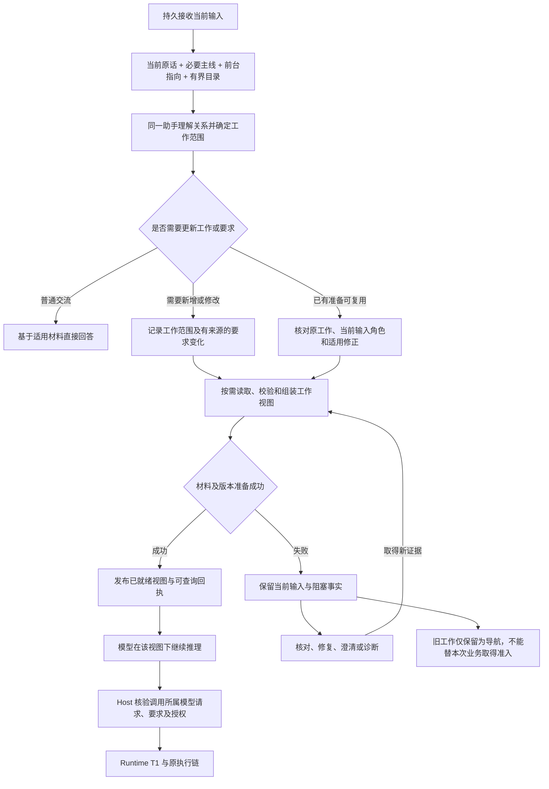

# 常驻助手工作连续性与执行准备闭环实施主方案

日期：2026-11-17。状态：**应用源码及本机隔离验收已完成，生产操作未执行；本文保留设计与验收契约。实际结果以[实施与验证记录](../docs/verification/resident-work-continuity-implementation-2026-11-17.md)为准。**

本方案依据用户已确认的判断重新设计：

> 系统没有可靠完成从理解输入、确认工作范围、记录新要求到准备执行的闭环，恢复失败后还允许助手把旧工作当成当前工作继续推进。

原[架构复盘](resident-assistant-architecture-postmortem-2026-11-17.md)已回写错误归因，作为证据；原[优化修复方案](resident-assistant-optimization-repair-plan-2026-11-17.md)已修正为专项说明，不再提供独立实施顺序。本文拥有实施契约、批次和验收标准，实施者不需要自行合并旧方案。实施阶段已按用户“开始完整实施”“继续实施”的授权推进；生产只读快照已变化，不能把早期复盘快照当成当前状态。设计、源码实现、隔离验证与生产操作分别记录，具体产物及上线边界见实施与验证记录。

## 1. 设计结论

保留稳定的前台工作指向，由同一个助手理解自然语言并决定工作范围；Host 将这个决定落实为有来源、有版本、有作用域的有效要求和请求视图。**业务操作必须关联产生该操作的实际模型请求，验证它当时使用的工作与要求已经准备就绪。**

选择失败后，保留旧工作作为历史与导航，不将旧工作的执行资格转移给当前输入。当前输入可以继续查询、核对、澄清和诊断；需要该工作材料的业务派发保持阻塞。

整个设计不新增常驻分类模型、Supervisor、独立 Goal/Task 数据库或第二套执行状态机。新增信息落在现有 ContextView、来源关联、命令回执及 Runtime 请求身份上。

### 1.1 对前一版方案的明确修正

| 前一版容易造成的理解 | 本方案的决定 |
| --- | --- |
| 新输入没有绑定分支，就是上下文故障 | 暂未归属是正常状态；系统要完成定位和确认，不能带着未解决的关键要求执行 |
| 新输入到达就清空旧 focus | 保留前台指向；区分“此前正在讨论的工作”与“本次已经确认的范围” |
| 今天的推送必须新建分支 | 分支按工作范围划分；同一持续工作可以包含多次执行，日期变化不自动新建分支 |
| `select` 成功就完成当前意图绑定 | 选择材料、记录要求、准备请求、获得执行准入是不同事实 |
| 只要最新全局上下文有效，就可以执行工具 | 必须核验产生该工具调用的模型请求所绑定的视图和要求，不能读取最新 pointer 替它补资格 |
| 原始授权还存在，就可以继续旧工作 | 还必须检查适用修正、撤销、待处理的新输入、效果未知及当前操作范围 |

## 2. Git 类比保留什么，边界在哪里

原 0.6.3 设计中，Git 类比用于主线连续、工作隔离、按需恢复和选择性回流。语义选择由助手完成，硬边界由 Host 执行。这些决定继续有效。

| 概念 | 本方案含义 | 所有者 |
| --- | --- | --- |
| 前台指向，近似 HEAD | 最近明确讨论的工作及其来源；提供跨轮连续性，可以保留多个相关工作入口 | `context.db` 中现有 pointer |
| 工作分支 | 一项具有稳定范围的工作，保存要求、修正及检查点引用；不是执行状态 | 现有 branch / associations / checkpoint |
| 当前输入 | 已持久化的用户原话或类型化事件；可以尚未归属，也可以按片段属于多个工作 | Session / Runtime 原始输入 |
| 本次请求视图 | 这次模型实际得到哪些工作、有效要求、材料和来源版本 | 现有 ContextView 与请求记录 |
| 执行实例 | 哪次委派、哪个 Worker 输入、哪次工具调用或重试 | 现有 delegation / Session / Runtime |

保留前台指向不意味着始终加载该分支全部正文，也不意味着新消息自动成为该分支的新要求。新输入类似尚待理解和归属的变化；助手可以继续原工作、切换工作、关联多项工作，或留在主线。

日期、分支标签、项目名称和文本相似度只提供定位线索，不能单独证明工作身份。分支的实质范围由原始目标及其有效修正决定。

## 3. 原故障暴露出的缺口

调查事实沿用已核对的 11 月 17 日会话与只读 Runtime 查询：同参数 `select` 当日被拒绝 22 次，阻塞源是 11 月 13 日没有 T2 的旧操作；助手仍称选择已经生效，并围绕 Day 72 继续行动。最后一次模型准备的快照到 Host T1 提交相隔 256,332 ms，超过 Pi 默认 15,000 ms 等待期限。

当前源码中与闭环直接相关的缺口是：

1. `session-context.ts` 按 `selectedForInput` 决定本轮选中分支，但同时注入持久的旧 `focus`。模型看到的“此前指向”和“本轮选择”没有清楚表达关系。
2. `select` 与 `associate` 分开；前者不会自动证明当前要求已经纳入本次工作的有效材料。当前输入虽可能出现在模型请求和原授权中，系统仍缺少完整要求覆盖的明确契约。
3. `modelContext.assertTool` 在普通常驻轮主要追踪来源版本，没有统一核验“这个业务调用由哪份已就绪工作视图产生”。现有来源、授权检查需要保留，但不能替代这一关联。
4. `prepareDelegatedInput` 可以从 active segment 或持久选择构造 Worker 材料。active segment 缺失时退回 pointer 的逻辑，不能继续充当新的执行依据。注意：空数组本身不会触发 `??` 回退，问题不能误写成所有空工作集都直接回退。
5. Runtime 能保存效果未知，却缺少对这类本地上下文命令的充分核对和恢复路径。模型反复收到同一不可执行建议，未形成有界失败。
6. 上下文准备、来源读取及回执处理存在本地迟滞；准备失败后的恢复资格也没有与本次目标、产生操作的请求一起固定。

本方案解决这些关联关系，同时保留现有授权、来源有效性、执行状态和幂等保护。

## 4. 从输入到执行的完整协议

以下是材料与执行资格的生命周期，不是新增业务任务状态。普通聊天不需要逐项调用管理工具。



### 4.1 接收：原话先有身份，归属可以稍后决定

- 先按原机制保存输入、来源、workspace / project、顺序和接收状态。
- 保留当前前台指向，不立刻把新输入附着到它，也不因 inputId 改变就把它抹掉。
- 为理解提供当前原话、必要近期原文、当前正在讨论的工作入口，以及有界目录。不要为了分类先展开全部分支。
- 对尚未完成的目标保留其原始输入和最新控制信息的引用，不只依赖最近四条消息。保留的是有界来源关系，不是另一个模型手写的任务账本。
- 类型化交付事件沿用原始委派、分支和授权身份；不能借用最后一条用户消息。

### 4.2 理解与定位：同一个助手作语义判断

助手识别当前输入与已有工作的关系，必要时查询目录、读原始目标及检查点。明确的关系直接处理；存在多个合理目标且会影响实际操作时，询问业务对象，而非要求用户选择 branchId。

| 输入关系 | 行为 |
| --- | --- |
| 原工作的继续 | 使用既有工作范围，核对尚未完成部分及原授权；没有新要求时不重复创建或 checkout |
| 补充 / 修正 | 记录新来源、替代关系和作用范围，之后按更新后的要求准备 |
| 切换到已有工作 | 保留旧入口，准备目标工作的当前要求；准备成功后再发布新的有效工作视图 |
| 新的独立目标 | 创建新分支；是否派发 Worker 仍按任务需要和授权决定 |
| 一句话涉及多项工作 | 按原话片段关联多个工作；后续业务调用选择相应子集 |
| 普通交流 / 状态询问 | 在主线或适用的只读工作材料上回答，不强制创建分支或准备执行 |
| 暂停 / 撤销 | 记录控制来源，走原目标的控制入口；不能等待坏分支恢复后才允许停止 |

前台指向是优先考察的候选，不能压过明确的新指令。检索命中、关键词相同和历史任务名称相同，均不能直接变成当前工作已确认的事实。

### 4.3 记录：要求必须有来源和适用范围

在现有关联与 ContextView 上明确三种材料：

| 材料 | 含义 | 有效范围 |
| --- | --- | --- |
| 持续工作要求 | 该工作长期适用的目标、验收和用户修正 | 对应工作分支，直到有效替代或撤销 |
| 本次执行要求 | 今天执行、这次改招呼语、此次输出格式等 | 原始输入及其关联执行实例，不外溢到后续实例 |
| 历史证据 | 旧结果、旧执行记录、检查点、可复用经验 | 作为证据读取，不自动授予当前执行资格 |

原始消息仍只保存一次；记录消息身份、内容版本、原文范围、要求角色、适用范围和替代关系。不要只保存模型概括后的目标标题。

“把招呼语改为下午好”若仅针对这次触发，应作为本次要求进入 Worker 输入，不能覆盖长期自动化定义。日期与当天编号按业务定义及实际状态解析，不能根据旧标题机械推算。

本次要求需要覆盖什么，由助手作语义解释；Host 核验引用确实存在、来自允许的来源、范围完整、版本匹配、作用域合法。**原文引用相符不等于 Host 已证明模型理解正确。** 对自由文本，语义保真仍通过场景验收、原文展示及必要澄清保证；有结构化业务 schema 时，再增加字段级验证。

### 4.4 准备：将已记录要求组装为本次实际材料

准备时固定工作子集、持续要求、本次要求、明确替代 / 撤销、必要证据及其版本。调用共用读取与组装边界，生成可验证的材料清单。

必须区分四件事：

- 要求已经持久记录；
- 工作材料已经成功准备；
- 某次模型请求实际使用了这份准备结果；
- 某项业务效果已经被 Runtime 接受并实际执行。

任何一步失败，都不能由后一步的口头陈述补齐。尤其不能将 `select` 回执、分支目录返回、模型 T1 或 checkpoint 当成业务完成证据。

### 4.5 准入：业务调用必须匹配产生它的请求

在现有常驻工具边界和委派所有者接入同一套工作准备检查。核验对象为**产生调用的模型请求所绑定的视图版本**，不能只查看当前全局 active pointer。

检查内容：

1. 调用能关联到确切的 producer model operation / request，而不是仅靠工具名或当前 run。关联由 Host / Pi 边界固定；模型不能自填一个无关请求 ID 获得资格。对应的有效模型结果及该工具调用必须已成为可核验事实；只有模型 T1 或 `entered` 标记，不证明模型实际产出了这项调用。
2. 该请求的视图已就绪；工作范围、有效要求和材料指纹与本次调用一致。
3. 已经记录的本次要求与适用修正，其必要原文引用完整进入当前任务材料；多工作调用明确选择必要子集。对于模型根本没有识别出的自然语言要求，Host 不能假装已机械证明其完整性，按第 7.1 节的语义边界验收。
4. 原始授权来源、当前控制信息、权限和执行配置仍有效；没有尚未解决的新输入竞争。
5. 相关来源未编辑、撤回或遗忘；相关工作修订未变化。其他无关分支变化不使其失效。
6. 同一业务意图没有未核对的效果，或已有可核验的幂等 / 恢复结果。

Host 通过后才走原有 T1、Worker 输入投递及工具执行。检查不取代原有权限和幂等边界，准备收据本身也不创造授权。

**同一旧推理响应不能靠先执行 prepare，再让同批次的旧业务调用读取最新 pointer 获得准入。** 一旦准备改变了有效要求或必要材料，后续业务调用必须来自真正使用新视图的推理。相同批次中的依赖不得由工具执行先后顺序碰巧满足。

## 5. 最小数据改动与工具契约

### 5.1 信息仍归原所有者

| 信息 | 设计落点 |
| --- | --- |
| 稳定前台指向 | 现有 pointer，保留原有作用；单独表达最近讨论的工作与最后成功准备的视图 |
| 当前输入的工作关系 | 现有来源关联及 ContextView 中的输入引用；允许多个片段、多项工作和未归属 |
| 要求及其替代 | 持续要求放入现有 associations；本次要求放入视图并传入关联的 Worker 输入；都保留原文引用 |
| 工作准备状态 | ContextView 内的小范围准备元数据；不设独立 Goal / Task 表 |
| 命令幂等与恢复 | 扩展现有 `context_commands`，保存结果引用及可核验回执；不再只返回最新 `get()` 冒充原命令结果 |
| 哪次模型使用了哪份材料 | 现有 provider request / model operation 关联，记录视图世代、要求指纹和材料指纹 |
| 实际执行及结果 | 原 delegation / Session / Runtime；不复制到分支状态 |

ContextView 新增或明确以下信息即可；字段名称在实施前契约冻结时确定，本文固定其语义：

| 字段组 | 必须表达 |
| --- | --- |
| 输入身份 | 实际触发输入、原始目标、适用修正和当前控制来源；后台事件另保留原始 grant |
| 工作范围 | 选中分支及必要修订；前台选择与 temporary event selection 区分 |
| 有效要求 | 原文引用、范围、作用域、替代关系及指纹；本次 override 单列 |
| 材料 | 实际注入的来源、范围、内容版本、必要执行状态及材料指纹 |
| 准备元数据 | 当前世代、状态、阻塞原因与可用恢复动作 |
| 请求关联 | 使用该世代的实际模型请求及其处置；工具能反查 producer |

现有 `views` 按 run 唯一，且同轮多次准备会更新视图。实施时不能假定 viewId 不变就等于内容没变：必须为请求保留其引用的不可变世代 / 指纹，复用现有 request snapshot 记录结构，不复制整份消息或工具 schema。

### 5.2 增加一个组合准备动作，减少松散步骤

模型侧在现有 `assistant_context` 下增加组合动作，本文暂名 **`prepare`**，它仍属于现有上下文所有者。该动作可以：

- 保留当前工作、选择已有工作，或明确创建独立工作；
- 一并提交当前输入的关联、要求补充及准确的替代范围；
- 指定持续工作要求与本次要求；
- 请求准备必要材料，并返回有状态、有来源的回执。

Host 固定当前真实输入身份。模型提供工作选择、原话范围及判断，不能通过参数把任意历史输入伪装成当前授权。

保留原 `branches/get/checkpoint/hibernate`；`select/associate/create` 等底层动作和 RPC 适配继续复用同一个所有者，但**单独成功不再隐含业务已就绪**。底层要求变化会使相关准备结果失效，不得保留旧的执行资格。

组合动作避免为了同一个新要求，机械地多次往返执行“选择、关联、再查状态”。需要读取新材料时，仍须完成下一次真实推理；不能为了节省一次调用让模型使用尚未见到的要求。

### 5.3 不为每条消息新增准备仪式

| 情况 | 是否需要改变准备结果 |
| --- | --- |
| 普通聊天、查询状态 | 不强制工作准备，不额外创建分支 |
| 同一工作、相同有效要求的继续 | 允许复用有效准备；将本次输入的继续 / 控制关系纳入当前请求，不重新读取全部来源 |
| 工作不变，但有新增要求或修正 | 更新要求并产生新的准备世代；必要材料未进入模型前不执行 |
| 切换工作或新的独立目标 | 准备目标范围，成功后发布；旧指向保留为导航 |
| 原授权内的后台接续 | 复用原工作与原授权，核对原任务事实及相关变化，不借前台最新消息获得新权限 |

“继续”是否真的是无新增要求，仍由助手解释。复用时 Host 检查声明的输入关系、原授权及版本；不另建分类循环，也不宣称机械校验能够识别所有被模型忽略的自然语言修正。

## 6. 提交边界、并发与失败恢复

### 6.1 用两个短事务保住新要求，又不提前宣布准备成功

原始输入先由原机制持久接收。随后一次组合准备按以下边界执行：

1. **事务前解析与校验来源。** 读取必要原文、解析范围，形成候选关联及版本快照；耗时 I/O 不放在 SQLite 写事务中。
2. **事务一记录变更。** 在 `context.db` 内原子提交工作 / 要求关联、新准备世代及命令身份。状态为 `recorded`，不开放新执行资格。适用的要求修正使旧准备版本失效；新要求不会因后续组装失败而丢失。
3. **事务外组装。** 按该世代读取和准备所需材料。期间的新输入、相关修正、撤权或取消均保留独立身份。
4. **事务二发布。** 重新核对输入所有者、要求版本、来源世代及取消状态；只有全部匹配才发布 `ready` 视图、更新有效活动指针并保存命令结果。失败则保留 `blocked` 或 `superseded` 事实。
5. **Runtime 回执收敛。** 从权威命令结果幂等补交 T2。`context.db` 与 Runtime 是不同数据库，不建立跨库原子提交承诺；优先复用已有 receipt journal / reconciliation 基础，补足命令结果到 T2 的可恢复桥接。

新工作已创建、要求已记录，但材料准备失败，是一种明确的可恢复结果，不应被压成“什么都没发生”的通用错误。失败回执应说明已经提交到哪一步，重试从该步骤恢复。

命令进度与单次工具结果分开：已提交的 Runtime T2 不改写。状态查询可以返回命令当前进度；尚未完成的准备通过显式恢复、携带预期进度世代继续，产生新的恢复操作回执，但不重复应用事务一。已经完成的原命令重试返回原最终结果。真正修改了要求内容，则是新的逻辑命令，不能伪装成旧命令重试。

### 6.2 准备状态只有材料含义

| 状态 | 含义 | 允许行为 |
| --- | --- | --- |
| `recorded` | 范围 / 要求已记录，材料尚未就绪 | 查询、读取、恢复准备、诊断 |
| `ready` | 本世代必要材料已完成组装及校验 | 推理；业务操作还须过当前授权与 producer 准入检查 |
| `blocked` | 有明确材料或恢复阻塞 | 安全核对、修复、澄清、诊断；不得自动使用旧工作代替 |
| `superseded` | 已被新输入的适用修正、取消或更新世代取代 | 只读历史与审计，不发布迟到执行资格 |

这些状态由现有 ContextView 元数据拥有。命令表引用对应结果，不另外维护一套 todo / done。业务任务是否完成仍只查原执行所有者。

### 6.3 前台输入竞争与停止能力

- 新直接用户输入持久接收后，旧前台 run 尚未准入的新效果先经过输入顺序屏障，不能在新指令尚未处理时继续偷跑。它不会自动撤销所有独立后台工作。
- 助手理解新输入的目标范围后，将修正或停止作用于相应工作 / 实例。其他无关工作不因此全局失效。
- 取消、暂停走原目标身份和权限校验，不要求该目标的材料视图先变成 ready。否则坏上下文会反过来阻止用户停止工作。
- 同步检查与 T1 提交使用现有准入顺序和版本检查；真正的 Worker / 外部效果开始前仍核对相应控制版本。
- 不能承诺用户文字到达时已在途的外部效果瞬间消失。停止前后已发生的效果保留真实记录，未知效果继续核对；测试必须覆盖“准入前停止”和“准入后停止”两种边界。

### 6.4 后台事件不改写前台 HEAD

事件通过原始 delegation / input / branch 绑定准备自己的临时视图，处理后回到前台连续性。后台读取、记忆维护与辅助模型请求都按自己的 run / request 找视图，不能通过最新全局 `activeSegmentId` 偷用前台材料。

同分支也可以有两个不同执行实例。事件归属到具体实例，不能仅凭相同 branchId 改写今天的要求或重新唤醒已取消的旧实例。

## 7. 执行准入必须覆盖的入口

不是所有工具都应用同一“已就绪”门槛。按实际动作与原有所有权划分：

| 类型 | 例子 | 准入规则 |
| --- | --- | --- |
| 导航与读取 | 分支查询、来源读取、任务状态、恢复证据 | 未就绪也可使用；仍受来源、项目、读取权限和预算约束 |
| 上下文准备 | prepare、选择、关联、检查点 | 使用本地命令幂等和输入 / 版本检查；不授予业务执行权限 |
| 新业务派发及恢复执行 | delegate、resume、retry、继续带副作用的工作 | producer 视图、有效要求、原授权、当前控制版本、未知效果全部匹配 |
| 停止与暂停 | cancel、pause | 按目标身份和授权执行；不得被材料恢复失败挡住 |
| 结果复核与交付 | delivery ack、review | 使用原事件 / 实例、实际读过的结果、原验收与授权；不能借无关前台准备过关 |
| 记忆维护 | memory update、project append | 继续使用原学习政策、source grant、项目所有权；不要求为了记忆新建业务分支 |

本方案首先覆盖常驻助手的自动业务入口，不改变普通 Session 的线性对话机制，也不把用户直接操作 UI 的明确权限伪装成模型准备收据。

Worker 输入由 Host 组装：固定已确认的工作子集、有效持续要求、本次要求、授权引用、配置和验收来源。模型的自由文本 instructions 可以补充实现安排，不能覆盖遗漏或扩张原话授权。保留所有原有权限及材料撤权检查。

### 7.1 结构保证与语义保证的界线

Host 可以机械保证：没有当前有效准备的业务调用不会执行；旧请求不能在新版本出现后偷偷获得资格；引用、来源、版本和作用域匹配；业务效果保持可核对。

Host 不能机械保证：模型一定正确理解了“今天”“这个”“先不要”，或自由文本方案完整体现了用户所有隐含意图。它不能仅因为字符串 quote 匹配，就宣称语义已经验证。

因此，错误处理同时需要：明确的原文与要求视图、失败状态进入模型上下文、业务准入硬约束，以及真实模型参与的语义场景验收。不能只测试精心构造的正确工具参数。

## 8. 未知效果与回执协议作为闭环的一部分

### 8.1 上下文命令恢复

- 读取动作按 read-only 语义恢复；不能把整个 `assistant_context` 标记 readOnly。
- 本地 prepare / select / associate 等动作使用稳定逻辑命令身份、输入作用域和预期世代，保存可核验结果。同一命令重试返回该命令结果，而非最新全局状态。
- A→B→A 中最后一次 A 是新命令；只有同一命令的重试才复用旧结果，不能按 Session + 相同参数永久拦截所有后续选择。
- 注册本地上下文命令 reconciliation adapter。若要求已记录但视图未发布，恢复组装；若视图已发布而 T2 缺失，补交原结果；若证据仍不足，保持未知并提供处理入口。
- 对新的独立输入允许符合当前世代的目标状态准备，但不把旧未知操作伪造为完成，也不能借新 branchId 或 requestId 重放旧业务副作用。

### 8.2 限期准入与迟到结果

prepare、执行等待、T2 回执和主动取消返回不同代码。使用稳定操作身份、Host 可检查的期限与 run 世代；耗时校验后、T1 准入前再次验证是否过期或已被取代。

T1 已提交但 ACK 丢失，通过身份查询原回执；已执行结果的 T2 迟到，通过现有 receipt journal 幂等补交。只有派发意图、没有开始执行证据时，不能宣布已执行；只有超时，也不能宣布未执行。

不以把 15 秒延长到几分钟作为首要修复。应先缩短和隔离准备重活，使旧请求没有机会在调用方结束很久后取得新资格。

### 8.3 有界恢复与诊断路径

结构化错误返回：阶段、稳定错误码、阻塞操作、已提交结果、可执行的安全下一步及独立工作是否可继续。

对同一输入、同一逻辑动作、同一阻塞原因，在证据没有变化时不再次派发相同失败。循环阻断保存在控制事实中，不能因换段消失。换参数或换工具不应绕过相同业务效果的保护。

准备失败后保留最小诊断视图：当前用户原话、原始目标 / 撤销引用、Host 的阻塞与操作事实。它不载入已撤权的历史材料，不开放业务执行，但能让助手完整说明“要求已记录到哪一步、尚未执行什么、正在恢复什么”。

模型仍可能写出错误陈述；系统应通过可见的真实状态、工具拒绝事实和语义验收减少此类错误。不可把“Host 能阻止旧效果”夸大为“Host 能自动判定所有自然语言回复是否正确”。

## 9. 用本次推送完整演算

### 9.1 正常路径

用户要求：「手动触发今日的双联知识推送任务，注意招呼语改成下午好。」

1. 保存这条原话，保留此前 Day 72 的工作入口作为候选，不宣布它已是当前工作。
2. 助手查实际任务定义与原目标，确定分支范围。若原分支代表持续的双联推送，可沿用；若只代表 Day 72 单次交付，创建本次独立工作并引用通用资料。不能仅按标题或日期决定。
3. 记录今日触发及“下午好”的原文范围，作用于本次输入 / 执行实例；长期自动化定义不变。
4. 确认任务定义当前版本、必要业务状态和本次要求已进入准备结果；生成已就绪视图。
5. 助手在该视图下生成派发；Host 核对 producer、材料、授权与控制版本，再创建本次 Worker 输入。
6. 返回真实派发或执行状态，不把准备成功说成推送完成。

### 9.2 旧 select 结果未知

旧操作的 T1 无 T2 时，查询命令结果与状态，恢复到其真实边界。今天的准备若因此阻塞，模型得到的是“本次要求已接收 / 已记录，但工作视图未就绪”的事实。

旧 Day 72 仍可以被读取作诊断，但不能补足今天的准备资格。即使助手继续提交旧分支的 delegate，producer / 要求检查也应拒绝。证据未变化时，不再反复发出相同 select。

### 9.3 用户说已经自行完成

用户随后明确：「不需要了，因为我自己开 session 去启动了……回顾意图混乱。」

- 将本次触发意图标记为已被当前控制输入取代；阻止尚未开始的相关派发。
- 本轮目标转为诊断，读取必要原始记录；无需先把旧工作恢复成可执行状态。
- 迟到准备结果只能保留为历史结果，不能发布今天的执行资格。
- 不推断其他 Session 的实际推送细节，也不重复执行来验证修复。

### 9.4 用户只是继续讨论同一份报告

前台指向为报告 A，用户说「第二段再短一点」。助手按近期原文和报告入口确定是 A，在同分支记录本次修正，准备更新后的必要材料即可。无需建立新分支，不清空 HEAD，不让用户手动选择。

如果存在两份都可能指向的报告且会改变修改目标，只询问具体哪份报告。这个判断由助手完成，不引入额外路由模型。

## 10. 性能与长期运行配套

工作准备不能成为新的同步阻塞中心。性能工作与正确性闭环一起交付：

1. **先缩小候选，再校验真正使用的材料。** 修正 collaboration profile 先校验大量候选、最后只取少量结果的顺序；失效候选可以补位，但不能跳过入选来源验证。
2. **工作集内复用读取和依赖验证。** 保留精确单条读取与共享祖先去重；缓存键包含来源版本与用途。缓存失败和循环不能变成成功。
3. **处理跨 8 个 Session 的索引抖动。** 统一共享索引预算、工作集复用及 writer 世代发布。是否引入磁盘 sidecar 根据完整链路测量决定，不默认当前已有磁盘持久索引。
4. **耗时 I/O 和图验证移出主线程。** 使用可取消的后台准备，返回带版本的材料结果；发布和业务准入前重新核对有关版本。SQLite 连接不跨不安全线程共享。
5. **分开计量材料和成本。** 当前输入、主线、检查点、分支要求、协作记忆分别计量；`selectedCharacters=0` 不再被误读成模型没有上下文。
6. **控制历史嵌套与投影写放大。** 优先返回叶子来源引用和有界展开，分别限制逻辑字符与序列化字节；不删除原始日志或必要 `context_edit` 审计。
7. **后台按自身 grant 调度。** 记忆维护不争用前台指向；目标不可写与没有记忆候选分开记录。模型目录使用已有能力发现，锁释放依赖实际效果核对，不简单靠超时。

完整观测链为：输入接收 → 工作判断对应的来源 → 要求提交 → 视图准备 → producer 请求 → 业务准入 → T1 / 执行 / T2 → 恢复。对来源验证、SQLite、IPC 排队及事件循环分别计时，不能把一段墙钟延迟全归给一个函数。

## 11. 实施拆分及源码落点

| 批次 | 改动 | 主要位置 | 批次验收 |
| --- | --- | --- | --- |
| B0. 固定失败基线 | 固定当前源码、构建身份、契约、脱敏现场和故障注入，先写 E2E | 现有验证工作流及新首批失败矩阵 | before 记录明确是目标缺陷，环境错误单列 |
| B1. 首批单工作完整闭环 | 要求作用域、组合 prepare、请求世代、producer 准入、最小恢复、期限防护、停止和诊断 | 上下文契约、context store、resident service、SessionManager、Pi 和 Runtime 边界 | 第 11.1 节首批门槛全部通过；正常与失败路径一起可用 |
| B2. 扩展与完整恢复 | 多工作、后台实例隔离、更多控制与崩溃恢复组合，完善生命周期 | 相同所有者上的事件、委派、控制和视图路径 | 第 12 节相应场景通过，无跨工作 / 实例污染 |
| B3. 性能与长期运行 | 工作集读取、索引策略、后台准备、定向失效、投影与维护预算 | SourceReader、source-index、MemoryStore / DerivedMemory、Session 调度 | 全链路响应改善，来源及权限保护不退化 |
| B4. 受控上线及旧状态恢复 | 版本化迁移、备份、积压分类核对、安装版复验和回退检查 | context schema、Runtime recovery、验证记录 | 原始事实保留，不自动恢复旧推送或取消任务 |

B0 是 B1 的先行验证工作，随后直接完成 B1，不把“基线已写”当成修复交付。B1 可以拆分提交，但 prepare、准入、最小恢复、停止及诊断是一个可用性门槛，不能只启用拦截、把恢复拖到 B2。多工作和性能的完整优化在后续批次展开；首次变更仍不得污染无关工作或产生过期准入。

### 11.1 从这里开工：B0 → B1 单工作完整纵向闭环

**第一批的目标只有一个：一条真实用户指令能够正确记录新要求、准备材料并派发；任何一步失败，都不会借旧工作继续执行，而且还能核对、停止和解释。**

实施按以下顺序推进，范围已在本文固定，不需要重新拼接三份方案或另写一轮总体设计。

#### A. 固定工作树与先行契约

1. 开工时重新读取 `AGENTS.md`、`git status` 和当前提交；保留用户现有变更，按需使用 `codex/resident-work-continuity` 分支及隔离工作树，不执行 reset / 覆盖清理。当前文档修订时观察到的提交为 `77c3a8f47`，它只作时间点记录，不替代实施时重新固定的基线。
2. 读取本方案第 4–8 节，冻结首批的最小字段契约：当前输入 / 原目标 / 修正引用、要求作用域及指纹、准备世代、不可变请求关联、命令进度、稳定错误码。复用已有实体，不创建独立 Goal / Task 服务。
3. 明确 feature 缺失、生产遗留和安装版映射不明的区别。安装版身份未确定可以继续隔离实现，但生产复验前必须补齐；不能假称当前源码已部署，也不能因此停在文档阶段不做隔离工作。

#### B. 先写失败矩阵与 E2E，再改产品代码

首批计划产物：

- `docs/verification/resident-work-continuity-failure-matrix-2026-11-17.md`：先写各失败方式、注入点、预期拒绝及正常行为。
- `scripts/verification/resident-work-continuity-workflow.ts`：在隔离工作区验证真实的 context → Pi / Runtime → Worker 边界和副作用计数；不能只直接调用 store 然后视为整链路通过。
- 对应的真实模型语义场景：可以接入已有 live 工作流，也可以增加专门入口；固定模型、提示和输入，记录真实选择，不用预制正确调用代替。

这些是实施前约定的产物，现已创建；具体运行状态及证据见实施与验证记录，不因文件存在就视为验证通过。使用现有 `verificationWorkflow` 产物格式及 `.cache/verification/` 隔离目录，生产 `.phaneris` 数据不写入。

现有基线入口已核对存在；实施时在源码固定后运行并保存结果：

```powershell
bun run scripts/verification/resident-context-063-workflow.ts
bun run scripts/verification/resident-context-063-recovery-workflow.ts
bun run scripts/verification/resident-assistant-sources-workflow.ts
```

首批新场景应先在修改前运行，保存可信的 before 失败。因接口尚不存在而无法运行的部分，明确标成特性尚未实现；环境错误不能冒充目标缺陷复现。

#### C. 实现首批完整路径

| 顺序 | 必须完成的工作 | 边界 |
| --- | --- | --- |
| C1 | 原话关联与本次要求作用域、ContextView 准备世代和状态、必要的版本化 schema 升级实现 | HEAD 保留；本次 override 不改长期定义；旧视图不自动升级为 ready；不强制每条聊天 prepare |
| C2 | 组合 prepare、记录要求与发布 ready 的两个短事务、不可变请求快照 | I/O 不在写事务内；要求记录后组装失败不丢失；相关旧准备失效 |
| C3 | producer 到工具 / 委派的 Host 关联及执行准入；将确认材料放入 Worker 输入 | 旧 pointer、单独 select 或旧推理同批次准备不能补资格；原权限检查保留 |
| C4 | 本地命令查询与最小 reconciliation、稳定命令身份、T2 补交和循环阻断 | 区分相同命令重试与 A→B→A；未知外部效果不自动重放 |
| C5 | 新输入顺序屏障、prepare 期限 / 世代核对、停止及最小诊断 | 准入前撤销无新相关效果；已开始效果保持真实；坏分支不挡取消和解释 |

C1–C5 都属于 B1 的交付范围。只完成数据结构、只增加提示词、只通过模拟工具返回，均不能宣布第一批完成。

#### D. 首批通过门槛

| ID | 首批场景 | 必须观察到 |
| --- | --- | --- |
| WC01 | 普通聊天与同一工作继续 | HEAD 连续；不重复建分支 / checkout；适用要求保持原来源 |
| WC02 | 今日触发并改“下午好” | 当前原文及本次作用域完整进入实际模型与 Worker；长期定义不变 |
| WC03 | select 成功但要求未准备 | 相关业务调用被拒绝；查询、停止与诊断仍可用 |
| WC04 | 旧推理同批次先 prepare 后 delegate | 变更材料后的旧业务调用效果计数为零；使用新视图的后续推理可正常执行一次 |
| WC05 | 旧 select T1 无 T2 | 能核对或明确阻塞；不出现无条件重复循环；不旁路外部未知效果保护 |
| WC06 | 要求记录后、材料发布前崩溃 | 新要求保留，恢复不重复应用关联，旧准备不取得新资格 |
| WC07 | ready 已发布，T2 缺失 | 命令结果可查询，原结果幂等补交，不重复创建或执行 |
| WC08 | 用户在准入前表示已自行完成 | 旧相关派发为零；迟到准备不恢复执行；诊断完整回答 |
| WC09 | 停止发生在已开始效果后 | 保留已发生 / 未知事实，停止后续效果，不伪造未执行 |
| WC10 | 本地准备超时或被新世代取代 | 过期请求不产生迟到新资格，已提交事实可恢复 |
| WC11 | 真实模型判断持续工作与单次交付 | 根据原目标范围选择沿用或独立工作；无按日期强制分支；实际决策与失败均保留 |
| WC12 | 相关来源撤权及无关工作变化 | 相关业务失效，无关工作不全局失效，诊断路径不注入被撤权材料 |
| WC13 | 旧 schema / 旧 pointer 在隔离副本上升级 | 原关联和 HEAD 保留；旧无证明视图不自动取得新资格；普通 Session 回归保持正常 |

真实模型或运行环境不可用时，明确列为未验证并给出原因，不能用 scripted 结果替代后宣布全部通过。确定性故障注入与真实语义验证分别记录。

#### E. 验证、交付与停止边界

- 修改后运行首批 E2E、必要既有回归及真实语义场景；完成时执行仓库要求的完整 `bun run validate:ci`，保留真实输出。门禁已覆盖的检查不无故重复；新增修改或失败才补跑。
- 交付代码差异、契约变化、before / after 场景结果、实际产物路径与哈希、尚未验证项及剩余 B2–B4 工作。每项“已完成”都对应可复核证据。
- 不在生产重发推送，不修改真实会话 / 数据库，不恢复已取消任务。代码实现与隔离验证不等于安装、生产迁移或发布；这些按 B4 的具体摘要处理。
- 默认单任务推进，不主动启动并行 agent / Worker；如需大规模并行，按用户已有约定另行决定。实施者不应要求用户再次复述本文范围。

### 11.2 可直接用于启动实施的任务说明

> 按 `analysis/resident-assistant-work-continuity-redesign-2026-11-17.md` 第 11.1 节执行 B0 → B1。先固定工作树和契约，编写失败矩阵与端到端场景并保存修改前证据；随后完成 C1–C5 的正常准备、producer 准入、最小恢复、期限防护、停止和诊断。保留稳定 HEAD，区分工作分支和执行实例，新增要求保留原文与本次作用域。通过 WC01–WC13 和必要回归，运行完整门禁，交付实际证据及未完成项。先完成首批闭环，不开展 B2–B4 的完整扩展；不写生产 `.phaneris` 数据、不重发推送、不自动恢复旧任务、不安装或发布。遵守 AGENTS.md，保留用户现有修改，默认单任务执行；不要停在重新写总体计划。

上述任务说明保留为开工时的任务契约。用户现已授权并开始完整实施；完成情况以实施与验证记录为准，不以此处的开工说明代替实际证据。

沿用原 0.6.3 的共用原文 / 来源 / 组装核心，沿用原 0.6.4 的任务、授权与控制所有者。模型工具统一走同一命令实现，避免模型入口、RPC 入口和委派准备各持有一套“当前分支”规则。

源码以调查期间的当前工作树为参照，存在其他未提交修改；实施前重新固定基线及安装二进制映射。本文不把工作树设计当成已经部署的行为。

## 12. 验收必须验证闭环，而不只验证工具返回

按仓库约定，先写失败矩阵和端到端场景，再实现。必须同时有确定性边界验证和真实模型参与的语义场景；真实模型场景记录模型、连接、提示版本及实际操作，不能用正确参数 fixture 代替全部自主选择验收。

| 场景 | 核心断言 |
| --- | --- |
| 普通聊天 → 报告 A → 简历 B → 报告 A | 前台连续性可恢复；只展开必要材料；不要求用户操作分支 |
| 已明确工作上的普通继续 | 不重复 create / checkout；原授权和有效要求可复用；不会靠近期四条消息偶然找对目标 |
| 同分支新要求 | 新原话被记录并进入后续模型 / Worker；旧要求不与修正并列成同时生效 |
| 分支选择成功但要求尚未准备 | 业务准入拒绝；不能把 select receipt 当作 ready |
| prepare 与 delegate 来自同一旧模型响应 | 改变了要求 / 材料时，旧调用不能读取新 pointer 过关 |
| 要求事务已提交、组装前崩溃 | 新要求不丢；恢复不重复应用关联；旧准备不继续执行 |
| 视图已发布、Runtime T2 丢失 | 命令结果可查，幂等补交原 T2；不重复创建或切换 |
| A→B→A 与相同命令重试 | 有意再次选择与同一命令重试区分；最后选中正确范围 |
| 今天推送，旧分支代表持续工作 | 可以同分支新实例；今天 / 下午好作用于本次，旧实例不重放 |
| 今天推送，旧分支仅代表 Day 72 | 能辨别原目标范围，建立独立工作或澄清；不会只按关键词选中 |
| 旧 select T1 无 T2 | 安全核对或解释性阻塞；同原因不出现 22 次重复；新独立工作仍可处理 |
| “我已自行启动，不需要了”发生在准入前 | 旧前台相关派发为零；诊断可完整回答；迟到准备不恢复执行 |
| 停止发生在效果已经开始后 | 保留真实已发生效果，停止后续效果；未知状态不改成未执行 |
| 多目标和局部修正 | 原话范围归属正确；对 A 的修正不改变 B 的要求和权限 |
| A 的事件在讨论 B 时到达 | 按原实例 / 原 grant 处理 A，不改变 B 的前台指向和要求 |
| 同分支两个执行实例 | 本次 override 和停止只影响其适用实例，另一实例不被标签相同误伤 |
| 旧授权存在，但已有相关撤销 / 修正 | producer 和准入检查拒绝旧版本；不得借 continuation 或换工具绕过 |
| 相关来源修改、遗忘或撤权 | 相关视图失效；无关分支与 Worker 不全局失效；缓存不能绕过保护 |
| 准备超时、ACK 丢失、乱序 T2 | 不产生迟到新资格；已提交结果可核对；外部未知效果不自动重复 |
| 坏分支下执行 cancel / pause / 诊断 | 停止与解释能力仍可用；不会为了诊断恢复业务执行资格 |
| 模型误把普通交流当执行、遗漏自然语言修正 | 记录真实选择及来源，暴露语义失败；不把 quote 匹配测试当成理解正确 |
| 宽依赖图、跨缓存容量、持续重写、冷 / 热准备 | 记录完整链路时间、唯一依赖、扫描、淘汰与事件循环延迟；冷重建不伪装热态成本 |
| 运行重启与迁移后新输入 | 保留 HEAD 导航及原始输入；旧无证明视图不能自动取得新业务资格 |

产物包含：场景结果、输入与脱敏原文引用、选择 / 要求世代、实际 provider 材料清单、producer 与工具关联、T1/T2 时间线、受控副作用计数、构建与 fixture 哈希。涉及 UI 的场景保留原生截图或录屏。私人原始历史不提交到仓库。

性能门槛先采集基线，再固定为发布条件；正确性门槛不靠平均延迟掩盖。外部副作用使用隔离桩及可检查计数，不通过生产重发推送验收。

## 13. 生产恢复、迁移与回退

1. 原始 Session、Pi 日志与 Runtime 执行事实保持原样。只迁移派生上下文元数据，并新增可追溯的恢复事件。
2. schema 版本化升级。旧 pointer 作为导航保留；没有充分证据的旧准备不能自动升级为新 ready 视图。尚无 branch 的普通交流也不批量建分支。
3. 明确旧软件不能读取新 schema 时的拒绝行为。回退不等于只替换二进制；需要停写、相容性验证和可用备份。
4. 生产备份使用 SQLite 一致性备份机制并处理 WAL；多个数据库备份不宣称跨库原子快照。固定 writer 所有者后才执行迁移与修订。
5. 当前会话的两个未知操作先单独核对；工作区 234 条积压按恢复模式、工具与实际效果分类。不能批量删行、改成功或排除 parked 来规避保护。
6. 已取消的四项旧委派保留取消结果；11 月 17 日推送已由用户自行启动，不因修复自动重跑。
7. 用户先审阅具体迁移和生产恢复摘要；按工作区约定，生产状态修订或不可逆动作在确认后实施。本文不执行这些动作。

## 14. 本次设计的完成标准

从用户输入到后续执行，可以完整回答：

- 助手把这句话理解为哪项工作、继续 / 修正 / 新目标中的哪一种关系，依据是什么原话？
- 哪些持续要求、本次要求及停止信息实际生效，作用于哪个工作或执行实例？
- 产生业务调用的那次模型请求究竟看到了什么？
- Host 为什么允许或拒绝这次业务操作，拒绝后有哪些安全恢复动作？
- 恢复失败时，系统是否保住当前目标、停止错误推进，并仍能向用户解释？

只有这条链可以被实际请求、来源记录和 Runtime 事实共同验证，才算修复完成。分支能够切换、工具返回成功、检查点能保存，都不能单独代表这个闭环已经成立。

## 参考材料

- `docs/architecture/resident-assistant-context-0.6.3-plan-2026-11-08.md`：主线 / 分支、助手语义选择、共用来源、请求视图、并发与恢复边界。
- `docs/architecture/resident-assistant-tasks-0.6.4-plan-2026-11-08.md`：原目标授权、Worker 材料、任务控制、结果归属与审阅。
- `docs/verification/resident-context-063-stability-report-2026-11-13.md`：同步来源读取与依赖放大、已实施修复及当日验证限制。
- `analysis/resident-assistant-architecture-postmortem-2026-11-17.md`：原始故障复盘。
- `analysis/resident-assistant-optimization-repair-plan-2026-11-17.md`：已修订的证据和专项说明，原独立实施顺序已撤回；本文为唯一实施入口。

## 文档修订记录

2026-11-17：同步回写原复盘及原修复方案的错误判断，统一文档职责；将容易形成“先拦截、后恢复”的分段顺序改为 B0 → B1 首批完整纵向闭环，并增加开工步骤、已核对的基线命令、首批验收门槛及可直接使用的实施任务说明。本文只描述计划；当前未写产品代码、未运行上述验证、未改生产状态。
