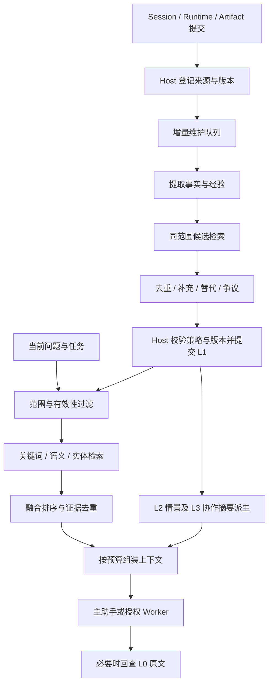

# 助手自主权限与记忆中枢：现状分析及实施规划

Status: historical — 保留源码调研与方案比较；本轮实施以[最终综合计划](resident-assistant-permissions-memory-final-plan-2026-11-05.md)为准。

日期：2026-11-05。状态：研究与建议，尚未批准实施。

## 1. 结论与建议

**建议赋予助手持续、受范围约束的自主维护能力：在已授权的 workspace 内自动学习、组织、检索和退出记忆；执行任务沿用现有 Worker 和权限机制；共享、删除原件、扩大权限另按其实际效果授权。**

现在的问题不是简单的“权限不够大”。现有系统把记忆的来源、可信程度、生命周期和操作授权部分混在了一起，又没有独立的自动维护闭环。因此，一般推断长期停留在候选，日常整理依赖当前用户轮次，历史提取也主要靠助手顺手执行。

推荐方向：

1. **自动记忆默认服务于助手的工作连续性。** 低风险、私有、可追溯、可撤销的整理不逐条打扰用户。
2. **区分有资格被使用与已被用户确认。** 自动生效的模型归纳仍是归纳，不能升级成用户陈述、授权或任务完成事实。
3. **保留现有权威基础。** 原始 Session、Runtime、Task、Artifact、Preferences 各自保留所有权；记忆服务负责派生信息与使用策略。
4. **借用腾讯的提取、组织和检索能力，优先做原生集成。** 初期不将整个 Proxy、Panel、身份系统和数据面一并嵌入桌面应用。
5. **Memory Hub 可以成为产品方向，但先做 workspace 内的资产中枢。** 跨 Agent、跨应用、团队共享是真实需求出现后的扩展条件。

这不是否定整体引入。外接完整 Hub 是有效选项，但它解决的是多客户端、多主体共享记忆；它不能直接替代我们对自主权限、来源、撤销和用户意图的设计。

## 2. 分析基线与证据边界

| 对象 | 本次基线 | 边界 |
| --- | --- | --- |
| Phaneris | 本地工作树；HEAD `3daa1eec0b8571f4f350928fd0a40f06bb00e3f2` | 已包含本轮之前未提交的助手、消息渠道、成果等开发变更；结论以实际文件为准，不能只用 HEAD 复现 |
| TencentDB Agent Memory | 默认分支 `feat/server_team`；提交 `2002196f2d7c22ea267cfcaf67c5a6fa861df681` | 最后一条提交时间为 2026-11-04 19:33:39 +08:00；本次固定此版本分析 |
| 腾讯许可证 | 根目录 LICENSE 明确采用 MIT | GitHub 元数据将其识别成 Other/NOASSERTION，不能据此否定正文；复用代码须保留相应版权和许可声明，依赖另核对 |
| 验证方式 | 设计文档与源码交叉核对 | 未部署腾讯服务、未跑腾讯测试、未对真实模型做质量对照；不能据此宣称性能或安全已经验证 |

外部源码仅在临时目录建立只读研究副本，没有引入本项目依赖，也没有运行其安装脚本。现有归档研究只作为历史背景，不把其中的生态判断、数据或旧版本说明当成当前结论。

腾讯源码存在旧插件路径、现行 Proxy 路径和可配置注入器。**不能把某一个文件中的策略当作所有部署共同执行的策略。** 下文分别说明。

## 3. 我们目前实际实现了什么

### 3.1 权限与职责

| 能力 | 实际实现 | 判断 |
| --- | --- | --- |
| 主助手角色 | `resident-role.ts` 的工具白名单允许记忆、历史、委派、工作查询等内部工具 | 主助手不能因切到 allow-all 就获得任意 shell、文件写入或全局偏好更新工具 |
| Worker 权限 | `resolveWorkerConfig` 使用 `clampPermissionMode`，将请求权限压到父会话上限 | 已有合适的权限继承基础，不应再造一套竞争的执行权限引擎 |
| 会话权限模式 | safe / ask / guarded / allow-all | 描述工具执行策略；不等同于工作目标授权、资产可见性或记忆可信度 |
| 已记住的工具批准 | `PermissionManager` 中的命令与域名白名单 | 是会话范围，不能当作跨任务、跨重启的长期授权记录 |
| 原始待决定事项 | Worker/Runtime 保留原请求，主助手负责转呈 | 助手不应为自己批准扩权，也不应把内部结果消息当作用户批准 |

主助手不直接执行实质工作，是职责分离，不等于助手产品只能“提供建议”。用户授权的改文件、调研和应用操作，可以通过 Worker 完成。真正需要补的是授权范围的持久表达及跨轮次接续，而不是简单放开主助手 shell。

还发现一处文档漂移：`mode-types.ts` 对 Guarded 不可用时行为的旧注释，与 `core/guarded-mode.ts` 当前实现不一致。当前实现对风险检查不可用会要求确认，无人值守且不能提示时会阻止相关执行。实施前应同步说明，不能把旧注释当实际保障。

### 3.2 记忆基础

| 部分 | 已实现 | 仍缺少 |
| --- | --- | --- |
| 原始材料 | Session 本地存储；普通会话历史目录与消息索引；工具结果保留独立来源视图 | 附件正文解析未接入这条历史索引；记忆管线不是所有来源的统一增量入口 |
| 原子记忆 | workspace 内 `memory/memory.db`；fact / decision / experience；来源和内容 hash | 自动准入规则、较丰富的证据类型、语义重复识别 |
| 版本 | revision、请求幂等、预期版本检查、修订历史 | 自动维护决策的执行主体与策略版本记录 |
| 时效 | validFrom / validUntil；scheduled / expired 的有效读取语义 | 按事实类型触发复核的完整维护调度 |
| 冲突 | dispute / resolve；同范围约束；替代关系；并存处理 | 自动发现与分级处理冲突的闭环 |
| 退出 | dormant / invalidated / forgotten / superseded；suppression；派生依赖失效 | 日常冷却和整理不再依赖当前用户请求；更精细的遗忘范围 |
| 检索 | 内容子串匹配、作用域、时间/状态过滤、分页、有界展开、原文回查 | BM25、语义向量、别名与实体匹配、融合排序 |
| 历史提取 | checkpoint、来源 hash 与项目范围绑定、一次 Runtime 最多一个 6000 字符片段 | 可持续推进的后台任务；稳定轮次触发；主助手自身历史与普通会话统一覆盖 |
| 上下文 | 议题、原始要求、历史锚点、依赖跟踪、材料变化后失效 | 自动挑选相关长期记忆与情景并组装，而不是主要依赖模型主动查找 |

具体限制：历史查询每次最多刷新八个变化的普通 Session；长期助手 Session 被普通历史索引排除，另由 `assistant_context_history` 访问其用户原话。**这是两条读取路径，不代表当前提取器已经自动沉淀了所有助手对话。**

### 3.3 “记忆必须手动确认”需要拆开理解

已定位的约束：

- Store 将 `basis=inferred` 的新记忆固定写成 `candidate`，`user_stated` 写成 `active`。
- 默认查询只使用当前有效、未争议、未被抑制的 active 内容；候选不会自然进入当前事实召回。
- 角色 prompt 和工具说明明确要求候选人工确认，不得自动晋升。
- `service.ts` 限制：除新建 inferred 候选之外，多数显式变更需要当前为直接用户轮次；user_stated 还必须引用当前用户输入。
- UI 提供激活、冷却、失效与修订按钮；遗忘有第二步确认。
- `assistant_memory_update` 本身已经是 `safeMode: allow`，因此这不是通用 Ask 模式的工具确认开关造成的。

所以，**并不是所有记忆引入都必须点击按钮**：当前用户明确表达的偏好已有直接生效通道，自然语言请求也有变更工具通道。真正不顺畅的是一般历史归纳无法自动成为可用背景，后台维护又被当前轮次来源限制。

同时，当前“人工确认”也不等于一套完全独立的批准凭证机制：服务层检查的是当前用户轮次的来源属性，并没有逐项验证该用户输入是否批准了具体候选；Store 的 transition 也没有接收绑定该记忆版本的用户批准记录。提示约束、来源检查与 UI 按钮共同表达了意图，但三者不是同一个强制授权事实。

**修正方向应是明确授权与准入契约，而不是移除几句提示，或者给全部候选批量改成 active。**

## 4. 四层架构：方向相容，但尚未真正对齐

需要区分三个维度：

1. **资源类型**：History / Chat Memory / Skill / Knowledge。
2. **语义层级**：Conversation → Atom → Scenario → Persona。
3. **读取粒度**：目录/摘要 → 相关正文 → 原始证据。

现有路线图第 4.5 节的 L0/L1/L2 指第三项，其 L2 是原始证据；腾讯的 L2 则是情景聚合。二者不能直接对号入座。建议未来用明确名称区分“记忆层级”和“展开深度”，避免 API 与产品说明继续混用编号。

| 腾讯语义层 | 我们的对应基础 | 对齐结论与建议 |
| --- | --- | --- |
| L0 Conversation | 原始 Session、用户输入、工具结果、成果与 Runtime 证据 | 基础成立；继续由原存储负责，只登记引用和可重建索引，不复制另一套聊天权威 |
| L1 Atom | MemoryRecord 的事实、决定、经验及来源 | 基础较强；补自动提炼、准入、去重和检索，不必换掉现有修订与退出机制 |
| L2 Scenario | project、议题、历史锚点和记忆条件 | 有定位组件，缺少长期情景的聚合内容、来源成员和持续修订；这是主要结构缺口 |
| L3 Persona | 全局 Preferences、AGENTS.md、workspace 中的相关记忆 | 有显式偏好基础，没有由记忆生成的 workspace 协作摘要；Preferences 不能直接等同完整 L3 |

四层应允许直接引用：L3 的显式沟通习惯可以直接引用用户原话和 L1；不必强迫每条信息经过四次摘要。更高层也不代表更真实、更有权限。

## 5. L3 与 Preferences 应如何相处

现有 Preferences 是用户级设置，包含称呼、时区、地区、notes 等，并由 `formatPreferencesForPrompt` 提供给 prompt；头像和部分界面设置不进入 prompt。它没有新记忆系统的逐条来源、revision、争议和有效期机制。项目 MEMORY.md 则是另一条现有项目笔记路径，不能忽略。

建议定义 **“协作摘要”而非深度人格推断**：帮助助手理解这个 workspace 中的长期工作背景、沟通与交付习惯、明确的稳定约束。

| 信息 | 所有者 | 自动维护边界 |
| --- | --- | --- |
| 用户明确设置的姓名、时区、语言、全局备注 | Preferences | 继续由对应用户指令和既有设置流程修改，不由 workspace 学习偷偷回写 |
| 项目规则与用户写下的协作协议 | AGENTS.md / 项目原文件 | 只按适用范围读取；摘要可引用，不覆盖原件、不推导成新授权 |
| workspace 的长期工作背景、常见交付格式、稳定交互习惯 | workspace 记忆与派生协作摘要 | 可按自动学习策略更新，逐项有出处，保留“用户陈述/系统归纳”的区别 |
| 一次任务的临时要求 | 当前原始输入、Task/Worker 上下文 | 优先留在任务；不能因为本次出现就变成长期偏好 |
| 人格标签、心理动机、价值观推断 | 无需新建默认权威 | 不作为提升工作连续性的必要数据，不默认生成 |

当前用户指令与适用项目规则优先于历史摘要。发生冲突时保留冲突的范围和来源，不通过“更新 L3”暗中解决。全局偏好对全部适用会话继续生效，workspace 学到的摘要只在当前 workspace 及授权材料包中使用。

腾讯当前 Persona prompt 包含兴趣、叙事原型、认知内核和深层动机等内容；这套目标与我们的工作助手并不完全一致。可借用触发、增量生成与长度预算，不能原样套用画像目标。[T7]

## 6. 助手到底应该自主到什么程度

### 6.1 总体模型

自主权是“在一个授权范围内决定怎样完成工作”，包括选择步骤、整理材料、使用已有能力、校验和恢复；不是自行发明新目标。

有效能力继续取交集：

`已授权目标与效果 ∩ workspace/项目范围 ∩ 当前模式上限 ∩ 角色与工具能力 ∩ 资源预算 ∩ 当前未撤销状态`

这里的目标、效果和授权引用需要逐步成为 Host 可持久记录的事实；当前并非所有维度都已经结构化。记忆内容不参与授予权限，模型也不能自填一个 permissionGranted 字段让自己获权。

| 行为 | 推荐默认 | 边界 |
| --- | --- | --- |
| 查阅当前 workspace 可用历史、记忆与证据 | 自主 | 作用域、来源访问权、suppression 和预算继续有效 |
| 提炼私有事实、整理情景、生成协作摘要 | 开启学习策略后自主 | 有来源、有版本、可撤销；不自动全局化或共享 |
| 去重、更新索引、上下文移出、可逆冷却、明确到期处理 | 自主 | 不改变原件；不丢失仍有效的任务约束；不以热度判断真假 |
| 同范围的明确纠错、可信新证据替代旧信息 | 规则内自主 | 保留新旧版本与证据；语义不清才形成争议或询问 |
| 在用户交办范围内调研、写文件、运行检查、重试 | 通过 Worker 自主 | 沿用当前权限模式与批准；不重新询问已覆盖的操作 |
| 选择新来源、增加付费模型调用、持续巡视 | 依已有具体授权 | 默认不因“维护记忆”扩大数据范围、费用或任务寿命 |
| 外发消息、发布、交易、共享资产 | 依任务或持续授权执行 | 授权必须覆盖对象和效果；没有覆盖时展示具体结果后再确认 |
| 扩大跨 workspace 可见性、修改 ACL、授予权限 | 用户/管理员授权 | 助手可准备方案，不能自批扩权 |
| 永久遗忘某项内容 | 明确请求覆盖后执行 | 记录不可自动复活的标记；请求有歧义或范围很大时先澄清 |
| 删除原始聊天、文件、记忆正文历史等物理清理 | 独立授权 | 不与记忆降温、合并或“忘记偏好”暗中绑定 |

“需要授权”并不意味着每次弹窗。同一任务中已批准的行动和用户明确的持续授权，应通过 Host 记录接续；只在超出对象、效果、期限、预算或当前版本时重新决定。

### 6.2 延续已有执行模式，单独表达记忆学习策略

不要再增加一个与 safe / ask / guarded / allow-all 竞争的“超级自主模式”。记忆学习属于独立的产品设置，可采用简单的策略：

- **自动学习**：默认工作方式建议；允许指定范围内的私有、可追溯记忆维护。
- **仅按要求记忆**：用户明确说记住、更正、忘记时执行，不持续沉淀一般对话。
- **暂停学习**：停止新提炼；已有记忆是否允许读取由独立开关表达，避免“暂停记录”被误解成“已忘记”。

其具体默认、首次启用说明与历史数据处理范围，需要在产品设置中明确。不能以配置缺失、损坏或迁移异常推断新的授权。严格只读或隐私模式也应明确是否暂停持久学习，不能只看工具名称是否是写操作。

授权记录建议最少包含：授权者与来源、workspace/项目、允许动作及目标范围、触发条件、预算/期限、撤销状态、策略版本。沿用现有请求/决定/Runtime 边界落地，而不是用记忆数据库保存一个可执行的“用户上次同意”。

### 6.3 主助手与维护任务的角色

主助手负责理解目标、沟通、按需回忆和调度；Worker 执行实质任务；Host 的维护任务负责受限提炼与派生更新。维护任务没有常驻聊天人格，没有任意 shell，不向人自动发消息，不获得主助手之外的新授权。

授权撤销后，排队任务和下一次工具调用重新检查；在途外部调用不能假称已经撤回。已知效果与未知效果分别记录，禁止通过重试掩盖不确定副作用。

## 7. 自动记忆的准入：取消逐条审批，保留证据区分

“是否能自动保存”“是否能用于本次回答”“是否能当作确定事实”“是否能授权行动”是四个问题。

| 来源与内容 | 建议准入 | 使用方式 |
| --- | --- | --- |
| 直接用户原话中的明确长期偏好或纠正 | 校验来源和范围后自动生效 | 标识为用户陈述；历史原话也可使用，不必强制重新说一次 |
| 有确切版本的工具结果、通过的验证、可读取成果 | 自动记录观察 | 只证明已观察的结果，不推导成用户接受、业务成功或额外授权 |
| 从多个相关事实形成的低风险工作归纳 | 可自动成为可用背景 | 始终保留 inferred 属性，必要时表达为倾向；不能覆盖显式决定 |
| 一次性要求、助手自己的建议、没有独立证据的重复总结 | 通常不进入长期记忆 | 留在原始历史或当前任务即可 |
| 证据不足、范围不清、影响较大的推断 | 留候选/待复核 | 仅在与当前任务有关时呈现，避免日常堆积审批清单 |
| 相同对象的未决矛盾 | 原子标记争议 | 默认不以其中某条作为确定的当前事实；需要时展示两种说法及出处 |
| 凭据、外部材料中的嵌入指令 | 不生成可执行长期指令 | 凭据留管理器；外部内容按资料处理，不影响权限与角色 |

不使用模型自报的“置信度 0.9”作为自动晋升依据。依据应是能检查的来源类型、明确程度、有效范围、冲突状态、验证记录与操作后果。

现有 `basis` 与生命周期可以保留兼容。必要的新增信息优先限于证据属性及 Host 维护回执：谁依据哪一策略、哪些来源版本，执行了什么变更。不要把“自动生效”写成“用户已确认”。

## 8. 退出与遗忘：把自动维护从永久删除中拆出来

| 退出类型 | 自动化策略 | 数据后果 |
| --- | --- | --- |
| 移出本轮上下文 | 自主决定 | 长期记忆仍在；换话题不等于忘记 |
| dormant 冷却 | 可自主 | 不默认注入，相关问题可查；可逆 |
| expired 到期 | 根据明确有效期确定 | 不作当前事实；旧事件仍可作为历史证据 |
| superseded 被替代 | 同范围明确纠正后可自主 | 保留旧记录及替代关系；不机械按最近写入获胜 |
| invalidated 被证据否定 | 清晰证据下可自主，否则争议 | 停止当前事实召回；保留撤销原因，防旧提取复活 |
| forgotten 用户不希望再记住 | 依据明确请求执行 | 记忆、派生摘要、索引、相关上下文均遵守抑制；不能自动恢复 |
| 物理删除原件/修订/备份 | 独立数据管理操作 | 说明范围及可恢复性；不作为日常记忆整理的隐含动作 |

用户明确说“忘记这条偏好”已经构成对应授权，不应再要求到管理面逐条点击。需要保留的是对象解析、范围检查和执行回执。用户只说“这个先不用了”时，优先解释为当前工作集退出或冷却，不能擅自永久遗忘。

当前 suppression 以整个 `sessionId + messageId` 为键，同一条长消息中的其他事实也可能随之不可用；这是潜在的精度代价。后续可增加来源片段/事实标识级范围，保留旧消息级标记的含义，不能通过重新切片绕过旧抑制。

也必须明确：当前 forgotten 的正常读取会遮蔽内容，但历史修订与原 Session 并不因此被物理擦除。需要彻底删除时，应走单独的数据清理和备份保留流程。自动冷却不是数据删除，语义遗忘也不是已撤回供应商之前收到的上下文。

## 9. 腾讯的设计：哪些可以吸收，哪些需要改造

| 模块 | 在固定源码版本中看到的机制 | 适配建议 |
| --- | --- | --- |
| L1 提取 | 新消息与背景消息分开；一次调用处理情境切分和结构化提取；来源 message ID；质量过滤 | **优先吸收**。新消息才产出新记忆，背景只用于理解；替换成我们的来源引用和类型契约 [T2] |
| 冲突与去重 | 先召回相似候选，再批量判断 store / skip / update / merge；与搜索共用混合候选召回 | **吸收候选发现与批处理**。最终用现有 revision/争议/替代事务提交；不让模型覆盖权威事实 [T3] |
| 中文与混合检索 | 中文预分词、FTS/BM25、向量；原生 hybrid 或双路 RRF | **优先吸收**。保留短词、精确标识和字面兜底；向量可选，不能因模型服务不可用而失去基本搜索 [T4] |
| L2 情景 | 从 L1 组织可更新的 Markdown 场景文件、摘要和导航；有备份、变化检测和索引同步 | **吸收组织模型**。我们用版本化结构记录与可读视图；提交经 Host，避免多份文件各自成为权威 [T5] |
| L3 更新 | 冷启动、变化/阈值触发、增量生成；部分路径有变化决策 gate | **吸收触发与预算**。改成协作摘要，移除深层人格叙事目标；变化判断可复用已有辅助模型基础 [T7] |
| 分层注入 | Persona + 情景索引的稳定块；相关原子记忆的动态块；情景正文按需展开 | **吸收按需展开与稳定/动态分离**。每次使用重新校验来源、退出和授权，不照搬会话缓存失效规则 [T6] |
| 后台管线 | checkpoint、排队、锁、恢复、重试、死信、L1→L2→L3 级联 | **吸收可靠性语义**。桌面初期用本地 Host 持久队列，不为此引入 Redis/Kafka 分布式栈 [T8] |
| Skill 沉淀 | 从对话和工具轨迹提炼候选，查已有 Skill；资源与版本可管理 | **第二阶段吸收**。以已验证结果和适用边界为输入，接现有 Skills 所有者 [T9] |
| Wiki | 资料解析、候选页提取、串行合并、索引和链接关系 | **适合优先于 CodeGraph**。我们以文档工作为主，可作为独立知识引擎验证；保留原件和版本 [T10] |
| CodeGraph | 包装独立 CodeGraph 引擎，提供代码符号和调用关系等能力 | **按需接入**。先验证平台包、语言支持、工作树更新与真实任务收益，避免成为记忆基础依赖 [T10] |
| 资产治理 | Owner、版本、状态、可见性、ACL、Agent 配装 | **借用模型，逐步落地**。先 workspace 私有库，后续再扩展多用户主体与共享 [T11] |
| 协议 Proxy | 接收模型请求、注入上下文并记录对话，兼容多种 Agent | **现阶段不作默认路径**。我们已控制 Host/Runtime，可直接携带类型化上下文；Proxy 留作外接多应用方案 [T6] |

### 9.1 不能原样继承的具体语义

1. **冲突判断失败不应等于都可信。** 腾讯 `batchDedup` 在缺少候选检索能力、判断失败等情况下可返回全部 store。我们可以保存新观察，但应标记未完成裁决，不能据此覆盖旧事实或无条件注入相互冲突的结论。[T3]
2. **去重范围要适应跨会话。** 其 L1 提取冲突召回会传 session 隔离维度。我们需要在同 workspace、同项目/主体/条件内识别不同会话的重复和纠错；不能照搬成只在同会话去重，也不能扩大到全局混合。[T2][T3]
3. **配置缺失不等于授权全部提取。** 当前 Proxy extraction gate 为兼容旧行为，在配置缺失或 extractors 格式不正确时允许全部提取。我们的新授权边界应拒绝默默扩权，回到已确认策略并报告配置问题。[T12]
4. **会话初始化缓存不足以保证纠错立即生效。** 当前 Profile 注入器声明 `session_init` 缓存；我们要求每次模型请求检查材料版本和 suppression，即使稳定块命中缓存，也要能失效重建。[T6]
5. **固定调用次数不证明不存在。** 某些工具指导设搜索次数上限，并把耗尽后无结果解释为信息不在记忆中。我们只应报告本次预算内未找到，同时区别索引覆盖不足、权限不足和依赖故障。[T13]
6. **服务级鉴权不是模型级权限。** 其 API 文档注明，部分删除接口信任 Bearer + service-id，依赖面板转发前校验用户权限。这是它的部署信任边界，不能把服务凭据交给模型后直接当我们的终端用户权限机制。[T14]
7. **情景数量阈值不是语义正确性的依据。** 固定场景上限、强制合并提示可以作为容量保护参考，但不应因为满了就把不同项目、条件或相反结论压成一个摘要。[T5]

### 9.2 “自动召回”存在两种接入策略

旧插件 `auto-recall.ts` 实现了动态 L1 召回与稳定 L2/L3 注入。现行 Proxy 中既有 L1 recall injector，也有按需搜索工具；memory-bridge 的说明强调 L0/L1 工具检索。实际行为取决于注入器配置，不能宣称所有请求必定自动注入 L1。

对我们建议采用：小而稳定的协作摘要 + 相关情景导航 + 少量高价值原子记忆；模型保留主动查原文的能力。是否启用每轮 L1 自动召回，通过真实任务质量与成本对照决定，不追求注入量最大。

## 10. 推荐的完整处理链路

### 10.1 提炼与维护

- 来源提交成功后登记事件；不读取尚未稳定落盘的流式内容作为最终事实。
- 普通会话、主助手、Worker 的有效来源统一进入目录，但保留作者、内部投递、原用户来源和工具结果的差异。
- 在稳定轮次、里程碑、明确纠正和 Host 空闲时调度；长会话不必等关闭。
- 主对话响应优先；维护批次有输入量、模型调用、token/费用和执行时间预算；无变化不调用模型。
- 复用已配置连接和明确的维护模型选择；配置允许外部模型时，说明本地存储不等于处理过程完全离线。
- 模型返回结构化建议，Host 完成来源校验、权限检查、预期版本与幂等提交。
- checkpoint 只在成果提交后推进；中断可重试，重试不重复记忆；旧快照结果不能覆盖新纠正。

### 10.2 L2 情景最小结构

建议字段：`id / revision / workspaceId / projectId / title / summary / entityRefs / memoryRefs / sourceRefs / validRange / derivedFromVersions`。

内容包括：场景目标、成立条件、当前阶段的结论与约束、关键决定、相关成果和原文入口。开放问题可以带指向原 Task 的引用；任务完成、取消、待批准状态读取现有权威，不在情景里再维护一套。

例如“Phaneris 常驻助手的权限与记忆设计”是一个情景；“用户这次要分析腾讯方案”是当前任务；“某次工具调用失败”是证据。三者不应合并成一个含糊的长期偏好。

### 10.3 检索、召回和注入

推荐顺序：

1. 在检索边界固定 Host 身份、workspace 和允许来源。
2. 先应用 suppression、有效期、争议与状态过滤，再进入相应查询范围；历史追查可显式选择历史视图。
3. 关键词/BM25 与语义向量独立召回；实体、别名、时间、项目、情景引用参与定位。
4. 以 RRF 等方式融合不同排名；不能直接比较 BM25 和向量原始分数。
5. 去除同一原始证据的重复转述，保留证据多样性；必要时再做相关性重排。
6. 组装时给出内容、条件、时间、来源、basis 与 revision；原文按需展开，预览截断不能吞掉否定词或成立条件。
7. 每次模型请求及 Worker 派发前复核已选材料的有效性；撤销和纠错使旧材料失效。

稳定/动态分离是缓存布局，不是指令权威提升。模型生成的 L3 与 Wiki 即使作为稳定材料，也不得覆盖用户输入、项目规则或执行权限。普通新会话不因此默认获得整个助手记忆；Worker 只接收与该任务相关的材料包。

### 10.4 冲突裁决

先判断是否同一主体、同一谓词/事实、同一项目和条件，是否存在有效时间重叠；然后再判断矛盾。

| 情况 | 处理 |
| --- | --- |
| 同一事实的无增量重复 | 跳过或增加独立来源，不复制多个原子 |
| 互补且同范围 | 合并为新版本，保留成员和来源 |
| 用户明确纠正 | 新事实替代对应旧事实；保留发生和生效时间 |
| 时间不同、条件不同或项目不同 | 并存，不能按语义相似度覆盖 |
| 用户原话与模型归纳相反 | 显式原话优先；归纳退出或待复核 |
| 两个原始来源相互矛盾，缺少解决依据 | 记录争议，保留双方，不猜胜者 |
| 外部文档里的命令要求修改权限 | 当资料内容处理，不进入授权链 |

资料新不必然更权威；工具报告成功也不等于用户同意结论；重复摘要不算新增独立证据。

### 10.5 兜底与恢复

| 故障 | 产品行为 |
| --- | --- |
| 向量/Embedding 不可用 | 降为词法与精确匹配；报告语义检索未完成 |
| 中文分词组件不可用 | 使用可用分词/短词字面路径；不假称检索能力相同 |
| 索引未完成或源文件不可读 | 显示真实覆盖；空结果不证明不存在 |
| 提取模型超时/格式错误 | 不提交半成品；保留待处理游标，受限重试 |
| 去重判断不可用 | 可保留待裁决观察；不自动覆盖旧事实 |
| L2/L3 生成失败 | L1 与 L0 仍可用；旧摘要仅在依赖仍有效时继续使用 |
| 原子修订、来源变化、遗忘或授权撤销 | 关联摘要、索引、缓存和待交付材料失效；旧结果不得写回 |
| Host 重启、维护中断 | 从持久任务与幂等身份恢复；不重新全量学习所有历史 |
| 记忆数据库不可用 | 当前对话与原始任务可继续；明确长期回忆不可用，不编造连续性 |
| 备份恢复 | 合并当前有效 suppression/撤销事实后才恢复索引，不能把旧 active 当新权威 |

## 11. 自动沉淀资产与 Memory Hub

四类资产可以统一发现、查看来源和路由，但不必共用一套写入机制，更不能把它们都当作聊天记忆。

| 资产 | 自动生成 | 生效/配装与更新 |
| --- | --- | --- |
| Chat Memory | 自动提炼、去重、情景与协作摘要维护 | 按第 7 节策略自动准入；范围不扩大 |
| Skill | 从已验证任务轨迹生成私有草案、失败边界和验证步骤 | 接现有 Skills 生命周期；满足既定策略的低风险流程可支持自动配装，覆盖已安装技能、引入可执行资源或扩权需匹配授权 |
| Wiki | 从已授权文档生成候选页、术语、关系与来源链接 | 保留原文版本与生成来源；知识修订不冒充原文；外部共享单独处理 |
| CodeGraph | 从已授权代码快照构建符号和关系索引 | 绑定 repo、revision、分支与工作树状态；不能只索引远端 clone 后宣称覆盖本地未提交代码 |

**自动生成、质量审核、授权使用、对外共享是不同阶段。** 审核可以由确定性验证或受限模型任务完成，只有涉及必须由人判断的决策才需要用户；不能把“资产需要治理”实现成每张卡片都要人点批准。

对用户的默认体验建议是：正常完成工作后，助手自行沉淀；需要时已经能正确找回；纠错可以直接说；管理入口用于追溯、修改和撤回。不要将后台队列、冲突技术细节或审批收件箱变成每次对话的必经流程。

现有助手工作概览已经明确不承载记忆/上下文，本方案不借 Memory Hub 再向该面板塞入新内容。先复用独立记忆管理入口，后续确有多资产管理需求再扩展。

## 12. 整体引入腾讯项目的四种路径

| 方案 | 优点 | 代价/适用前提 | 当前建议 |
| --- | --- | --- | --- |
| A. 借设计，全部原生实现 | 与现有来源、权限、修订和 UI 最一致 | 所有算法自行维护，容易重复开发 | 基础契约采用，但不要求所有算法重写 |
| B. 抽取可复用模块，原生整合 | 复用提取/检索等成熟实现，保留我们已有权威 | 要剥离宿主耦合、跟踪改动和许可 | **近期首选**；先做小范围兼容验证再冻结模块清单 |
| C. 外接独立 Core/Knowledge/Hub 服务 | 多 Agent 共享、知识服务边界清晰；腾讯升级相对独立 | 部署生命周期、认证、数据映射、网络和撤销一致性 | 作为受控试验与后续多应用选项 |
| D. 整仓 vendoring 或 fork 后全部嵌入 | 最接近它现有完整产品 | 多一套身份、资产、聊天记录、面板、模型请求代理和维护栈 | 当前不推荐作为默认产品改造路径 |

### 12.1 为什么不能“装个包就接上”

- 固定版本的 MemoryCore 包仍包含 OpenClaw 宿主整合、peerDependencies 与安装后 shell patch；并非可直接视为干净的宿主无关内核。
- 其 SQLite 向量路径依赖 sqlite-vec，中文分词与 CodeGraph 还涉及平台包；我们现有 SQLite 适配同时考虑 Bun 与 Electron/Node，需验证打包与 ABI。
- MemoryKnowledge 是独立 HTTP/MCP 知识服务；完整产品链路还涉及 Panel 的模型绑定、回调和元数据，不是只导入一个类。[T10]
- 当前全局部署脚本面向 macOS/Linux 和 Bash/Docker，镜像为 Linux 架构；Windows 桌面需要额外验证和生命周期管理，不能把脚本存在当作原生集成完成。[T15]
- 腾讯的 user/team/agent/session/task 与我们的用户、workspace、项目、主助手、Worker 不一一对应。尤其不能让每个临时 Worker 的独立 agent 记忆打散同一 workspace 的经验。
- Proxy 能看模型请求和响应，但不能天然掌握我们完整的用户意图、Task 状态、Artifact 接受和权限撤销事实。隐藏代理注入也会绕过当前上下文依赖与用量可观测边界。

### 12.2 若选外接 Hub，最低集成契约

1. Phaneris Host 是入口；从 Host 确定 workspace/项目和调用主体，模型不提供可信租户 ID。
2. 服务 token 保留在 Host 凭据管理；不暴露给模型、prompt 或生成 Skill。
3. 先实现只读 search/read 与单向派生写入，不允许两个系统同时任意修改同一记忆权威。
4. L0 原件继续在原存储；服务中的检索副本标明来源版本与身份，不冒充第二份聊天主库。
5. 更新和遗忘有稳定外部 ID、预期版本、幂等身份、抑制同步与重建规则。
6. 明确离线行为、失联降级、导出、备份、升级与卸载后的数据归属。
7. 验证真实质量收益后，再决定是否迁移部分派生数据的权威；迁移必须有写入所有权交接，不能无边界双向同步。

### 12.3 首轮可复用模块与兼容性验证

腾讯的提取器并非完全锁死在 OpenClaw：L1 和情景提取已经提供可注入的宿主无关 `LLMRunner`，这是选择性复用的实际切口。但 runner 可替换，不等于存储、工具写入、身份与运行语义已兼容。

| 复用候选 | 采取方式 | 最先验证的兼容点 |
| --- | --- | --- |
| `core/store/tokenize.ts` | 保留分词和查询构建思路，适配本项目索引边界 | Windows 平台包、中文短词、混排、缺失依赖兜底；无须为词法检索安装完整 Core |
| `core/tools/l1-candidate-recall.ts` | 复用检索融合与后端能力协商，改接现有记录查询 | 类型/来源映射；检索前作用域；故障信号；不得把外部 Store 设为第二权威 |
| `core/prompts/l1-extraction.ts` 与 L1 提取流程 | 复用新旧消息分区与结构化输出，注入已有模型调用能力 | 自定义我们的记忆类型与来源 ID；检查生成结果不引用背景消息冒充新证据 |
| `core/prompts/l1-dedup.ts` 与 `record/l1-dedup.ts` | 复用候选池批量裁决，输出建议 | 改造跨会话范围与失败策略；替代/合并最终通过我们的事务与权限边界 |
| `core/scene/scene-extractor.ts` | 先借用输入组织、变化检测和导航语义 | 文件工具结果转为 Host 管理的派生修订；不将模型任意写文件作为数据库提交 |
| `MemoryKnowledge` | 独立小服务试验 Wiki；保留原 API 边界 | 认证、模型绑定、回调、原件版本、原生依赖、离线与卸载；确有收益再决定是否内嵌 |

最小验证输入应使用同一组隔离来源，在“当前字面检索”“词法改进”“词法+向量”“增加情景”之间逐步比较。先证明来源与退出语义一致，再比较质量、延迟和成本。不同时替换存储、模型、prompt、检索与注入，否则无法归因。

若抽取源码，记录上游提交、原文件位置、许可证及本地差异；若以独立服务接入，固定可复现版本。两者都不直接跟随默认分支或 latest。原生版本与外接服务尚未同时存在时，不提前建立通用 Memory Provider 框架。

## 13. 推荐实施顺序与验收

按依赖顺序串行推进，不在本轮擅自开启并行开发。以下阶段是建议范围，不是日历承诺或已经批准的版本排期。

| 阶段 | 具体工作 | 验收结果 |
| --- | --- | --- |
| P0：统一语义和授权契约 | 先列失败场景；固定学习策略、来源/归纳/确认区分；更新与新方案冲突的角色和路线图要求；定义 Host 调用主体与授权引用 | 同一个动作在工具、RPC、后台和 UI 中服从相同策略；不再用“直接用户轮次存在”替代具体授权 |
| P1：自动记忆闭环 | 稳定轮次事件；统一来源登记；持久维护队列；低风险自动准入；自动冷却、到期和明确纠错；依赖失效与撤销 | 不点击管理按钮也能记住明确偏好与有据经验；重启后接续；遗忘不复活；普通会话不被全量注入 |
| P2：混合检索与 L2 | 中文词法；可选向量；融合排序；实体/条件与跨会话去重；情景生成、目录和按需展开 | 同义问法、短词、别名和跨会话问题能定位正确证据；不同项目与条件不混用 |
| P3：协作摘要与注入闭环 | 从有效证据生成 workspace 摘要；稳定/动态材料组装；按请求复核缓存与 Worker 材料包 | 当前用户要求覆盖历史摘要；纠正下一次请求生效；无 workspace 信息写入全局 Preferences |
| P4：私有 Skill 与 Wiki 资产 | 从真实已验证任务生成 Skill 候选；文档 Wiki 小范围试验；统一来源/版本/使用路由 | 资产能帮助下一任务；不会把一次成功泛化成万能流程；原件、脚本效果和使用授权清晰 |
| P5：按条件扩展 Hub | 需要跨应用或团队时，试验独立服务、共享 ACL 和配装；CodeGraph 按真实代码任务接入 | 共享隔离、撤销、导出、升级、离线和卸载可验收，再决定是否扩大引入 |

P1/P2 可以吸收腾讯模块，但应先验证最小边界：提取与去重输出是否能落到现有 MemoryMutation；分词/RRF 是否能复用；可选向量是否能在 Windows 打包中稳定工作。不要先迁库，再发现退出与来源契约不兼容。

### 13.1 本地主要改动位置

| 位置 | 计划责任 |
| --- | --- |
| `packages/server-core/src/resident-assistant/service.ts` | 统一来源事件、维护调度入口、当前用户与后台执行主体的区别 |
| `.../history-index.ts`、`.../history-extraction.ts` | 从按查询顺带处理扩为可恢复的增量任务；仍保留读取预算与真实覆盖 |
| `.../memory-store.ts` | 自动准入回执、版本事务、同范围冲突、退出与派生抑制；保留现有数据库权威 |
| `.../context-store.ts` | 选材与依赖版本；注入前复核；纠正后重建材料 |
| `packages/session-tools-core/src/memory-*.ts`、`tool-defs.ts` | 同源契约；不再将 inferred 永久等同必须人工确认 |
| `packages/shared/src/agent/resident-role.ts` | 允许策略内自主维护，保留当前输入、事实和权限的区别 |
| `packages/server-core/src/handlers/rpc/assistant-memory.ts` | 与模型工具、维护任务共用领域策略；保留 workspace 访问检查 |
| 现有记忆管理 UI | 学习状态、来源/归纳标记、变更历史、自然语言纠错的可核对结果；不新增逐条审批义务 |
| 新的情景/协作摘要模块 | 只在职责确定后拆分；先复用既有存储与依赖机制，不预先建立通用框架 |

### 13.2 既有数据迁移

1. 先备份并记录 schema、现有 revision 与 suppression；新增字段采取兼容读取。
2. 既有 active 不改成模型推断，既有用户决定不自动覆盖。
3. 既有 candidate 逐批按新策略重新评估来源、范围和争议；不执行全库一键激活。
4. 新生成的 L2/L3 标为派生资产，记录依赖的原子版本；摘要不可反向充当新的独立证据。
5. 索引可重建，来源目录、用户纠正、授权撤销和 suppression 不当作缓存清除。
6. 先记录影子决策并与现状比较，再在选定范围启用自动准入；只有真正提交的维护才显示为已完成。
7. 回滚可以关闭新维护和注入器；不能恢复已经失效的旧材料或丢弃新的遗忘标记。

### 13.3 实施前失败矩阵与 E2E 证据

| 场景 | 必须观察的结果 |
| --- | --- |
| 普通会话明确长期偏好；用户不打开记忆管理 | 下一次相关助手任务能正确使用，来源可回查 |
| 主助手自身对话、Worker 报告、直接用户纠正同时存在 | 来源归属准确；内部报告不能冒充用户确认 |
| 无关用户消息出现在候选晋升前 | 不能仅因“当前有用户轮次”就声称该候选已被人批准 |
| “这次用表格”与“以后默认用表格” | 前者留任务，后者可成为长期偏好 |
| 两项目同名对象、不同条件、未来生效决定 | 不混用；时间与条件保留 |
| 用户改正旧事实，旧提取任务随后完成 | 旧结果拒绝提交，下一次召回使用新事实 |
| 用户要求忘记后重启、重建索引、恢复旧备份 | 正常查询、派生摘要及 Worker 上下文不复活该内容 |
| 同一长消息承载多个事实，用户只忘记其中一个 | 明确当前抑制粒度，后续细化不绕过已有遗忘 |
| 模型生成 inferred 摘要被多次转述 | 不成为用户已确认，也不计为多个独立来源 |
| 暂停学习、来源权限撤回、workspace 切换 | 不新增学习或跨范围暴露；排队任务重新检查 |
| 外部资料包含修改权限、外发资料的命令 | 只作为资料，不形成授权或系统指令 |
| Embedding、分词、辅助模型、数据库分别故障 | 按第 10.5 节降级；故障和无结果可区分 |
| 重复事件、进程中断、修订冲突、后台预算耗尽 | 无重复记录、无半提交、可恢复且前台可响应 |
| 自动生成 Skill 包含脚本或依赖安装 | 不因资产审核通过就突破执行权限 |
| 文档/代码原件变更或工作树未提交 | Wiki/CodeGraph 显示准确来源版本与覆盖，不返回伪当前结果 |
| 外接服务收到伪造 workspace/tenant 字段 | Host 绑定身份覆盖或拒绝请求，模型字段不成为访问凭据 |

按项目约定先冻结失败场景再实现，优先复用 E2E 工作流。每次验收保留可重复运行的隔离 fixture、实际模型请求材料、来源/修订/授权回执、重启前后查询结果和带 hash 的 manifest。真实账户及真实模型质量对照与确定性工作流分别报告。

效果指标先建立本地基线：有来源的正确回忆、无关/过期误注入、遗漏约束、跨范围泄漏、用户纠正后的生效、反复确认次数、维护调用成本和响应影响。外部 benchmark 不能直接换算成本项目的提升百分比。

## 14. 本轮建议确认的产品方向

本报告推荐以下方向，尚未改动产品行为：

- workspace 自动学习成为推荐默认；候选审核不再是普通记忆可用的必经步骤。
- 记忆自身的私有整理自主运行；永久遗忘、物理删除、共享和授权扩张按具体效果区分。
- 四层语义采用 Conversation / Atom / Scenario / 协作摘要；读取深度另命名。
- Preferences 与 AGENTS.md 保留显式所有权，workspace 学习不回写全局。
- 近期采用“现有 Host + 选择性复用腾讯模块”；完整 Hub 留作可独立验证的外接路线。
- 顺序先完成权限/准入与自动维护，再补检索/L2/L3，最后扩展 Skill、Wiki 和跨应用共享。

这些方向会调整旧路线图中候选准入、维护运行方式及“不新增画像文件”的部分表达；正式实施时应统一重写相关契约并保留原有来源、范围和退出保证，不在旧提示上继续叠加例外。

## 15. 主要证据与复核入口

### 本项目

- [角色工具边界与行为约束](../../packages/shared/src/agent/resident-role.ts)
- [记忆模型、来源与变更命令](../../packages/session-tools-core/src/memory-contracts.ts)
- [记忆工具说明与 safe-mode 注册](../../packages/session-tools-core/src/tool-defs.ts)
- [当前用户轮次与变更回调](../../packages/server-core/src/resident-assistant/service.ts)
- [记忆存储、召回过滤、关系及 suppression](../../packages/server-core/src/resident-assistant/memory-store.ts)
- [普通历史目录及检索](../../packages/server-core/src/resident-assistant/history-index.ts)
- [受限历史提取](../../packages/server-core/src/resident-assistant/history-extraction.ts)
- [模型上下文及依赖检查](../../packages/server-core/src/resident-assistant/context-store.ts)
- [Worker 实际配置与权限 clamp](../../packages/server-core/src/resident-assistant/worker-config.ts)
- [记忆 UI](../../apps/electron/src/renderer/components/resident-assistant/ResidentAssistantDetails.tsx)
- [全局偏好及 prompt 格式化](../../packages/shared/src/config/preferences.ts)
- [Guarded 当前运行规则](../../packages/shared/src/agent/core/guarded-mode.ts)
- [现有项目记忆追加路径](../../packages/session-tools-core/src/handlers/project-memory.ts)
- [既有助手路线图](resident-assistant-0.6-roadmap-2026-11-03.md)
- [此前助手开发记录](../process/resident-assistant-followup-2026-11-05.md)

### 腾讯固定版本

以下链接均固定提交，避免默认分支后续变化影响结论。

- T1：[许可证](https://github.com/TencentCloud/TencentDB-Agent-Memory/blob/2002196f2d7c22ea267cfcaf67c5a6fa861df681/LICENSE)；[项目说明](https://github.com/TencentCloud/TencentDB-Agent-Memory/blob/2002196f2d7c22ea267cfcaf67c5a6fa861df681/README_CN.md)
- T2：[L1 提取与来源](https://github.com/TencentCloud/TencentDB-Agent-Memory/blob/2002196f2d7c22ea267cfcaf67c5a6fa861df681/MemoryCore/src/core/record/l1-extractor.ts)；[提取提示](https://github.com/TencentCloud/TencentDB-Agent-Memory/blob/2002196f2d7c22ea267cfcaf67c5a6fa861df681/MemoryCore/src/core/prompts/l1-extraction.ts)
- T3：[候选去重与失败兜底](https://github.com/TencentCloud/TencentDB-Agent-Memory/blob/2002196f2d7c22ea267cfcaf67c5a6fa861df681/MemoryCore/src/core/record/l1-dedup.ts)；[裁决语义](https://github.com/TencentCloud/TencentDB-Agent-Memory/blob/2002196f2d7c22ea267cfcaf67c5a6fa861df681/MemoryCore/src/core/prompts/l1-dedup.ts)
- T4：[共享混合召回](https://github.com/TencentCloud/TencentDB-Agent-Memory/blob/2002196f2d7c22ea267cfcaf67c5a6fa861df681/MemoryCore/src/core/tools/l1-candidate-recall.ts)；[中文分词](https://github.com/TencentCloud/TencentDB-Agent-Memory/blob/2002196f2d7c22ea267cfcaf67c5a6fa861df681/MemoryCore/src/core/store/tokenize.ts)
- T5：[情景组织与恢复](https://github.com/TencentCloud/TencentDB-Agent-Memory/blob/2002196f2d7c22ea267cfcaf67c5a6fa861df681/MemoryCore/src/core/scene/scene-extractor.ts)
- T6：[Profile 注入及缓存](https://github.com/TencentCloud/TencentDB-Agent-Memory/blob/2002196f2d7c22ea267cfcaf67c5a6fa861df681/MemoryProxy/src/injection/injectors/tdai-profile-memory-injector.ts)；[L1 注入器](https://github.com/TencentCloud/TencentDB-Agent-Memory/blob/2002196f2d7c22ea267cfcaf67c5a6fa861df681/MemoryProxy/src/injection/injectors/tdai-l1-recall-injector.ts)；[只读 bridge](https://github.com/TencentCloud/TencentDB-Agent-Memory/blob/2002196f2d7c22ea267cfcaf67c5a6fa861df681/MemoryProxy/src/memory/memory-bridge.ts)
- T7：[Persona 目标](https://github.com/TencentCloud/TencentDB-Agent-Memory/blob/2002196f2d7c22ea267cfcaf67c5a6fa861df681/MemoryCore/src/core/prompts/persona-generation.ts)；[触发](https://github.com/TencentCloud/TencentDB-Agent-Memory/blob/2002196f2d7c22ea267cfcaf67c5a6fa861df681/MemoryCore/src/core/persona/persona-trigger.ts)；[变化决策 gate](https://github.com/TencentCloud/TencentDB-Agent-Memory/blob/2002196f2d7c22ea267cfcaf67c5a6fa861df681/MemoryCore/src/core/persona/jev-gate.ts)
- T8：[持久管线 Worker](https://github.com/TencentCloud/TencentDB-Agent-Memory/blob/2002196f2d7c22ea267cfcaf67c5a6fa861df681/MemoryCore/src/services/pipeline-worker.ts)
- T9：[Skill 提炼](https://github.com/TencentCloud/TencentDB-Agent-Memory/blob/2002196f2d7c22ea267cfcaf67c5a6fa861df681/MemoryCore/src/core/skill/skill-extractor.ts)
- T10：[Knowledge 服务与部署边界](https://github.com/TencentCloud/TencentDB-Agent-Memory/blob/2002196f2d7c22ea267cfcaf67c5a6fa861df681/MemoryKnowledge/README.md)；[Wiki 两阶段摄取](https://github.com/TencentCloud/TencentDB-Agent-Memory/blob/2002196f2d7c22ea267cfcaf67c5a6fa861df681/MemoryKnowledge/src/engines/wiki/ingest-v2/index.ts)；[CodeGraph 平台包桥接](https://github.com/TencentCloud/TencentDB-Agent-Memory/blob/2002196f2d7c22ea267cfcaf67c5a6fa861df681/MemoryKnowledge/src/engines/code/bridge.ts)
- T11：[资产状态、可见性与 ACL 类型](https://github.com/TencentCloud/TencentDB-Agent-Memory/blob/2002196f2d7c22ea267cfcaf67c5a6fa861df681/MemoryCore/src/metadata/types.ts)
- T12：[提取开关与缺失配置行为](https://github.com/TencentCloud/TencentDB-Agent-Memory/blob/2002196f2d7c22ea267cfcaf67c5a6fa861df681/MemoryProxy/src/extraction-gate.ts)
- T13：[旧插件自动召回与工具指导](https://github.com/TencentCloud/TencentDB-Agent-Memory/blob/2002196f2d7c22ea267cfcaf67c5a6fa861df681/MemoryCore/src/core/hooks/auto-recall.ts)
- T14：[V3 API 与删除接口信任边界](https://github.com/TencentCloud/TencentDB-Agent-Memory/blob/2002196f2d7c22ea267cfcaf67c5a6fa861df681/MemoryCore/v3-api-memorycore-doc.md)
- T15：[三组件部署](https://github.com/TencentCloud/TencentDB-Agent-Memory/blob/2002196f2d7c22ea267cfcaf67c5a6fa861df681/deploy/global-images/README.md)；[MemoryCore 包依赖与宿主耦合](https://github.com/TencentCloud/TencentDB-Agent-Memory/blob/2002196f2d7c22ea267cfcaf67c5a6fa861df681/MemoryCore/package.json)
