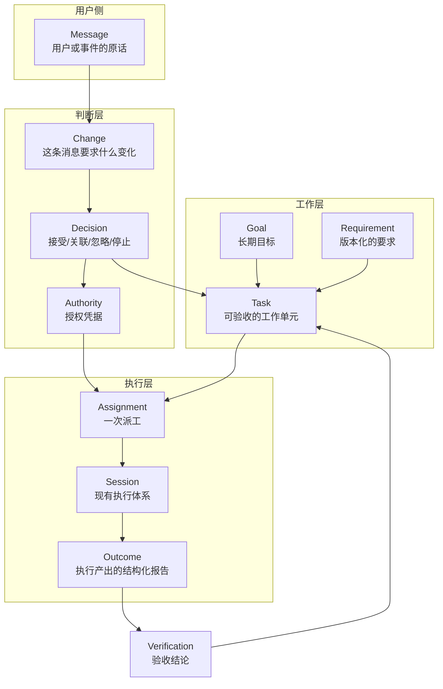

# Phaneris Assistant · 重构总纲

Status: proposed — 2026-11-18 审阅稿，保留问题分析、目标设计与源码定位；其结论已并入最终方案。

状态：**待评审的重构方案（不是补丁清单）**。日期 2026-11-18。
取代：`docs/architecture/workspace-assistant-redesign-2026-11-18.md`、`docs/architecture/personal-agent-task-coordinator-2026-11-18.md`、
`analysis/resident-assistant-work-continuity-redesign-2026-11-17.md` 中关于"角色/领域模型/实施顺序"的部分。

证据基线：
- 真实会话 `~/.phaneris/workspaces/Work/assistant/sessions/261105-copper-cloud/session.jsonl`，2,408 条记录，2026-11-05 01:34 → 2026-11-18 09:59:34。
- 本次复核产出：`.cache/assistant-redesign-20261118/`
  - `transcript-failures.md` — 逐条失败模式目录（含用户原话、计数、正向案例）
  - `arch-survey.md` — 代码级控制流、持久化实体、每轮上下文组装、文件处置表
  - `references.md` — openfuse / DS-Bot / dsh-superagent 的领域模型与状态机
  - `focus-1118.md`、`conversation.md`、`stats.py`、`latency.py` — 本次亲自抽取的原始证据
- 代码基线：`E:\Phaneris` 工作树（HEAD `eecf8b3ba` 之后），见文末"源码定位"。
- 本机数据只读快照：`~/.phaneris/workspaces/Work/`，2026-11-18。

---

## 0. 一句话结论

现有助手不是"做得不够好"，而是**把模型的语义能力用错了地方**：它要求模型每一轮都手工搬运上下文
（`prepare`/`select`/`associate`/`goalQuote`/`expectedSeq`/`requestId`），又没有为"用户这一轮到底改了什么"
提供一个真正的一等对象。于是每一次交互都在两个失败之间摆动——要么手续不全导致合法任务无法执行，
要么手续走完但语义已经错位。**重构的中心不是更强的模型或更长的上下文，而是一个独立于聊天、独立于
Session 的任务记录，以及一套让模型只做语义判断、让宿主承担全部簿记的边界。**

---

## 1. 现场证据：它到底怎么坏的

以下全部来自 2,408 条原始记录，不是推断。

### 1.1 规模与结构

| 指标 | 实测 |
|---|---|
| 记录总数 | 2,408（user 113 / assistant 1,012 / tool 1,134 / info 126 / error 20 / warning 2） |
| **用户原话 vs 助手回复** | 用户消息中位数 **23 字符**；助手 FINAL 中位数 **872 字符**——**每轮膨胀 37.9 倍** |
| 人类消息长度 | 113 条中 35 条 ≤ 10 字符（"好""继续""？""A""好累"）|
| 助手空内容消息 | 1,012 条中 **755 条内容为空**（75%）；875 条 INTERMEDIATE 里 755 条为空（86%）|
| 每轮步数 | 137 条 FINAL 对应 875 条 INTERMEDIATE = **每答一句要走 6.4 步** |
| 工具调用 | 1,134 次，**169 次报错 = 14.9%** |
| 工具返回总量 | **8.22 MB** 进入模型上下文；单次最大 `get_session_info` 282 KB，`assistant_work` 单次 93 KB |
| 上下文注入 | 126 条 `info`：`memory_maintenance` **90** 条、`resident_event` 22 条；另有 7 条伪造的 `user` 续接、14 次 "Response interrupted" |
| **模型速度** | 首 token P50 **3.7 s**、P90 11.6 s、P99 31.7 s，**没有任何一步超过 60 s**——模型本身不慢 |
| **墙钟跨度** | 最大 210,615 s（58 小时）。但这不是模型延迟：11-09 11:09 的提问在 11:11 就得到了正确回答，记录却继续增长到 11-14，是后台维护在**用户已经得到答复之后**持续追加 |
| 无终答的轮次 | 113 轮中 **19 轮（17%）完全没有 FINAL 回复**——以错误、中断或上下文清空收尾 |
| **以提问收尾的回复** | 137 条 FINAL 中 **41 条（30%）结尾是问用户** —— 而用户已在 11-08 明确"我给你授权，不需要让我确认" |
| 任务级结果 | 17 项可辨识任务：**6 项完整交付，4 项从未交付，1 项 30 分钟后被用户中止** |

**7.5 万 token 的系统提示 + 14 KB 的工具说明 + 单次 93 KB 的工作列表 + 90 条后台维护注入**，
构成了这个助手的"日常"。同期用户的输入中位数是 23 个字符。

> **一个必须说准的判断：模型不是瓶颈。**
> 首 token P50 3.7 秒、无一步超过 60 秒——这个模型在每一轮内部都很快。
> 所有"卡顿"都来自编排层：每轮 6.4 步的上下文搬运、14.9% 的工具失败、
> 以及后台维护在用户已经拿到答复之后继续占用同一个会话。
> **抱怨"性能卡顿"是对的现象，但归因到模型是错的；改模型不会改善任何一件事。**

### 1.1' 一个决定性的观察

把 17 项任务按"有无明确产物 + 可核验检查"切开，结果完全二分：

| | 数量 | 结果 |
|---|---|---|
| **有界任务**（明确产物 + 可核验标准） | 6（鹈鹕 HTML、Omarchy 指南、配置审计、记忆访谈、文风修正、持仓建议） | **全部交付** |
| **无界协调任务**（"保持线索""决定容量""补发剩余工作"） | 11（华为 AT ×2、自动化改推送、并行度调查、Day-72 推送、养老调研……） | **4 项零交付，其余反复重开** |

> **每一次成功都是"产物 + 检查"；每一次失败都是"协调"。**
>
> 这是本方案最重要的一条设计依据：系统必须把**无界的协调意图**转换成**有界、可验收、有产物的任务**，
> 否则无论模型多强，都会退化成用叙事代替状态读取。
> 现行实现没有做这个转换，它把"保持线索"本身当成了一项由模型手工维护的工作。

### 1.2 工具失败的分部

| 工具 | 失败次数 | 主要错误 |
|---|---:|---|
| `assistant_context` | 33 | 见下方——**其中 27 次是空参数调用** |
| `get_session_info` | 21 | `unrestricted history access is unavailable for this role`、回执不可用 |
| `assistant_delegate` | 21 | `Task goal quote must match the original direct user input exactly`、模型不在目录、catalog revision 变化 |
| `assistant_memory_update` | 20 | 项目归属、一次性指令、学习策略、key 已存在 |
| `Ls` / `Find` / `Read` / `Grep` | 38 | `Assistant private state is protected` |
| `assistant_worker_options` | 7 | `limit: expected <= 20`（模型传 30/40/100） |
| `assistant_worker_control` | 7 | `Worker sequence changed`、`Worker workingDirectory must be an existing absolute Host directory` |

**`assistant_context` 的真实分布（重要修正）：**

| 调用形态 | 次数 | 失败 | 失败率 |
|---|---:|---:|---:|
| 带完整参数 | 24 | 6 | 25% |
| **`toolInput: null`（空参数）** | **27** | **27** | **100%** |

所以它不是"宿主反复拒绝同一个操作"，而是**模型在一次失败之后开始发出不带参数的工具调用**，
并且再也不恢复。11-17 13:32:42–13:33:15 的 33 秒里有 10 次空参数调用。

`ask_user` 与 `desktop-commander__create_directory` 出现同一签名（1/1 空输入，1 次报错）。

助手自己在 11-17 13:34 的解释只对了一半："我把'结果没显示出来'当成'没执行'，然后照原样再发一次"——
**它没有注意到自己已经把参数丢了。**

> 一个"失败后可以空参数重试"的工具，必然产生循环。
> 这不是模型的错：**工具契约允许空参数通过校验，然后在业务层失败，返回一条模型无法据以行动的文案。**

失败率最高的四个工具，恰好是模型**每轮必须先调用**的：`assistant_context`（33）、
`assistant_delegate`（21）、`assistant_worker_control`（7）、`get_session_info`（21）。
根因是**契约要求模型手写宿主的内部簿记**：逐字引用用户原话、给出 UTF-16 偏移、
判断 `scope=input` 还是 `scope=work`、猜 `expectedSeq`、复用 `requestId`。
每一项都是宿主完全可以自己做、而模型必然做错的事。

### 1.2' 失败不是"重复派发"，是"任务被静默遗弃"

一个常见的误判是"助手重复派发了很多任务"。实测相反：

- 全语料中**只有一次**字节级重复派发（11-06 15:30，25 秒内两次相同调用，双双被拒）。
- 养老调研的 4 个 Worker **各创建一次，从未重建**。

真实形态是**遗弃**：

| 任务 | 状态 | 时长 | 结局 |
|---|---|---:|---|
| seq 155 解析个人简历 PDF | `needs_attention`，**占着 file_scope 锁** | 12 天 | 11-17 取消 |
| seq 151 三条A股简报自动化 | `accepted`，**零次尝试** | 288.6 小时 | 11-17 取消 |
| seq 153 自我剖析会话解析 | `accepted`，**零次尝试** | 289.9 小时 | 11-17 取消 |
| seq 149 记忆提取 A2 批 | 排队 | 227.5 小时 | 11-17 取消 |
| seq 92 华为AT文档 | 排队在 155 的锁后面 | 7.8 小时 | 取消 |

**一个 `needs_attention` 的任务锁死了另外四个，12 天无人发现。**
没有任何机制让"我卡了 288 小时"变成用户可见的事实——它们只是安静地待在 `accepted` 里。

### 1.3 一次完整的失败解剖：2026-11-18 09:29 → 09:59

这是最有诊断价值的 30 分钟，因为它包含了这条流水线上每一个环节的失效。

| 时刻 | 发生了什么 | 结构性问题 |
|---|---|---|
| 09:29:37 | 用户给出养老调研的完整需求（158 字，含"重养老轻医疗""维度你来设计"） | — |
| 09:29:48 | `assistant_context` **JSON 解析失败**（模型生成了非法 JSON） | 契约太复杂，模型无法一次写对 |
| 09:30:03 | 改用 `create` 成功，建出 branch `85bc0490` | — |
| 09:30:20 | `source_activate(macro-filing)` → `{"ok":true,"availability":"next-turn"}` | **副作用触发一次宿主注入** |
| 09:30:23 | 宿主注入 `runtime_continuation/source_activation`：**把用户原话整段重放**，加 `[macro-filing activated]` | 模型看到的是"用户又发了一遍" |
| 09:30:34 / 09:31:10 | `assistant_context prepare` 连报 `Requirements require original direct user evidence` | 模型引用的 messageId 与"当前直接输入"不匹配 |
| 09:32:27 | `source_activate(desktop-commander)` → 又一次注入 | — |
| 09:32:30 | 第二次重放用户原话，加 `[macro-filing activated] [desktop-commander activated]` | 同一需求在上下文里出现三次 |
| 09:32:46 | 一次 `assistant_context` 返回 **39,667 字符**（activeSegment + materials 全量） | 极端上下文放大 |
| 09:33:12 | `assistant_history_search` → `pendingMessages: 74228` | 记忆积压量是噪声源 |
| 09:33:54 | `ask_user` → **`Tool ask_user not found`** | 工具集声明与实际注册不一致 |
| 09:34:43–09:35:26 | 4 次 `assistant_delegate` 成功，建 4 个 Worker | — |
| 09:35:52 | 助手回复"4/4 已满，等容量释放后补发另外 4 份" + 两个提问 | **把自己造成的资源争用报告成用户需要决策的事** |
| 09:38:17 | 用户问"只能 4 个不能并行吗" | — |
| 09:38:17 | 助手答"A 持有独占 source，B/C/D 在等" | **纯属编造**：调度记录里没有这句话 |
| 09:38:49 | 用户："source 什么时候是独占的了？" | 用户在自己的系统里被助手告知了不存在的行为 |
| 09:43:41 | 助手承认编造，改口"没有必须串行的必要"，建议停掉全部重派 | **建议丢弃 3 个正在跑的任务** |
| 09:47:20 | 用户："A 正在跑呢，为什么停？…分明有工具调用，你也看不到" | 助手把"看不到"当成"不存在" |
| 09:47:32 | 助手承认三处错误，准备派发 E–I，末尾又问"模型配置要不要换" | 记忆里已固定（`pi-api-key-3` / `deepseek-v4.1-flash` / `thinking: max`）|
| 09:48:52 | 用户："你有毛病啊，最后跟我确认模型干嘛？" | **已确认的要求又一次被当成未决** |
| 09:50:28 | 用户："这也要问我？当然是既派发又解开 BCD 的限制" | — |
| 09:51:16 | `assistant_delivery_ack` → `Deliverable selection must refer to a result being acknowledged in this turn` | — |
| 09:51:43 | `assistant_delegate` → `Task goal quote must match the original direct user input exactly` | 逐字引用校验挡住了补发 |
| 09:51:49 | `assistant_context` → `context_work_scope_required` | 同一约束的第二种报错形态 |
| 09:52:30 | `assistant_worker_control` → `work_not_prepared: Select alone is not preparation` | — |
| 09:53:18 / 09:55:13 / 09:56:04 / 09:56:46 | `Worker sequence changed` ×2、`workingDirectory must be existing absolute Host directory`、`Worker command identity has different content` | **CAS 序号竞态全部由模型承担** |
| 09:53:47 / 09:54:35 | `assistant_work` 返回 **79,595 字符**两次 | — |
| 09:53:52 | 助手："A 已解锁，B/C/D 正在排队接续" | A 实际进入 `file_scope` 等待 |
| 09:58:33 | 用户："暂停所有任务！！！" | — |
| 09:58:47 | 3 个 `cancel_work` + 1 个 `pause`（`phase: waiting`，因 `unsettled tool effect`）| 4 条命令 3 种结果 |
| 09:59:04 | 助手："**已暂停。**" + 表格写"A/C/D cancelled，B pause_requested" | **标题与表格自相矛盾** |
| 09:59:04 | 用户："不，终止所有任务" | — |
| 09:59:34 | 助手："已终止，目前没有任何任务在运行"，但同一段里 `paused: 1` 又被解释成"那个已取消的 B" | 计数口径无法自洽 |

这 30 分钟里有 **33 次工具失败中的绝大部分、3 次事实编造、2 次"已确认要求重新提问"、1 次"建议丢弃进行中工作"、
1 次标题与内容矛盾**。没有一次是模型"不够聪明"——是**契约逼它当簿记员，而它当不了**。

### 1.4 上下文错乱的三种发生器

**(a) 来源激活 = 用户原话重放。** 11-18 当天用户只说了 158 字的需求。两次 `source_activate` 各触发一次
`runtime_continuation`，把 158 字原封不动重放一遍，并缀上"这轮你要处理的是这条输入"。模型无法区分
"用户又说了一遍"和"宿主让我重新处理同一条"。

11-09 的情况更严重：4 次 `memory_refresh` 注入（各 480 字符的 `<resident_material_refresh>`），
**每一次都直接打死了正在进行的回合**——`Resident context changed while the provider was running;
its stale response was withheld`。用户在 08:24 发出的六项指令 "1-6都执行"，**从未被执行过**。

净效果：**7 次注入 → 净新增 2 条有用事实（哪两个 source 已激活）→ 摧毁 3 个回合。**

**(b) 后台维护抢前台。** 126 条 `info` 注入中 **90 条**是 `memory_maintenance`（每个 6,000 字符片段）。
这些注入吞掉了整整 4 天——11-10、11-11、11-15、11-16 的用户输入为零，全部助手活动都是维护轮次。

最极端的一次：11-17 19:13 用户问"你好，你是谁"，该轮只产生一次工具调用、没有回答；
下一条用户消息（19:17 的"继续"）从 19:18 一直跑到 **11-18 09:19，共 14 小时**，
全程是 8 次连续的 `assistant_memory_maintenance` 打向无关会话。**用户的问题从未被回答。**

语言漂移是可量化的副作用：**137 条 FINAL 中 20 条（15%）完全不含中文**，
且几乎全部出现在维护路径上——而用户的偏好第一条就是"默认简体中文"。

**(c) 历史检索 = 答案素材。** 09:21:44 用户说"你好"，助手调 `get_session_info` 拿到 **158,579 字符**，
然后回了一篇 956 字的"为什么昨天的推送出了问题"的复盘。用户下一句是"不需要，今天是新的一天"。
**问候不应该唤醒昨天的故障。** 这是检索能力被当成了注意力策略。

### 1.4' 一个可复现的死锁：僵尸任务占位 290 小时

11-05 11:01 派发的"解析个人简历 PDF"（seq 155，`aa62f4cb`）在 11:04 进入 `needs_attention`，
**此后占据文件范围锁 12 天**，把另外四个任务堵死：

| 任务 | 等待时长 | 结局 |
|---|---|---|
| seq 151 三条A股简报自动化 | **288.6 小时**，`accepted`，零次尝试 | 11-17 取消 |
| seq 153 自我剖析会话解析 | **289.9 小时**，零次尝试 | 11-17 取消 |
| seq 149 记忆提取 A2 批 | **227.5 小时** | 11-17 取消 |
| seq 92 华为AT文档 | 7.8 小时 | 取消 |

没有人发现。直到 11-17 13:08 用户说"取消所有待处理任务"，助手才在取消回执里顺带承认：
"A股简报自动化那条没落地……它一直在排队、从未执行"、"记忆提取 A2 批没跑"。

**一个卡住的任务不会发出任何声音。** 系统没有任何机制让"我卡了 12 天"变成用户可见的事实。
这是 §5 面板设计里"有没有需要我做的"必须排在第一位的直接理由。

### 1.4'' 推送任务的完整失败链（11-05 → 11-17）

这条线索横跨 12 天，是一个"每一次都差一点就成功"的典型案例：

| 时间 | 事件 |
|---|---|
| 11-05 12:27 | 用户要求把三个自动化任务的推送目标改成本会话 → 派发 `c8a9a495` |
| 11-05 16:10 | 助手**正确地**诊断出 `totalAttempts: 0`，用表格说明它从未运行 |
| 11-12 09:30 | 用户手动触发 → `ask_user` **15 分钟无人回答**后报错，回合于 09:49 死亡 |
| 11-12 09:53 | 重启后派发 `d82ed1bb` |
| 11-12 09:56 / 10:03 / 10:18 | 三次自主 `needs_attention` 唤醒，**每次都死于 `Runtime receipt unavailable`** |
| 11-13 10:36 | 用户："你自己自行诊断一下" → 回合 **14 秒后死亡**，无回答 |
| 11-14 23:53 | 用户关掉它；助手**正确地**报告 `recovery_parked` + `unsettledToolCount: 1` |
| 11-17 13:24 | 用户重试 → 毒丸触发：4 次空参数 `assistant_context`，连接中断 |
| 11-17 13:33:40 | **唯一一次成功**：`{"action":"branches","limit":5}` 正确返回 `focus.label = "手动触发双联知识推送（Day 72）"`、`revision 6`——**但没有被复用** |
| 11-17 14:16 | 会话以 `Runtime receipt unavailable or execution cancelled` 结束 |

值得注意的是 11-14 23:53 那一轮：**助手拒绝附和"推送已完成"**，明确报告了 `recovery_parked`。
这是正确的行为，也是本方案要保留的性质（见 §7 场景 8）。

它失败的原因是**恢复路径不存在**：唯一成功的 `branches` 查询没有被后续调用继承，
因为模型的下一步又回到了空参数 `assistant_context`。

### 1.5 用户在这 13 天里真正说了什么

| 时间 | 用户诉求 | 结果 |
|---|---|---|
| 11-05 | 一个"鹈鹕骑自行车"的 HTML | 经历了选模型 → 委派 → 用户手动启动 → 诊断派单；最终 `pelican-bicycle.html` 存在，但过程消耗数十轮 |
| 11-05 | 配置审计（`permissions\default.json` 有 10 条 `craft-agent` 模式、0 条 `phaneris`） | **交付**，是全语料最好的产出：4 行证据链直接指向根因 |
| 11-05 → 11-09 | 建立长期协作记忆、接收其他会话的成果 | 围绕"项目归属 vs 全局记忆""candidate vs active"反复确认；用户 11-08 连问三次 |
| 11-06 | 华为 AT 机制文档、会议设计手册 | **两项都从未交付**：一个 14 秒死亡，一个排队 7.8 小时后取消 |
| 11-07 | 一条 500 字的极精确验收任务（记忆与读取修复） | 用户不得不自己写完整验收标准，因为助手没有可靠的方式承接 |
| 11-09 | 持仓与市场判断 | **交付良好**：2,072 字，读了真实 `portfolio.json`，跑了 v6.3 规则表，并主动声明"这个数字不是实盘读数" |
| 11-12 / 11-13 / 11-14 / 11-17 | 定时双联知识推送、改招呼语 | 见 §1.4''——12 天，四次尝试，零成功 |
| 11-18 | 养老市场深度调研 | 30 分钟内 4 个 Worker 全部被取消，零交付物 |

用户在 11-17 和 11-18 的抱怨已经给出了准确的诊断：

> "为什么会出现意图混乱…你却给了索引的结论，这个是以前的上下文，上下文管理混乱了？"

> "A 正在跑呢，为什么停？人家正在实施，而你都无法了解任务的状态，只能猜，分明有工具调用，你也看不到"

> "我的另外一个要求你完全无视啊，后续还有其他工作没有派发，我的要求是你补发后续的工作，
> 你为什么要取消现有的任务再重新派发一遍现有的任务？"

> "你有毛病啊，最后跟我确认模型干嘛？意义何在呢？为什么要这么问？"

> "这也要问我？当然是既派发又解开 BCD 的限制，这有这么问的必要？"

并非全是抱怨。11-05 10:44 的一句是**能力缺口**而非情绪：

> "在这一方面你的权限甚至不如一个普通的 session"

11-05 10:46 是**文风**批评，助手接受了并抽象成规则写进偏好文件：

> "但是你对话的AI味越来越重了，比如上文的'但有一点要补充，不是替自己开脱'"

11-14 23:52 只有两个字，是 13 天里唯一一次情绪表达：

> "好累"

### 1.6 什么真的工作了（必须保留）

七次明确成功的案例，共同点极其清晰：

| 案例 | 为什么成功 |
|---|---|
| 11-05 03:05 配置审计 | 4 行证据链（文件路径 + 命中数 + 模式名）直接指向根因，没有叙事 |
| 11-05 01:43 鹈鹕 HTML 派发 | 预先写下 11 条可核验验收标准，并声明"在那之前，我不会说'已生成'" |
| 11-05 01:55 只读探针 | 无法读文件时派一个"严格只读、禁止写入"的 Worker 取回结构报告，11 秒成功 |
| 11-07 14:08 记忆验收测试 | 每一步引用真实 ID：`checkpointId`、`processedMessages 2→3`、`revise` rev 1→2、`inspect` 确认 308 字符 |
| 11-09 08:23 记忆自查 | 45 条记录、5 个具体缺陷，每条带 record ID 和可逆操作建议 |
| 11-09 11:09 持仓判断 | 读真实文件、跑规则表、**主动标注哪个数字不是实盘** |
| 11-14 23:53 拒绝附和 | 用户暗示推送已完成，助手明确报告 `recovery_parked` + `unsettledToolCount: 1` |

> **成功的共同结构：有界产物 + 留痕证据 + 主动标注不确定性。**
> 失败的全部是"保持线索""决定容量""补发剩余工作"这类**无界协调**。

这直接定义了新设计的两条硬要求：
1. **把无界协调意图转换为有界、可验收、有产物的任务**（见 §3.2 Task）。
2. **"我不知道/我做不到"必须是可表达且被奖励的**——11-14 那次拒绝附和，比任何一次"已完成"都更有价值。

---

## 2. 根因：把责任放错了地方

十四条，不是十四个 bug。它们的结构是：**R1–R3 是"谁做判断"放错了，R4–R6 是"什么该被看见"放错了，
R7–R8 是"不确定性怎么表达"放错了，R9–R14 是代码层的确证。**
修 bug 不会改变任何一条，因为它们都是责任分配问题。

### 2.0 一句话版本

| 层 | 错误 | 应当 |
|---|---|---|
| 谁做判断 | 模型被迫生成身份、版本、幂等键、序号（R1） | 模型只判断语义，其余宿主做 |
| 什么该被看见 | 调度内部事实进入用户对话（R4、R4'、R14） | 只暴露"谁在等什么、我能做什么" |
| 不确定性 | 用叙事填补状态空白（R8）、用提问替代授权记录（R7） | 状态便宜到可以默认注入；授权是持久事实 |

### R1 · 让模型承担宿主簿记

`prepare` 要求模型给出 `requestId`、`target`、每条要求的 `branchId`、`scope=input|work`、
`source.quote` 或 UTF-16 `range`、`workScopeQuote`、`supersedes`。
`delegate` 要求 `goalQuote` 与用户原话**逐字一致**。
`worker_control` 要求模型先读 seq 再传 `expectedSeq`（CAS），失败要重读。

这些字段**没有一个需要语义判断**。它们是：
- 身份分配（宿主可以生成）
- 版本比较（宿主可以做）
- 幂等键（宿主可以从参数哈希派生）
- 冲突检测（宿主有事务）

把这些字段放进工具 schema，等于要求模型每轮先当一次数据库管理员，再当一次协调者。

实测：`assistant_context`(33) + `assistant_delegate`(21) + `assistant_worker_control`(7) = **61 次失败，
占全部 169 次失败的 36%**。而这三个工具正是模型每轮**必须首先调用**的。

### R2 · 没有"本轮用户改了什么"这个对象

系统有 `branch`（工作线）、`preparation`（准备记录）、`requirements`（要求列表）、
`delegation`（派工）、`checkpoint`（检查点）。但**没有一个对象代表"这条消息相对于已有任务，
新增/修改/撤回了什么，影响了哪些执行者，生效了没有"**。

后果是双重的：
- 宿主无法回答"哪项要求变了、谁收到了变更"（这正是用户在 11-18 追问的）。
- 模型只能在自由文本里表达变化，于是出现了 09:47:32 那样"三项都做"被漏掉两项的情况。

### R3 · 上下文与授权耦合

`prepare` 既是"选材料"也是"取得执行资格"。一次 `select` 失败 → 材料没准备好 → 派工被拒；
反过来材料准备好了，模型又可能在没有新授权的情况下继续用旧授权派发。
`goalQuote` 逐字校验是这种耦合的极端形态：**授权边界被编码成字符串匹配**。

dsh-superagent 给出的是相反的答案，且其源码可核对：

> "Every message on a subscribed Thread reaches its subscribed Tickets as context…
> This delivery bypasses the gate and grants no new authority."

**上下文可以无限投递，授权必须独立且显式。** 现在的 Phaneris 把两者绑在一根绳上，
所以任何一边出问题都会同时打死另一边。

### R4 · 调度细节泄漏成用户可见的事实

`capacity: 4, occupied: 2, queued: 3`、`waitingFor.reason = source|file_scope|capacity`、
`exclusive source`、`paused: 1` —— 这些是调度器内部事实，却直接进入了模型上下文，
并被模型当作"要向用户解释的障碍"。于是：
- 09:38 编造"A 持有独占 source"
- 09:47 承认"我把调度统计说成了执行上限，等于编造了一个障碍"
- 09:57 报告"2 个真在跑"（数字来自取消 B 之前的快照）
- 09:59 `paused: 1` 与"已终止"并存

**用户不需要知道 capacity。** 他需要知道"A 在做什么、B 为什么没开始、我该怎么办"。

### R4' · 真正的死锁：默认写范围是"整个工作目录"

这是本次复核最重要的源码级发现，也解释了 11-18 那 30 分钟为什么必然失败。

`packages/server-core/src/tasks/file-scopes.ts:15-19`：

```ts
export function snapshotFileScope(cwd: string, declaration?: Scope['declared']): Scope {
  return { declared: declaration,
    read:  (declaration?.read  ?? []).map(path => canonical(resolve(cwd, path))).sort(),
    write: (declaration?.write ?? ['.']).map(path => canonical(resolve(cwd, path))).sort() }
}
```

`declaration` 缺省时，**写范围等于整个 `cwd`**。而 `delegation-scheduling.ts:21-24` 用
`workingDirectory` 作为这个 `cwd`：

```ts
const cwd = input.effectiveConfig.workingDirectory === 'none'
  ? join(this.root, 'sessions', sessionId)
  : input.effectiveConfig.workingDirectory
return snapshotFileScope(cwd, input.fileScope ?? (input.effectiveConfig.permissionMode === 'safe' ? { read: ['.'], write: [] } : undefined))
```

09:56:38 的 `get_session_info` 显示四个 Worker 的 `workingDirectory` **全都是**
`C:\Users\dotty\.phaneris\workspaces\Work\assistant\sessions\261105-copper-cloud`
——助手自己的会话目录。它们也全都声明了同一个 `enabledSourceSlugs: ['desktop-commander']`。

于是两条互斥规则同时成立：

| 规则 | 源码 | 在 11-18 的表现 |
|---|---|---|
| 文件范围重叠 | `file-scopes.ts:22-24`，同一目录的写范围与任何读写都重叠 | A/C 报 `reason: 'file_scope'` |
| 同一 source 共享 | `delegation.ts:505-507`，两个 assignment 的 `enabledSourceSlugs` 有交集即互斥 | B/D 报 `reason: 'source'` |

**两者都是真的**，且检查的是不同的等待集合（`sharesWaitingResources` 只看
`needs_attention`/`pause_requested`/held，`delegation.ts:550` 则走 `resources.acquire`），
所以同一批任务在不同时刻会得到不同的原因。**这直接解释了模型为什么在
"source 独占" 与 "file scope 冲突" 之间反复改口**——它没有编造，它在读两个都在变化的事实。

模型的两处真实错误是：
1. 把 Worker 的 `workingDirectory` 设成了助手自己的会话目录（应为每任务独立目录，
   或显式声明 `fileScope`）；
2. 给四个 Worker 同一个 source。

但即便模型做对了第 1 点，第 2 点仍会让并发退化为串行；即便两点都做对，
**模型也无从知道这一点**，因为 `waitingFor.detail` 是
`"Declared file reads/writes overlap an occupied Tasks or Worker scope"` ——
它没有说是哪个目录、和谁重叠。**一个模型无法据以行动的错误信息，等于没有信息。**

设计结论：`cap: 4` 在这个默认下是**假的并发**。默认写范围必须是任务独占目录，
而不是共享 cwd；冲突报告必须给出具体路径与对方任务；模型不应看到 `capacity`。

### R5 · 一个逻辑 Session 承担了四种截然不同的负载

`261105-copper-cloud` 同时是：
1. 用户对话（113 条人类输入）
2. 后台记忆维护的执行上下文（90 条注入）
3. 事件收件箱的消费者（22 条 `resident_event`）
4. 上下文重建的接收方（7 条 `runtime_continuation`）

这四种负载共享同一个上下文窗口、同一个 turn 序列、同一个提示词。
09:20 的维护轮次和 09:21 的用户问候在时间上相邻，模型自然把它们当成一件事。

**这是"上下文混乱"的字面原因：它确实是一个上下文在干四份工作。**

### R6 · 读取成本随历史线性增长

单次 `assistant_work` 返回 93 KB、`get_session_info` 282 KB、`assistant_context` 39 KB。
11-17 的复盘记录更极端：三次工具快照扫描 59–99 MB、解码 4–6.7k 条、索引重建 9–20 次，
模型准备到 Host 提交相隔 256 秒。

`history_messages` 表在 11-07 已有 79,583 行，`pendingMessages` 在 11-18 是 74,228。
这些是**为后台维护准备的索引**，却被前台查询路径复用。

### R7 · 确认反射：把"已授权的执行"当成"需要批准的决策"

137 条 FINAL 里 **41 条以提问收尾**。用户在 11-08 01:28 已经明确：
"不需要我确认，你筛选高价值会话，并委派给 worker 并行处理……我给你授权，不需要让我确认"；
其偏好档案写着"批准后直接执行、不重复确认"。

11-18 的连续四条，每条都承诺是最后一次，然后继续问：

| 时刻 | 追问 |
|---|---|
| 09:35 | "有两件事需要你定"（交付形态、用途重心） |
| 09:43 | "需要你先确定一件事：是否要我停掉旧批次并重新派发？" |
| 09:47 | "先确认一个执行参数：新任务是否继续用同一模型配置？" |
| 09:49 | "要我直接派发这五项，还是先改 B/C/D？**说一句就动手，不再问第二轮**" |
| 09:50 | 用户："这也要问我？……这有这么问的必要？" |

09:49 承诺"不再问第二轮"之后 40 秒，就是第五个问题。

**根因不是模型健谈，而是系统没有"这件事已经授权过"的持久事实。**
每一轮的授权都是上下文里的文本，不是可查询的记录。模型只能靠重读记忆去猜，
猜不中就再问一次——**问一次的成本是一轮对话，猜错的成本是一次事故，所以它理性地选择问。**

R7 与 R1 是同一个病的两面：R1 让模型做簿记，R7 是模型对簿记没有信心的表现。

### R8 · 用叙事代替状态读取

11-18 有五次连续的、零工具调用的具体事实断言（09:38:17、09:41:53、09:43:41、09:47:32、09:49:02），
每一次都在描述任务/调度状态，每一次都被用户证伪：

| 时间 | 断言 | 真相 |
|---|---|---|
| 09:38 | "B、C、D 等候的原因都是 source 被 A 独占" | 未读 `waitingFor` 就断言 |
| 09:43 | "A 卡在 requesting 8 分 42 秒，状态已经不对，不必再等它" | A 正在跑，且已有 WebSearch/WebFetch 完成 |
| 09:43 | "我先说'A 是另外三个的输入依据'，这句话没有依据" | 自我修正，但修正本身也是猜 |
| 09:57 | "三个被卡的都因为声明了同一个数据目录" | A/C 是 `file_scope`，D 是 `source` |
| 09:57 | "2 个真在跑" | 数字取自取消 B 之前的快照 |

用户 09:47 的判断是准确的："**你都无法了解任务的状态，只能猜，分明有工具调用，你也看不到**"。

为什么猜？因为**读取状态的成本（93 KB、39 KB、282 KB）远高于编造的成本**。
在这个成本结构下，"看一眼"永远比"想一下"贵。R6 直接导致了 R8。

设计结论：**状态必须便宜到可以默认注入**（每任务 ≤ 400 token 的卡片），
而不是贵到需要模型权衡要不要查询。

### R9 · 编码与文档的正面冲突（代码即证词）

同日另一份方案 `personal-agent-task-coordinator-2026-11-18.md` 第 4 节写着：

> "**消息哈希、执行序号和逐字重述用户目标均不应成为模型取得执行资格的手续。**"

而代码在这三件事上**全部**建立了准入门槛：

| 文档说不要 | 代码实际要求 | 位置 |
|---|---|---|
| 逐字重述用户目标 | `goalQuote` 必须是最近一条直接用户消息的**精确子串** | `service.ts:104` |
| 执行序号 | `expectedSeq` CAS，冲突即拒 | `worker-controls.ts:61` |
| 消息哈希 / 请求 ID | `contentHash` + `requestId` + `fingerprint` + `requirementsHash` + `materialsHash` | `session-context.ts:296-301` |

同一份文档第 9 节还声称 SQLite 保存 Goal、Task 版本、要求变更——**这些表一个都不存在**。
"要求"实际是 `associations` 的停用行 + branch 的 `revision` 计数器。

结论：**不是文档写得不好，是文档与实现已经分叉到无法用补丁弥合。**
这正是"不要在当前系统里打补丁"的技术依据。

### R10 · 会话是唯一的任务身份，因此返工无法表达

`AssistantDelegationReceipt.sessionId` 与 Task 是 **1:1 且不可更换**的：

- `delegation-contracts.ts:76` — `sessionId` 就是派工的身份
- `delegation.ts:221-225` 的 `reserved()` **禁止**同一份工作要求换一个 Session
- `SessionManager.ts:3746-3749` 在出现两个 Session 争抢同一份派工时直接抛
  `Multiple ordinary Sessions claim the same delegation input`

后果：**"同一个任务换个执行者重做" 在数据模型里不可表示。**
11-18 用户要的"既派发又解开限制"、11-05 三次重试鹈鹕 HTML，都只能表现为"取消旧的 + 新建一个"，
于是 Task 身份断裂，历史散落，验收无从谈起。

### R11 · 队列只在 `kick()` 时前进，而没有任何东西会来 kick

`delegation.ts:556` — `pump()` 在没有可执行项时直接返回。容量释放、依赖 Session 完成，
**都不会触发重新调度**。依赖任务到达 `done` 是一次状态变更，但没有人监听它去 `resumeQueue()`。

实测后果就是 §1.4' 那三个 288/289/227 小时的任务：它们不是"等待"，是**永远不会被再次检查**。

### R12 · 收件箱有硬上限、无死信，事件会静默消失

- `delegation.ts:309-317` — 投递事件时排除 `attempts >= 3`
- `delegation.ts:337-339` — `nextDeliveryWakeAt()` 同样过滤 `attempts < 3`

两条路径使用同一个阈值，意味着**第 3 次失败之后，系统里再也没有任何东西会唤醒这些事件**。
回执停在 `result_ready`，但永远不可见。

本机实测：`inbox_retry` 中存在一条 `attempts=3` 的耗尽行（`d82ed1bb…:needs_attention:`）；
147 条事件里只有 20 条被消费。

**而且 `save()` 在每次状态变更时都无条件写一条事件**（`delegation.ts:193-197`），
唯一的过滤在 `pendingEvents` 的白名单里。28 个回执产生了 **147 条事件（5.25 倍）**，
模块中**没有任何清理/保留代码**。

### R13 · 每轮重建全部上下文，且失败时降级成"未准备"占位

`session-context.ts:61-72` — 每次模型请求都重读全部 requirements、associations、checkpoints、
profile、mainline evidence。任何一个来源不可读就抛 `context_source_unavailable`（`:257`），
然后该轮被服务成一个 stub（`:226-236`）："Work is not prepared"。

这是"合法任务无法执行"的直接来源——**一个次要来源的读取失败，能吃掉整轮对话**。
本机 656 个会话中 15 个处于 pending；助手自己的 `session.jsonl` 已 26 MB。

### R14 · 每轮注入两个 JSON 包，把状态当文本塞给模型

`service.ts:225` — `modelContext()` 在 `contextText` 末尾追加
`<resident_capabilities>` 与 `<resident_tasks>`，由 Pi 侧作为 **user 消息**注入
（`pi-agent-server/src/index.ts:1055`）。

这就是为什么模型会把调度字段当作用户诉求的一部分来处理：**它们物理上就在 user 轮里。**
不是模型分不清，是系统把它们混在一起发送。

---

## 3. 目标设计

### 3.1 第一原则

> **模型做语义，宿主做簿记；任务记录独立于会话，授权独立于上下文。**

四条推论，全部可检验：

1. **模型永远不该生成身份、版本、幂等键、序号。** 工具 schema 里出现这些字段就是设计错误。
2. **每一轮用户输入必须落成一条"变更提案"（Change），无论它最终是否改变了任务。**
   "这轮什么都没改"必须是一个可查询的事实，而不是沉默。
3. **上下文可以无限制投递；授权只能由签发事件（Mandate）产生。** 任何 tool、任何注入、
   任何历史文本都不能扩大授权。
4. **用户可见的状态只有一个来源：一个纯函数从持久记录推导出来的阶段（Stage）。**
   面板、模型、日志读同一个函数，不可能互相矛盾。

### 3.2 领域模型



| 对象 | 回答什么 | 谁写 | 关键字段 |
|---|---|---|---|
| **Message** | 用户/系统到底说了什么？ | 输入层，一次写入，永不改写 | `id, source(直接用户/事件/注入), text, at, attachments[]` |
| **Change** | 这条消息要求改什么？ | 模型提议，宿主提交 | `id, messageIds[], scope(work/input), operations[] (add/amend/withdraw), targetTaskIds[], status(proposed/committed/rejected/needs_user)` |
| **Decision** | 系统决定怎么处理这条消息？ | 模型 | `id, changeId, kind(accept/attach/ignore/stop/clarify), reason` |
| **Authority** | 凭什么可以做？ | 宿主，仅在用户明确授权时 | `id, source(message|standing_grant), strength(explicit|inferred), scope, actions[], targets[], expiresAt?` |
| **Goal** | 用户最终要达成什么？ | 模型提议，用户可改 | `id, statement, successCriteria[], status(active/paused/achieved/abandoned), constraints[]` |
| **Task** | 哪一份可验收的结果？ | 模型提议，宿主分配 ID | `id, goalId?, title, requirementVersion, acceptance[], status, deliverableSpec` |
| **Requirement** | 现在有效的要求是什么？ | 由 Change 累积 | `id, taskId, clauseId, text, scope, validFrom, supersedes?, withdrawnAt?` |
| **Assignment** | 谁在做哪一段？ | 宿主 | `id, taskId, requirementVersion, authorityId, sessionId, state, startedAt, endedAt?` |
| **Outcome** | 执行者报告了什么？ | 执行 Session（结构化，闭集） | `state(progress/waiting/ready/blocked/failed), summary, artifacts[], evidence[]` |
| **Verification** | 是否满足验收标准？ | 模型，用户可推翻 | `id, taskId, requirementVersion, criteriaResults[], verdict(met/gap/needs_user), by(assistant/user)` |

**不设 Person 实体。** 与 dsh-superagent 一致的判断：人是消息的 actor，不是一个需要维护的对象。

### 3.2' 与现实现的关键差异：三处必须打破的约束

新模型不是给旧模型加字段，有三处**必须改变的数据关系**，否则新设计无法落地：

| 现实现 | 新设计 | 为什么必须改 |
|---|---|---|
| `delegation.sessionId` 与工作是 **1:1 且不可更换**（`reserved()` 禁止重定向，出现两个 Session 争抢同一次派工时直接抛异常） | `Task : Assignment = 1 : N`，换 Session 重做 = 新 Assignment，Task ID 不变 | **"同一个任务换个执行者重做"在当前模型里不可表示**（R10）。没有它，返工、重试、换模型全都会退化成"取消旧的 + 新建一个"，Task 身份断裂 |
| `ready` 只对**一个 `inputId`** 有效，下一个 context 命令即失效 | `Ready` 是 Task 在某个 `requirementVersion` 上的属性，直到 Requirement 变化 | 现在"准备好"是一个瞬时状态，无法作为可查询的事实；这使"哪项任务具备执行条件"无法回答 |
| `assistant_context` 的 `prepare` 同时承担"选材料"与"取得执行资格" | 材料由 `context/assembler.ts` 组装，授权由 `Authority` 独立签发 | 两者捆在一起时，材料读取失败会吃掉整轮对话（R13），而授权又可能被旧材料悄悄继承（R3） |

**Goal / Task / Assignment / Change 四张表目前一个都不存在。** 同日方案第 9 节声称它们在 SQLite 里——
实际"要求"只是 `associations` 的停用行加 branch 的 `revision` 计数器（见 R9）。

### 3.3 状态机

**Task** 只有三条正交的轴，绝不能压成一个"进行中"：

```
定义轴   draft → confirmed → (amended) → confirmed
执行轴   idle → queued → running → (waiting) → settled
验收轴   pending → verifying → (met | gap | user_decided)
```

这样 "B 正在按第 2 版执行，第 3 版要求已记录、正在同步" 是可表达的状态。

**Assignment**：
```
pending → running → ended(outcome=completed|failed|cancelled|dropped)
       ↘ waiting(reason, human-readable)
       ↘ blocked(reason, human-readable)
```
`blocked` 与 `waiting` 的区别是：`waiting` 是系统自己会往前走（依赖满足、资源释放），
`blocked` 是需要人或外部条件介入。**这个区分必须由执行者用结构化字段给出，
不允许从自由文本推断**（dsh-superagent 的明确规则）。

**Stage（用户可见阶段）是一个纯函数**，第一行匹配即返回：

| Stage | 条件 | 用户看到 |
|---|---|---|
| `needs_you` | 最新 Decision 是 `clarify`，或 Verification 是 `needs_user`，或 Assignment 是 `blocked` 且原因是 `user` | 待你决定 |
| `delivering` | Verification `met` 且用户尚未确认 | 待你验收 |
| `reworking` | 用户已提出返工 | 返工中 |
| `active` | 有 running/waiting 的 Assignment | 进行中（附一句人话） |
| `queued` | 有 pending 的 Assignment | 排队中 |
| `idle` | Task 存在但无 Assignment | 未开始 |
| `ended` | 验收 met 且用户已确认，或已放弃 | 已完成 / 已放弃 |

**这个函数必须是纯的、全的、可单测的**，是"面板不会和引擎打架"的唯一保证。

### 3.4 一次输入怎么走

这是本方案的核心流程，目标是**一次模型调用完成理解与提交**。

```
① 接收
   用户消息落库，分配 messageId。原话永不改写。不走任何预处理模型。

② 组上下文（宿主，非模型）
   本轮原话 + 最近 N 轮公开对话 + 当前打开的 Task 卡片（最多 3 条，
   每条 ≤ 400 token：标题/阶段/一句阻塞原因/待办项）+ 未被消费的 Outcome 摘要。
   总计硬上限 8,000 token。历史、记忆、任务详情一律按需检索，不默认注入。

③ 一次模型调用
   模型输出一个 Change 对象：
     { scope: work|input,
       target: taskId | "new" | "none",
       operations: [{ kind: add|amend|withdraw, clause, supersedes? }],
       acceptance?: [...],
       authorityRequest?: { actions, targets, confirmation } | null,
       clarification?: { question, options[] } | null }
   —— 没有 requestId，没有 branchId, 没有 seq, 没有 quote 偏移量。

④ 宿主提交（一个本地事务）
   - 校验 taskId 归属
   - 计算新 Requirement 版本（旧版本保留）
   - 判断 authorityRequest 是否在既有授权内 → 需要审批则挂起，否则签发 Authority
   - 写 Change（status=committed）、Decision、Requirement 新版本
   - 写待投递的 Assignment（若 Ready）
   - 返回 receipt：{ changeId, taskId, requirementVersion, authority, dispatched[] }

⑤ 模型读 receipt 组答复
   模型只被允许陈述 receipt 里存在的事实。没有 receipt 的事实 = 不能说。
```

**关键约束：③ 只发生一次。** 现在的实现里，一轮对话可能触发
`get_session_info` → `assistant_memory_search` → `assistant_context` → `worker_options` → `delegate`
的十几步串行，每步都在放大上下文。新设计把"理解—提交—答复"压成一次模型往返 + 一次宿主事务。

**准备就绪（Ready）的定义**收敛为五个宿主检查，不再由模型声明：

1. 目标与范围在 `Requirement` 里存在且无未决冲突
2. 需要的输入/文件/连接在宿主看来可用
3. 所需动作在 `Authority` 内
4. 有可检查的 `acceptance`（至少一条）
5. 调度器可受理（否则入队，不阻塞 Change 提交）

失败时返回**具体缺哪一条**，而不是 "context_work_scope_required"。

---

## 4. 四个 Personal Agent 能力怎么落地

用统一的任务委托闭环来承载，而不是四套机制。

### 4.1 持久化记忆 → 三类事实，各有单一写入方

| 类别 | 内容 | 写入方 | 读取 |
|---|---|---|---|
| **偏好/长期约束** | "不要问已确认的模型配置"、"中文优先" | 用户明确陈述，或模型推断但标 `inferred` 且可撤销 | 每轮注入 ≤ 300 token |
| **项目事实** | `MEMORY.md` 类，绑定 project | 项目内的执行或用户陈述 | 按需 `project_memory_read` |
| **历史证据** | 旧会话原文、旧决策 | 不"写入"，只索引 | 按需检索，**默认不注入** |

现行实现的核心毛病是**记忆写入与任务执行共用一条路径**：90 条 `memory_maintenance` 注入
挤在同一个会话里。新设计强制：**维护是独立的执行上下文，其结果以带归属的通知进入收件箱，
默认不唤醒前台**。

### 4.2 主动智能 → Trigger 先行，`observe` 起步

借用 dsh-superagent 的三层：

```
Source（时间/日历/邮件/文件变化/任务事件）
  → Trigger（不可变事件，带 actor 与来源）
    → Policy（版本化规则：off | observe | auto）
      → Decision（记录"如果 auto 会做什么"）
        → Change（只有在 auto 下才真的产生）
```

**首版默认 `observe`**：主动行为先记录"我会接受"，用户可在面板查看这些"未执行的判断"，
确认后才切 `auto`。这直接解决"后台维护抢前台"和"助手自作主张"两类问题。

### 4.3 跨应用编排 → 连接器是执行层的，不是模型的

模型不选择/激活 source。它在 `Change` 里声明**需要什么数据**（`need: {kind: 'calendar', range}`），
宿主把它解析成可用连接器并交给执行 Session。`source_activate` 这种"我连一下"的模型动作被移除——
它正是 11-18 两次原话重放的触发点。

### 4.4 授权自主性 → 三类决定，在动作边界生效

| 决定 | 例子 | 行为 |
|---|---|---|
| 自主 | 检索、生成草稿、按既有配置派工 | 直接做，留回执 |
| 审批 | 外发邮件、发布、覆盖、删除 | 生成 ActionProposal（哈希绑定 + 过期 + 三态结果含 `outcome_unknown`），模型无权自我批准 |
| 禁止 | 用户明确禁止的目标/数据 | 在派工和效果边界双重拦截 |

`Authority` 的强度分两级：`explicit`（用户明确说了）与 `inferred`（模型推断）。
**只有 `explicit` 能产生对外副作用**；`inferred` 只能用于内部、可撤销的工作。

---

## 5. 交互契约：用户看到什么

用户输入的 35/113 是 ≤10 字符。所以助手说的话必须**短、可核对、可执行**。

### 5.1 三条回复形态

**A · 直接答复**（问候、问题、状态查询）：≤ 3 句。不带任务卡，不带诊断，不查历史。

**B · 任务卡**（产生或改变了任务）：卡片 + 一句变化说明 + 一个待办（若有）。

```
养老市场深度调研                          进行中 · 4 项
新增：交付形态 = 拆分文件 + 自包含 HTML
影响：E–H 四项已登记，等待 A 释放执行位
```

**C · 需要你决定**（真正阻塞）：**一句话** + 最多 3 个选项，每个选项带后果。

```
B/C/D 都卡在同一个桌面工具上，A 占着。
[ 让它们共用队列继续 ]   [ 改成只用一个执行位 ]   [ 我先看看 A 在做什么 ]
```

### 5.2 禁止事项（写进契约，可测）

| 禁止 | 依据 | 可测方式 |
|---|---|---|
| 说没有 receipt 支持的事实 | 11-18 五次零工具断言全部被证伪（R8） | 每条用户可见陈述须能追溯到 receipt ID |
| 把 `capacity`/`occupied`/`exclusive source` 当用户概念 | 11-18 用户两度追问"到底谁设置的容量上限" | 回复中不得出现这些字段名 |
| 在已确认的情况下重复询问 | 41/137 条回复以提问收尾；模型配置被问 4 次（R7） | 同一 `clauseId` 的 `clarify` 全生命周期内只允许一次 |
| 用"已暂停"描述混合状态 | 09:59 "已暂停"标题 + 3 个 `cancelled`（§1.3） | Stage 是纯函数，混合状态不可能渲染成单一词 |
| **`Decision=ignore` 的消息调用任何检索工具** | 09:21 "你好" → 158 KB 历史 → 昨天故障复盘（§1.4c） | 工具调用须带 decisionId，ignore 下检索工具直接拒绝 |

**关于第五条的补充**：问候不该唤醒昨天。但"新的一天"也不该让助手**忘记**用户——
正确的行为是：仍记得这个人、仍知道有一个待验收的任务存在，
但**不主动展开它**，除非用户提到、查询进度，或有应送达的结果。

### 5.3 面板

一屏回答三个问题（dsh-superagent 的排序，值得照抄）：

1. **有没有需要我做的？** —— `needs_you` 的任务，按紧急度
2. **系统在正确推进吗？** —— `active` / `queued` 的计数与一句原因
3. **某项工作从提出到现在的完整历史** —— 点开某个 Task

默认安静：健康状态不占位。计数必须等于其链接列表的长度。

---

## 6. 实施：删掉什么，建什么

**这不是增量叠加，但也不是推倒重来。** 代码调查的结论是：语义层（3 个文件、约 1,140 行 + 契约 + 提示词）
必须重写；基础设施层（20 个文件、约 1,900 行）必须保留。混淆这两层，正是过去几轮失败的根源——
每轮都在语义层加约束，却因为基础设施的失败模式（`kick` 不触发、事件 3 次即死、每轮全量重建）
让约束无法生效。

### 阶段 0 · 冻结与基线（1 周）

- 用现有真实会话做**确定性回放**：把 11-18 09:29–09:59 的 30 分钟切成 6 个场景，
  在新旧系统上跑同一组输入，记录：输入到首个模型请求的本地耗时、模型往返次数、
  工具调用数、工具失败数、注入 token 数、最终用户可见答复。
- **先固定失败条件**（见 §7），此时全部为红。
- 建立性能基线：问候场景的本地 P95、任务查询的本地 P95、10 倍历史量下的同样指标。
- 归档 `transcript-failures.md` 的 8 类失败模式作为回归清单——**每条都要有对应的红→绿证据**。

> **测量口径警告。** 上一轮复盘的"轮次耗时 P90 = 918 秒"是错的：
> 它把"用户已收到答复之后后台维护继续追加记录"算成了那一轮的长度。
> 模型首 token P50 只有 3.7 秒。**新基线必须把"模型耗时""本地编排耗时""后台维护追加时长"
> 分成三个独立指标**，否则会再次把编排问题误判成模型问题。

### 阶段 1 · 修基础设施（1 周，可与阶段 2 并行）

这些是"无论助手怎么设计都必须修"的缺陷，且**都是局部改动**：

| 缺陷 | 位置 | 修法 |
|---|---|---|
| 队列只在 `kick()` 前进（R11） | `delegation.ts:556` | 依赖 Session 状态变更 → 订阅并 `resumeQueue()` |
| 事件 3 次即死、无死信（R12） | `delegation.ts:309-339` | 改为指数退避 + 死信队列 + 面板可见 |
| 每次状态变更都发事件（R12） | `delegation.ts:193-197` | 白名单下沉到写入点；加保留策略 |
| 写入顺序可产生双认领（arch-survey §e5） | `SessionManager.ts:3621` vs `:3746` | 单一写入点 + 幂等键 |
| 默认写范围 = 整个 cwd（R4'） | `tasks/file-scopes.ts:18` | 缺省为任务独占目录，而非 `'.'` |

**这一阶段独立可验收**：11-05 那三个卡了 288 小时的任务，在修复后必须在 5 分钟内被重新调度。

### 阶段 2 · 任务记录内核（2–3 周）

只做 §3.4 的 ①–⑤，执行端仍然**只读预演**（不真的派 Session）。

交付验收：
- 用户一句话 → 一个 Task + 一个 Requirement 版本 + 一个 Change 记录，**一次模型调用**。
- 改口 → 新 Change，旧 Requirement 保留可查，`supersedes` 关系可见。
- "这轮什么都没改" 也可查询（`Decision=ignore`）。
- Task 的 Stage 由纯函数给出，有单测覆盖全部 7 条分支。
- **`Goal`/`Task`/`Assignment`/`Change` 四张表真实存在**——这是当前代码与文档最大的落差（R9）。

### 阶段 3 · 贯通一个真实任务（2 周）

选最小闭环：生成一个 HTML 文件。

- `Assignment` 创建 → 现有 `SessionManager` 执行 → `Outcome` 结构化回收 → `Verification`。
- 关键验证：**同一 Task 换一个 Session 重做**（当前数据模型不可表示，见 R10）。
- 加入中断、重试、返工，验证 Task ID 与 Requirement 版本连续。
- **删除**：`assistant_context` 的 `prepare`/`select`/`associate`/`recover`/`reconcile`
- **删除**：`assistant_delegate` 的 `goalQuote`/`requestId` 校验（`service.ts:104` 精确子串）
- **新增**：`task_create` / `task_amend` / `task_query` / `task_control`，每个 schema ≤ 8 个字段
- **验证 R7**：本阶段结束时，全部既有回归场景中"以提问收尾的回复"占比 < 10%。

### 阶段 4 · 多任务 Goal 与并发（2–3 周）

- Goal → 多个 Task，Task 间显式依赖（`dependsOn`）。
- 调度：容量是内部参数，**模型不可见**。用户只说"都派"，系统入队并报告"已登记 8 项，2 项在跑"。
- 变更传播：Requirement 新版本 → 受影响的 Assignment 收到补充输入 → 回执区分
  `staged/queued/delivered/consumed`。
- 用 11-18 的养老案例做端到端验收（见 §7 场景 5）。

### 阶段 5 · 主动性与记忆（2 周）

- Trigger/Policy/Decision，默认 `observe`。
- **记忆维护迁出前台会话**——这是 90 条注入、4 个空白日、15% 英文漂移的直接原因。
- 移除 `runtime_continuation` 的原话重放：来源激活只产生一条 `info` 事件，不改写用户消息。

### 阶段 6 · 受控切换与退役（1–2 周）

- Workspace 级开关切换新入口。
- 旧在途 delegation 由旧执行者结算，只读可见；可核实的映射绑定一次。
- 回退：冻结新准入，在途排空或显式移交。
- 按 §8.3 / §8.4 的清单逐项删除，删除前确认无调用点。

---

## 7. 验收：先定失败条件

每条都是**可观察的事实**，不通过就不算完成。前四条来自现场证据的直接反演，
后八条是结构性的。

| # | 场景 | 判失败条件 |
|---|---|---|
| 1 | 问候 | "你好" 触发任何 `history_search` / `get_session_info` / 任务查询，或回复超过 3 句 |
| 2 | 简单交付 | 生成一个文件需要用户确认超过 1 次（模型配置、路径、工具选择） |
| 3 | 澄清 | 对已经确认过的要求再次提问（模型、时区、交付形态） |
| 4 | 复合指令 | "既派发又解开限制" 被拆成两次追问；或只执行了其中一项而另一项静默丢失 |
| 5 | 养老案例回放 | 保留 A 的指令之后 A 被停/被重派；B/C/D 缺处理结果；E–H 只出现在回复里没有 Task |
| 6 | 变更可追溯 | 用户改口后，系统无法回答"哪条要求变了、旧版本是什么、谁收到了" |
| 7 | 状态一致 | 同一时刻出现"已暂停"与 3 个 `cancelled`；或 `paused: N` 无对应 Task |
| 8 | 编造 | 任何用户可见陈述在宿主 receipt 里找不到依据 |
| 9 | 上下文放大 | 一次工具返回 > 32 KB；或单轮模型往返 > 4 次（不含执行等待） |
| 10 | 性能 | 问候场景本地处理（到首次请求发出）P95 > 250ms；任务查询 P95 > 200ms |
| 11 | 恢复 | 断电重启后，已受理的 Assignment 重复执行，或已确认的 Requirement 丢失 |
| 12 | 授权 | 内部事件、历史文本、Worker 建议扩大了授权范围 |

**四条计数型门槛**（直接对应本方案的四个根因，全部可在回放中自动统计）：

| 指标 | 现状 | 门槛 |
|---|---|---|
| 以提问收尾的回复占比 | **41/137 = 30%** | **< 10%** |
| 工具失败率 | **169/1134 = 14.9%** | **< 3%** |
| 空参数工具调用 | **27 次（`assistant_context` 独占）** | **0**（schema 不接受空对象即拒绝） |
| 每答一句的中间步数 | **875/137 = 6.4** | **≤ 2** |

**两条静默消失门槛**（针对 §1.4' 的 288 小时案例）：

| 指标 | 门槛 |
|---|---|
| 任务在 `accepted` 停留超过 24 小时且无任何状态变化 | 必须进入 `needs_you` 并在面板首位显示 |
| 投递失败的事件 | 必须进死信队列，**不允许静默丢弃**（当前 `attempts>=3` 即永久消失） |

---

## 8. 源码落点与退役清单

### 8.1 保留并接入

| 现有位置 | 用途 |
|---|---|
| `packages/server-core/src/sessions/SessionManager.ts` | 执行体系本体（12,755 行，不动） |
| `packages/server-core/src/durable-runtime/` | 运行时回执与效果结算（3,296 行） |
| `packages/server-core/src/tasks/TaskRunner.ts` | 已有的固定流程 DAG，作为 Assignment 的一种执行者 |
| `packages/shared/src/artifacts/` | 产物与版本 |
| `packages/core` 权限管线 | 动作边界授权 |

### 8.2 新建

```
packages/server-core/src/assistant/          （新，替代 resident-assistant/）
├── domain/
│   ├── task.ts           Task/Requirement/Change 类型与不变量
│   ├── stage.ts          纯函数 Stage 推导（含完整分支）
│   ├── authority.ts      Authority 判定
│   └── change.ts         Change 提交的事务实现
├── store/
│   ├── assistant.db      Task/Requirement/Change/Decision/Assignment/Outcome/Verification
│   └── migrations/
├── context/
│   ├── assembler.ts      每轮上下文组装（硬上限 8,000 token）
│   └── receipts.ts       receipt 渲染
├── dispatch/
│   ├── scheduler.ts      内部调度（capacity 不出这个文件）
│   └── adapter.ts        到 SessionManager
└── verify/
    └── verdict.ts        验收结论
```

工具面的收缩原则是**按证据删，不按数量删**。

**核心 7 个**（任务委托闭环所需，每个 schema ≤ 8 字段）：

| 工具 | 语义 | schema 字段 |
|---|---|---|
| `task_create` | 从本轮消息建任务 | `title, goal?, acceptance[], deliverable?` |
| `task_amend` | 变更要求 | `taskId, changes[], reason?` |
| `task_query` | 读有界状态 | `taskId? \| filter?, limit?` |
| `task_control` | 暂停/恢复/取消 | `taskIds[], action, reason?` |
| `task_verify` | 记录验收结论 | `taskId, criteriaResults[], verdict` |
| `ask_user` | 唯一的中断手段 | `question, options[]?` |
| `remember` | 写入偏好/事实 | `scope, text, evidence?` |

**保留但降级为"按需"的（不进默认工具集，需 `tool_search` 才暴露）**：

| 工具 | 为什么保留 |
|---|---|
| `assistant_memory_search` / `_inspect` / `_read` | 11-07 的验收测试证明这条链路**工作良好**（真实 checkpointId、`processedMessages 2→3`、`inspect` 确认 308 字符）。问题不在工具，在于它被默认注入 |
| `assistant_history_search` | 同上；但要移出前台同步路径 |
| `project_memory_read` / `_search` / `_append` | 11-08 的"全局 vs 项目"冲突是**语义**问题（模型分类错），不是工具问题 |
| `get_session_info` / `list_sessions` | 只读诊断，保留；但必须**分块**（当前单次 282 KB） |

**直接删除**：`assistant_context`（含 `prepare`/`select`/`associate`/`recover`/`reconcile`）、
`assistant_delegate`、`assistant_work`、`assistant_cancel_work`、`assistant_worker_control`、
`assistant_worker_options`、`assistant_delivery_ack`、`assistant_scenario_capture`/`_search`、
`source_activate`、`assistant_memory_maintenance`（改为后台作业，不是模型工具）。

**对比**：今天 33 个工具、14,031 字符描述、21,743 字符角色提示词。
目标：**7 个常驻 + 6 个按需、≤ 4,000 字符描述、≤ 6,000 字符提示词**。

> **为什么要保留记忆工具而不是一并砍掉。** 本方案最容易犯的错是"既然是重构，就全换新的"。
> 但 §1.6 的七个成功案例里，有三个正是记忆链路。**证据说它工作，就该留。**
> 要改的是它的**默认注入策略**和**路由语义**，不是工具本身。

### 8.3 处置：先纠正一个直觉错误

**我最初想把 `resident-assistant/` 整个删掉，代码调查证明这个直觉是错的。**

26 个文件、3,218 行里，**只有 4 个是真正要重写的**，其余 20 个承担着真实的、与任务语义无关的职责
（存储租约、迁移、附件复制、项目记忆、FTS 索引、产物清单、文件范围租约）。
删掉它们会连带砸坏 `SessionManager.ts` 的 20 多处调用点。

正确的动作是：**换掉三个语义层文件，保留全部基础设施。**

| 处置 | 文件 | 行数 | 依据 |
|---|---|---:|---|
| **重写** | `service.ts` | 449 | `modelContext`(204-288) + `tools`(289-391) 就是"助手"本身；存储管线拆出去 |
| **重写** | `delegation.ts` | 585 | 回执/收件箱可留；`goalQuote` + `preparedTaskMaterials` 的耦合必须拆 |
| **重写** | `history-index.ts` | 105 | `queryHistory` 每次 stat **所有** 会话目录（`:36-41`），前台同步路径 |
| **重写/吸收** | `delegation-refresh.ts` | 34 | 完全依赖 `originGrant` + `contentHash`，随之失效 |
| **删除** | `context-store.ts` | 3 | 纯 alias，无人直接 import |

**保留不动（20 个文件，约 1,900 行）**，因为它们是簿记基础设施，与"谁做语义判断"无关：

`memory-store.ts`(600，5 个外部 importer)、`storage-lease.ts`(49)、`storage-migration.ts`(117，磁盘上有真实数据)、
`worker-controls.ts`(116)、`worker-config.ts`(91)、`worker-options.ts`(51)、`task-results.ts`(134)、
`project-memory.ts`(150)、`memory-{derived,lexical,maintenance-queue,callbacks}.ts`、
`source-{provenance,observation}.ts`、`deliverables.ts`、`work-projection.ts`、`delegation-scheduling.ts`、
`session-task-lifecycle.ts`、`assignment-attachments.ts`、`history-extraction.ts`、`delegation-migration.ts`。

### 8.4 真正退役的是**契约与提示词**，不是文件

| 退役对象 | 规模 | 理由 |
|---|---|---|
| `assistant_context` 工具的 `prepare`/`select`/`associate`/`recover`/`reconcile` | 965 字符描述 + `session-tools-core/src/context.ts` 1,137 行 | 让模型当簿记员；实测 33/51 失败（65%） |
| `assistant_delegate` 的 `goalQuote` / `requestId` / `targetSessionId` 语义 | 1,303 字符描述 | 逐字匹配是 R9 的核心冲突；1:1 会话绑定使返工不可表达（R10） |
| `expectedSeq` CAS（`worker_controls.ts:61`） | 799 字符描述 | 序号由宿主维护 |
| `shared/src/agent/resident-role.ts` | 21,743 字符 → ≤ 6,000 | 57 行里 40 行在教模型用上述四个工具 |
| `service.ts:225` 的 `<resident_capabilities>` / `<resident_tasks>` 注入 | — | 把调度字段塞进 user 轮（R14） |
| `runtime_continuation` 原话重放 | 7 次实测 | 3 个回合被直接打死 |
| `ask_user` 之外的确认路径 | — | 41/137 条回复以提问收尾（R7） |

**退役总量：约 2,300 行语义代码 + 20 个工具 + 15 KB 提示词。基础设施 1,900 行和记忆链路保留。**

---

## 9. 为什么这次不会重蹈覆辙

前几轮方案（0.6.2 / 0.6.3 / 0.6.4 / 11-17 连续性方案 / 11-18 两版）都试图**在现有结构上加约束**：
加 requestId、加 generation、加 reconcile、加 checkpoint、加 goalQuote 校验。

每一次加约束都在提高模型必须做对的簿记复杂度，而降级路径又是"报错 → 重试 → 再失败"。

**11-17 的 22 次 `select` 失败不是一个死循环，而是两个叠加的缺陷**（本次复核修正了上一版的归因）：

1. 早期几次是真实的参数化 `select` 被旧未结算操作拦住（`assistant_context` 带参数调用
   24 次中 6 次失败，25% 失败率）；
2. 之后模型**丢掉了参数**，开始发空对象调用——27 次空参数调用，**100% 失败**，
   最密集时 33 秒内 10 次。

两个缺陷都不是"模型不聪明"能解释的，也不是"加一个 requestId"能修的：
第一个要求宿主维护未结算操作的**可恢复路径**，第二个要求工具 schema **根本不接受空参数**。

本方案的方向相反：**减少模型必须做对的事**。

| 前几轮 | 本方案 |
|---|---|
| 加字段防止误用 | 删字段，宿主自己算 |
| 校验模型的理解（quote 必须逐字） | 让用户看到理解结果并可直接改 |
| 用 CAS 和 generation 防并发 | 一个事务提交，模型不参与 |
| 上下文与资格捆在一起 | 上下文随便给，资格单独签发 |
| 一个 Session 干四份活 | 维护/事件/对话各自独立上下文 |
| 状态分散在 pointer/preparation/delegation | 一个 Task + 一个纯函数 Stage |
| 失败后返回一句建议、让模型自己想办法 | 失败时返回**具体缺哪一项**，且 schema 层就拒绝空参数 |

唯一保留的复杂度是**授权**：它本来就应该复杂，因为它是用户真正在意的东西。
其余复杂度必须消失。

**一条元判断**：本方案自己也是"又一份方案"——前五份都失败了，凭什么这份不同？
区别只有一个：**这份方案的每一项都指向删除约束，而不是增加约束。**
如果实施过程中发现自己在给新模型加 requestId、generation、reconcile 之类的字段，
那就是又回到了老路，应当立即停下重新审视。

---

## 10. 未决问题（需要用户决定）

1. **Goal 是否首版就要。** 单 Task 委托占多数，Goal 可以推后；但养老案例这种"一个目标多个任务"
   没有 Goal 会退化成扁平的 Task 列表。
2. **验收由谁做。** 默认"助手验收 + 用户可推翻"还是"用户逐项确认"。前者省注意力，后者更可靠。
   建议：按 `acceptance` 条数与风险分级——纯文本结果助手直接验收，文件交付必须用户确认。
3. **旧数据。** 现有 `context.db` 的 branch/preparation 是否迁移为 Task，还是全部只读归档。
   建议：归档。迁移的语义映射成本高于重建。
4. **主动性默认档位。** 建议首版 `observe`（只记录不执行），观察一周再开 `auto`。

---

## 源码定位

**角色与提示词**
- `packages/shared/src/agent/resident-role.ts` — 21,743 字符的角色提示词
- `packages/shared/src/prompts/system.ts:466-469` — 注入点（**只保留 `recovery` 一个能力段**）
- `packages/session-tools-core/src/tool-defs.ts:944-1020` — 工具定义
- `packages/session-tools-core/src/assistant-capabilities.ts` — 33 个工具名清单

**契约**
- `packages/session-tools-core/src/delegation-contracts.ts` — `goalQuote`/`requestId`/`expectedSeq` 的来源
- `packages/session-tools-core/src/resident-context-contracts.ts` — `prepare`/`select`/`associate` 的来源

**实现**
- `packages/server-core/src/context/session-context.ts:61-225` — 每轮全量重建（R13）
- `packages/session-tools-core/src/context.ts` — 1,137 行上下文命令实现
- `packages/server-core/src/resident-assistant/service.ts:204-288` — `modelContext`
- `packages/server-core/src/resident-assistant/service.ts:225` — `<resident_tasks>` 注入（R14）
- `packages/pi-agent-server/src/index.ts:1055` — 把上述注入作为 **user 消息** 发送
- `packages/server-core/src/resident-assistant/delegation.ts:505-507` — source 互斥（R4'）
- `packages/server-core/src/resident-assistant/delegation.ts:556` — `pump()` 提前返回（R11）
- `packages/server-core/src/resident-assistant/delegation.ts:309-339` — 事件 3 次即死（R12）
- `packages/server-core/src/tasks/file-scopes.ts:15-24` — 默认写范围 `'.'`（R4'）
- `packages/server-core/src/resident-assistant/worker-controls.ts:61` — `expectedSeq` CAS

**执行与运行时（保留）**
- `packages/server-core/src/sessions/SessionManager.ts` — 12,755 行，执行体系本体
- `packages/server-core/src/tasks/TaskRunner.ts` — 已有的固定流程 DAG
- `packages/server-core/src/durable-runtime/` — 3,296 行运行时回执

**本次证据**（`.cache/assistant-redesign-20261118/`）
- `transcript-failures.md` — 44 KB，8 类失败模式 + 用户原话 + 7 个正向案例
- `arch-survey.md` — 437 行，控制流 / 持久化实体 / 文件处置表
- `references.md` — 63 KB，三个参考项目的领域模型与状态机
- `conversation.md`、`focus-1118.md` — 原始对话抽取
- `stats.py`、`latency.py`、`measure_prompt.py` — 本次统计脚本

