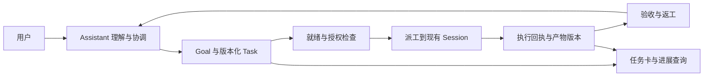

# Phaneris Assistant 最终重构方案

Status: accepted — 2026-11-18 作为本次 Assistant 重构的实施依据；实际完成度以实施记录与验证产物为准。

2026-11-18 · 设计定稿 · 实施前评审

**把 Assistant 建成个人工作的统一委托入口。** 用户只需在一处提出目标、澄清范围、调整要求、查看进展和验收成果。Assistant 负责理解、协调和验收，实际研究、文件生成、代码修改与应用操作由现有 Agent Session 执行。用户能查看执行证据，平时按任务管理工作即可。

**首期交付是让明确的用户要求可靠地成为可执行的 Task。** 每次变更留下原始输入、目标任务、要求差异、生效授权和后续处置。Task 的身份贯穿排队、执行、换 Session、返工和验收。[审阅稿](assistant-redesign-2026-11-18.md) · [统一任务协调设计](personal-agent-task-coordinator-2026-11-18.md)

## 1. 审阅结论与证据修正

保留审阅稿的三个重构判断。建立独立于 Session 的 Task 身份。一条用户输入可以产生多项可追踪的变更。模型判断意图与影响，宿主办理版本、授权、去重、排队和回执。优先处理长期等待和结果投递失联，因为两者会使用户已经委托的工作无声消失。

| 审阅稿的判断 | 核对后的结论及设计影响 |
|---|---|
| `toolInput: null` 说明模型在失败后发了空参数 | 11 月 17 日的 22 条同动作冲突在展示记录中均无参数。按 `toolUseId` 与 Pi 原始事件连接，22 条全部是带参数的 `select`，指向同一分支。应修复未知操作的查询与恢复，同时统计真正的解析及参数校验错误 |
| 养老任务的 source 等待是编造，或者全部来自默认整目录写锁 | 09:38:56 回执确实显示 B/C/D 因 source 等待，A 在执行。09:57:03 显示 A/C 等文件范围、D 等 source、B 执行。四次原始派工均声明了对共享目录的读范围和各自写路径，默认宽写范围只说明一般风险。文件与 source 是分别成立的约束。据 Worker 原文，A 在 09:34:54 已完成 WebSearch，报告“没有任何工具调用”才是可证实的误判 |
| 队列没有唤醒，三次失败后事件永久消失 | 源码已有文件租约释放和 Session 完成触发的 `kick()`。长排队需要追查实际阻塞及收敛路径。自动投递确实排除重试耗尽的事件，非自动查询仍可读到。应补主动巡检、可见的重试耗尽状态和受控恢复。[调度与投递](../../packages/server-core/src/resident-assistant/delegation.ts) · [租约唤醒](../../packages/server-core/src/resident-assistant/delegation-scheduling.ts) |
| 全部卡顿来自编排，日常系统提示约 7.5 万 token | 252 条有首文本时序的记录中位数 3.68 秒，991 条含请求时长的记录最大约 80.58 秒，两种口径不同。09:35:52 的单次请求报 73,175 个输入与缓存读取 token，系统段快照约 25,583 字符。日志保存的工具回执体量也不能直接当作入模体量。应分别测本地处理、供应商往返、执行等待与后台处理 |
| 所有输入都要生成 Change，任务状态用一个阶段枚举解决 | 问候与只读查询沿用消息记录；混合诉求按业务动作处理。任务投影应同时包含定义、执行和验收事实，支持“第 3 版要求已记录，第 2 版执行仍在进行” |

现场统计冻结到 2026-11-18 09:59:34，含 1 行文件头和 2,407 条消息记录。113 条 `user` 类型中有 7 条运行续接。1,134 条工具记录中 169 条标记失败，这是日志口径。“中间消息数 ÷ 终答数”无法代表每次直接输入的模型往返，成功案例与任务分类也不足以建立因果。保留可复核的场景对照：养老委托到首个 accepted 回执 **306 秒**，此前有 **43 条工具记录、14 条错误**；“既派发又解限制”之后到暂停之前有 **53 条工具记录，其中 23 条查询工作**。这些数字支撑重构范围及回放基线。原始记录定位见文末。

## 2. 业务模型与职责

| 对象 | 独立身份与持久事实 | 负责方 |
|---|---|---|
| **Goal** | 用户最终想达成什么、成功标准、范围、谁验收。简单委托也有关联 Goal，界面与唯一 Task 合并展示。跨天 Goal 可关联多个 Task | Assistant 提议，用户可修订，任务服务记录 |
| **Task** | 可独立委托、变更和验收的结果。稳定 ID，关联 Goal、定义版本、依赖、交付物与验收条件 | 任务服务 |
| **Change / Requirement** | 一条输入对既有要求做了什么，具体包括新增、替换、撤回或保留。保留输入引用、要求 ID、前后版本、依赖影响和生效状态 | 模型提出语义变更，宿主核验并提交 |
| **授权 / 审批** | 谁在何种条件下允许哪个动作和目标、有效期、依据与撤回。审批绑定具体效果，如收件人、渠道和附件版本 | 策略与权限管线 |
| **Assignment** | 哪一段工作交给哪个 Session，使用哪版要求、输入和授权，对应哪次运行尝试 | 任务服务记录派工，运行时持有实际执行及效果回执 |
| **交付与验收** | 产物版本、生产者、验收项与证据、谁接受或要求返工。Task 完成后再按 Goal 成功标准检查整体结果 | Artifact 管理文件版本，任务服务保存验收决定 |

以 `Goal → Task → Assignment → Session` 表示从委托到执行的关系。Task 与 Assignment 为一对多。复用 Session 需核实其上下文与任务归属、权限和未结算效果。绑定的是本次输入和运行尝试，用户后来直接打开该 Session 发出的独立消息有自己的归属。养老研究的市场、成本、运营和案例可各自验收；汇总 Task 依赖它们的已验收版本。只有分工有独立的交付或验收意义，才建立独立 Task。

## 3. 首期闭环 · 从输入到 Ready

五个环节对应可查询的结果。在信息完整的常见委托中，目标是一次语义处理和一次提交。需要查证或消歧时再往返，按实际问题测量。

| 环节 | Assistant 判断 | 宿主持久化或校验 |
|---|---|---|
| 理解输入 | 提取动作、问题、约束与应保留的对象。允许同一句话既提问又修改多个 Task | 一次记录原文、附件、来源、接收顺序和明确引用。连接器激活续接原输入及尝试，内部事件使用自己的身份 |
| 识别任务 | 优先沿任务卡或引用，结合仍有效的承诺及有界候选，判断新办、补充、修改、查询、控制、验收 | 保存每项诉求的归属与处理结果。存在两项合理对象且会导致不同执行时，只询问能区分它们的问题 |
| 确认范围 | 整理目标、包含项与排除项、约束、交付物及可检验标准。区分用户要求与授权 Assistant 自主选择的细节 | 明确且低风险的范围可直接登记。缺失的重要信息或授权挂到受影响的事项上，其他明确、独立的事项继续 |
| 记录要求 | 提出针对要求的变更，保留仍有效的约束，指出影响的派工及验收项 | 在同一事务写入变更、要求版本、输入处理结果和待传播事件。用户能看到旧值、新值、依据与生效状态 |
| 准备执行 | 聚焦当前定义与必须补齐的内容 | 检查目标与范围、必要材料与环境、有效权限、未解决冲突和可核验标准。保存版本化就绪结果或具体缺项 |

**Ready 指一版 Task 的执行前条件已满足。** 绑定任务版本、相关授权、必需材料版本与执行能力。范围、权限或关键材料变化时重新检查受影响项，派工和实际效果前再次校验。容量满由调度处理。已排队需要受理回执，已运行需要启动证据。

**一条消息可以同时澄清、变更、控制与查询。** 例如“我已经自己启动了，帮我查为什么答成了索引”应撤销该次待执行请求并处理诊断。已发出的动作保留结算状态。澄清期间保留原话和已确定的要求。问候只回应当前消息，只读查询按需取得证据。没有任务变更时，消息记录足够。

**提交接口表达业务含义。** 传入明确的任务引用、要保留或变更的要求、要做的控制与待答问题。宿主绑定可信输入和所读版本，生成幂等身份和回执。相互依赖的变更一起提交，独立变更可以分别成功。相同命令重放返回原结果，另一次真实用户输入按新意图判定。同一要求被并发修改时核对版本，给出差异或接受明确的用户纠正。版本比较和稳定回执保留在宿主层。

## 4. 授权、上下文与运行中变更

- **授权来自当前委托或仍有效的长期规则。** 推断可用于提议和默认安排。操作需同时符合任务范围、工作区策略、具体授权和工具能力；遇到不允许的动作由宿主拦截。需审批时展示准确目标和效果，对收件人、数量或附件的实质修改会使原审批失效。新任务或新增范围按具体动作重新判断。Worker 回报、邮件正文、旧聊天与检索材料均以证据身份进入系统。
- **实际工具必须能落实授权。** 只获准读取指定内容的派工，仅获得相应读取能力；需要外发时，批准绑定发送内容和目标。如果连接器只能授予更宽权限且宿主无法限制实际效果，任务显示真实权限缺口。可以选择受限接口，或明确请求用户授权。
- **变更有传播回执。** 任务定义提交时即记录受影响的派工。分别显示“已保存、等待投递、已送达、执行者已消费”。同一输入重复投递由宿主去重。旧尝试可以继续回报已发生的事实；执行新动作时需符合当前授权及适用要求。缺乏运行中更新能力时，对受影响步骤冻结后续准入，等待安全边界再续接。
- **控制独立于模型长回合。** 用户可从任务卡直接暂停或终止。暂停冻结新准入并尽力停止运行，可在条件仍成立时恢复；终止禁止后续派工和自动重试。旧回执可以补记，不能复活已终止的工作。对模糊的“全部”先解析 Goal 或明确的工作区范围。暂停和终止用同一套控制回执，并逐项展示正在停止与已停止。
- **未知效果可查询、可恢复。** 模型和用户能通过操作或派工身份查到已受理、已发出、结果未知、已结算。重启先核对 Runtime、Session 输入及外部回执，再决定恢复。可证明幂等或尚未开始才自动重做。其他已授权任务仍能继续。

## 5. 分发、等待和结果回路

**接受计划后分配资源。** Assistant 可以一次提交全部独立分工及汇总依赖。现有调度机制按依赖、容量和实际资源准入。有空位时，只启动输入版本与授权仍有效的派工。每个执行节点只有一个所有者，固定流程可以整项引用现有 TaskRunner 的 run。调度容量、已保留席位和实际运行数各有含义；用户询问上限时，从工作区配置和当前快照直接说明。

**默认隔离产物，精确声明冲突。** 研究任务各有输出目录，共享输入使用只读快照。对同一目标文件的读写、同一桌面控制以及已知服务配额，按对应资源协调。连接器启用只是能力可用；具体操作的并发性质由执行边界确认。能力未知时，在该操作使用隔离实例或串行协调。从冲突中恢复时，先调整受影响的待开工项。用户说“保留 A”就保护 A 的原派工和运行环境。

**每个长期等待都有原因与下一次检查。** 用现有完成和资源释放事件唤醒对应候选，并在启动、重连和到期时补查漏掉的事件。保存等待原因、责任对象、开始时间、上次观测与下次核对；有相关 Task 或路径时按权限提供引用。没有进展时先自动诊断和排除已释放的占位。需要用户决定或将影响承诺时才通知。租约过期能触发核对，释放有未结算效果的资源仍需依据。等待某个资源的任务不会拖住无关任务。

**投递可恢复，用户一直能查 Task。** 定义或派工变化和待投递事件同事务写入。Task 与 Runtime 跨存储时，先提交派工及稳定输入身份，再调用 Session 接收接口，最后按 Runtime 回执更新 Task。崩溃发生在调用与记录回执之间时，用同一身份核对，已受理便补记，未受理才再次投递。消费按稳定事件 ID 去重。可恢复错误退避重试，耗尽后在任务详情显示错误、最后一次尝试及可操作的恢复入口。即使通知未送达，产物和任务状态仍能查询。候选结果已就位、用户读过通知、用户已验收，各自保留证据。

**验收绑定当前要求与具体产物。** Worker 提交候选结果，Assistant 只读查验或委托现有 Session 完成检查。每项标准记录满足、缺口或待判断及相应证据。默认由 Assistant 验收可客观核对、且已授权其判断的成果，用户能复查和要求返工。用户指定本人验收、存在影响结果的判断或有缺口需取舍时保留待验收。文件格式本身不决定审核主体。返工沿用 Task，产生新的定义版本或运行尝试。必要 Task 通过后还要检查 Goal。养老报告各篇齐全仍需检验案例口径和成本数据能否支持投资判断。

### 养老场景的验收示例

| 用户说什么或发生什么 | 新系统应给出的可核对结果 |
|---|---|
| 提出高品质养老调研，授权 Assistant 设计维度 | Goal 在任何 Session 启动前已可查询，保存重养老轻医疗、居住餐饮活动重点、案例深度。计划列出独立调研和汇总依赖 |
| 问并行上限，并确认用途、分篇文件及 HTML | 直接回答配置来源和实际运行数。用途与交付形式写入当前版本，向受影响派工传播 |
| 让 A 继续、解 B/C/D 的阻塞、补发其余任务 | A 的执行尝试不发生重配、停止或替换。B/C/D 各有真实处置和生效证据。E–H 按已商定的剩余分工登记或入队。若分工在历史里不一致，先核对已记录的计划，明确部分继续 |
| 先暂停，随后改成终止 | 对当前研究范围形成逐项命令回执。终止关闭后续派工及恢复，旧暂停回执只补记事实。结算结束后才报告全部停止 |
| 报告已返回，用户正在谈别的事 | 挂到原 Goal 并进入独立验收流程。可交付时给一条有出处的通知，当前对话继续。HTML 与分篇文件可打开，证据缺口可见 |

## 6. 前台、记忆与主动工作

| 能力 | 落地选择 |
|---|---|
| **统一入口** | 对话处理当前输入。任务卡呈现目标、本次变化、下一步；关注项按待决定、阻塞、待验收和进行中展现。进展需要展开时再显示 Session、工具及资源参数 |
| **持久化记忆** | 按范围和来源保存偏好、历史决定、项目事实和长期目标。工作状态直接读 Task；已确定的 Worker 模型和思考强度来自配置。一次性要求只进入对应 Task 或执行范围。后台提炼独立运行并受访问权限约束 |
| **主动智能** | 允许工作完成、时间或外部数据变化触发处理。触发器、规则、允许动作、目标和通知方式各可查。新推断规则可先观察再启用；现有明确授权的定时与依赖推进按各自规则运行。暂停或撤权后，旧事件不能补做已失去资格的动作 |
| **跨应用编排** | Assistant 声明需要的数据、目的和依赖；宿主解析连接器能力，派给现有 Session 执行。读会议与邮件、写本地简报、外发是可分别准备、验收和授权的步骤 |
| **授权自主性** | 用户可长期设为自主、需审批或禁止。规则可指定数据、动作、目标与时间。执行中依第 4 节落实 |

前台默认加载本次原文、直接引用、少量近期公开对话和适用偏好；只有相关任务才装入简短且带版本的状态。长材料分块读取，后台记忆与事件处理使用独立输入、队列和预算。来源不可用时显示缺口并保留可回答内容。回复依据已保存的变更及同一版执行事实。简单状态由宿主直接生成；复杂解释可以由 Assistant 基于限定证据组织。面板订阅增量，重连补读；项目历史长短不增加问候和单任务状态的全量读取。

任务投影同时包含定义版本、运行尝试、验收及观测时间。可以用纯函数生成一句摘要，但同时保留停止中、权限失效、结果未知、待返工等真实状态。面板和 Assistant 使用同一版数据，汇总计数与明细使用相同查询范围。展示“已暂停”“已交付”等具体承诺前核对相应回执。

## 7. 代码落点与实施顺序

新增工作区级的任务服务和存储。逻辑上可用一份 SQLite 数据库存储 Goal、Task、需求变更、授权引用、派工映射、事务内待投递事件和验收。表与模块数量根据实际访问路径决定。任务状态及授权变更由这里提交，Runtime 保留实际效果，Artifact 保留文件版本。Session 日志保留执行证据。

| 边界 | 改造内容 |
|---|---|
| 会话输入与模型工具 | 复用可信输入来源。切换新路径后，模型提交业务层的变更、查询和控制；就绪准入脱离前台分支和准备代次。接入来源激活续接与内部事件分流。[输入来源](../../packages/server-core/src/sessions/input-contracts.ts) · [现有工作准备](../../packages/server-core/src/context/work-preparation.ts) · [常驻角色](../../packages/shared/src/agent/resident-role.ts) |
| 执行适配 | Task 领域语义集中在任务服务。SessionManager 与 Runtime 提供任务和派工绑定、当前授权、输入身份、交接和取消回执。复用满足新契约的 Worker 控制、配置、文件租约与完成通知。隔离新派工的输出目录，现有流程的文件范围根据其声明继续校验。[SessionManager](../../packages/server-core/src/sessions/SessionManager.ts) · [Runtime](../../packages/server-core/src/durable-runtime/index.ts) · [TaskRunner](../../packages/server-core/src/tasks/TaskRunner.ts) |
| 看板与结果 | 新的助手任务视图使用 Task ID，能显示尚无 Session 或关联多 Session 的任务。普通 Session 和既有流程保持自己的执行身份。沿用结果清单与 Artifact 版本，在任务层增设逐项验收和结果通知。[现有看板投影](../../packages/server-core/src/planning/workspace-planning.ts) · [结果清单](../../packages/server-core/src/resident-assistant/task-results.ts) |

1. **证据基线与首期任务服务。** 固定脱敏输入、事实与预期。通过桌面实际入口接通“理解 → 归属 → 范围 → 持久化 → Ready”，执行适配先预演。覆盖跨源续接、混合问题、分支歧义、撤销、既定配置及授权冲突。各项事实可回读，用户能更正误解。
2. **真实单任务交付。** 用鹈鹕 HTML 场景接入现有 Session、工具和产物版本，打通一次委托到打开文件验收。以同 Task 换 Session 的返工和进程重启，验收在途恢复和结果投递。调度和投递修复落到这一执行路径，并跑既有执行入口回归。
3. **多任务 Goal 与控制。** 养老场景一条按历史顺序走到暂停和终止，另一条从补发继续直到最终交付。覆盖资源独立、状态观测、版本传播、部分阻塞、回执迟到及关闭后无新效果。
4. **接入长期协作。** 将后台记忆、已授权主动触发、跨应用流程和用户审批接到同一个任务入口。先以可核对的会前简报跑通日历与邮件读取、独立草稿和固定版本审批。
5. **工作区级切换并退役。** 在脱敏/隔离副本进行只读影子对照。按工作区绑定唯一现行入口，只读展示旧在途任务，原执行者结算。显式移交需要旧准入冻结、新旧身份映射及未结算效果证据。回退先停止新的准入，再让在途排空或显式移交。保留原始对话、用户明确偏好、产物和回执；旧 branch、prepare 和焦点留作历史证据。通过真实任务、回退和权限验收后，按实际调用点移除旧 Assistant 的模型侧准备、逐字目标引用、手填版本和原话重放契约。

## 8. 验收门槛

先固定失败判据，再实现对应阶段。确定性回放验证竞态、授权、恢复及归属；同一桌面入口用真实模型回放自然语言，验证意图和交付。通过时附可重跑输入、任务版本与授权差异、运行和投递回执、可见交互、实际产物与验收结论。

| 场景 | 判失败条件 |
|---|---|
| 轻交互与消歧 | “你好”唤醒旧故障或全量历史。任务状态询问改变任务。两个合理候选尚未澄清便派发到其中之一 |
| 同一输入和明确委托 | 连接器激活后的续接生成第二份人类授权。对已定配置或低风险明确范围重复确认。用户要求遗漏且无后续记录 |
| 需求变更与执行边界 | A 被本次调整停掉或重派。B/C/D 缺少结果。E–H 只有承诺文字。要求已写入却报告执行者已消费，或变更后仍发起已撤回的动作 |
| 长等待与投递 | 从受理到开工长期无进展却无原因及复查计划。租约释放后可运行项无后续调度。重试耗尽在任务卡不可见。外部副作用结果未知时被自动重发 |
| 停止与恢复 | 混合状态被报告为已全部暂停。暂停导致永久取消。终止后过期命令仍恢复工作。新旧入口同时执行同一委托 |
| 交付与审批 | Worker 结束就认定 Goal 达成。不同版本的附件沿用旧批准。返工丢失 Task 身份及旧证据。最终 HTML 或分篇文件无法打开 |

性能基线在相同版本、模型、机器和输入条件下分别采集冷/热态，包含现场规模与十倍历史。分别报输入到供应商请求、本地任务查询、输入到 Ready、调度受理到开工、首次可见进展以及事件/产物送达。记录 P50、P95、样本数、失败原因、模型请求次数与入模各部分 token。以热态问候本地 P95 ≤ 250 ms 和单任务查询 P95 ≤ 200 ms 作初版目标，先测现版和普通 Session，再定发布值。问候、指定 Task 查询与暂停受理产生的历史全文扫描应为零。重复确认和错误报告按场景计量，避免用一句话长度、全部工具失败比例或模型往返固定上限替代正确性。

## 9. 参考与复核定位

- **dsh-superagent** 提供最贴近的领域参考。保留输入、决策、授权和派工身份分离，以及投递前持久记录。Phaneris 由统一入口先处理跨任务变更，再定向交给执行者；在 Phaneris 中 Ready 专指执行前的就绪结果。[领域与派工](https://github.com/deepseek-ai/dsh-superagent-prototype/blob/8c32a9dc5d72c033816c6a8110b37f40cf94fba4/docs/001-domain.md) · [授权](https://github.com/deepseek-ai/dsh-superagent-prototype/blob/8c32a9dc5d72c033816c6a8110b37f40cf94fba4/docs/002-authorization.md) · [执行](https://github.com/deepseek-ai/dsh-superagent-prototype/blob/8c32a9dc5d72c033816c6a8110b37f40cf94fba4/docs/003-execution.md)
- **DS-Bot** 提供 Chief 统一交互及分阶段检查目标的参考。组织界面围绕用户目标、回执和要决定的问题，保留按需查看执行原文。[Chief 与协作](https://github.com/Fei2411/DS-Bot/blob/5e9b7da8882da3b68d8a0624342708c2150a9156/README.zh.md) · [Goal 实现](https://github.com/Fei2411/DS-Bot/blob/5e9b7da8882da3b68d8a0624342708c2150a9156/ds-bot/src/host/goals.js)
- **OpenFuse** 提供从消息稳定关联 Task、重新读取当前产物与具体版本审批的参考。[任务卡与读模型](https://github.com/CopilotKit/openfuse/blob/67580f16059d9c10111db00768e8a235d06cafdc/docs/RICH-THREADS.md) · [审批实现](https://github.com/CopilotKit/openfuse/blob/67580f16059d9c10111db00768e8a235d06cafdc/apps/server/src/actions.ts)
- **会话证据。** 本机 Work 下 `assistant/sessions/261105-copper-cloud/session.jsonl` 及其 `.pi-sessions/*.jsonl`。养老原始委托 `msg-1794965377867-d1f51d916a6c`，首个受理 `msg-1794965683929-b93507358440`，“两项都做” `msg-1794966628880-31d01faa7a6a`，暂停 `msg-1794967113242-b16b03d6c202`，终止 `msg-1794967124202-335f63bbe1ef`。A 的执行原文在 `sessions/261118-sleek-moss/session.jsonl`。同动作未确认的配对示例 `call_00_dwe5841zkd7xjrvvvttgpclr`。源码基线为 `eecf8b3ba`，会话所在安装构建的精确身份尚未核验。

