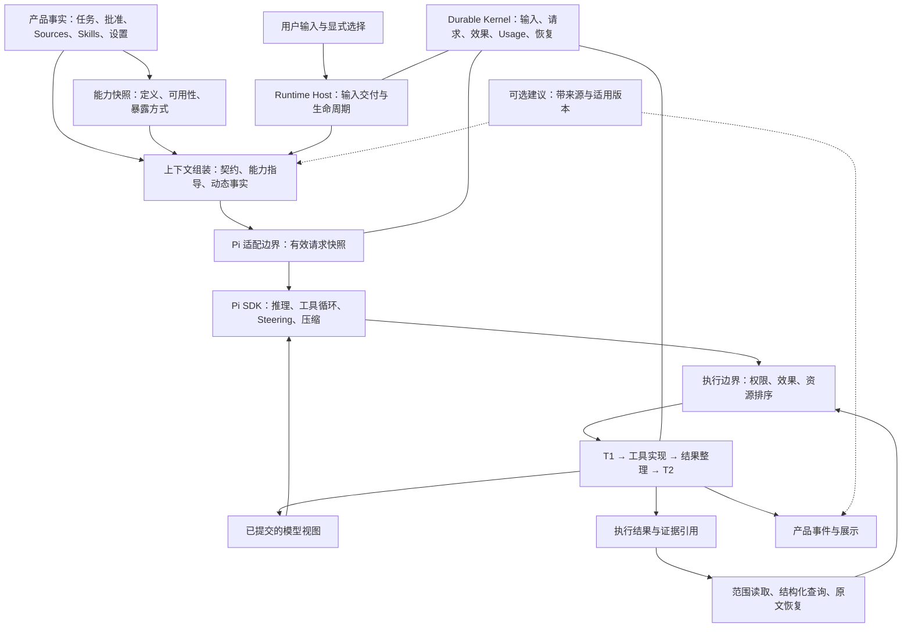

# Phaneris Harness 设计方案

Status: accepted — implementation authorized on 2026-10-23; current implementation and verification scope are recorded separately.

日期：2026-10-23。设计基线：`main@df397f88025231d8494f56d6555a271bab0b71e4`，Pi SDK `1.3.0`。本方案基于[能力影响复审](harness-capability-review-2026-10-23.md)、[六个 harness 源码比较](six-harness-comparison-2026-10-23.md)及当前实现。初次交付仅设计，随后用户授权新建分支完整实施；当前落点、验收和限制见[实施记录](../process/harness-capability-implementation-2026-10-23.md)。目标设计不代表已经上线或证明质量收益。

**1. 设计决策：保留一个 Pi 主循环，让 Phaneris 提供真实的能力、证据、任务连续性和执行保障。**

主模型负责理解目标、选择方法、探索资料、判断证据、调整策略和形成交付物。Phaneris 负责把用户意图和运行事实准确交付给它，并让它的行动可执行、可核验、可恢复。模型通常比只看到短片段的辅助分类器更了解当前任务；宿主通常比模型更了解权限、平台、文件版本和执行状态。设计按这种信息优势划分职责。

目标是减少 harness 引入的错误事实、信息损失、能力不可达和无依据介入，同时提高真实任务完成质量。Prompt 长度、工具数量、调用轮数和 token 消耗是诊断指标，不是设计目标。必要的领域指导可以很长，强工具可以很多，执行约束也可以严格；每一项都应有清楚的适用范围。

| 设计要求 | 可验收的含义 |
| --- | --- |
| 主模型拥有解题选择权 | 没有隐藏分类器按每轮意图封锁能力、改写目标或替换核心证据；用户明确选用的工作流按其范围生效 |
| 能力真实且可发现 | 目录、工具 schema、对应指导、执行后端使用同一份版本化事实；不可用原因和恢复入口可见 |
| 证据可追溯 | 模型知道收到的是全文、范围、摘录、摘要还是未知完整性的结果；能继续取得可用原文 |
| 用户纠正及时生效 | 显式 steering 不等待关系分类；输入有身份、投递状态及消费边界，不因压缩或交接丢失 |
| 行动稳定 | 保留批准范围、隔离、T1/T2、效果未知恢复、结果配对和资源冲突排序 |
| 能力收益可验证 | 通过同模型、同任务的重复对照检查事实准确性、交付质量和用户介入；不以链路测试代替质量结论 |

本轮确立接口与行为取舍。自动摘要导致多少质量损失、哪些工具应常驻、某种模型 overlay 是否有效，仍是待验证假设。确定性契约问题与统计性的模型质量问题，采用不同验收标准。

**2. 对六个项目的吸收集中在接口和职责，不累加它们的默认行为。**

| 来源 | 吸收的设计 | 在 Phaneris 中的落点 |
| --- | --- | --- |
| Pi | 单一执行循环、公开扩展点、工具相关指导、steering/follow-up | 保留 SDK 所有权，整理 host 适配契约 |
| OMP | 可操作的工具反馈、统一能力入口、按效果处理中途纠正 | 工具错误与版本反馈、能力家族、取消语义 |
| DSH | 作用域明确的 prompt、执行值与呈现分离、恢复读取不重复裁剪 | 能力贡献指导、结果契约、原文恢复通道 |
| OpenCode | 模型适配与角色分开、请求时工具快照、输出元数据 | 有效请求快照、条件指导、明确结果范围 |
| Claude 可见资料 | 主模型推进任务，动态提供能力和上下文 | 模型自主探索、渐进发现、上下文整理 |
| Codex | 模型能力、工具暴露、上下文与执行监管分层 | 模型兼容适配、暴露策略、稳定执行边界 |

来源的固定 commit、源码链接与局限见[六项目比较](six-harness-comparison-2026-10-23.md)。其中 Claude 恢复仓库只作为结构参照。本方案不依据这些项目的宣传数字设定 Phaneris 的收益目标。

**3. 总体结构由现有组件收敛而成，不增加第二个 agent loop。**



图中的能力快照、上下文组装、结果整理是逻辑职责，可作为现有包内模块和纯函数实现。没有建设通用插件总线、新任务数据库或独立策略服务的必要。

| 所有者 | 唯一职责 | 对外提供的事实或接口 |
| --- | --- | --- |
| Pi SDK | 模型与工具循环、active tools、provider 适配、原生压缩与消息调度 | 公开 session/extension API、模型请求与事件 |
| Runtime Kernel | operation、T1/T2、usage、canonical context、恢复裁决 | 已提交事实及只读投影 |
| Runtime Host | 输入交付、运行槽位、取消、settlement、运行资源生命周期 | 当前 run 状态、输入 admission、backend 驱动 |
| Session/产品域 | 用户设置、任务字段、批准、source/skill/plugin 选择、交付物状态 | 有限且版本化的产品 DTO |
| Pi/host 适配层 | 将产品事实转为 prompt、工具、结果与 SDK 调用 | 请求快照、能力视图、结果契约 |
| 工具所有者 | schema、平台依赖、效果分类、结果范围、错误恢复、领域指导 | canonical definition 及执行实现 |

沿用[Runtime 边界](durable-runtime-boundary.md)和[Durable 协议](durable-agent-runtime.md)。产品任务进度、模型总结和辅助判断，都不能成为第二份执行账本。

**4. 用少量明确的数据契约消除错位，避免新增多套“真相”。**

建议扩充现有类型与协议，形成以下五种逻辑对象。名称是设计用语，最终命名与字段放置应服从现有包边界。

| 契约 | 主要字段/语义 | 权威来源及生命周期 |
| --- | --- | --- |
| 能力描述 `CapabilityDescriptor` | ID、所属家族、定义版本、schema、指导、平台依赖、效果语义 | 各工具/能力所有者的 canonical definition；外部 source 内容保留其来源 |
| 有效能力快照 `CapabilitySnapshot` | 定义版本、当前可用性、暴露方式、权限模式版本、active-set revision | 宿主事实与 SDK active set 的派生视图；每次模型请求冻结 |
| 请求清单 `RequestManifest` | 模型有效配置、prompt sections、工具快照、输入 ID、上下文版本、视图 ID | 实际进入 Pi/provider 适配边界的请求；诊断默认保存哈希与摘要元数据 |
| 工具结果契约 `ResultEnvelope` | 执行状态、原始返回、证据引用、覆盖范围、模型视图、变换记录 | 工具适配器产生，随 T2 提交；保留既有 codemode 输出契约 |
| 内容交付记录 `DeliveryReceipt` | 内容 ID/版本、精确范围、变换类型、关联结果和请求、上下文有效性 | 从已提交结果与实际请求投影派生；不由模型自报“读完”生成 |

能力描述不承载用户批准；快照不替代执行前复核；请求清单不保存另一套可编辑上下文；交付记录只证明内容进入了可观察的请求视图，不能证明模型理解或记住了它。

宿主与子进程共享的数据类型保持纯 DTO，不把 Pi SDK 对象、SessionManager 实例或 Runtime Store 向其他领域传播。现有 JSONL 协议承担传输，无需新建 RPC 体系。

输入附件同样遵守来源与视图区分：用户原文和明确纠正完整保留；图片在模型支持且容量允许时作为真正图像块交付；PDF/文档的提取文本、OCR 和页面渲染各自标记来源与范围。解析成功不等于所有页面、表格或视觉信息已提供。大附件先提供可靠的文件身份、内容概况和读取入口，模型可以继续选择页面或查询；不能把自动生成的摘要冒充用户上传原件。用户明确要求核对排版或视觉内容时，提供对应渲染/查看能力。

**5. Prompt 按内容责任组装，常驻部分只保留跨任务成立的契约。**

| 内容 | 进入条件 | 位置与失效方式 |
| --- | --- | --- |
| 产品行为契约 | 所有主会话 | 稳定 prefix；版本化 |
| 用户偏好与项目指令 | 当前有效作用域 | 保留原始来源与优先关系；变更时显式替换 |
| 模型兼容指导 | 经验证的模型能力或协议要求 | 独立小 section；与实际模型配置绑定 |
| 基础工具使用指导 | 对应工具实际暴露且可用 | 与工具定义共同生成，按 ID 去重 |
| 能力家族说明 | 模型展开该家族，或用户显式选择该能力 | 家族激活时加入，后续稳定保留；失效时明确撤销 |
| Skill/plugin 工作流 | 沿用用户显式选用规则 | 精确路径与版本，按所选内容加载 |
| 运行事实 | 工作目录、平台、mode、source 状态等发生变化 | 有版本的动态部分，不重复追加互相矛盾的快照 |
| 当前任务与纠正 | 用户输入及产品任务更新 | 动态上下文，保持用户原文和引用 |
| 可选建议 | 用户开启且适用版本仍有效 | 低权重、可忽略、明确来源；不混入用户要求 |

常驻行为契约可收敛为以下语义，具体语言仍须通过任务评测校准：

```text
持续完成用户的当前目标，保留其后续纠正、约束与已授权范围。
根据任务选择探索、执行和验证的方法；需要澄清时说明缺失的关键事实。
以当前能力和真实工具反馈行动；未知事实应明确表达不确定。
区分原始证据、派生视图和自己的推断；关键内容可继续读取和核对。
遵守当前权限与已接受的计划范围；等待必要输入时准确说明原因。
按任务需要检查交付物；完成、失败、等待和未验证项应如实报告。
```

这个样例不是要求把所有 prompt 压成六句话。它明确产品契约的边界；文档渲染、Pages、认证、自动化、会话管理等细节应由相应能力提供。强指导仅在相应场景激活，例如用户选择文档生成技能后，视觉验收要求可以完整进入上下文。

`PromptSection` 可增加 `owner`、`revision`、适用能力和作用域；保留现有 `id/source/content` 与稳定排序。更新语义区分“未变化”“替换为新内容”“移除”，避免空值被解释成沿用旧规则。编译器只处理确定性条件，不调用模型判断该删哪段指令。

Pi 集成先保留公开的完整 prompt override 路径，收敛为单一编译来源：包括当前 loader 追加的 orchestration 指导，都由同一清单审计。不要在 host prompt 与 SDK 默认 coding prompt 中重复声明身份和工具规则。后续若采用 SDK section 增量机制，应作为兼容性变更单独验证，禁止修改 SDK 私有字段。

循环内的工具展开还需要请求级同步，不能假设 `before_agent_start` 会在每次工具返回后重跑。目标方案使用 Pi 1.3.0 公开的 `context_with_system` 边界，为下一次请求同步已激活能力的指导与版本；只处理 host 所属内容，保留 SDK 已恢复的工具声明及消息配对。这个 hook 不调用模型、不过滤证据、不选择任务策略。请求诊断与预算必须检查同步后的实际内容。若适配验证尚未通过，先由 `tool_search` 的已提交结果交付必要指导，不能发布“工具已可用但其指导要等下一次用户消息”的中间状态。

稳定 sections 保持顺序；能力指导更新按固定 ID 与激活记录处理，避免每次重排破坏稳定前缀。来源、网页或插件内的文本不因被装入上下文而获得产品授权；显式选用的工作流保留来源，权限与批准仍由宿主维护。来源标记有助于辨认，但不宣称因此消除了提示注入风险。

对于现有工作流文本，迁移前逐条登记归属：进入常驻契约、随能力加载、由运行时执行或保留为可读手册。授权语义、用户专有产品操作和必要恢复说明不能在“缩短 prompt”时丢失。

**6. 能力设计采用统一目录、渐进展开、稳定活跃集合。**

能力的四个维度必须独立：

| 维度 | 示例 | 不可混同的含义 |
| --- | --- | --- |
| 定义 | 一个文件工具、内部产品工具、source resource 或 prompt | 有定义不代表当前能用 |
| 可用性 | ready、needs-auth、needs-setup、unsupported、temporarily-unavailable | 技术可执行性，不是用户授权 |
| 暴露方式 | direct、deferred、codemode、hidden，以及 SDK 的 model-only 等传输语义 | 模型怎样发现与调用，不是权限等级 |
| 授权状态 | 当前 mode、工具效果、批准范围、参数版本 | 调用能否执行；由宿主判定 |

能力目录由现有内部工具定义、native tools、连接状态与 source manifests 派生。它是组合视图，不另建手工维护的工具表。描述、schema、namespace、指导与可用性必须能追溯到同一 owner/revision。

建议初始暴露策略如下；具体工具名称保持现有 API，最终边界用消融验证：

| 家族 | 建议暴露 | 理由与展开语义 |
| --- | --- | --- |
| 文件读取、检索、编辑、当前平台 shell | direct，按 mode 执行 | 高频基础行动，工具自身提供范围、冲突和恢复反馈 |
| 能力发现、必要提问、进度 | direct | 用户协作与探索能力的通用入口 |
| 计划提交 | 适用模式下直接可达 | 用户要求计划或批准时不增加发现障碍；模式变化不会绕过批准 |
| Web/浏览器 | 按现有启用状态暴露基础入口，复杂能力可展开 | 以真实后端为准，不声明未启用的能力 |
| 交付物、Pages、会话/任务管理、配置/认证 | deferred 家族 | 目录说明用途；展开相关操作与对应指导，避免常驻完整产品手册 |
| 外部 source 工具 | 保持 deferred，支持 namespace/精确名称加载 | 展开不等于授权；认证与连接状态单独报告 |
| codemode | 支持时保留，模型按任务选择 | 批量、筛选与结构化计算的能力；每个嵌套调用仍走普通执行边界 |
| Skills | 沿用显式选择，默认不公开目录 | 不纳入通用能力搜索，不自动启用 |

工具 schema 是否保留在 Plan 等模式中，应以现有协议兼容和缓存稳定为依据；运行时门禁仍然执行。能力目录必须显示“可发现但当前模式不允许执行”的状态，不能让 schema 的存在暗示已获许可。

扩展现有 `tool_search` 即可承载内部家族发现，无需另外发明一套模型必须先学会的资源协议。返回值至少包含：精确名称、所属家族、可用性、`loaded_now/already_available/available_to_load`、匹配总量、是否还有下一页和下一步。空查询提供有界目录；中文未匹配时提供 namespace 与目录入口，不能把“检索没命中”说成“系统没有能力”。先采用双语关键词、别名与确定性匹配；语义检索只作为后续可比较选项。

家族是发现与指导的单位，不强制一次加载家族所有工具。小家族可整体展开；大型 source 仍按具体命中加载。精确名称与 namespace 能绕过相关性排名，不被 top-k 永久隐藏。目录只暴露用户当前可见的能力，不列出未授权工作区或账户信息。

会话中已展开的能力原则上保持稳定。断连、schema 更新、显式禁用、模型切换或上下文压力才触发明确更新。上下文整理时可折叠未使用的定义，但保留发现入口与引用；不得在有在途调用时静默卸载执行实现。SDK active set 是执行侧唯一集合；宿主只保留版本化投影与恢复所需选择记录。

每次模型请求冻结能力和指导的同一快照。请求发出后 capability 发生变化，旧调用按原 schema 身份解析，再用当前可用性与授权执行复核：兼容则执行，不兼容则返回已变更原因和可重取定义。禁止用新 schema 静默解释旧参数。权限收紧立即生效，不等待下一轮 prompt 刷新。

Windows 上无隔离后端的能力应在目录中标注 unsupported，并给出已验证可用的替代入口；不得通过降低隔离要求使其“可用”。source 的工具、资源、prompts 分别列明，零工具不等于零能力。

**7. 工具结果保留四种含义：执行事实、证据、模型视图、UI 展示。**

| 对象 | 回答的问题 | 典型内容 |
| --- | --- | --- |
| 执行事实 | 实际做了什么，结果已知吗 | operation、最终参数、成功/失败/未知效果、外部回执 |
| 证据与程序值 | 工具实际返回了什么，原始材料在哪里 | content blocks、structuredContent、源文件版本、快照引用 |
| 模型视图 | 本次推理实际收到什么 | 全文、范围、头尾预览、结构化查询结果、显式摘要 |
| UI 展示 | 用户看到什么状态和内容 | 卡片、进度、折叠预览、可打开的文件 |

完整“工具返回”不必然是完整“源材料”。Pi Read 返回某个文件的前段时，保存这一返回只能称为“该次读取结果”，不能称为“原文件全文”。API 返回完整一页，也不能声明取得了全量数据集。

建议的结果字段按以下语义扩充现有协议；该表不是要求为所有小结果复制一份巨大 JSON：

| 字段 | 契约 |
| --- | --- |
| `execution` | 关联现有 operation 与实际执行状态；呈现失败不改写已确认的业务结果 |
| `canonicalValue` | 原始程序值或稳定引用；保持现有 MCP/codemode `structuredContent` schema |
| `source` | 来源标识、版本/快照、材料类型、可用时的总长度或分页状态 |
| `coverage` | 相对于哪个对象的哪些范围；full/partial/unknown；未获证据不填 full |
| `modelView` | 有序内容块、视图 ID、exact/range/preview/excerpt/summary、当前显示范围 |
| `recovery` | 实际可调用的读取工具、参数和适用版本；不可恢复时显式说明 |
| `transforms` | SDK 原生分页、host 确定性裁剪、显式摘要等变换链，含来源引用 |

元数据默认属于 host/details 通道。模型只接收理解本结果所需的简短范围和恢复说明，不必为每次调用阅读完整审计信封。程序值不被一份自然语言摘要替换，UI 字段也不参与证据筛选。

默认处理顺序：

1. 识别工具已有的分页、截断、范围和非文本块。已由工具提供有界结果时，优先保留其原有恢复语义。
2. 对未受控大结果保留实际返回值或可恢复快照，再生成确定性视图；范围、未显示部分和恢复入口明确。
3. Read、范围读取、原文恢复及显式指令加载，不进入通用语义摘要。需要更小结果时缩小读取范围，保持原文精确。
4. 图片、文件、音频等块按类型和模型能力处理。文本预算不能顺手删除非文本块；不支持的类型保留可用文件引用并说明当前无法直接消费。
5. 摘要、相关性摘录和专题综合作为显式派生结果，记录输入引用及覆盖限制。主模型可以请求此类辅助工作，用户也可以明确选择；它不自动取代关键原文。
6. 一次真实外部结果只执行一轮通用视图预算。必要的后续缩小仍是同一来源的范围变换，有记录、可恢复，不再把摘要继续当原文摘要。

预算需要针对整批结果分配，不能让并行完成顺序决定哪些证据被保留。分配依据包括请求剩余预算、结果类型和工具声明的可分页性；每个结果至少保留状态、范围与恢复入口。不得使用短 `_intent` 作为丢弃反证的依据。

现有 `_displayName/_intent` 建议从未来模型 schema 的默认附加字段中退出，由事件与参数生成 UI 标签；兼容读取旧调用，但不再拿展示字段做语义过滤。若某工具真正需要“分析目的”参数，应在该工具 schema 中明确声明用途，由主模型显式传入。

**8. “可恢复”必须覆盖真实失败条件，而不只是返回一个路径。**

恢复入口优先复用现有文件 Read、source resource read 与结构化查询工具。文本给出行/字节等明确单位与下一范围；结构化数据给出有效分页游标或查询方式；图片保留可读文件/MIME 与块身份。恢复调用本身不再被同一摘要器吞掉。

对易变文件，精确核对和跨页读取使用同一不可变快照，或在每次读取时核验版本。版本改变就不能将旧页与新页拼成一次“完整阅读”。API 只有在游标/快照契约支持时才能声明一致分页；不支持就标记这一限制，不能靠 hash 虚构远端全量快照。

版本可靠性也要明确：内容 hash、不可变快照或后端保证的版本可支撑同版本覆盖；仅凭路径、mtime 或大小不足以证明内容相同。范围单位和全文结束条件由工具给出，缺少可靠总量/结束信号时保持 unknown，不能由模型生成的页数补齐。

证据引用绑定会话/工作区与实际授权，不能因为知道路径或 result ID 就获得跨边界读取权。大型材料优先复用会话所属的长期文件/附件存储，登记校验、租约或保留状态。[会话消息读取快照](session-snapshot-reads.md)属于短期传输机制，不能直接充当跨重启的证据存储；可借用其有界读取和完整性校验思路。尚被恢复上下文、批准范围或未决操作引用的材料不应被普通清理当作无主缓存。文件先持久化再提交引用；进程崩溃留下的孤立文件可延后清理，账本不能引用尚未落稳的文件。

| 失败条件 | 规定行为 |
| --- | --- |
| 落盘失败但原结果仍能安全放入请求 | 保留原结果，标明未建立持久恢复副本 |
| 落盘失败且原结果超过请求容量 | 保留已知执行状态，明确返回交付不完整；停止宣称“全文已保存”，提供仍真实可用的源读取方式或明确缺口 |
| 恢复文件被删除、游标过期、源版本改变 | 返回明确原因和可行的重新获取方式；不能把新材料冒充旧快照 |
| 执行成功、视图生成失败 | 记录执行成功与视图故障；后续修复视图不重新执行写入或外部动作 |
| T1 后进程中断且没有 T2 | 沿用现有未知效果恢复；禁止因“没看到工具结果”自动重放 |
| 图片/附件不能被当前模型消费 | 保留引用并说明能力限制；OCR、转码和文字描述作为有来源的派生材料 |

必须承认物理失败的边界：如果外部操作已完成、原结果又未持久化且源不可重取，系统不能保证原结果可恢复。正确行为是保留执行事实与材料缺失状态，而不是伪造成功交付或盲目重跑。

**9. 阅读确认依据内容交付记录，不依据调用名称或成功字符串。**

定义“完整交付”为：同一内容版本的要求范围已经以原文形式进入可观察的模型请求视图。它只解决系统是否提供了材料，不评价模型是否理解。

receipt 关联现有模型请求与 outcome：区分准备好的视图、已观察的请求尝试和产生后续响应的请求。仅触发 payload 回调不证明网络请求完成；请求失败也不能把待交付内容变成当前已读。系统不声称可观察提供商内部未公开的处理。

| 情况 | 能否确认完整交付 |
| --- | --- |
| 无 offset/limit 的 Read，但 SDK 截断 | 否，使用实际范围 |
| 多次范围读取，范围连续覆盖同一版本全文 | 可以；不强制单次调用 |
| 文件全文变为摘要或相关性摘录 | 否，派生视图另记 |
| Shell 命令里出现文件路径，或命令 exit code 为零 | 不能据此确认；需要受支持的读取适配器给出范围事实 |
| codemode 程序取得全部数据，但只向模型打印一部分 | 程序消费与模型交付分别记录 |
| T2 已提交，SDK 尚未将结果装入后续请求 | 只记已结算/可交付，不记模型已获得 |
| 文件已修改，或相关原文在压缩后不再可见 | 历史 receipt 保留；当前内容可用性重新判断 |

首先覆盖原生 Read、source resource 和受管快照这类能够可靠报告范围的入口。任意 shell 输出不通过复杂启发式“证明读完”；返回一条明确的原文读取建议即可。

显式选中的 skill 保留选择事实、确切路径和版本。其必要指令尚未交付时，只约束依赖该工作流的动作；读取、检索、修复加载和与该 skill 无关的工作仍可推进。加载失败应报告缺口和下一步，不能靠重试次数把“未加载”改成“已加载”。复杂的动作依赖无法可靠划分时，给主模型明确未加载状态并保留产品既有必要边界，避免扩大成全会话任意工具门禁。

压缩后不再仅依靠 `hasRead(path)`。继续使用该 skill 时，检查其当前指令是否仍在上下文；必要时重新取得原文。保持“用户仍选用”与“模型当前持有内容”两个不同事实。Skills 默认隐藏、不自动发现的设计保持不变。

**10. 上下文管理处理容量和连续性，不暗中决定任务中哪些证据更重要。**

保留当前互斥的 `compact / handoff / manual` 用户选择。Pi 负责原生 compact；宿主负责 handoff 的产品交接与事实恢复；manual 在容量不足时清楚暂停。不能为了避免实现预算管理，偷偷把一种选择改成另一种。

请求预算采用同一计数口径：

```text
可追加预算 = 有效上下文窗口
           − 已组装请求的占用
           − 当前策略所需预留

当前策略所需预留 = 输出、压缩或交接、估计误差等必要空间的统一计算
```

已有 SDK reserve、输出限制及 handoff 预算应由一个适配入口协调，不能各自重复扣减。工具定义、图片、历史、动态 sections 和本批结果都必须计入；token 估算应标注来源与误差，不把字符数当精确 token。对可用窗口不确定的自定义 endpoint，使用明确的配置事实与保守估计，并在诊断中显示依据，不凭模型名称猜测更大窗口。

实际请求边界是最后容量检查点。提交前的结果整理先消除重复内容，并生成有恢复入口的范围；已通过 T2 提交的工具视图不在请求前再次改写。容量不足时依用户所选策略处理历史：原生压缩产生新的上下文版本，handoff/manual 按现有语义交接或暂停。receipt 保留其关联的历史范围，当前内容可见性按新上下文重新计算。

整批预算在派发时预留，按照已有 batch identity/ordinal、调用数量及输出类型确定各项额度；不能等待所有操作执行后再决定是否有空间记录结果。未用额度的再分配若要引入，应另有确定性规则。codemode 的嵌套程序值不计作全部模型可见输出，其日志与最终打印仍受外层可见额度约束。连每项最小状态与恢复入口都无法容纳时，在 T1 前限制超量派发，并按 SDK 配对规则返回明确的未执行结果；不先完成副作用再发现无法报告。

不设“每个结果一律 12k”这样的全局语义摘要触发器；可以保留 transport 的硬字节上限和有界分页默认值。读取超大材料时，模型依次选择范围、查询或派生分析。原文无法一次放入上下文是容量事实，不等于必须交给另一个模型决定其相关性。

容量整理优先保护这些信息：

| 信息 | 保留方式 |
| --- | --- |
| 当前目标、最近纠正、禁止事项、用户已作决定 | 优先保留原文与消息 ID；较早记录保留可恢复引用 |
| 批准与等待 | 从现有批准版本、UI 交接、pending input 等事实恢复，不从摘要生成新授权 |
| 已执行效果与未知操作 | 从 durable ledger 恢复；摘要不覆盖账本 |
| 当前使用的文件/资料、结果范围、交付物 | 保留版本化引用与必要近期原文 |
| 正在使用的能力、skills、source 状态 | 重新计算有效性，避免旧连接或旧规则继续冒充当前事实 |
| 探索过程、早期重复输出、暂时想法 | 可摘要；保留追溯入口，区分推断与已核验事实 |

“保护”不意味着把历史用户输入无限固定在窗口里。必须超预算时，优先保留最新相关原文和明确事实；更早约束通过带消息引用的连续性摘要保存。无法判断一项关键冲突时交给主模型核实；manual 模式不容纳时明确暂停，不能静默删除批准或纠正。

复用当前任务 DTO、批准快照、输入日志与 canonical context，生成一份可重建的连续性上下文，包含目标引用、最近纠正、待答事项、实际进展和资料索引。模型可以维护工作笔记，但笔记属于推导内容，不取得修改用户目标或账本的权限。不要求每个普通对话先建计划、任务卡或 DAG。

handoff 继续保留原会话与摘要截止位置。截止之后到达的消息原文转交；已提交效果、未决操作、批准范围与选中能力由宿主恢复，不能只靠交接文档。继任会话获得需要继续完成的任务及真实状态；交接成功不是任务完成。

**11. 单次执行链保持 T1/T2 语义，先消除重复处理，再细化锁的范围。**

第一阶段保留当前调度边界，避免同时改结果协议和并发协议。目标结果路径为：

```text
模型提出调用
  → 身份/schema 解析与 host preflight
  → 按最终执行参数确定效果与资源
  → 授权/前置条件有效性复核
  → T1 提交
  → 执行工具
  → 整理已知执行结果、证据引用、确定性初始模型视图
  → T2 原子提交这些可恢复信息
  → 将同一视图交付 Pi，并产生 UI 投影
  → 后续模型请求
```

现有 T2 提交的是 Pi 将追加的工具结果。迁移应保持这一不变量：在结果/details 中添加证据与覆盖元数据，兼容原有 `content` 与 `structuredContent`。不能先把 T2 改成只存原始结果，再让一个未记账的异步摘要偷偷决定模型看到什么。摘要若被主动请求，应形成自己的结果与来源；如后续实现独立视图变更事件，也须先设计 canonical replay、版本协商和恢复验收，第一阶段不需要它。

一份输出需要落盘时，T2 引用必须可恢复；小结果直接随 outcome 保存即可。恢复读模型区分操作结果与呈现状态。T2 成功而响应丢失，重新交付已有结果；T2 未知则沿用现有恢复裁决，不重执行工具。

并发采用“已知独立可并行、已知冲突有序、未知效果保守”的规则：

| 调用 | 目标分类 |
| --- | --- |
| 不同文件的受管读取、互不相交的只读查询 | 在声明资源范围内并行 |
| 同一文件写入、读取与写入、父目录范围冲突 | 按模型提交顺序与依赖排序，保留路径/junction 归一化 |
| 任意 shell、未知远端副作用 | 继续使用保守屏障；工具自报 readOnly 不构成可信证明 |
| 会触发 UI 交接的调用 | 保留批次 barrier；确认等待并提交 T2 后暂停，后续调用不进入 T1 |
| codemode 外壳 | 不持有会与嵌套调用死锁的资源锁；每个嵌套调用独立经过权限和 T1/T2 |

不新增一套 shell 语义理解模型来提高并发。需要高效只读操作时优先改进受管工具；对经验证的固定操作才扩展分类。外部 annotations 只作为描述，不能赋予授权、幂等性或安全重放能力。

在分段时延证明确有必要后，再将不占用效果资源的审批等待移出效果锁。其前提是：锁外得到的授权绑定最终参数和授权版本；锁内重新检查能力/权限版本；参数变化必须重算资源；用户交接 barrier 仍阻止后续 T1。否则继续保持当前保守排序。

效果锁至少覆盖执行及必要 T2 结算，低价值语义建议不进入这一范围。结算失败不得简单释放为“无效果可重试”；当前 run 停止继续派发冲突动作，并转交既有恢复机制。第一阶段不引入跨会话分布式文件锁。

**12. 工具反馈直接帮助模型修正动作，减少额外规则和重试。**

结果的失败语义至少区分以下类别；不要求所有后端在第一次迁移就新增相同枚举，但适配输出应表达这些差异：

| 类别 | 反馈必须包含 | 主模型可采取的动作 |
| --- | --- | --- |
| 参数无效 | 当前 schema/具体字段问题 | 修正参数；不改写整个任务计划 |
| 能力不可用 | 连接、认证、平台或依赖原因 | 使用真实恢复入口或已验证替代工具 |
| 等待用户 | 等待对象、已展示的请求/计划版本 | 保留目标，待对应输入后继续 |
| 版本冲突 | 当前文件/对象版本和冲突范围 | 重新读取相关范围，保留用户已有修改 |
| 可重试故障 | 已知未执行或幂等约束、退避信息 | 按工具契约重试；不自行推断副作用未发生 |
| 效果未知 | 已越过的边界、可用回执、对账入口 | 查询与对账，避免重复外部动作 |
| 内容交付不完整 | 已知范围、缺失原因、原文入口 | 继续读取或明确证据限制 |

文件编辑应提供版本与冲突定位；文档工具应区分“保存文件”“编译/渲染”“检查布局”；数据工具应给出筛选条件、行数、单位和导出位置；浏览器应区分页面操作、等待与已确认业务结果。专用工具提供准确反馈后，prompt 不必用重复的禁止句教模型猜测失败原因。

对当前模型提供更大的 API schema 或更强的工具，需要先验证工具可用性；不通过修改模型输出风格掩盖工具缺陷。

**13. 用户输入优先于自动分流，取消与效果结算分开。**

| 输入方式 | 规定行为 |
| --- | --- |
| 显式立即补充/纠正 | 原文进入 steering；不等待辅助模型分类 |
| 显式排队 | 保持消息身份与顺序，在自然停止边界接续 |
| 未显式选择 | 遵循可见的会话/连接默认；目标设计建议进行中会话默认 steer，保留用户已有 queue 偏好 |
| 停止 | 停止后续派发并向在途操作发取消信号；等待其真实结算或进入未知效果恢复 |
| 计划批准、问题回答、认证完成 | 关联原始 request/plan version；不能当作对其他动作的泛化许可 |

自动消息分类可以给 UI 建议，但不在主输入路径上改变用户显式选择。保持每条消息的原文、ID 和先后关系；即使将数条消息合并为一次推理，也不把它们压成丢失独立约束的短摘要。

输入状态沿用并明确区分：产品收到、持久化、SDK 接纳、进入某次请求；网络送达不等于模型已经消费。UI 可说明“已加入当前任务”或“已排队”，不提前宣称纠正已经影响了在途执行。

steering 首先影响下一可用推理边界。纯等待或可安全取消的读取可以更早结束；已经开始的副作用不因新纠正被描述为已撤销。用户明确停止则尽力取消，但结果仍依工具与 durable 状态确认。不要用协作纠正触发一连串全会话硬重启。

**14. 辅助模型保留清楚的权限上限，默认不接管核心判断。**

| 功能 | 建议目标行为 | 不能产生的效果 |
| --- | --- | --- |
| 标题、显示标签、UI 风险提示 | 异步派生；失败保留现有显示 | 阻塞主请求、改变授权或目标 |
| 能力/插件建议 | 用户启用时提供建议；不阻塞首请求；过时丢弃 | 自动加载 skill、静默安装/连接、替换工具集合 |
| `decide`、`call_llm` | 保留主模型或用户主动调用；明确上下文、结果和 usage | 获得高于主会话的权限，隐藏模型切换 |
| Guarded | 在用户所选模式与既有产品语义内判断；仍由 host 执行权限 | 提升授权、把 Execute 全局改成隐藏审批模式 |
| 大结果相关性摘录/摘要 | 显式派生视图；可选分析能力 | 自动删除主模型可能需要的原文或伪造完整阅读 |
| 中途消息关系判断 | UI 建议或诊断；显式投递决定优先 | 推迟纠正、吞掉输入、覆盖 queue/steer 选择 |
| turn outcome、task repair | 提供候选解释或恢复建议 | 仅凭结尾文字宣布验收成功、关闭任务或重复未知效果 |
| adaptive thinking | 仅在用户明确启用且有质量证据时参与 | 为隐藏延迟/成本而静默降低主模型能力 |

建议携带 `kind`、来源、所依据的输入/能力版本、适用范围与过期条件。只有在仍适用的下一自然边界才能进入主模型上下文；不能因迟到建议额外启动一次无用户目标的推理。对正在发展的任务，输入内容没变也可能使建议过时，应同时绑定其所依据的上下文边界。完整新鲜度无法证明时，只作为 UI 建议展示。

主动辅助调用使用独立请求作用域：接收明确的问题、必要上下文或材料引用，返回其分析与来源限制；不默认复制主会话完整产品手册和全部工具，也不与主会话共享可变 prompt/active-set 状态。主模型负责综合这些结果。是否采用多角色或并行协作仍由明确任务需求与用户选择决定，不成为所有任务的固定调度流程。

Guarded 的故障策略沿用明确产品配置，超时不能自动扩大权限。标题等非关键建议可以失败后忽略；“所有辅助模型统一 fail-open”不成立。辅助模型的 usage 仍进入现有账本，不能通过异步化隐藏开销。

现有用户明确启用的设置，在迁移设计中保留其选择意图并说明新行为。不能把一个“关闭 decision layer”的开关误宣传为“关闭全部摘要”，也不能保留旧字段却让它继续控制不相干的隐藏分支。自动介入与主动调用分别配置、分别观测。

**15. 模型适配以准确传递能力和用户选择为主，行为 overlay 以证据决定。**

模型档案保留实际 provider/route、模型 ID、上下文窗口、最大输出、有效 thinking、媒体支持、工具调用与结构化输入能力。来源优先采用明确配置和 SDK 可核验元数据。请求清单区分用户请求值、SDK 实际生效值、已观察到的 provider 请求，以及仍不可观测的服务端行为。

适配层处理协议差异、工具格式、图像块、输出限制、原生 stop/error 与 retry。不得为了跨模型统一而普遍降为纯文本、丢失结构化值、静默切换模型或降低思考等级。具体模型不支持某项能力时，说明限制并保留可用恢复路径。

行为 overlay 的新增条件是：复现某一稳定失败模式；局部指导能改善该失败；同一模型的重复对照显示收益且未引入明显回归。适用范围绑定模型能力/版本，不用“某厂模型都需要更多提醒”作为依据。默认不存在额外的行业人格、推理步骤模板或强制反思循环。

**16. 完成与验证保留模型判断，同时准确区分产品状态。**

| 状态或证据 | 能说明什么 | 不能说明什么 |
| --- | --- | --- |
| Pi `agent_settled` | 当前执行循环已收敛 | 用户目标已达到 |
| 工具返回成功 | 对应工具操作成功 | 最终文件内容、视觉效果或业务目标已验收 |
| 主模型最终回复 | 模型给出的完成/限制说明 | 可自动升级为宿主验证事实 |
| 任务进度 100、辅助 outcome 分类 | 产品元数据或候选判断 | 关闭任务的授权与客观验收依据 |
| 可复核交付物及检查结果 | 支持特定验收项 | 超出检查范围的全面正确性 |

主模型根据任务选择足够的验证。用户明确要求的专业工作流，应给出对应工具和标准，例如文档最终渲染检查。宿主只强制确定性业务不变量及明确的产品合同；普通回答不强制通过一个额外“审稿模型”，不为每个任务生成复杂验收状态机。

后台任务若已有明确验收条件与执行策略，可沿用其确定性结果处理；无法判断的交付质量保留未验证状态。用户专有的 Artifact 接受、任务关闭、Page 发布等行为保持现有权限归属。

**17. 四个任务走查说明目标行为。**

| 场景 | 目标路径 | 主要改善点 |
| --- | --- | --- |
| 改写一段有日期和数字的通知 | 用户原文 + 简洁契约 → 主模型直接改写 → 按约束自查 | 不加载 Pages、认证、任务管理手册，不增加默认审稿回合 |
| 阅读长报告并查找反证 | Read 返回范围与版本 → 模型按问题选段/搜索 → 引文回到原文 → 形成结论 | 中段/尾段证据可达，预览不会冒充全文 |
| 用户显式选文档 skill 生成报告 | 精确加载该版本指令 → 展开相关能力 → 生成文件 → 渲染并检查 → 交付 | 领域约束充分加载，技能选择保持显式，生成与验收区分 |
| 长任务中用户说“保留第三章，只改结论” | 新消息原文 steering → 在途效果结算 → 后续推理采用纠正 → 压缩/交接保留约束 | 纠正不经过隐藏延迟分类，已做操作不被虚构撤销 |

第五个必须覆盖的异常走查是：模型调用工具后外部写入完成，但进程在 T2 前退出。系统恢复时显示未决效果并对账；即使主模型说“再试一次”，仍不能无证据重放。这是 harness 应保留的执行保障。

**18. 工程落点复用当前结构，变化围绕契约而非目录重命名。**

| 当前入口 | 设计中的职责变化 |
| --- | --- |
| [assistant-contract](../../packages/shared/src/prompts/assistant-contract.ts)、[capability-guidance](../../packages/shared/src/prompts/capability-guidance.ts)、[assistant-prompt](../../packages/shared/src/prompts/assistant-prompt.ts) | 保留纯编译；领域指导归属能力 owner，输出有来源与版本的 sections |
| [system prompt 组装](../../packages/shared/src/prompts/system.ts)、[prompt builder](../../packages/shared/src/agent/core/prompt-builder.ts) | 从同一运行事实快照编译，保持稳定 prefix 与动态部分的职责 |
| [session canonical definitions](../../packages/session-tools-core/src/tool-defs.ts) | 以现有定义扩充家族、指导、可用性与效果元数据，避免第二套定义工厂 |
| [Pi 资源加载器](../../packages/pi-agent-server/src/phaneris-resource-loader.ts)、[tool discovery](../../packages/pi-agent-server/src/tool-discovery.ts) | 统一指导来源，扩展内部家族发现，保持 SDK active-set 协议 |
| [Pi 工具边界](../../packages/pi-agent-server/src/index.ts)、[共享 Pi 协议](../../packages/shared/src/agent/backend/pi/protocol.ts) | 传递覆盖、原始块与证据引用，维持 T2 与实际模型视图一致 |
| [large-response](../../packages/shared/src/utils/large-response.ts) | 收敛为有界、可追溯的结果视图与显式派生能力；读取恢复豁免语义改写 |
| [prerequisite manager](../../packages/shared/src/agent/core/prerequisite-manager.ts) | 用可靠内容交付信息替代文本标记猜测；保持 skill 选择与内容可见性的区分 |
| [context policy](../../packages/shared/src/agent/context-policy.ts)、[请求容量边界](../../packages/pi-agent-server/src/context-policy-stream.ts) | 协调 SDK reserve 与当前策略预算；保护纠正、批准与恢复引用 |
| [resource scheduler](../../packages/pi-agent-server/src/tool-execution-scheduler.ts) | 先维持保守边界；取得分段证据后再收窄锁范围 |
| [decisions](../../packages/server-core/src/decisions/)、[SessionManager](../../packages/server-core/src/sessions/SessionManager.ts) | 区分建议、主动调用、Guarded 与产品状态判断，移除非关键阻塞依赖 |
| [Runtime Host](../../packages/server-core/src/durable-runtime/execution/host.ts)、[Coordinator](../../packages/server-core/src/durable-runtime/coordinator.ts) | 继续唯一持有执行/结算职责，兼容新增元数据及恢复投影 |

第一阶段不迁移 SDK、不拆新进程、不更换权限模式、不重建任务管理系统。现有 accepted 文档仍描述各自基线；本设计不会使它们自动失效。分支实施后的实际结果已在独立实施记录中更新。

**19. 迁移按独立风险分批，先固定证据，再改变默认。**

| 批次 | 范围 | 退出条件与产物 |
| --- | --- | --- |
| H0：基线与失败清单 | 冻结真实任务材料、配置、现有请求元数据；登记失败方式与实验变量 | 可重复的输入、版本 manifest、评分口径；无需先修改生产默认 |
| H1：结果与交付契约 | Read 二次处理、范围/版本、非文本块、原文恢复、阅读 receipt、T2 兼容 | 完整 Pi→host→存储→下一请求→重启恢复的 E2E 证据；没有伪造全文和未知效果重放 |
| H2：能力与 prompt 同源 | 内部家族发现、真实可用性、条件指导、元数据去语义化 | 全部能力仍可达；显式 skills 行为保持；请求/执行定义一致；开展负担消融 |
| H3：输入与辅助判断 | 显式 steering 优先、非关键建议脱离主路径、建议过期、完成语义 | 用户输入无丢失、无静默重分流；等待和最终状态准确；分项质量对照 |
| H4：上下文与工具反馈 | 整批预算、连续性投影、精确恢复、典型工具可操作错误 | 长任务压缩/交接保留目标和批准，结果来源可恢复，文档/数据任务质量证据 |
| H5：经证据支持的优化 | 锁范围、进一步暴露策略、模型 overlay 等 | 只处理已观测瓶颈；质量与执行不变量同时通过 |

H0/H1 是后续策略评估的基础：先保证记录的“模型看到了什么”可信。H2–H4 可以按明确依赖细分，但一次质量对照只变更一个因素。未通过对照的策略继续保留为诊断候选，不能因代码完成就切换所有用户默认。

协议迁移采用可选字段与能力协商。新 host 遇到旧子进程时，不依据缺失元数据填造 full，而按 unknown 兼容；旧历史仍能读取，不把过去的摘要回写成原文。当前运行在边界内完成后，新会话/安全刷新点采用新策略，避免一批调用混用两种执行契约。

回滚只回滚后续请求策略或兼容代码，不删除 durable 数据、证据文件、用户设置和批准记录。写入新格式前应明确旧 reader 的支持范围；无法安全降级时保留兼容 reader，禁止直接启动会误读状态的旧版本。诊断开关保留在开发/评测入口，不要求用户管理一页内部 harness 参数。

**20. 实施前失败矩阵与验收口径。**

下表保留实施前登记的验收设计。执行后的覆盖与证据限制见[失败矩阵](../verification/harness-capability-failure-matrix-2026-10-23.md)及实施记录；设计条目本身不代替通过证据。复杂功能以完整链路 E2E 验证，并保存可复核产物。

| 编号 | 失败注入/任务 | 必须观察到的结果 |
| --- | --- | --- |
| F01 | 长文件超过 Pi Read 原生范围，再经过 host | 无语义二次摘要；真实范围、下一范围和原文件身份保留 |
| F02 | 摘要、头尾、失败读取、Shell 仅提到路径 | 不确认全文交付；错误不变成已读 |
| F03 | 同版本多页覆盖，随后文件改变 | 同版本可合并；跨版本不合并 |
| F04 | 长文本与图片/文件混合，切换媒体能力不同的模型 | 保留块顺序与可恢复引用；明确实际可消费内容 |
| F05 | 保存失败、引用丢失、游标过期、恢复路径被再次处理 | 缺口准确，恢复不循环摘要，不重放业务动作 |
| F06 | codemode 取得完整结构化值，仅输出部分文本 | 程序结果 schema 不变；模型 receipt 只记录打印部分 |
| F07 | T2 前/后崩溃、ACK 丢失、重启 | 原有恢复不变量成立；已提交视图重放一致，无重复副作用 |
| F08 | 中文查询英文工具、精确名称、空目录、重复展开、大目录分页 | 有确定性可达路径，不把无匹配等同无能力 |
| F09 | source 断连、工具 schema 热变更、平台不可用、权限收紧 | 执行前复核；定义与权限不漂移；可操作反馈 |
| F10 | 切换模式、加载家族、重建 Pi 会话 | 指导与工具快照对应；不双重持有 active set |
| F11 | 显式 skill 读取失败/被压缩、插件同名 skill | 选择与内容状态分开；路径版本正确；默认目录仍隐藏 |
| F12 | 多条 steering/queue、迟到建议、handoff 中收到纠正 | 消息身份与顺序保留，最新纠正可追溯，无越权新推理 |
| F13 | 并发结果合计超预算，单结果可容纳 | 派发前预留，T2 后不重复改写；压缩后的当前可见性准确 |
| F14 | 审批期间参数/资源变化、UI 交接与写入同批 | 重算与复核生效，后续 T1 不越过 barrier |
| F15 | Guarded 判断超时、辅助模型不可用、任务 outcome 误判 | 各自降级策略正确；不放宽权限、不伪造验收 |
| F16 | 历史老结果无 coverage、新 host 配旧子进程、回滚 reader | unknown 兼容，不篡改历史，不丢失新增可恢复事实 |

每次验收产物至少包含：版本/配置 manifest、脱敏轨迹、关键请求的 sections/工具/视图身份、原始与模型可见结果的对照、故障位置与恢复结果、最终文件及独立核验记录。默认运行日志维持已有最小元数据策略；包含真实正文和附件的完整回放材料只在用户授权的本地诊断或隔离评测中保存，不能把研究便利变成生产默认全文采集。

真实模型评测另立一条证据线：

| 任务族 | 主要判据 | 关键对照 |
| --- | --- | --- |
| 约束改写 | 日期/数字保真、遗漏、无据新增、表达质量 | 常驻工作流是否减负，工具定义不同时变化 |
| 长资料研究 | 中段/尾段反证、引文支持、结论完整性 | 当前结果处理与可追溯范围读取；保留相同源材料 |
| 文档交付 | 内容正确、格式完整、真实渲染与视觉检查 | 指导按需加载后的工作完成率与返工 |
| 数据处理 | 独立可核算的数字、筛选、单位和导出 | 程序值与模型视图区分是否减少信息损失 |
| 图形/创作 | 同题盲评的结构、构图与完成度 | 相同模型、有效参数与渲染条件，不预设 prompt 更短必胜 |
| 长任务纠正 | 纠正及时性、批准连续性、无重复动作 | 消息分流与连续性处理分别消融 |

固定输入与评分规则后，交错进行同一配置的多次试验；记录模型有效参数、路由、缓存冷热、媒体输入、重试和人工介入。对照容许多种有效解法，不把固定工具序列或更少调用作为正确答案。需要统计结论时先按预实验波动确定样本量和非劣界限，不能试完后挑有利阈值。当前没有足够数据给出质量提升百分比或统一延迟目标。

发布策略分别判断：契约不变量必须通过全部适用失败场景；默认策略需达到预先约定的质量非劣要求，并在目标质量、用户介入或完成耗时上有可重复收益。token、prompt 字数和工具数用于解释收益与代价。

观测需将首个有效行动之前的等待分为初始化、能力同步、辅助决策、模型服务与输入交付；工具阶段分为排队、审批、执行、结果处理和 T2。仅有一个总耗时无法判断该优化哪一层。沿用当前 request observation 与 usage 记账，不能将回调次数冒充网络尝试次数。

**21. 本方案确定的方向与仍需实验的参数。**

| 可作为实施设计基础的方向 | 仍需真实任务验证的参数 |
| --- | --- |
| Pi 单循环与现有 Runtime 所有权 | 各能力家族的初始 direct/deferred 边界 |
| 原始证据、程序值、模型视图与 UI 分离 | 结果范围大小、批次预算分配与近期原文保留量 |
| 完整交付不由摘要、成功字符串或路径猜测 | 能力建议、显式摘要与模型 overlay 的净收益 |
| 能力与指导同源、授权独立复核 | 哪些已知资源分类值得细化并发 |
| 显式用户选择优先，建议不获得授权 | 各任务族的评测样本量和可接受非劣范围 |
| 已有权限、隔离、T1/T2、未知效果恢复继续成立 | 对不同模型/上下文规模的参数校准 |

方案同时承担以下成本，验收时要一起比较：

| 取舍 | 成本 | 控制方式 |
| --- | --- | --- |
| 能力按需展开 | 低频能力第一次使用可能多一次发现调用 | 基础工具直接可用；显式选择可预展开；家族保持稳定 |
| 保留原文与版本 | 增加磁盘和引用生命周期管理 | 小结果内联、大结果复用存储；内容去重与有依据的清理 |
| 原文范围读取 | 主模型可能需要更多调用，并承担选择范围的工作 | 提供搜索、目录、结构化查询与可主动请求的派生分析 |
| 当前内容交付状态 | 适配元数据与恢复验证增加工程成本 | 只先覆盖可靠读取入口，避免给任意 shell 建推断系统 |
| 非关键建议异步化 | 某些建议无法赶上首轮行动 | 只在仍有效的边界提供，主模型基础能力保持完整 |
| 保留未知效果屏障 | 一部分 shell/外部调用仍然串行 | 以实际时延证据改进受管工具，不牺牲恢复正确性 |

推荐实施目标是：**模型有充分的工具与证据选择空间，宿主准确描述事实、维护行动边界并保存连续性。** 每增加一项自动干预，都应说明它掌握了主模型没有的什么信息、改变了什么行为、失败后如何恢复，以及哪项任务证据支持它成为默认。

本文件固定设计意图；用户后续授权的分支实施、验证与偏离说明见独立实施记录。发布与真实模型收益验证不由设计接受状态代替。
