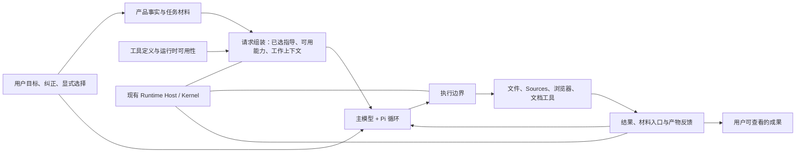

# Phaneris Harness 系统演进方案

Status: accepted — implementation authorized on 2026-10-26; implementation and verification are recorded separately.

日期：2026-10-25。审查基线：`codex/harness-capability-implementation@ab0282111`，本地 Pi SDK `1.3.0`。本方案接续[上一轮设计](harness-design-proposal-2026-10-23.md)和[实施记录](../process/harness-capability-implementation-2026-10-23.md)，修订下一阶段的目标和取舍，不覆盖其实施历史。工作区另有打包验收相关改动，不纳入本次 harness 基线，也未改动。

2026-10-26 已获用户授权实施。以下正文保留 10-25 的设计判断与实验项；当前落点、取舍修订和验证范围见[系统演进实施记录](../process/harness-system-evolution-implementation-2026-10-26.md)。

**1. 核心判断：下一阶段应把重点从“正确约束调用”转向“充分支持任务”。**

上一轮修复必要且应保留：原文不再被自动语义改写；用户输入不再被辅助分类器重新分流；工具、条件指导和结果范围更一致；执行与恢复有可核对的记录。这些改善了模型与环境之间的契约。

但契约正确并不等于工作环境好用。当前模型仍需要承担较多宿主本可完成的准备：读取已明确选中的技能、查产品手册、找到内部能力、理解多种文件与产物状态，以及在压缩后重新建立工作现场。长期任务是否保持关键要求、工具反馈是否足够支撑判断、模型是否能看到实际产物，也比再增加一项防御检查更接近能力发挥的核心。

下一阶段的目标是：**用户交付目标后，模型尽早接触真正的任务材料；执行过程中能够看清结果、修正方法；长任务能够带着要求、证据和成果继续。** 宿主负责准备环境和兑现行动，模型负责解题。衡量收益以任务完成质量和用户介入为主，准备轮数、等待、上下文占用和成本用于解释差异。

这不是把所有能力常驻、取消执行边界，或改成更短的 prompt。真正需要减少的是重复选择、重复说明、无效往返和缺乏依据的语义干预。必要的专业指导、充分的原文、昂贵但有用的验证，都可以保留。

本轮对上一方案作出四项明确修订：

| 上一阶段的取舍 | 下一阶段的取舍 | 修订原因 |
| --- | --- | --- |
| 大部分专业工具延迟发现 | 基础工具直接可用；用户已选能力预先展开；长尾能力继续发现 | “少暴露”会把 schema 成本转成模型搜索与往返成本 |
| 显式技能通过路径指令和阅读前置条件加载 | 宿主准备已选技能的原文；大材料保留范围读取 | 用户已经完成选择，不需要模型再执行一次机械激活 |
| 每次文本 Read 保存完整不可变副本 | 结果本身、范围内容与恢复副本按用途保留 | 精确交付和完整源文件永久复制是两个需求 |
| 通过多个局部预算防止上下文越界 | 基于实际请求形成一个容量口径，分配材料与输出空间 | 分散估算容易相互挤占，并且难以解释为何裁剪或暂停 |

这些是设计建议，尚未实施。不能由此推导现有版本一定比原生 Pi 更慢或质量更低；目前没有同模型、同材料的任务对照支持这个量化结论。

**2. 当前基础与真实问题。**

| 已观察到的实现 | 系统影响 | 证据与边界 |
| --- | --- | --- |
| Pi 是主循环；Host/Kernel 管输入、执行、结果提交和恢复 | 已有可靠分层，不需要另建 loop 或任务内核 | 继续沿用现有 runtime 边界 |
| `BaseAgent.chat()` 解析显式技能后注册 prerequisite，再给模型文件路径 | 已知的用户选择被转换成额外读取和状态确认 | `extractSkillPaths`、`formatSkillDirective`、`chat` |
| Source/浏览器存在 guide 前置规则；浏览器规则为 strict；一般规则最多拒绝一次 | “读说明”同时承担指导和拦截，职责不一致；拒绝次数不能代表理解程度 | `PrerequisiteManager`；并非每次工具调用都会被拒绝 |
| 常驻 prompt 仍有产品文档目录、权限和恢复说明；工具家族再条件展开 | 单纯移出部分文案尚未消除产品知识的重复学习 | 一个已归档 fixture 的 system prefix 为 **12,652 字符**，不是 token 数，也不是所有真实会话的长度 |
| Session 工具家族主要由名称正则推导，非核心家族通常 deferred | 新工具的暴露与指导容易受命名影响；用户选择未充分影响初始能力集合 | `capabilityMetadata`、`tool-discovery.ts`；MCP resources/prompts 已有独立入口，并非缺失 |
| 每次捕获成功的 UTF-8 文本 Read 都尝试保存完整源快照；已有副本会同步校验 | 提供了强恢复语义，也增加 I/O、存储和处理工作 | `tool-result-view.ts`；具体延迟和存储影响尚未测量 |
| 大文本通用结果采用确定性头尾视图，保留完整值和恢复路径 | 避免了语义删改，但头尾通常不是表格、PDF 或搜索结果的最佳操作界面 | 不能把“可恢复全文”等同于“当前视图足够有用” |
| 工具批次预算、handoff/manual 预算和 SDK compaction 分别计算 | 缺少共同的容量解释；批次按 token 余量派生字符额度，并非精确 token 计量 | `rememberDurableToolBatch`、`context-policy-stream.ts`、`context-policy.ts` |
| 资源锁覆盖权限等待、执行和结果提交；未知效果使用会话屏障，普通 shell 也落入这一类 | 已保证顺序，但可能让无关工作一起等待 | `wrapToolsWithHooks` 路径、`ToolExecutionScheduler`；实际等待占比尚未测量 |
| handoff 补充首条、最近八条、批准相关输入与技能引用，并设字符预算 | 比单一模型摘要可靠，但按位置保留仍不能保证中间关键要求被带入 | `SessionManager` 的 handoff seed 组装；完整历史仍在 |
| 辅助决策层默认关闭；开启 adaptive thinking 后会在主请求前等待，并可下调 thinking | 是可选路径的取舍，不应误诊为所有会话的默认瓶颈 | `startPreTurnDecisions`、decision settings |

已有 **84 个 harness 场景**及真实 Pi 协议链路验收，证明相关机械契约在记录范围内成立；不证明模型更会研究、写作或完成文档。证据见[已归档验收索引](../verification/results/harness-capability-2026-10-24/index.json)与[prompt fixture](../verification/results/harness-capability-2026-10-24/harness-prompt-assembly--compiled-prompt-budget.json)。本次没有运行付费模型任务，也未重新做发布验收。

**3. 目标架构：一个判断中心，几个清楚的事实所有者。**

| 所有者 | 负责 | 不承担 |
| --- | --- | --- |
| 主模型 | 理解目标、形成与修改方法、选择工具、综合证据、决定合理验证、形成交付物 | 猜测连接状态、重复解析宿主已知的路径和配置 |
| Pi | 推理与工具循环、steering/follow-up、provider 适配、原生压缩机制 | 产品任务字段、Artifact 接受状态、用户授权的产品语义 |
| Runtime Host/Kernel | 输入交付、执行身份、权限执行、取消结算、已知结果和恢复 | 另起一个循环判断主模型“是否足够努力” |
| 产品域 | 用户选项、任务字段、批准、连接、文件与产物状态 | 把推断出的目标或自动评分伪装为用户事实 |
| 工具及其适配器 | schema、可用性、领域指导、实际效果、可操作结果 | 通过名称猜测长期架构归属；让模型替其维护内部状态 |
| 请求组装 | 将上述事实形成一致的请求视图，记录实际进入请求的内容 | 新建可编辑任务真相、独立数据库或通用规则引擎 |

请求组装是对现有 `PromptBuilder`、resource loader、工具目录和请求诊断的收敛，不是新增一个“智能中间层”。所有者之间传有限 DTO；源数据继续由原来的领域管理。

Runtime 记录的应是“已分派、已返回、已确认、仍未知”等事实。它能证明记录与执行链路，不能仅凭本地记录证明远端世界的最终状态。相关判断仍应依赖工具回执或针对性的查询。

**4. 任务准备：把确定的机械工作前移，把探索留给模型。**

请求开始前，只准备由用户选择和确定性环境事实直接导出的材料，不调用分类器决定用户“真正想做什么”。准备工作尽量本地完成；不因无关连接健康检查、全库索引或辅助建议延迟主请求。

| 材料 | 默认交付 | 按需取得 |
| --- | --- | --- |
| 用户明确选中的 skill | 按既有 project > workspace > global 规则解析；将正常大小的 `SKILL.md` 原文、来源与版本放入本次上下文 | skill 引用的长文、示例、模板、脚本；超出容量的原文分段 |
| 当前项目规则 | 当前工作范围的根规则原文与适用路径；避免只给一张需要再定位的路径表 | 进入具体目录时的嵌套规则、较大参考资料 |
| 已选 source | 身份、可用性、当前能力；完成调用所需的稳定指导 | 完整指南、服务资源、原始配置的诊断细节 |
| 用户附件和指定文件 | 文件身份、类型、大小、已有解析状态与可用入口；小文本可直接提供 | PDF 页面、长文章节、表格范围、原图等任务材料 |
| 任务与工作现场 | 产品中已有目标、要求、批准引用、工作目录、当前交付物与未完成操作 | 更早原始输入、旧草稿、历史工具结果 |

处理边界：

- **显式选择仍是技能激活条件。** 不恢复自动技能路由，也不把全库技能目录塞进每轮请求。准备已选技能与替用户选择技能是不同的操作。
- 选择保留所属任务和适用范围。“继续”或压缩后接续应恢复它；明确切换工作时，不把历次提及过的技能永久叠加为新任务的强制规则。沿用已有产品选择与用户输入，不另设自动意图分类器判断切换。
- 内容进入上下文按来源与作用域标记。用户选择的技能按其被选择的范围生效；外部服务文本保持其来源，不能升格为宿主权限。
- 不因原文过大而悄悄用摘要替代。交付完整性和剩余读取入口必须准确；容量限制由统一请求预算处理。
- 已准备内容直接形成交付记录，不再要求一个等价的 `Read` 调用来证明它进入过上下文。交付记录只说明收到哪些内容，不推断模型已理解。
- 加载失败时保留任务、已获得的资料和失败原因，让模型说明影响、开展不依赖它的工作或请求必要信息。不能把缺失技能伪装成已加载，也不应默认让一个路径错误终止整个可继续的任务。
- source 正常调用不要求先阅读原始 `config.json`。连接、认证和路由由宿主掌握；配置诊断或修改时才需要相应材料。

完成替代后，移除一般性的“先读说明才准使用工具”阻塞和拒绝计数。浏览器操作帮助、产品指南和技能加载由各自能力提供，不再用全局 prerequisite 系统管理。实际权限、参数和执行可用性检查继续保留。

这项变化的验收不是“少了一次 Read”：要确认首个请求已经包含准确的已选指导，模型随后仍遵守它，并且没有因多注入无关内容使质量下降。

**5. 能力暴露：根据已知工作环境准备，保留模型探索空间。**

采用三种暴露方式，但不新增用户需要逐项配置的模式：

| 方式 | 适用能力 | 行为 |
| --- | --- | --- |
| 直接可用 | 常用文件读写、检索、执行、提问与必要发现入口 | schema 与简洁操作指导直接进入请求 |
| 已选即准备 | 用户选择的 source、插件，已打开的 Artifact/Page，以及显式 skill 声明的已安装依赖 | 在任务开始或选择变化时提供相关能力与指导；能力可用不等于获得操作授权 |
| 按需发现 | 未涉及的专业家族、低频管理能力与大型外部工具集合 | 简短目录说明能解决什么问题；发现返回 schema、必要指导、可用性与直接调用方式 |

技能依赖声明只是可选的确定性元数据；缺少声明时仍可完整使用技能，不让模型先生成一份依赖计划。也不自动安装插件、创建连接或联系外部服务。

工具定义直接声明 family、暴露方式、指导引用和效果信息，替代基于名称的家族推断。名称继续用于协议兼容与检索，不能成为长期语义所有者。Source 的 tools、resources、prompts 属于同一个可用性视图；没有 tools 的 source 仍可能完全有用。

发现应一次返回足以开始工作的内容，减少“搜索能力 → 读目录 → 搜索工具 → 再读操作手册”的链条。完整教程保留按需读取；必要参数、最小示例和常见恢复方式随能力到达。工具返回“不可用”时给出已知原因和实际替代路径，不让模型通过反复试错探测平台。

活跃集合在任务中保持稳定，按明确选择和已激活能力增量变化。权限模式变化不必强制重排全部 schema；授权仍在执行边界判断。是否在长任务阶段结束后缩减集合，应通过上下文与任务对照决定，不按每轮意图预测来回切换。

Direct 与 codemode 共用定义和执行路径：简单调用可直接完成，批量计算和数据组合可走程序化调用。不要为了减少工具声明而强迫所有任务先写 JavaScript，也不要为了“简单”丢掉已有的程序化能力。

**6. 工具和材料：把结果做成可以继续工作的对象。**

现有结果契约解决了“收到什么”和“能否找回原文”。下一阶段要解决“能否高效地看清、变换并验证它”。优先改进已有工具和文档 CLI，避免先建设一套覆盖全部文件格式的抽象平台。

| 工作材料 | 默认有用反馈 | 后续操作 |
| --- | --- | --- |
| 长文本 | 文件身份、准确行段、搜索命中和邻近上下文 | 范围读取、继续搜索、定位修改 |
| 搜索/API 列表 | 项目身份、有效字段、分页状态、来源引用 | 下一页、单项详情、按字段查询；不能用头尾文本伪装完整列表 |
| 表格/JSON | sheet/列/类型、尺寸、少量原始样本和已计算值 | 范围查询、聚合、排序、导出；程序侧保留完整值 |
| PDF/Office | 页面或章节入口、提取方式、表格与视觉内容是否可用 | 指定页原文、页面渲染、图片查看、局部编辑 |
| 命令与后台工作 | 是否仍运行、进程/会话身份、输出入口、退出状态 | 继续等待、读取增量、取消；避免大日志耗尽上下文 |
| 用户交付物 | 当前可编辑文件、版本、预览与检查结果 | 按实际缺陷修改、重新渲染、提交当前版本 |

默认概况应来自解析器、schema、页数、字段等确定性事实；语义摘要是模型可选择的操作，不自动替换材料。对于尚未适配的通用工具，现有头尾视图和恢复路径仍是合理后备。

工具错误应让下一步变得明确：例如配置缺失给出缺失项；文件修改冲突给出当前版本和相关片段；不支持的格式给出当前可用转换方式。不要继续增加全局“失败后应如何思考”的长篇规则，去补偿没有操作信息的报错。

文档与知识工作应成为能力验收的主场景。能够生成 DOCX/PDF 不代表模型能看见排版；能提取电子表格文本不代表获得了公式与计算结果。优先闭合读取、编辑、计算/渲染、查看、修正这一过程，再考虑增加新的展示类型或工具数量。

**7. 上下文：一个容量口径，按工作价值组织，按来源保留事实。**

先把上下文分清用途，再做体积优化：

| 内容 | 放置与更新 |
| --- | --- |
| 跨任务成立的产品契约 | 稳定前缀，保持简洁、一致；不放完整产品手册 |
| 当前能力的操作语义 | 随能力定义与激活进入；只保留实际适用指导 |
| 已选技能、项目规则与稳定偏好 | 版本稳定时复用；内容变化时明确更新 |
| 当前任务事实、用户纠正、连接/产物变化 | 按有效版本提供当前值；保留原始输入出处 |
| 工作材料、工具结果、模型工作记录 | 在有效容量内保留；需要裁剪时提供准确范围和恢复入口 |

保留现有稳定/易变上下文拆分。缓存目标是减少重复处理，不是让状态过期；不得为了前缀缓存把失效 source、已变化的规则或被纠正的要求继续当作当前事实。

容量口径应位于实际请求适配边界，覆盖 system、工具 schema、消息、附件和输出预留。能用 provider/SDK 实际 usage 时用实际值；其余明确标为估算，并校正新增能力和材料带来的变化。字符额度可作为执行限制，不能被描述成精确 token 容量。

工具结果投影、compaction 触发和 handoff 使用这个共同口径，各自保留不同语义。先复用 SDK 提供的容量与压缩接口；只补齐宿主新增内容的计量，避免另做一个与 Pi 竞争的 context manager。

批次结果不再永久平均分配同一字符额度。先给每个结果足够的身份、状态和继续入口，再在总预算内向实际有内容的结果分配剩余空间。分配按模型调用顺序或稳定规则确定，不随并发完成顺序漂移；完整程序值不因展示预算损坏。是否需要更复杂分配，以大结果任务的对照决定。

持久化也按用途区分：

- 已通过 T2 保留的完整小结果，不额外复制整份源文件，只为“有一个快照路径”。这里承诺恢复的是实际交付内容；未保存源文件字节时，不声称能够恢复原文件的字节级快照。
- 分段读取需要一致版本时，从本次实际读取的字节保存必要快照；不能延迟到源文件变化后再复制，却声称是旧版本。
- 超大外部返回需要脱离模型视图保存可恢复的原始值；持久化失败必须准确暴露恢复限制。
- 原始输入、执行效果与必要恢复事实继续遵守 durable runtime，不通过削弱这些记录换取表面速度。

具体复用已有内容存储还是精简当前快照逻辑，应先测调用路径的 CPU、I/O 和文件增长。目标是减少没有额外用途的复制，不是再建设一套通用内容寻址平台。

**8. 连续性：继续一项工作，而不只是继续一段对话。**

长期任务需要保留的不是全部历史等量复制，而是仍然有效的要求、工作现场和可靠的回看入口。采用三类已有材料的组合：

| 材料 | 来源 | 在接续中的作用 |
| --- | --- | --- |
| 用户与产品事实 | 原始输入、任务字段、批准记录、显式技能/source 选择 | 说明要完成什么、当前范围是什么；保留原文引用 |
| 执行与成果事实 | Runtime 已提交结果、文件/Artifact 版本、未结算操作 | 说明做到了哪里、哪些结论有回执、哪些动作不能直接重做 |
| 模型工作记录 | 当前计划、问题分析、证据索引、交接说明 | 说明为什么采取当前方法、接下来准备做什么；始终是可修订的模型判断 |

前两类从现有所有者产生只读投影，第三类复用已有计划文件、任务上下文或 handoff 文档，不新建独立的目标数据库。模型可在重要阶段维护简短工作记录；短任务不强制建计划、不要求每次调用写 checkpoint。

压缩与跨会话交接共享同一份事实投影。SDK 压缩负责整理会话，handoff 负责迁移会话；两者都重新附上仍适用的用户选择和当前成果入口，不再分别发明一套保留规则。已选技能内容若仍有效，由组装器恢复必要指导，而非清空阅读状态后让模型再次排队读全部文件。

“首条 + 最近八条”可以继续作为兼容后备，但不能作为关键要求的完整性保证。新的接续应带上当前任务字段、明确批准的范围、已引用的要求原文以及用户后续纠正。更早历史需要可按消息 ID/范围准确取得，避免模型为了找一条要求重读整份会话文件。

对于只存在于自由对话、从未写入任务字段或工作记录的要求，宿主不能靠确定性代码识别其全部语义。这里仍存在模型整理遗漏的风险，应通过长任务对照验证；不以另一个自动要求提取器宣称解决。模型工作记录中的“用户已批准”也不能替代原始批准事实。

新输入继续按用户或客户端明确的 steering/queue 语义进入；晚于交接截点的输入原文交给接续会话。压缩、请求失败或进程重建不能把“准备发送”当成“已经交付”。这应覆盖所有一次性上下文，而不只覆盖 source 介绍或 Read 结果。

目标未完成时，主模型可以在用户授权范围内持续推进；自然停止由 Pi 和当前任务运行语义处理。不增加一个后台评审模型，逐轮判断是否继续并不断唤醒主模型。只有用户明确交付的持续任务，才使用已有 task runner/conductor 的生命周期。

**9. 执行：缩短等待链，保持真实动作的顺序。**

目标链路为：

`规范化参数与目标 → 解析实际能力/效果 → 必要授权 → 资源排序 → T1 → 执行 → 结果与 T2 → Pi`

这里的“单一链路”指同一份已解析调用在各边界传递，不表示合并所有进程或把不同检查揉成一个函数。权限规则仍在 Host，执行身份仍在 Kernel，实际工具仍走其适配器。

当前资源锁在授权前取得。优化应首先让等待用户的调用不持有实际效果锁，并用原有队列维护相关调用的先后；不能让同批次的读越过其依赖的写。授权等待期间，已知不相关的工作可以继续。参数或目标变化时重新解析和确认适用范围，T1 记录最终实际参数。

工具效果逐步回到 canonical definition 与具体适配器。先改宿主自己掌握的文件、文档、Artifact 和 source 操作；不通过猜测任意 shell 文本来宣布其可并行。未知效果仍允许使用保守屏障，直到存在明确语义。是否值得细化某种锁，取决于真实等待记录，而不是“并发率越高越好”。

并行使用 Pi 与现有 scheduler 的能力；不叠加第二套 DAG 执行器。程序化调用的子操作仍走同一执行边界。长命令、浏览器和外部调用要能返回运行身份与增量状态，让用户纠正和停止及时生效；停止后的已发生效果由既有 settlement/recovery 处理。

重试按责任归属处理，避免层层叠加：

| 情形 | 默认处理者 | 行为 |
| --- | --- | --- |
| 请求尚未执行的短暂传输失败 | provider/连接适配器 | 复用既有有限重试；上层不再盲目重放一轮 |
| 参数、格式或方法错误 | 主模型 | 返回具体反馈，由模型调整方法 |
| 能力未安装、认证缺失 | Host 与产品连接流程 | 返回可用性和恢复入口，不让模型靠重复调用探测 |
| 外部效果未知 | Runtime 与对应工具适配器 | 依据查询或回执确认；未知状态不被自动改成失败再执行 |

这部分优先减少重复解析、无用等待和模糊报错。跨进程重构、全新调度算法或通用重试框架都不是预设交付物。

**10. 交付与用户协作：让模型看到成果，让用户控制真实决策。**

Phaneris 已有 Artifact 草稿、`editablePath`、检查、Office 预览和提交，不应再建设另一套文档流水线。改进重点是让既有结果更容易被模型消费：

- 创建或打开产物时直接提供当前可写路径和必要操作语义；模型无需先读完整产品手册才能开始。
- 检查返回与当前版本对应的结构、计算或渲染结果。给出预览路径只是入口；需要视觉判断时，模型必须能真正查看该版本的页面或图像。
- 已有同版本检查可以复用；检查后文件变化则更新结果。只做任务所需的验证，不给每种文件附加同一套仪式。
- 用户直接修改文件或产物后，后续请求看到新的版本与变化入口。模型不依据旧草稿继续覆盖工作。
- 提交仍表示成果可供查看或接受。文件存在、模型认为完成、Artifact 已提交、用户已接受、外部已发布，保持各自已有语义。

状态与进度优先来自 Host 已知的工作阶段、运行工具和成果更新，模型补充有价值的进展与问题。不要要求模型频繁调用进度工具，才能让用户知道程序仍在工作。

用户的“继续”默认延续当前未完成目标；纠正修改后续行为；明确新目标才替换原目标。沿用已批准范围，避免重复确认。提问应围绕真正缺失的输入、影响结果的取舍和必要的人类决策，而不是因为系统没有替模型准备内部配置。

完成判断由主模型基于任务与证据给出，产品呈现准确状态。禁止把每项任务都变成“计划 → 审批 → 执行 → 评审模型打分 → 继续”的固定流程；用户显式选择这种工作流时另当别论。

**11. 模型与辅助能力：忠实传递能力，按实际收益采用建议。**

模型适配的基础是正确传递所选 provider/model、有效 thinking、输出限制、图像与工具支持。不同模型确实可能需要不同工具说明和编码方式，但应先使用 Pi/provider 的公开能力，不添加基于模型名称的泛化性格规则。

不能把“模型输出很快”自动等同于“任务更高效”。当前 adaptive thinking 是显式可选、默认关闭的路径；建议后续退出通用主请求前的自动降档设计。若保留预算优化，应作为用户明确选择、能够做质量对照的选项，准确展示实际设置，不把它包装成无代价增强。

其他辅助能力按用途分开：

| 用途 | 方向 |
| --- | --- |
| 主模型主动调用 `call_llm`、`decide` 处理独立子问题 | 保留。输入、返回、费用与上下文边界清楚，主模型决定是否采用 |
| UI 推荐、标题、标签等产品辅助 | 可异步运行；结果过期即失效，不阻塞主任务 |
| 用户明确启用的 Guarded 或任务工作流 | 保留其产品契约，单独衡量额外等待与误报 |
| 自动改写用户意图、筛选核心证据、判定授权、逐轮强制审查 | 不纳入通用主路径；已退出的输入/结果分类不重新引入 |

多模型和多 agent 可以是有效能力，但不能作为“系统性设计”的默认答案。是否拆任务应由任务独立性、实际工具和用户约定决定；不用一组 planner/reviewer/supervisor 角色替代对主模型工作环境的改进。

**12. 需要合并、退出和保留的机制。**

| 当前机制 | 建议 | 替代与退出条件 |
| --- | --- | --- |
| 读指南 prerequisite、重复阅读提醒、拒绝次数 | 替代后退出一般流程 | 已选指导能准确交付，发现能带回必要操作说明；保留真实权限检查 |
| 常驻完整产品文档目录与重复操作条款 | 收敛 | 能力入口、schema 与工具反馈承担相应知识；不会出现找不到能力的空白 |
| 工具名正则推导家族 | 退出 | canonical definition 声明归属，旧名只做兼容 |
| 所有非核心工具一律 deferred | 调整默认 | 基础、已选、长尾三类暴露通过任务对照验证 |
| tool results、handoff、compaction 各算预算 | 合并容量口径 | 保留三个动作各自语义，统一解释实际请求占用 |
| 每次 Read 都保存完整源文件 | 按用途缩减 | 小结果可由已提交内容恢复；分段与大型外部材料仍有准确恢复来源 |
| 接续中的产品事实组装分散 | 合并投影 | 从原所有者取当前值，压缩与交接共同使用 |
| 主请求前自动降低 thinking | 建议退出通用方向 | 已选用户配置直达 provider；特定节费方案需独立质量证据 |
| 自动输入重分类、自动结果语义过滤的兼容残留 | 按兼容窗口清理 | 旧配置可读取、旧会话可恢复；不保留两个长期行为分支 |
| Pi loop、steering、公开扩展点 | 保留 | 不修改 SDK 私有状态，不另做 loop |
| T1/T2、未知效果恢复、取消结算、用户权限模式 | 保留 | 优化重复工作，不降低真实执行记录与授权语义 |
| Artifact、原文范围、结构化值、请求诊断 | 保留并提升可用性 | 用于实际工作和排障，不演变成新的审批流程 |

新的抽象必须消除至少一个重复所有者或明显的调用往返。若只是新增一个 descriptor、registry 或 manager，再让旧状态照常存在，则没有达到本方案的收敛目标。

**13. 演进顺序：按完整任务切片推进。**

下表是拟议顺序，不是第二份已批准实施队列。正式实施仍需同步[唯一实施登记](../process/implementation-value-register-2026-10-13.md)。先建立小规模基线，再改能够独立完成验收的纵向切片；不先投入大型框架整理。

| 阶段 | 主要工作 | 现有落点 | 完成与退出条件 |
| --- | --- | --- | --- |
| A：冻结任务基线 | 选取真实代表任务；补齐首个实质动作、准备往返与分段等待的记录 | 既有 verification workflow、request diagnostics、runtime events | 可重复运行、保存输入/有效配置/最终产物；不新增运行时语义门槛 |
| B：让任务直接开始 | 已选 skill 原文准备；当前 source/项目事实交付；能力定义显式归属；已选能力预展开；替代一般阅读门槛 | `BaseAgent`、`PromptBuilder`、`SourceManager`、resource loader、tool defs/discovery | 同一研究/文档任务能从第一轮进入实质材料；指导正确、无额外自动选择；旧 prerequisite 路径对应退出 |
| C：让材料与结果可操作 | 对实际高频文档/数据工具改善反馈；统一请求容量口径；精简重复快照；贯通 Artifact 检查与查看 | result view、context policy、文档 CLI、Artifact 工具和预览服务 | 大材料可定位、查询、修改和验证；完整值可用；对照质量不下降，恢复保持原有约定 |
| D：让长任务保持目标 | 统一事实投影；按消息引用回看；复用模型工作记录；压缩与 handoff 共享接续材料；覆盖用户中途修改 | `SessionManager`、task context、canonical context、Pi 压缩/交接适配 | 中段要求与后续纠正可接续；成果版本准确；无需用户重复交代，旧位置截取只做后备 |
| E：按观测缩短执行链 | 授权等待与效果锁分开；为高频宿主工具声明实际资源；清理重复转换和失效辅助分支 | pre-tool-use、Pi wrapper、scheduler、decision integration | 可解释的等待减少；依赖顺序/停止/效果结算不回退；没有增加第二套调度与决策系统 |

B 是第一优先级。C 与 D 是随后最影响真实任务的部分。E 的具体范围由 A 及各阶段的等待记录确定；如果瓶颈主要在模型推理或外部工具，就不为追求并发而重写执行器。

大型 source 的“预展开”不等于把其所有工具 schema 塞入上下文：先保证相关能力入口和必要说明到位，大集合仍保留发现。B 可在现有容量限制下先实现一个正常大小的完整任务，C 再收敛预算；避免以统一预算改造为由推迟所有用户收益。

每个阶段均按“先列失败与质量退化情形 → 实施 → E2E 与成果检查 → 对照 → 清理被替代路径”推进。迁移开关仅在需要对照或兼容时短期使用，验收后收敛；不把每项内部策略都永久暴露为用户设置。

回退按具体变更单元进行：例如恢复旧暴露默认或旧结果投影，不回滚已经修复的原文语义、输入交付和执行事实。禁止为了维持旧测试的字符串断言，把已退出的 prompt 行为重新补回主路径。

**14. 验收：用真正的工作判断 harness 是否释放能力。**

机械契约与任务质量分开报告。现有真实 Pi 协议 fixture、崩溃恢复和效果排序场景继续用于回归；模型质量需要实际模型完成任务并留下产物。

| 代表任务 | 主要观察 | 可复核产物 |
| --- | --- | --- |
| 已选研究技能，结合本地长文和 source 写分析 | 准备往返、核心观点是否有原文支撑、遗漏与误引 | 分析文档、引用定位、输入与请求清单 |
| 多份 PDF 形成指定风格报告 | 能否访问页面/表格；是否把提取结果误当完整视觉信息 | 报告、对应原文页、必要渲染 |
| 带公式的表格清洗、计算和导出 | 结构、公式与值是否正确；是否为取数浪费多轮 | 工作簿、关键计算结果、操作记录 |
| 修改已有 Office 产物，中途用户调整要求 | 是否看到当前版本、修正排版并保留新要求 | 修改前后文件、当前版本预览 |
| 长任务压缩或交接，关键要求出现在对话中段 | 目标和限制是否延续；是否重复完成工作或重复询问 | 原始输入引用、交接材料、最终成果 |
| source 暂时不可用，但部分工作可独立完成 | 是否明确说明影响并继续可做部分，而非陷入重试或整轮终止 | 实际完成部分、失败原因和恢复后的成果 |
| 仓库内跨文件修改与验证 | 不能因加强文档场景而损害代码任务；用户纠正和停止及时 | diff、适当检查、执行与取消记录 |

对照以 `ab0282111` 的当前 harness 为起点，冻结同一模型、provider、有效 thinking、材料和可用工具；先逐项比较准备方式、暴露方式、结果视图，再比较组合效果。原生 Pi 可作为窄场景参照，但缺少本产品能力时不能当作所有任务的公平基准。

优先观察：

1. **成果是否正确且满足要求。** 事实与计算用可核对答案，写作与版式用任务约定评审；不要把它们合成一个掩盖严重失败的总分。
2. **用户是否需要补救。** 重复输入、纠正被遗忘、重复确认、人工取回材料，单独记录。
3. **模型花在哪里。** 区分必要研究/验证与纯产品操作准备；观察首次实质动作、重复读取、发现往返和最终完成时间。
4. **时间与资源花在哪里。** Host 准备、辅助调用、模型请求、排队、权限等待、工具执行、结果处理分别记录；token/费用与字符估计分开。

真实模型输出会波动，需要重复对照并报告样本限制。首次少量案例只用于发现退化和判断方向，不声称具有统计显著性。质量不能下降后靠更低 token 宣布成功；也不为了减少调用次数而取消有价值的检查。

在实现前补充下列端到端失败情形；它们用于验证替代设计，不发展为生产中的新审查环节：

| 情形 | 应观察到的结果 |
| --- | --- |
| 已选技能被注入，但版本错误、缺段或来源混淆 | 不能报告为完整加载；范围与实际内容一致，可继续取得原文 |
| 大型 source 选中后工具声明挤掉主要材料 | 维持可用发现入口，任务仍能获取材料；不悄悄裁掉用户要求 |
| 新指导在失败请求前准备，重试/压缩后丢失 | 下次有效请求仍能取得必要内容，没有“假交付” |
| 分段读取之间源文件变化 | 能区分旧版本与新版本，不拼成一份不存在的原文 |
| 多个大结果与图像同时返回 | 请求在有效容量内，顺序、结构化值和继续入口准确 |
| 权限等待时有独立读和依赖写后读 | 独立工作可推进；依赖关系与最终实际参数保持正确 |
| 用户在长任务中改目标、改文件或停止 | 后续动作服从纠正，读取当前产物；已发生效果准确结算 |
| 同一文档已检查，随后又发生编辑 | 不沿用旧版本“通过”来声称新成果已验证 |

每次 E2E 留下可重跑命令、有效配置、预期结果、实际文件与关键 trace。沿用现有证据目录和索引，不建设新的评测门户；真实模型对照未跑就明确写“未验证”，不以 fixture 通过代替。

**15. 一个完整任务的目标体验。**

用户选择报告技能、上传几份资料、选定一个 source，并要求形成可修改报告：

1. Host 准备已选技能原文、资料入口、source 当前能力、用户要求和工作目录。首个模型请求已经可以开展研究。
2. 模型选择读取章节、查看图表或查询 source。结果提供准确位置、完整程序值或清楚的下一步入口；不先要求它完成产品配置阅读。
3. 模型创建现有 Artifact 草稿，取得 `editablePath`，用文档工具生成内容；查看相应版本的渲染，按发现的问题修改。
4. 用户中途改变报告重点。新输入按 steering/queue 到达，主模型修订方法；Host 不重新分类成新任务，也不撤销既有授权。
5. 若需要压缩，SDK 整理对话，Host 补上当前任务事实、已选指导、成果入口和未处理输入。模型可以按引用回看更早要求，继续当前草稿。
6. 模型提交经适当检查的当前版本，说明仍有影响结果的限制。用户查看并接受成果；宿主如实呈现状态。

这条路径依靠已存在的主要能力。优化点在于减少准备和转接、提升材料与反馈质量、维持工作连续性，而非要求模型遵守更多阶段协议。

**16. 本轮确定的方向、实验项与边界。**

**建议确定：**一个 Pi 主循环；用户显式选择直接驱动准备；工具定义与指导同源；指导交付替代通用阅读门槛；材料可以被继续操作；上下文容量与接续事实收敛；执行保障不接管解题；优先研究、文档、数据和长任务的实际成果。

**需要对照决定：**基础工具的具体集合、已选能力展开粒度、原文内联容量、结构化视图的默认内容、结果空间分配、快照复用方式、值得细化的资源锁，以及任何模型专用指导。没有证据的参数先采用简单实现，保留明确调整点。

**当前不规划：**重写 Pi、通用 agent OS、第二套任务图/执行数据库、逐轮监督模型、自动技能路由、自动要求提取与授权推断、无差别自动摘要、全量向量记忆、为了观测建设新控制台，或为所有潜在故障新增防御层。

这些取舍继续吸收[六个 harness 的固定源码比较](six-harness-comparison-2026-10-23.md)：Pi 的循环所有权、OMP 的可操作工具反馈、DSH 的作用域组合与完整程序值、OpenCode 的请求时能力适配、Claude 可见资料中的动态上下文、Codex 的分层执行监管。复用的是取舍与接口，不把六套机制同时叠加。该比较使用 2026-10-23 固定快照，本轮没有把它冒充各项目的最新状态。

**源码依据与实施定位。** 以下链接指向本地审查基线对应的文件；函数名用于后续实施定位，不意味着已经实现本方案。

| 主题 | 当前入口 |
| --- | --- |
| 技能选择、指令与 chat 准备 | [base-agent.ts](../../packages/shared/src/agent/base-agent.ts)：`extractSkillPaths`、`formatSkillDirective`、`chat` |
| 阅读前置规则与状态 | [prerequisite-manager.ts](../../packages/shared/src/agent/core/prerequisite-manager.ts)：`RULES`、`MAX_REJECTIONS`、`registerSkillPrerequisites` |
| 产品 prompt 与手册路径 | [assistant-contract.ts](../../packages/shared/src/prompts/assistant-contract.ts)、[capability-guidance.ts](../../packages/shared/src/prompts/capability-guidance.ts)、[assistant-prompt.ts](../../packages/shared/src/prompts/assistant-prompt.ts) |
| 上下文与 source 状态 | [prompt-builder.ts](../../packages/shared/src/agent/core/prompt-builder.ts)、[source-manager.ts](../../packages/shared/src/agent/core/source-manager.ts)：`buildVolatileContextParts`、`prepareSourceState` |
| 能力定义、发现与条件指导 | [tool-defs.ts](../../packages/session-tools-core/src/tool-defs.ts)：`capabilityMetadata`；[tool-discovery.ts](../../packages/pi-agent-server/src/tool-discovery.ts)、[phaneris-resource-loader.ts](../../packages/pi-agent-server/src/phaneris-resource-loader.ts) |
| 结果投影、快照和实际请求 | [tool-result-view.ts](../../packages/pi-agent-server/src/tool-result-view.ts)：`readFileWithEvidence`、`persist`、`prepareToolResultView`；[request-diagnostics.ts](../../packages/pi-agent-server/src/request-diagnostics.ts) |
| 预算与接续 | [Pi index.ts](../../packages/pi-agent-server/src/index.ts)：`rememberDurableToolBatch`；[context-policy-stream.ts](../../packages/pi-agent-server/src/context-policy-stream.ts)、[context-policy.ts](../../packages/shared/src/agent/context-policy.ts) |
| 执行与权限链 | [pre-tool-use.ts](../../packages/shared/src/agent/core/pre-tool-use.ts)：`runPreToolUseChecks`；[pi-agent.ts](../../packages/shared/src/agent/pi-agent.ts)：`handlePreToolUseRequest`；[tool-execution-scheduler.ts](../../packages/pi-agent-server/src/tool-execution-scheduler.ts) |
| 任务、交接、辅助决策与产物装配 | [SessionManager.ts](../../packages/server-core/src/sessions/SessionManager.ts)：handoff seed、`startPreTurnDecisions`、`artifactEventResult` 与 Artifact callbacks |
| 辅助能力与 Artifact 基础 | [decision settings](../../packages/shared/src/decisions/settings.ts)、[Artifact handlers](../../packages/session-tools-core/src/handlers/artifact.ts)、[Artifact types](../../packages/shared/src/artifacts/types.ts) |
