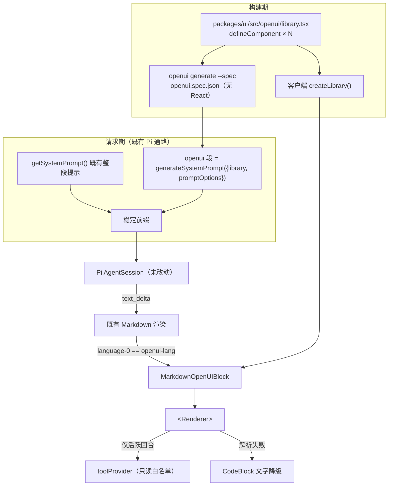

# OpenUI 智能界面：目标架构与实施设计

Status: proposed — 待评审。目标架构与实施设计；实测证据见 [接入实测证据记录](../verification/openui-adoption-evidence-2026-10-14.md)，评估结论与采用/退出标准见 [2026-10-13 接入评估提案](../design/openui-reply-presentation-plan-2026-10-13.md)。**本文不授权实施。**

日期：2026-10-14（Asia/Shanghai）。

本文回答提案没有回答的问题：**如果要接入，目标架构长什么样、分几步、每步的退出标准是什么、哪些东西明确不做。** 所有量化数字来自 [实测证据记录](../verification/openui-adoption-evidence-2026-10-14.md)，本文不重复。

---

## 1. 为什么这是类别跃迁，而不是"再加一个渲染器"

Phaneris 现有三条富输出路径，天花板是**同一个**：能渲染什么，在构建时就已经定死。

| 路径 | 机制 | 天花板 |
| --- | --- | --- |
| Markdown 围栏块 | [Markdown.tsx](../../packages/ui/src/components/markdown/Markdown.tsx) 按 `language-*` 分派到 10 个写死的区块组件 | 每种围栏对应**一个**组件；**组合**是开发者的事 |
| 工具结果渲染器 | `packages/ui/src/lib/tool-parsers.ts` 按工具名解析 | 每接一个工具就要写一对解析器 + 组件 |
| Page | `pages/{slug}/` 完整生命周期 | 能力最强但最重：持久化、可调度、可分享的工程产物 |

共性是：**"这个回答该长什么样"由开发者回答，模型只能选择用不用已有的盒子。**

OpenUI 把这个问题交回给模型：它从**受限组件库**里现场组合出界面。同时——这是它真正的架构主张——**生成与执行分离**：`Query()` 的数据在运行时直连工具，`$variable` 一变就重取重画，**不再经过 LLM**。

### 1.1 与 Page 的关系：互补，且可互相晋升

| | 对话内 OpenUI 区块 | Page |
| --- | --- | --- |
| 生命周期 | 一次回答 | 持久、可定时刷新 |
| 数据 | 运行时 `Query()` | `store.sqlite` + `snapshot.json` |
| 分享 | 随会话 | 可发布公开链接 |
| 回答的问题 | "给我看看" | "给我盯着" |

**晋升路径是天然的**：对话里生成了一个有用的面板 → 物化成 Page。这比让模型从零写 HTML 可靠得多，因为 OpenUI Lang 是受限 DSL——语法可校验、错误可结构化、失败可降级。提案 §2 把"持久化小应用"排除在首轮之外，本文认同；晋升属于后续候选，不在本文的 P1–P3 内。

---

## 2. 目标架构



### 2.1 所有权边界

| 领域 | 职责 | 边界 |
| --- | --- | --- |
| `packages/ui` | 组件库、`MarkdownOpenUIBlock`、主题适配、错误与文字降级 | 模型只能在注册组件里选；风格由现有主题决定 |
| `packages/shared` 提示词 | 序列化规格、`openui` 提示段、启用条件 | 后端不引 React；不覆盖既有文件与权限规则 |
| 消息契约与存储 | 围栏原文随既有 content 走 | **零 schema 迁移**；不把轨迹字段改作 UI 状态仓 |
| Electron / WebUI / Viewer | 宿主能力与显示模式 | Viewer 只读；操作走既有入口 |
| Runtime / 权限 | 工具执行、恢复、记账 | 界面点击不能自行推进执行状态 |

所有权依据：[Runtime 边界](../architecture/durable-runtime-boundary.md)、[领域所有权](../architecture/governance-domain-ownership.md)。

### 2.2 三条不可动摇的约束

1. **稳定前缀。** OpenUI 提示段按（库版本 × 档位 × 权限模式）是会话不变量，**必须进 `getSystemPrompt()` 的稳定前缀**，绝不能挂到易变段——否则 pi-ai 的系统前缀缓存全部失效（仓库既有约束）。
2. **流式状态来自消息链路。** `isStreaming` 必须从消息链路贯通到区块组件；**不得由围栏是否闭合推断**（一条消息可以有多个区块，后面的还没到）。提案 §3 已指出 `MarkdownProps` 当前不含 `isStreaming`，这是 P1 的必改项。
3. **历史消息是不可信输入。** 见 §4。

---

## 3. 围栏契约（实测确定）

`inlineMode` 下官方生成的语言标签是 **`openui-lang`**，且**围栏抽取在解析器内部完成**（字符串感知，支持多围栏）。因此宿主不需要自写分段器：把整条消息文本交给 `<Renderer response={...}>` 即可。

由此得到的关键性质：**未闭合围栏在 CommonMark 中就是延续到文末的代码块**，所以既有 `text_delta` 流式链路天然可用，**不需要新增流式管道**；`text_discard` 也天然正确。

**必须由宿主额外施加的**（官方提示词不保证）：区块必须自包含、工具结果与外部文本中的同名围栏不得自动取得能力。对应提案 §5.2 第 1/2 条与 §9 OU08。

### 3.1 组件库设计原则

实测结论（证据记录 §2）：**库规模对提示词成本是超线性的**——每个容器组件的 `children` 联合类型会把子组件名逐个列出。因此：

1. **控制容器数量**：每多一个"能装东西"的容器，就要进所有父容器的联合类型。
2. **控制联合宽度**：叶子组件便宜，容器组件贵。
3. **能用一个叶子表达的，不拆成容器 + 叶子。**
4. **规则写进 `componentGroups.notes`**，比散在 `additionalRules` 里更省、注意力更集中。
5. **面向编码 Agent 精选**：`CodeBlock` 与 `MarkDownRenderer` 是相对官方库的关键差异项，不能被营销向卡片组件淹没。

### 3.2 与既有围栏区块的收敛分析

问题：接入 OpenUI 后，现有 10 个围栏区块（mermaid / json / datatable / spreadsheet / html-preview / pdf-preview / image-preview / latex / diff / doc）是否有些可以收敛掉？

**结论：替换式收敛 ≈ 0，但有三层真实的收敛，其中一层与 OpenUI 无关、现在就该做。**

#### 3.2.1 为什么替换不了

这些区块不是"通用 UI"，而是**带能力的格式适配器**：

| 区块 | 它真正提供的能力 | OpenUI 最接近的组件 | 能否替换 |
| --- | --- | --- | --- |
| `datatable` | 排序 + 全屏 + **日期/数值粒度重组** + **`src` 文件加载** | `Table(Col[])` 静态；`EditableTable` 可编辑 | ❌ 丢排序、粒度、文件加载 |
| `spreadsheet` | **导出 xlsx**（`TableExportDropdown` + filename）+ 网格 | `EditableTable` | ❌ 语义不同（编辑 ≠ 导出） |
| `json` | shiki 高亮 + 折叠树 | `CodeBlock(language, codeString)` | ⚠️ 丢折叠 |
| `diff` | unified diff 着色 | 无 | ❌ |
| `html-preview` | 沙箱 iframe + base target 注入 | 无 | ❌ |
| `image-preview` | 比例探测 + 区域批注 | `Image` / `ImageBlock` / `ImageGallery` | ⚠️ 丢批注 |
| `doc` | 多文档预览列表 | 无 | ❌ |
| `latex` | KaTeX | 无 | ❌ |
| `pdf-preview` | PDF 查看 | 无 | ❌ |
| `mermaid` | 布局引擎出 SVG | 无 | ❌ |

**经济性也反对替换**，而且方向是反的：围栏今天几乎不花提示词成本——[system.ts](../../packages/shared/src/prompts/system.ts) 只写一行规则加一个 `DOC_REFS` 指南指针（例如"Use `datatable` for sortable/filterable data and `spreadsheet` for exportable grids; **read the table guide before either**"），语法细节按需读取；而 **OpenUI 每个组件都必须进提示词**，且容器组件因 `children` 联合类型是超线性的。

#### 3.2.2 收敛一：把区块注册成 OpenUI **叶子**（真正有价值的）

今天这些区块是**终点**：`mermaid` 旁边放不了图表，进不了 KPI 行，筛选变了不会重画。注册成 OpenUI 叶子之后，它们成为生成树里的可组合节点：可以放进 `Stack([hdr, MermaidDiagram(...), tbl], "row")`，可以被 `Query()` 供数，可以绑 `$variable` 响应式重算。

**成本极低，已实测**：在 23 组件的精选库上追加 6 个区块叶子（MermaidDiagram / DataTable / Spreadsheet / JsonViewer / DiffView / MathBlock），提示词只增 **+777 字符 ≈ +195 tokens**，即 **约 33 tokens/叶子**——而且这个增量在 L1 与 L2 两档下完全相同（叶子只加签名行，不与 `toolCalls` 块相互作用）。**与之对比，容器组件的成本是超线性的。**

原因是叶子没有 `children` 联合类型。**这反过来印证了 §3.1 的设计原则：贵的是容器，不是叶子。**

**实现上不需要重写**：`MarkdownMermaidBlock` / `MarkdownDatatableBlock` 等已经是接收 `{ code }` 的 React 组件，`defineComponent` 包装层只做 props → 该区块期望的 spec 的再序列化。

**三条限制**：

1. **不要注册全部 10 个。** `html-preview`（允许脚本与外部资源、仅靠宿主路由链接）、以及取路径的 `pdf-preview` / `doc` / `image-preview` 应暂不注册——见下条。
2. **取路径的区块需要单独的门。** `datatable` 与 `spreadsheet` 的 `src` 经 `PlatformContext.onReadFile` 读取工作区文件。**注意这不是 OpenUI 引入的新洞**：持久化消息里的 ` ```datatable {"src": …} ` 今天就会走同一条路径。差别在于 OpenUI 让它**更可达**（可组合、且模型更可能用组件而不是手写路径）。正确做法是在平台层把 `onReadFile` 的包含性检查收敛到**一处**，同时覆盖围栏路径与生成 UI 路径——这是另一种收敛：**执法点收敛**。
3. **`z.any()` 会放弃解析期校验。** 以 `spec: z.any()` 包住整个区块载荷，等于把校验让给区块自身的错误边界。可接受（区块本来就有边界），但要明确这是有意的取舍，不是遗漏。

#### 3.2.3 收敛二：围栏分派注册表（与 OpenUI 无关，独立收益）

`Markdown.tsx` 的 `createComponents(mode, …)`（该文件 177 行起）在 `mode === 'minimal'`（324 行）处分出两支，**10 个分支按 mode 重复了一遍**；Tiptap 编辑器还有第三条路径（`extensions/MermaidBlock.tsx`、`extensions/LatexBlock.tsx`）。

不做收敛的话，接入 OpenUI = 在多处各加一个分支（10 → 11，且重复）。**建议抽成单一 `FENCE_BLOCKS` 注册表**：OpenUI 是第 11 项、只声明一次；两支收敛；并且 OpenUI 组件库可以直接复用同一批区块组件作为叶子——**一份实现，两个消费者**。

**这一项不依赖 OpenUI 是否采用，应独立评估与推进。**

#### 3.2.4 收敛三：能力收敛（最深的一层，也是 OpenUI 最强的论证）

`MarkdownDatatableBlock` 已经手搓了 OpenUI 要泛化的机制：

| datatable 里已有的 | OpenUI 的通用形式 |
| --- | --- |
| 粒度切换（日期/数值重组，`GranularityOption`） | `$variable` + 响应式重算 |
| `src` 文件加载 + `transform_data` 工具产出 | `Query()` |
| `TableExportDropdown` | library action |

也就是说：**datatable 是通用机制的一个单用途硬编码实例**，规模还不小（该文件 28.3 KiB，是全部区块里最大的）。这证明"按数据现组合界面"的需求真实且反复出现，也是支持 OpenUI 的最强论据。

**但不要因此删掉它。** 它服务"模型吐一个便宜的 JSON 载荷"的场景（一条围栏即可，无需学新语言、无解析失败面）；OpenUI 要求模型吐一个**程序**（更多 token、更多失败模式、需要语法规则）。两者是**不同价位的工具**，应并存：围栏是便宜档，OpenUI 是表达力档。真正的收敛是长期上让通用机制吸收个例，而不是一次性删除。


---

## 4. 安全设计（本方案的第一约束）

**威胁**：一条持久化消息里的 OpenUI 程序含 `Mutation("delete_page", …)` 或 `Query("send_mail", …)`。来源可能是共享会话、messaging-gateway、导入会话。**重放历史时若自动执行，即提权。**

四条不变量：

1. **只有当前活跃回合能执行工具。** 历史与已完成回合渲染时 `toolProvider` 为空；程序照常渲染但取不到数据、不产生写入。可用性判定来自消息链路。
2. **白名单从既有元数据派生。** [tool-defs.ts](../../packages/session-tools-core/src/tool-defs.ts) 已维护 `safeMode` / `readOnly`，且已有 `filter` 派生用法——**复用同一谓词，不新写清单**。
3. **写操作只能由用户手势触发**（OpenUI 本身即如此：`Mutation` 不在加载时执行），并走既有工具权限判定路径，与 Agent 自身调用**同一条**路径。
4. **`@OpenUrl` 走既有链接路由策略**，不得自带一套 URL 处理。

另外：`<Renderer>` 不传 `onError` 时错误只进 `console.warn`，且**默认不显示任何查询错误或重试界面**——必须显式接管，否则查询失败时用户看到的是空白。

提案 §5.4 决定"首轮关闭 UI 侧工具工作流"，实测显示它同时省下约 2.3k tokens 的固定开销（证据记录 §2）——安全决策与成本决策在此重合。

---

## 5. 分期实施与退出标准

| 期 | 目标 | 交付 | 退出标准 |
| --- | --- | --- | --- |
| **P0 事实基线** | 冻结版本相关事实，禁止照文档写代码（已观察到 Lang 1.0 与文档 v0.5 并存） | 基线脚本：输出真实库的 `$defs`、逐组件签名、提示词字节数 | 产出可比对的 `library.schema.json` + `system-prompt.txt` + manifest；字节数进 CI 阈值 |
| **P1 只读接入** | 围栏 → Renderer → 自建库，端到端可见 | `MarkdownOpenUIBlock`；自建库；`Markdown.tsx` 两处 `code:` 分派加 `openui-lang`；`isStreaming` 贯通；提示段（L1） | 提案 §9 OU01–OU09、OU12、OU14、OU17 + OU19/OU20/OU22 通过；桌面、WebUI、Viewer 三类宿主可用 |
| **P2 生命周期** | 复制、批注、重启恢复、分支与历史兼容、文字降级完整 | 状态归属与降级契约 | OU10、OU11、OU13、OU15、OU16、OU23、OU24 通过；旧回复可读、完整内容可复制、失败不静默丢内容 |
| **P3 有限交互** | 追问按钮接入既有用户消息入口 | 动作记录与权限衔接 | OU18 + OU21 通过；无权限旁路、无重复副作用 |

**顺序不可压缩**：提案 §8 已明确"P1 必须已有可用降级和流式基本处理，P2 是生命周期的完整验收，不能先把半成品全量启用后再补可靠性"。P3 不因为只读试点通过而自动获批。

**L1 / L2 分档**（实测新增）：L1 = 静态 + 响应式界面（约 1.6k tokens）；L2 = 加 `toolCalls + bindings`（约 3.9k tokens）并打开运行时数据查询。**建议 P1/P2 全程停在 L1**，L2 作为 P3 之后的独立决策——它同时是成本决策与安全决策。

---

## 6. 纠错闭环（不接云 Autofix）

提案 §5.4 已排除 Gateway/Autofix。本地闭环：

```text
<Renderer onError={…}>
   ↓ 结构化错误（source / statementId / component / hint）
仅当回合已结束才判定无效（流式期间 incomplete/unresolved 是正常的）
   ↓ 若无效
① 就地降级：渲染 CodeBlock 展示原始 Lang（用户仍看得到内容，不停在白屏）
② 至多一次静默重试：错误清单作为隐藏上下文重发一回合（复用既有 one-shot 机制）
③ 仍失败：不改写消息，标注"界面生成失败"
```

**硬规则**：流式期间绝不判无效；不因每个解析告警触发重复模型请求（提案 §6.1、§9 OU15 的边界）。

---

## 7. 风险登记册

| # | 风险 | 严重度 | 概率 | 应对 |
| --- | --- | --- | --- | --- |
| R1 | 重放历史自动执行工具 = 提权 | 严重 | 中 | §4 四条不变量；OU21 为阻塞门 |
| R2 | 提示词成本（**已实测**） | 高 | 高 | 自建精选库（3.0× 收益）；L1/L2 分档；字节数进 CI；走稳定前缀保缓存 |
| R3 | 生成不稳定 / 白屏 | 中 | 中 | §6 闭环；降级为 CodeBlock 而非白屏；库小而命名无歧义（官方实测：一条好规则 +13pp，一条坏例子 -两位数 pp） |
| R4 | `z.object` 键序漂移 → 静默渲染错乱 | 中 | 中 | P0 基线 + OU23；规格构建期生成；会话记录带 spec 版本 |
| R5 | 供应链（postinstall 遥测） | 低 | 低 | 维持不在 `trustedDependencies`（bun 默认已拦）；CI 设 `OPENUI_TELEMETRY_DISABLED=1` |
| R6 | 视觉与主题体系冲突 | 中 | 低 | 不装 `react-ui`；自建库用现有 token；OU22 专测 |
| R7 | 上游 API 漂移（v0.5 → 1.0 已发生） | 中 | 中 | 精确锁版本；升级时重跑 P0 基线对比 |
| R8 | 大程序流式渲染性能 | 中 | 中 | P1 实测；必要时对 `code` 节流（`MarkdownMermaidBlock` 已有懒加载先例） |
| R9 | Tiptap 编辑器 / 文件导出路径未覆盖 | 低 | 高 | 已知降级为普通代码块；OU17 处理 |
| R10 | Viewer / 分享场景无原工作区资源 | 中 | 中 | 只读；缺失资源明确降级；OU13 |

---

## 8. 明确不做的设计（及理由）

| 方案 | 否决理由 |
| --- | --- |
| 直接用 `openuiLibrary`（82 组件） | 提示词 3.0× 成本；2,902 KiB / 230 包；自带设计系统与主题冲突 |
| `<AgentInterface>` 替换聊天界面 | 等于重写产品；丢失 TurnCard / 工具时间线 / Page / i18n / 主题 |
| OpenUI Gateway + Autofix | 云依赖、出网、第三方处理用户对话；与自托管定位与凭证边界冲突 |
| 用工具调用承载 OpenUI Lang | 语义错位（"回答"不是"工具调用"）；会进工具时间线；参数流式要另修；持久化要迁移 |
| 新增消息类型存界面 | 迁移成本 + 版本兼容；围栏方案已免费拿到零迁移 |
| 让模型直接生成 HTML | 无组件约束 = 无设计一致性、无 `Query` 绑定、无解析期校验；受限 DSL 才是可靠性来源 |
| 首轮就开 UI 侧工具工作流 | 安全面与 2.3k tokens 固定成本同时打开；提案 §5.4 已排除 |

---

## 9. 未决问题（需要产品判断，非技术判断）

1. **默认档位 L1 还是 L2？** 建议默认 L1、L2 设置项显式开启（同时是安全与成本开关）。
2. **触发频率的期望？** 提示词只加"需要时画图"可能很少触发；加"优先用界面回答"会污染纯问答。需要产品取向。
3. **"晋升为 Page" 是否立项？** 我判断这是本方案最有产品价值的部分，但它跨 `packages/shared/src/pages/` 全生命周期，工作量不小，且提案 §2 已排除在首轮外。
4. **组件库是否允许用户/插件扩展？** 与既有 plugin 机制（`resolveActivePluginContext()`）呼应，技术上可行，但会让提示词成本重新失控（R2），需要配额设计。
5. **生成文案的语言**：跟随对话语言还是 UI 语言？i18n 三闸门只覆盖我们自己的字符串，模型生成的文案不受控——需要明确预期。

---

## 10. 与提案的关系

本文是[提案](../design/openui-reply-presentation-plan-2026-10-13.md)的技术展开，不改变其状态、决定表与退出条件。提案的状态与后续安排仍在[唯一实施价值登记表](../process/implementation-value-register-2026-10-13.md)维护。本文不新建实施队列、不新建验收权威。

| 日期 | 变化 |
| --- | --- |
| 2026-10-14 | 形成目标架构、围栏契约、安全不变量、分期退出标准、风险登记册与否定设计清单。仅文档，未实施。 |
