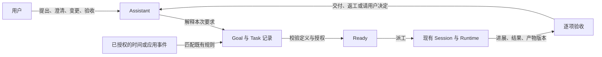

# Phaneris Personal Agent · 统一任务协调助手重构方案

Status: proposed — 2026-11-18 产品与架构评审稿，保留 Goal→Task→Session 的业务模型与交互取舍。

2026-11-18 · 产品与架构评审稿 · 本文取代同日第一版的角色和实施建议。

**用户把目标委托给 Assistant。Assistant 对需求、授权、协调和验收负责，现有 Agent Session 对具体执行负责。** 无论交付物是一个 HTML 文件，还是一项跨周研究，用户只需向同一个入口说明结果、约束和可自主决定的范围。Assistant 可以直接回答问题、澄清、读取执行证据、组织验收。生成文件、修改代码、操作其他应用等业务执行，通过受托 Session 完成。

重构的中心是**一项独立于聊天和执行会话的任务记录**。每次用户改口，系统都应能回答：哪项要求变了，哪些动作获得或失去了授权，哪些执行者实际收到了变更，最终交付的是哪个版本。第一阶段先证明需求接收能够可靠走到 Ready，再接通执行和验收。

## 1. 用户面对的产品

| 用户想知道 | Assistant 应给出的答案 |
|---|---|
| 你理解我要什么了吗？ | 用一句话说出目标和关键边界。清楚且有授权就继续，会导致不同结果的歧义才提问 |
| 我刚说的改动记住了吗？ | 指出哪项任务的什么要求改变了、影响哪些工作。可以点开原始要求和前一版 |
| 现在进展如何？ | 首先显示任务、阶段、阻塞和交付物；排障时才展开执行 Session、工具活动和回执 |
| 我要参与吗？ | 只在归属或范围无法确定、动作超出授权、用户指定本人验收，或真实障碍改变交付时打断 |
| 算做完了吗？ | 展示验收标准、对应结果和缺口。用户可以接受、要求返工或拒绝，反馈写回原任务 |

主入口是对话。涉及委托的消息可以带一张任务卡，显示目标、本次变化、状态和下一步。任务详情呈现要求、历史、授权、证据和产物。用户按“需要我决定、正在推进、待验收”查看工作，可以自愿打开 Session 原文。正常委托无需用户切换聊天、手工启动 Worker 或转述结果。

## 2. Goal → Task → Session

| 对象 | 回答的问题 | 身份与结束条件 |
|---|---|---|
| **Goal · 目标** | 用户最终希望达成什么？ | 稳定 ID、目标边界、成功标准、验收责任人和跨任务约束。跨天目标可以有多个 Task。简单委托使用一个 Goal 和一个 Task，界面合并展示 |
| **Task · 任务** | 哪一份可检查的结果交给了 Assistant？ | 稳定 ID、所属 Goal、任务定义版本和验收记录。换 Session、重试或更换模型均保留 Task ID |
| **Assignment · 派工记录** | 谁按哪版要求、凭什么权限做哪一段？ | 关联 Task、适用要求版本、有效授权、输入材料、输出约定、Session 和执行尝试。并行分工和先后接手均保留记录 |
| **Session · 执行资源** | 这次在哪里、用哪些工具完成？ | 由现有执行体系创建、复用、恢复或停止。工具活动、失败、完成及文件版本归回对应派工。后续独立的人类输入保留自己的归属 |

拆分标准是**能否独立委托、变更和验收**。养老研究的案例库和经济模型可以成为两个 Task；一个 Task 内的查资料、算表和排版可以是多个执行步骤。采用什么模型、用几个 Session 属于执行安排。全部必要 Task 通过后，Assistant 仍须检查 Goal，例如不同案例的经济口径是否可比、材料是否足以支持投资判断。目标达成、用户主动结束、目标无法达成分别记录。

## 3. 首要建设目标：从一句话到 Ready

这五步是必须具备的业务结果。明确请求可以通过一次模型判断、一次宿主事务完成。只有真正缺信息才增加用户交互。

| 阶段 | Assistant 的判断 | 宿主负责的事实与产出 |
|---|---|---|
| ① 理解输入 | 分开读出问题、动作、限制和禁止触碰的对象。一条消息可以同时问并发、改用途、确认交付形式 | 保存一次原文、附件、真实发送者、输入 ID、引用对象和接收顺序。工具重连及后台回执保留各自事件身份 |
| ② 识别任务 | 区分讨论、查询、新委托、补充、修改、撤销、控制、验收。先沿任务卡或引用定位，再看近期公开承诺和任务候选 | 每项诉求关联 Goal/Task、候选或“无需任务”。“昨天那个登录功能”若同时匹配后台和客户端，只问“指后台还是客户端？”；澄清期间保留待处理输入 |
| ③ 确认范围 | 提取目标、包含项和排除项、约束、交付物、验收标准。区分用户已指定、委托助手决定、仍需用户选择的部分 | 原话连同来源保存。明确且授权充分即可确认。助手采用的默认值可追溯，仅阻塞会实际改变结果或授权的部分 |
| ④ 记录要求 | 对已有要求提出新增、替换、撤回或保留，标出影响的任务、依赖和执行者 | 写入新版本、变更依据、取代关系、待同步对象和本条输入的处理结果。未决分歧保留为待决定项，旧要求保持可查 |
| ⑤ 准备执行 | 针对当前版本检查可执行性，给出缺口或派工摘要 | 核实范围清楚、输入可用、权限与环境具备、无关键冲突、标准可核验五项条件。写入绑定版本和授权的就绪记录，或返回具体阻塞原因 |

**Ready 表示这一版 Task 已具备派工条件。** 执行位暂满可以排队。缺少必需文件、连接没有授权、交付要求相互冲突，都会阻止受影响的 Task 就绪。排队要有调度受理记录，运行要有执行启动证据，达标要有验收结论。部分工作可独立推进时，把有不同授权或验收边界的部分拆为子任务，分别检查。

**处理指代。** 消息引用任务卡时直接使用该对象；“继续”追溯最近仍有效的用户要求；相似的旧任务标题只提供候选。“我自己已经启动了，帮我回顾为什么弄错”同时撤回待触发动作并提出诊断。已发出的动作保留待核对，随后一句“继续”承接诊断。问候、咨询和只读查询无需建任务。在两个实质不同的解释之间拿不准时，保存已明确部分，仅对争议部分提问。

## 4. 需求变更怎样落地

Task 当前版本至少包含目标与边界、要求及来源、交付物与验收项、依赖、有效授权引用和未决问题。每条要求有稳定身份和适用范围，例如“这一次推送”“这份报告”“以后的协作默认值”。模型提交业务含义，宿主负责写版本、查权限、合并并发变更、生成派工身份。消息哈希、执行序号和逐字重述用户目标均不应成为模型取得执行资格的手续。

以 11 月 18 日真实原话“这也要问我？当然是既派发又解开BCD的限制”为例。前文已明确 A 正在工作、应保留，并要求补发剩余工作。**新输入有两项行动，还继承了一项禁止变更的约束。** 假设已有养老 Goal 和 A–D，预期变更如下。

| 任务记录发生什么变化 | 对执行的影响 | 何时可以报告成功 |
|---|---|---|
| 保留 A 的任务、当前派工和已获准的工作范围 | 不向 A 发停止、重配或重建命令。此前确认的报告用途如需送达，使用同一派工的补充输入 | 原派工仍在，已有 WebSearch、WebFetch 活动可回查 |
| 分别记录 B、C、D 的资源调整事项，各自调研目标继续有效 | 读取实时阻塞。可独立写产物的任务使用自己的目录；确实独占的设备仍按实际资源等待 | 分别显示已修改安排、执行者已消费、已开始或仍在等什么。用户说“解除”不会让真实独占设备变成可共享 |
| 按已商定的原分工一次登记 E–H，汇总依赖相应成果 | 无空位的留在队列。同一逻辑任务沿用原 ID，重复投递不额外建任务 | 有 Task ID 后可说“已登记”；有调度受理回执才可说“已入队” |
| 保留报告用途、分篇文件和自包含 HTML 要求，以及既定 Worker 配置 | 报告用途进入适用派工和最终验收，模型与思考强度从可信设置读取 | 可以从 Task 当前定义和派工所用版本核对，无需用户再选一次模型 |

**事务和冲突。** 每项诉求保留去向、结果或澄清原因。必须共同生效的变更作为一组提交，例如撤销旧收件人并替换新收件人。独立组分别处理，一个环境阻塞不吞掉其他已授权事项。相同输入重放读取原结果；用户新发的一条同文消息仍按新意图判断。不同字段的并发修改可合并，同一要求的修改比较基准版本；用户明确纠正时取代旧项，解释仍有歧义时保留差异。结构校验能够验证记录，却不能证明模型理解正确，因此用户必须能看到并修正已保存的含义。

**传播和生效。** 新定义与待投递事件在同一事务落库。适配器向现有 Session 传送补充，区分待投递、已送达、执行者已消费。新约束影响下一次外部动作时，宿主在动作边界核对最新相关要求和授权。已发出的动作保留原结果及未知项。变更只使受影响的就绪和验收项失效。后端不能立即约束旧尝试时，冻结该项新准入，请求在安全边界停住，并向用户显示“变更待生效”。

**可实施的最小接口。** 四个操作均由宿主绑定身份。界面和模型使用同一组结果，重连后可按 ID 回读。

| 操作 | 调用方表达什么 | 宿主保证什么 |
|---|---|---|
| 提交任务变更 | 对象、要保留/替换/新增的要求、要回答的问题、相关原话或明确引用 | 按可信输入和基础版本核对。返回每项的新版本、未决冲突和传播状态。模型提案本身不授予操作权 |
| 检查就绪 | 指定 Task 及拟执行的工作 | 返回任务版本、所用授权、所需材料版本、检查结果或缺项。只读预演即可验证前五步 |
| 请求派工或控制 | 对就绪任务分配执行，或指明暂停、恢复、终止的对象集合 | 校验相关版本及最新控制状态后受理。重复请求复用回执。变更通知采用稳定投递 ID；进程崩溃后先查已有派工再决定是否补发 |
| 提交验收决定 | 针对特定产物版本逐条给出满足项、缺口、返工或接受意见 | 校验评审者权限、要求版本和产物版本。任一与本次评审相关的事实变更时，只重评受影响部分 |

## 5. 授权自主性

任务定义描述用户想得到的结果。授权描述谁允许系统在什么情境下，对哪些数据或目标做何种操作。记录授权来源、主体、范围、目标、允许动作、有效期或终止条件、是否需审批及撤回历史。任务可引用已有长期授权，也可仅取得本次授权。

| 决定 | 例子 | 系统行为 |
|---|---|---|
| 可自主执行 | 在指定工作区检索资料、生成草稿、按已定配置派工 | 目标、授权、环境均相符时直接推进，保留回执 |
| 需事前审批 | 将报告发给外部收件人 | 展示收件人、渠道、文件版本和实际效果。一次批准绑定所见动作；更换收件人或附件后重新评估 |
| 禁止或已撤回 | 指定私人资料不能发给 Worker；取消尚未发送的推送 | 在派工和效果边界拦截。既有产物和已经发生的效果保留记录 |

实际可执行范围取**当前委托、有效授权、工作区策略、执行资源实际能力**的交集。要求扩大范围时先登记变更提案，新增授权后才派发。外部邮件、Worker 建议、历史会话和模型推断均可提供信息，不能自行扩大授权。接受一份报告也不自动批准外发。

授权缩小、过期和取消优先于旧派工、审批卡及待发送队列。外部请求已经送出却丢失回执时，按服务方标识核对，效果明确前不重复发送。这类未知项只阻止可能重复该效果的动作，用户仍可查询进度和推进其他授权工作。

授权必须能在实际工具边界执行。例如，只有“读取指定邮件、写本地草稿”的派工，Session 只取得相应的读取和草稿能力。若某连接器只能授予整账号读写，且宿主无法约束收件人或发送动作，该步应显示具体的权限缺口，改用能受限的接口或重新请求授权。写进提示词的限制不足以使它就绪。

## 6. 四项 Personal Agent 能力如何共同服务委托

| 能力 | 机制 | 用户获得的结果 |
|---|---|---|
| **持久化记忆** | 协作偏好、长期目标、历史决定、项目事实各有作用域、来源和更正记录。任务状态从 Task 读取。明确的模型和思考强度进入设置；本次要求留在任务，长期目标关联 Goal | “我是谁”回到获准的记忆，“报告做到哪了”查到执行事实。用户能查看、更正和撤回指定范围内的记忆 |
| **主动智能** | 订阅获准的时间、数据变化和任务事件，记录触发条件、允许推进的目标与动作、通知方式和停用条件。事件去重，重启后核对漏过的触发与已生效果 | 交付到达自动唤醒验收，依赖满足后推进下一任务。常规进展安静记录，真实阻塞、需要用户决定和可交付时才通知 |
| **跨应用编排** | Assistant 安排依赖，Session 通过已有连接器执行并保留每步输入、结果和回执。例如读取获准的日历会议和邮件、生成会前简报、准备发送提案 | 用户只交代一次结果。邮件读取失败时可先整理日历部分，缺口可见；草稿可完成，需要审批的发送单独等待 |
| **授权自主性** | 自主、需审批、禁止三类决定在动作边界生效。已配置的连接器按本次工作和实际作用选用，真正的设备独占、写入冲突或供应商限流由执行层处理 | 用户通过 Assistant 设定“此类草稿自己做”“发给外部之前问我”“暂停这个目标下的工作” |

后台记忆维护、定时触发、应用事件使用独立的执行上下文。结果作为带归属的通知进入收件箱。把昨天未完的工作带到今天，需要用户明确承接或一条仍然有效的主动规则。用户第二天说“你好”，助手可以自然回应，同时维持已授权工作在后台的连续性。

## 7. 分发、跟踪、验收，直到 Goal 达成

**分发。** Assistant 按交付物和数据依赖安排工作。独立且获准并行的 Task 可以一并受理；下游 Task 引用前置产物的已发布版本。复用 Session 时核对任务归属、材料隔离、授权及待结算效果；不兼容时为同一 Task 建立新派工。执行容量只改变开工顺序。普通 Session、已有 TaskRunner 流程和自动化各自由原执行者运行，一个执行节点只有一个调度所有者。

**跟踪和控制。** 任务卡同时显示观测时刻、当前运行状态、最近一次已完成的工具活动和阻塞原因。席位占用与实际运行数分别统计。即使明细分页，汇总也须来自同一时点。用户说“暂停所有任务”，先从所回复对象、当前 Goal 或明确的工作区限定确定目标集合；范围不清时先冻结明确部分的新准入，澄清剩余对象。暂停保留恢复能力，终止关闭剩余准入和重试，迟到的回执只补记原尝试。受理、停止中、已停止分别可见。

**验收。** Worker 返回候选产物和版本。Assistant 按 Task 当前验收条件逐项记录“满足 / 有缺口 / 待用户判断”，并引用文件位置、测试结果或原文。Assistant 可以只读打开成果并比较证据；渲染、测试、修复和额外调研由执行 Session 完成。用户指定本人验收时保持待验收；已委托 Assistant 验收时按规则关闭并送达。接受、拒绝或返工均关联具体版本和反馈，返工沿用原 Task 与历史产物。

**Goal 收敛。** 全部必要 Task 通过后，再检查整体成功标准。八份养老调研文件齐全，若成本口径仍无法横向比较，就不能宣称已满足投资判断用途。范围内的缺口安排补充；需要新增付费数据、扩大样本或改变交付标准时，把选择和影响交给用户。最终交付呈现报告、结论、覆盖情况和真实缺口。

Task 的定义、执行与验收分别有状态。例如“B 正在按第 2 版执行，第 3 版要求已记录，正在同步”是合法状态。把三者覆盖成一个“进行中”，会同时隐藏需求变化和真实进度。

## 8. 三个参考项目的取舍

下表依据固定提交的项目文档和源码。最后一列是 Phaneris 的设计选择。

| 参考 | 可核对的机制 | 用于 Phaneris |
|---|---|---|
| **dsh-superagent-prototype** | Source 产生 Trigger，Eval 按策略作 Decision，接受后建立带 Mandate 的 Ticket，Assignment 表示一次执行归属。上下文订阅可以投递信息，授权有独立来源。重试可更换 Assignment | 领域模型借鉴“判断、授权、任务、派工”各有身份。Phaneris 由 Assistant 统一处理跨任务变更，再增加版本化要求、Goal 和用户验收。扩大范围需要新授权依据，历史授权可追溯。[领域模型](https://github.com/deepseek-ai/dsh-superagent-prototype/blob/8c32a9dc5d72c033816c6a8110b37f40cf94fba4/docs/001-domain.md) · [授权](https://github.com/deepseek-ai/dsh-superagent-prototype/blob/8c32a9dc5d72c033816c6a8110b37f40cf94fba4/docs/002-authorization.md) · [派工实现](https://github.com/deepseek-ai/dsh-superagent-prototype/blob/8c32a9dc5d72c033816c6a8110b37f40cf94fba4/src/core/assignments.ts) |
| **DS-Bot** | Chief 提供起始入口。群组目标有阶段和验收条件，每次变更带 revision 和事件。投递账本区分记录与实际送达 | 借鉴一处委托、成果回到同一入口、分阶段检查，以及随交接传递原要求。用户界面以目标、结果和待决定事项组织；Bot 分工留在详情。[Chief 与协作方式](https://github.com/Fei2411/DS-Bot/blob/5e9b7da8882da3b68d8a0624342708c2150a9156/README.zh.md) · [Goal 实现](https://github.com/Fei2411/DS-Bot/blob/5e9b7da8882da3b68d8a0624342708c2150a9156/ds-bot/src/host/goals.js) · [送达实现](https://github.com/Fei2411/DS-Bot/blob/5e9b7da8882da3b68d8a0624342708c2150a9156/ds-bot/src/host/delivery.js) |
| **OpenFuse** | 富消息保留 Task ID，重新打开后读取当前任务、产物和预览。服务端核对所审提案版本、是否过期，以及任务是否仍允许执行 | 可直接借鉴的交互是实时任务卡、产物预览、限定具体效果的审批卡。Phaneris 继续使用 Electron、Artifact 和现有权限体系。[富消息与任务](https://github.com/CopilotKit/openfuse/blob/67580f16059d9c10111db00768e8a235d06cafdc/docs/RICH-THREADS.md) · [任务卡](https://github.com/CopilotKit/openfuse/blob/67580f16059d9c10111db00768e8a235d06cafdc/apps/mobile/src/thread-artifacts.tsx) · [审批实现](https://github.com/CopilotKit/openfuse/blob/67580f16059d9c10111db00768e8a235d06cafdc/apps/server/src/actions.ts) |

DSH 还有两个容易误用的细节。其订阅机制能把跟进消息直接交给持有 Ticket 的执行者，这适合单仓库议题；在 Phaneris，一条消息可能同时问 A、修改 B、撤销 C，因此先由 Assistant 分解诉求，再定向送给执行者。其次，DSH 的 Worker 可以用 ready 报告成果；本方案的 Ready 专指执行前就绪，执行后统一进入待验收。复用这些机制时必须保留 Phaneris 自己的业务语义。[跟进消息与授权](https://github.com/deepseek-ai/dsh-superagent-prototype/blob/8c32a9dc5d72c033816c6a8110b37f40cf94fba4/docs/002-authorization.md) · [执行与报告](https://github.com/deepseek-ai/dsh-superagent-prototype/blob/8c32a9dc5d72c033816c6a8110b37f40cf94fba4/docs/003-execution.md)

## 9. 在 Phaneris 的落点和实施顺序

建议在现有服务端增加工作区级的 Task 记录及变更入口。SQLite 保存 Goal、Task 当前版本、要求变更、授权引用、派工映射、待投递事件和验收决定；定义更新与待投递事件同事务写入。模型和界面调用同一业务接口。实际执行效果以现有 Runtime 为准，文件版本以 Artifact 为准。Task 保存引用。

| 现有位置 | 复用或改变的边界 |
|---|---|
| 工作区看板 | 现有 WorkItem 投影使用 Session ID。增加以 Task ID 查询的助手任务视图，保留普通 Session 原展示方式。Task 可以先存在再派工，也可以关联多个 Session。[现有投影](../../packages/server-core/src/planning/workspace-planning.ts) |
| 输入与准备 | 沿用可信输入来源和原文引用。Task 领域判断这项委托是否 Ready，已有上下文准备负责一次模型调用的材料。只读本次原文、明确引用、相关 Task 版本和适用记忆。[输入边界](../../packages/server-core/src/sessions/input-contracts.ts) · [上下文准备](../../packages/server-core/src/context/work-preparation.ts) |
| 分发与运行 | 复用 SessionManager、Worker 控制、Runtime 回执与资源协调。在适配层传入 Task、版本、授权及派工身份，回执归回 Task。已有 task.yaml 是工作流定义，可引用其 run，无需再复制一套节点调度。[SessionManager](../../packages/server-core/src/sessions/SessionManager.ts) · [Worker 控制](../../packages/server-core/src/resident-assistant/worker-controls.ts) · [TaskRunner](../../packages/server-core/src/tasks/TaskRunner.ts) |
| 交付和面板 | 沿用 manifest 与 Artifact 版本，补上“验收项 → 证据 → 决定”。面板按 Task ID 读有界快照、订阅变化，重连后补缺口。历史不会触发前台全量扫描。[结果清单](../../packages/server-core/src/resident-assistant/task-results.ts) · [现有入口刷新](../../apps/electron/src/renderer/components/resident-assistant/useResidentSnapshot.ts) |

1. **先交付需求接收与执行准备。** 实现独立 Task 身份、归属判断、要求版本、授权判定和 Ready 记录。从桌面输入自然语言，执行适配器暂作只读预演。此阶段的交付标准是用户能看到已登记的要求、待澄清项、就绪依据，以及改口后哪些旧动作失效。
2. **贯通一个真实任务。** 对“生成一个鹈鹕骑自行车的 HTML”，形成单 Task，派给现有 Session、取回文件、打开核验并交付。加入中断、重试和返工，验证 Task 身份持续，验收指向正确版本。
3. **扩展到多任务 Goal。** 接通并行分工、变更传播、审批和收件箱。用养老案例验证保护 A、调整 B/C/D、补发 E–H、暂停和整体交付。用会前简报验证跨应用读取、已生成草稿与待审批发送三个不同事实。
4. **受控切换。** 先在隔离副本只读重放，再用工作区开关接入新委托。旧在途工作由原执行者结算，可核实的映射只绑定一次，效果未知的留待核对。回退先冻结新准入，排空或显式移交在途工作；原文、回执、产物仍可查。

## 10. 用真实委托验收

先固定失败条件，再实施。确定性回放检查权限、版本、恢复和归属；真实模型从桌面接受自然语言，检验语义判断、额外打断和最终交付质量。两类证据分别报告。

| 场景 | 必须观察到的事实 |
|---|---|
| 问候、查询、模糊指代 | 问候不会唤起昨天的故障；只问进度无写入；两个匹配的登录任务只问一次消歧，澄清前无误派 |
| 清楚的小任务 | 无重复确认，无 Session 时已可查看 Task。现有 Session 负责生成文件，Assistant 组织验收 |
| 复合输入与重放 | 每项诉求都有去向；source 激活两次仍只有一次人类授权；重放同一提交不重复派工；一项待批不会吞掉其他已授权事项 |
| 养老调研补发 | A 保留原尝试与工具历史，B/C/D 各有处理和生效状态，E–H 各有受理证据。用途、研究重点和 HTML 要求可追到派工与验收，既定模型无需再问 |
| 主动触发与跨应用审批 | 重复事件只推进一次。更换收件人、附件或撤权后，旧审批无法发送。回执区分草稿、待审批、已送达和结果未知 |
| 暂停和终止 | 暂停可恢复，终止关闭后续准入。过期派工、旧审批和迟到回执不能启动新效果，查询保持可用 |
| 返工与 Goal 验收 | 旧版产物不能满足已修改的验收项。用户反馈保留在原 Task；全部子任务已结束时，仍能识别整体目标尚未达成 |

针对卡顿，在同一台 Windows 机器、同一模型和工作区分别测现版、普通 Session 和新版。记录输入到 Ready 的本地耗时及模型往返数、Ready 到受理与开工的耗时、首次可见进展、前台事件循环延迟、读取字节与 token、无需用户决定却发生的追问次数。分别报告冷/热、样本数、P50、P95 和失败次数，使用原规模与十倍历史量测试普通问候、单任务查询和控制操作的读取边界。养老案例从输入到首个派工回执约 306 秒，覆盖多个环节，只作端到端现场对照。

验收留存脱敏输入、任务版本与授权差异、执行和控制回执、用户可见答复、实际文件及验收结论。养老案例分两条回放，一条按真实对话暂停再终止，另一条从补发后继续直到交付。两条分别验证用户改主意时能否控制住，和授权持续有效时能否完成目标。

**本机依据。** 现场以 Work 工作区会话 `261105-copper-cloud` 截至 11 月 18 日 09:59:34 的片段为准。原始养老需求 `msg-1794965377867-d1f51d916a6c`，用途与格式 `msg-1794965886300-958390ab3b3a`，保留 A 并补发 `msg-1794966440965-2e43194d53e5`，两项都做 `msg-1794966628880-31d01faa7a6a`，暂停与终止 `msg-1794967113242-b16b03d6c202`、`msg-1794967124202-335f63bbe1ef`。A 的检索事实来自执行 Session `261118-sleek-moss`。现有源码基线为 `eecf8b3ba`。本文为待实施设计；参考项目已核对源码，新版尚无运行或性能实测。

