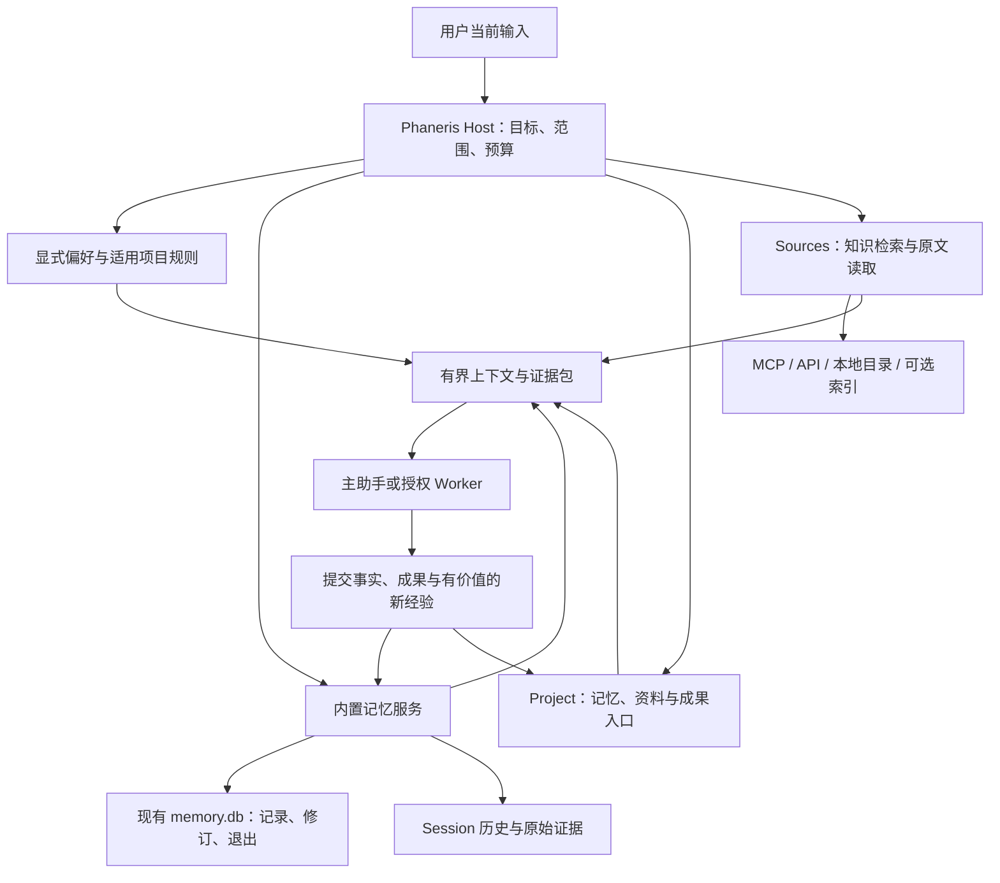

# 个人助手的内置记忆、Project 与知识库：Hermes 对照与设计收敛

Status: historical — 保留 Hermes 对照与个人设计讨论；能力、目录、迁移和实施顺序以[最终综合计划](resident-assistant-permissions-memory-final-plan-2026-11-05.md)为准。

日期：2026-11-05。状态：研究与设计建议，未实施。

本稿承接[权限与腾讯记忆中枢分析](assistant-autonomy-memory-hub-analysis-2026-11-05.md)。按用户本轮明确的个人使用、偏好内置、不需要团队功能的条件收敛：**首期采用内置记忆服务，外部记忆 Provider 不进入近期实施目标；已有 MCP 知识库继续使用。** 保留清楚的模块边界即可，不预建通用记忆插件平台。

## 1. 推荐的最终形态

**一个由 Host 管理的内置记忆服务，统一查询已有个人偏好、工作区记忆、Project 记忆与相关历史；知识库继续作为独立资料来源，按需检索。**

常驻在模型上下文中的内容保持精简；完整经历留在历史，项目细节留在 Project，文档正文留在知识库，经过验证的方法进入 Skill。助手需要知道去哪里找、当前哪些结论仍然有效，不必把所有内容再记一遍。

| 内容 | 归属与用途 | 默认使用方式 |
| --- | --- | --- |
| 显式个人偏好、协作协议 | 现有 Preferences、适用 AGENTS.md | 维持原所有权，按作用域加载 |
| 工作区内长期背景、稳定习惯、非项目专属经验 | 现有助手记忆库 | 小型常驻摘要 + 有关时召回；推断不写成用户确认 |
| 项目目标、决定、约束与项目经验 | 对应 Project | 项目内维护；主助手按任务读取，不全量复制到常驻记忆 |
| 历史对话、任务结果、成果版本 | Session / Runtime / Task / Artifact | 保留原始证据，索引与有界回查 |
| 文档、笔记、书籍、资料库 | Sources / Project assets / 本地目录 | 检索与读取正文；不因读过就自动变成个人事实 |
| 可复用操作方法 | 现有 Skills | 形成有适用边界、来源与验证规则的方法资产 |

不做 Team、成员、角色、共享市场或跨组织 ACL。workspace 与 project 边界、来源可用性、凭据、撤销和数据删除仍要保留：个人使用并不会让旧内容自动成为当前事实，也不会让一个知识库文件变成授权。

## 2. 研究基线与验证边界

- Hermes：`NousResearch/hermes-agent`，固定提交 `ed1afb082eb3e46cf2edae9d8f68fb67b09ee4df`，提交时间换算为北京时间为 2026-11-05 04:04:37。
- 腾讯：沿用上一轮固定提交 `2002196f2d7c22ea267cfcaf67c5a6fa861df681`。
- Phaneris：以当前工作树为准，包含此前未提交的助手开发变更；本次只新增本文。
- 方法：源码与官方文档交叉核对。未运行 Hermes，未部署外部记忆服务，未测真实模型回忆质量；以下区分观察与建议，不宣称已验证收益。

Hermes README、在线文档与最新源码存在部分描述漂移。例如 README 仍提历史搜索配合 LLM 摘要；固定版本的 `session_search_tool.py` 明确直接返回数据库消息、不调用 LLM，并对部分读取内容设上限。分析以具体实现为准，不能把宣传描述直接当运行事实。

## 3. Hermes 的内置记忆究竟是什么

### 3.1 少量常驻笔记，而非四层语义数据库

| 部分 | 固定版本中的实现 | 意义 |
| --- | --- | --- |
| `MEMORY.md` | agent 的环境事实、惯例、经验笔记；默认上限 2200 字符 | 只保留值得反复携带的内容，不容纳所有经历 |
| `USER.md` | 用户偏好、沟通与交付习惯；默认上限 1375 字符 | 用户背景与一般工作笔记分开 |
| 注入 | 在会话开始加载，形成冻结的 system-prompt 快照 | 稳定前缀有利于缓存；中途写盘不会直接替换该快照 |
| 写入 | `memory` 工具支持 add / patch / remove，以及批量 operations | 模型可以自主整理；不是仅靠人编辑文件 |
| 满额 | 工具返回超限错误，要求模型合并、缩短或移除后重试 | 没有一个后台存储算法自动决定哪些事实可以丢掉 |
| 去重 | 拒绝完全相同的重复条目 | 并非完整的语义去重与冲突裁决 |

这些字符上限是 Hermes 的默认实现参数，不应直接作为我们的产品预算。中文、代码和多语混排的字符/token 密度不同，应分别校准。文件名也不是必须照搬的架构。

来源：[MemoryStore](https://github.com/NousResearch/hermes-agent/blob/ed1afb082eb3e46cf2edae9d8f68fb67b09ee4df/tools/memory_tool_store.py)、[工具入口](https://github.com/NousResearch/hermes-agent/blob/ed1afb082eb3e46cf2edae9d8f68fb67b09ee4df/tools/memory_tool.py)。

### 3.2 完整历史另外保存、按需找回

`session_search` 使用本地 SQLite 会话数据库和 FTS5，提供关键词发现、按消息邻域展开、按会话读取和浏览。最新工具不通过另一个模型重新编造历史摘要，而是返回原始数据库消息及定位信息；部分路径有截断和数量预算，并可进一步展开。

其实现还会区别压缩延续的会话链、用户交互与重复自动任务，避免同一经历重复占据结果。固定版本含 CJK bigram 分词索引及能力降级路径；因此不能将它概括成“英文 FTS 就解决所有中文检索”。

来源：[历史搜索工具](https://github.com/NousResearch/hermes-agent/blob/ed1afb082eb3e46cf2edae9d8f68fb67b09ee4df/tools/session_search_tool.py)、[FTS 与 CJK 索引](https://github.com/NousResearch/hermes-agent/blob/ed1afb082eb3e46cf2edae9d8f68fb67b09ee4df/hermes_state_fts.py)。

### 3.3 学习通过前台工具与后台复盘共同发生

Hermes 指导模型主动记住明确偏好、环境事实、纠正与惯例，跳过日志、大段原始数据和临时内容。另有按触发条件运行的后台复盘，检查是否值得保存记忆或创建/更新 Skill。

后台复盘是受工具白名单和预算约束的辅助模型运行，不是纯粹的文件整理线程。其代码包含前台优先、取消、输入预算以及本地模型空闲调度。默认预算、执行成本和并发行为属于实现选择，不能仅凭“自动学习”推断它开销很低。

特别需要区分：**`write_approval` 默认关闭，并不意味着所有后台修改都无人审核。** 固定版本的 `_background_delete_gate` 会将无人值守复盘中的 patch/remove，包含批量中的相关操作，送入待审核；add 仍可执行。这与我们希望日常可逆维护自主完成的方向存在差异。

来源：[后台复盘](https://github.com/NousResearch/hermes-agent/blob/ed1afb082eb3e46cf2edae9d8f68fb67b09ee4df/agent/background_review.py)、[后台变更 gate](https://github.com/NousResearch/hermes-agent/blob/ed1afb082eb3e46cf2edae9d8f68fb67b09ee4df/tools/memory_tool.py)、[官方配置说明](https://hermes-agent.nousresearch.com/docs/user-guide/features/memory)。

### 3.4 Skill 是单独维护的方法资产

Hermes 将从工作中学到的方法保存为 Skill。`/learn` 通过现有 agent 工具收集来源并创建技能；大型资料可以组织为精简入口和按主题拆开的 references，而非把整本书塞入常驻记忆。

它还有 Curator，主要维护 agent 创建的 Skill：记录使用、过时与归档；默认不自动物理删除。广泛的模型合并整理需单独启用。可吸收的是使用边界、可恢复归档与方法/事实分离；不必采用它的具体维护周期或默认规则。

来源：[/learn 实现](https://github.com/NousResearch/hermes-agent/blob/ed1afb082eb3e46cf2edae9d8f68fb67b09ee4df/agent/learn_prompt.py)、[Curator](https://github.com/NousResearch/hermes-agent/blob/ed1afb082eb3e46cf2edae9d8f68fb67b09ee4df/website/docs/user-guide/features/curator.md)。

### 3.5 内置可以独立工作，同时容许外接

Hermes 也有外部 Memory Provider 生命周期：初始化、获取背景、每轮 prefetch/sync、结束/压缩前处理与工具分发。内置文件和外部 provider 可同时存在，并有镜像写入路径。

这说明内置与可扩展并不冲突，但不证明我们现在需要实现整套 Provider 框架。镜像体系还需要额外解释修改、移除和遗忘传播；不能将“多存一份”当作更可靠的同义词。

来源：[Provider 契约](https://github.com/NousResearch/hermes-agent/blob/ed1afb082eb3e46cf2edae9d8f68fb67b09ee4df/agent/memory_provider.py)、[官方 Provider 说明](https://hermes-agent.nousresearch.com/docs/user-guide/features/memory-providers)。

## 4. Hermes、腾讯与我们：取各自适合的部分

| 维度 | Hermes 的启发 | 腾讯的启发 | Phaneris 建议 |
| --- | --- | --- | --- |
| 产品形态 | 内置即可形成个人学习闭环 | 可独立部署的多 Agent 记忆服务与治理面 | 内置、单用户，无需额外服务才能工作 |
| 常驻内容 | 极少量 curated notes | 人格/情景导航与原子检索分离 | 少量协作摘要与任务相关记忆，正文按需取 |
| 历史 | 原始会话可搜索 | L0 与提炼资产分离 | 继续复用本地 Session，不新增聊天主库 |
| 组织方式 | 文件条目与 Skill | 原子、情景、画像的语义组织 | 保留原子与情景；无需每条经历走完四层 |
| 更新 | agent 工具与后台复盘 | 增量流水线与去重 | Host 持久、受预算维护；前台及时响应 |
| 当前性 | 内置常驻快照冻结到会话边界 | 各路径有自身缓存策略 | 利用现有 revision/依赖，纠错与遗忘影响下一请求 |
| 数据可靠性 | 文件锁、原子写、漂移与超限处理 | 来源记录与生成管线 | 保留现有 SQLite 事务、来源、争议、时效与 suppression |
| 知识接入 | 文件工具、MCP、可按需加载的参考文件 | Wiki / CodeGraph 引擎 | 先把已有 Sources 和项目资料用好，按漏检需求补索引 |

不建议把现有结构化记忆降为两份无逐条来源的自由文本，也不建议因腾讯功能完整就把团队控制面一并搬入。内置由谁运行决定，数据用 SQLite 还是 Markdown 决定不了产品是否“原生”。

另一个不能直接照搬的范围规则：Hermes 的历史搜索默认隐藏 subagent、kanban 和 tool 来源。Phaneris 的 Worker 承担实际工作，其交付和验证恰是重要来源，因此应保留来源归属和有界读取，不能因它属于子会话就一律排除。

## 5. Project 是否还需要全量记忆

**不需要把 Project 的全部内容再次提炼到助手记忆，更不需要在每轮加载全部 Project。** 但需要让助手能发现项目、定位相关内容，以及在必要时回查。

### 5.1 当前项目基础的实际能力

已核对：

- Project 有独立配置、工作目录、details、assets 和 `MEMORY.md`。
- `project_memory_append` 通过 Host 将短记追加到项目文件，避免从旧快照重写覆盖其他会话新增内容。
- 项目记忆默认加载预算为 5000 token；超出时保留头尾并省略中间。该数字是当前代码参数，不代表全部项目结论都已被正确筛选。
- 项目 assets 向模型提供轻量清单，正文原本就要求相关时按需读取。
- 助手数据库已支持 projectId 作用域，但其来源契约当前仅支持 Session/message，尚未把项目文件和 MCP 文档统一成可验证来源。

来源：[Project 存储](../../packages/shared/src/projects/storage.ts)、[项目 prompt](../../packages/shared/src/prompts/system.ts)、[记忆来源契约](../../packages/session-tools-core/src/memory-contracts.ts)。

因此，“有项目 MEMORY.md”是很好的已有基础，但不能据此宣称项目记忆已经具有自动去重、当前性筛选和完整召回。

### 5.2 四个操作必须区分

| 操作 | 是否需要 | 建议 |
| --- | --- | --- |
| 保留完整项目原始资料 | 需要，按原保留策略 | 留在 Project、文件、历史、成果各自所有者处 |
| 将已允许资料纳入可检索范围 | 有价值，按规模选择 | 可建立目录、关键词或全文索引；这是检索投影，不是再次学习全部内容 |
| 提炼所有项目内容为长期记忆 | 不需要 | 只提炼有复用价值的决定、约束、经验与必要情节 |
| 把全部项目内容注入当前对话 | 不需要 | 按本轮项目、问题与证据需求选择 |

“不全量记忆”不等于“不能全文索引”。全文索引可以覆盖较完整的已授权范围，而常驻摘要与提炼条目保持很少；这两个预算应独立。

### 5.3 主助手只携带项目导航与接续摘要

助手可知道项目的名称、用途、入口、最近有意义的进展、关键约束所在和未完成工作的权威引用。深入讨论时再读项目决定、原文和成果。

| 信息例子 | 正确归属 |
| --- | --- |
| “Phaneris 目前以个人使用为主，首期不做团队功能” | Phaneris 的项目决定 |
| “这个项目用 Bun，某次迁移失败有特定原因” | 该 Project 的约定与经验 |
| “用户明确要求中文沟通、禁止 emoji” | 适用的显式协作协议/偏好 |
| “某文档提出一种与用户观点不同的理论” | 知识来源，不能提炼成用户信念 |
| “项目 A 的方法可能适合项目 B” | 先作为本轮跨项目比较；验证适用条件后才考虑一般化 |

项目导航不应让每次修改都成为一次全量摘要：原记录版本变化时只更新受影响的提示；任务完成与待批准状态继续读 Task/Runtime，导航不得自建另一份任务状态。

### 5.4 避免 Project 与助手重复记账

近期建议保留 Project `MEMORY.md` 的现有所有权和写入路径：

1. 项目专属的新决定与经验继续进入对应 Project；助手工具通过同一 Host 项目写入能力调用，不另写一份工作区通用事实。
2. 记忆服务对项目文件建立有版本、可定位的索引及短摘要；这些是派生视图，不能独立修改后反过来覆盖原文件。
3. 若项目结论已在原文件中表达，保存其引用和适用范围即可，不再从摘要提取成多条“独立证据”。
4. 已存在的 projectId MemoryRecord 保留兼容，按来源去重与回查；不在接入时自动删除或批量迁移。
5. 若以后需要结构化项目原子和精确状态，再单独设计 Project 写入权威的迁移。不能让 MEMORY.md 和数据库同时成为同一条事实的两个独立可写主库。

## 6. 我们的内置记忆应如何工作

### 6.1 一套服务，按已有范围管理

不新增全局推断用户库：显式全局偏好继续归 Preferences；自动学习默认留在当前 workspace，项目内容归 project。个人使用不要求增加 teamId、用户角色或租户平台。

内置服务复用现有 `memory.db`、Session 目录、项目存储、Context Segment 与 Host 生命周期。界面仍是当前助手和按需打开的记忆管理入口，不新建 Memory Hub 子产品。

### 6.2 常驻摘要、情节与原文入口

- **常驻摘要**：稳定且明确的协作习惯、工作背景、当前相关项目入口；有预算、来源与 revision，不重复所有原子。
- **可检索记忆**：事实、决定、经验，以及有必要时生成的情节。情节是某件事情的背景、条件和关键决定，不是新的项目或任务系统。
- **历史与来源**：保留原始 Session、Project、Artifact 和知识源，能够从摘要回到正文。

这与 Tencent 的 L0/L1/L2/L3 可以做概念映射，但无需强迫所有信息经过“原文→原子→情景→人格”的流水线。明确偏好可以直接形成带出处的摘要，项目资料可以一直留在项目中。

### 6.3 自动学习与退出

在稳定轮次、明确纠正、任务里程碑和 Host 空闲时调度受限维护。模型产出建议，Host 校验来源、范围、版本和操作策略后提交；允许“没有值得保存的内容”。学习状态由提交回执证明，不能只由一句“我记住了”证明。

明确偏好与有据观察可自动保存；低风险归纳保持 inferred 标识。冷却、到期、同范围明确纠正和派生摘要重建在策略内自主执行；永久遗忘按明确请求执行，原始数据删除仍是独立动作。沿用上一份报告的范围与授权原则。

不复制 Hermes 的后台 patch/remove 一律待审核策略；应依据是否可逆、是否只是派生维护、是否改变显式决定来控制。也不让主助手忙于无限复盘；队列有预算、去重、恢复与前台优先。

### 6.4 长驻助手无需用户手工制造会话边界

Hermes 的冻结内置快照适合频繁开始新会话的使用方式。我们的主助手逻辑 Session 长期存在，因此应由 Host 在适当边界重新组装有界上下文，并按 revision 复核材料。未变化的块保持稳定以利用缓存，发生纠正/遗忘的块及时失效。

不能把“请手工开新会话才生效”作为记忆一致性机制，也不能为了缓存继续发送已经退出的旧信息。此处复用我们已有的 Context Segment 与依赖检查。

## 7. 个人知识库：成熟产品有几种实际接法

### 7.1 文件导入与项目知识

Claude Projects 支持上传项目资料，并在接近上下文容量时通过项目知识搜索按需检索。它明确区分“资料可用”和“全部资料同时放在上下文里”。这属于产品管理的知识语料，不是个人偏好记忆。

来源：[Claude 项目 RAG](https://support.claude.com/en/articles/11473015-retrieval-augmented-generation-rag-for-projects)。

### 7.2 连接已有服务，实时检索与读取

Claude Connectors 可以连接现有应用，也支持自定义 MCP。用户看到目录、认证和可用能力，底层通过连接器访问原服务。Google Workspace 连接器提供 Drive 搜索、读取及其他受权限约束的操作；不是必须先把整个云盘复制成模型记忆。

来源：[连接器](https://support.claude.com/en/articles/11176164-use-connectors-to-extend-claude-s-capabilities)、[Google Workspace](https://support.claude.com/en/articles/10166901-use-google-workspace-connectors)。

### 7.3 本地文件与笔记库直接读取

Hermes 自带 Obsidian Skill，通过已知 vault 路径和文件工具列取、搜索、读取或按要求编辑 Markdown。它并没有把“个人知识库”强制定义成向量数据库。

目录规模、文件格式与问题类型决定是否需要更强索引。文件名、目录、标题、链接与关键词足够时，可直接使用；扫描图片/PDF 等资料则需要可用解析，不能凭发现文件名声称已理解正文。

来源：[Hermes Obsidian Skill](https://github.com/NousResearch/hermes-agent/blob/ed1afb082eb3e46cf2edae9d8f68fb67b09ee4df/skills/note-taking/obsidian/SKILL.md)。本次只将该文件作为研究对象，没有执行其中操作。

### 7.4 本地或自托管的资料索引

AnythingLLM 区分会话附件与 workspace 中可跨对话检索的嵌入文档，支持 RAG 与重排。其自动文档同步功能能更新已监控文件的嵌入；官方仍将相关同步功能放在 beta 文档中，支持范围与进程运行条件需要按功能核对，不能称为任意目录实时同步。

来源：[文档使用](https://docs.anythingllm.com/chatting-with-documents/introduction)、[自动同步](https://docs.anythingllm.com/beta-preview/active-features/live-document-sync)。

这些路径可以并存：本地目录、上传资料、已有知识服务、MCP 和原生 API。**MCP 是接入协议，RAG 是检索与组装方法，Memory 是经验与个人背景的维护机制；它们不是互相替代的同类选项。**

## 8. 我们的知识库缺口，主要在产品组织而非接入协议

当前 Sources 已支持 MCP / API / local，MCP 还支持 tools、resources 和 prompts。现有实现会检查会话已启用且连接的来源；本地目录来源只提供入口，不会自动为整盘建索引。这些能力可以继续复用。

主助手目前的角色白名单主要是记忆、历史和工作协调工具，不能因为 Sources 已配置就假称主助手能够直接读取全部外部知识。需要增加受限的只读知识查询能力，或明确由 Worker 负责检索；不必因此放开主助手通用 shell。

来源：[Sources 类型](../../packages/shared/src/sources/types.ts)、[MCP 来源回调](../../packages/server-core/src/sources/mcp-source-tool-callbacks.ts)、[主助手工具范围](../../packages/shared/src/agent/resident-role.ts)、[本地目录说明](../../apps/electron/src/renderer/docs/guide/zh-Hans/sources/local-filesystems.md)。

### 8.1 给已有 Source 增加知识用途

建议在现有 Sources 上表达少量产品信息：

| 信息 | 作用 |
| --- | --- |
| 名称与资料说明 | 让助手知道哪个库保存什么内容 |
| 默认适用范围 | 当前 workspace 通用，或与某个 Project 关联 |
| 实际能力 | 能搜索、列目录、读取正文，还是只能给出资源清单 |
| 已授权的读写边界 | 可自动检索不等于可改笔记或发布文档 |
| 当前可用状态 | 已连接、待认证、失联、覆盖不足分别呈现 |
| 引用与更新信息 | 原 URI/路径、标题、段落位置、可取得的版本/更新时间 |

这是 Sources 的知识路由信息，不是另一套连接配置、凭据仓或知识库产品。关联 Project 也不意味着自动启用全部来源；读取仍经过既有可用性与授权检查。

### 8.2 不假设所有 MCP 服务都提供同一种搜索

MCP 工具发现不等于全文索引；resources 列表也不等于全文搜索。已有知识库若提供成熟搜索，优先调用其搜索和原文读取，不再抓全库重建一份向量库。只有列目录/读文件能力的来源，使用相应目录搜索或按需求增加本地索引。

主助手按当前问题和项目选择少量相关来源。结果进入统一的证据包，保留原始排名、位置、来源和能力缺口；不同服务分数不可直接相加。索引未完成、无匹配、无权限与服务错误必须区别。

不要对每条日常消息搜索所有库，也不要机械先检索记忆才能读知识。任务明确指向一份资料时直接读取；任务要求历史接续时先查历史/项目；跨来源问题才组合检索。

### 8.3 知识与记忆之间只保存必要关系

读完一本书，不自动把书中观点存成“用户相信的事实”。可以记住：用户正在研究什么、哪份资料与某项工作相关、已经明确作出的选择，以及返回原文的入口。具体论述继续在资料库中查询。

当前 MemorySource 只包含 Session/message。要把项目文件或外部资料作为可靠来源，需要在边界增补对应的来源引用：项目文件/段落及内容身份、Artifact revision、外部 sourceId + URI + 可验证版本。上游没有版本时记录实际读取时间与内容 hash，不能编造其最后修改时间。

来源权限撤销后，相关摘要和缓存不能绕过撤销继续提供原资料。用户“忘记这条偏好”和“移除知识库文档”含义不同：知识库仍包含的原文是否应被禁止再次使用，要按明确范围处理，不能承诺仅删除一个记忆条目就完成全局擦除。

## 9. 推荐的原生架构

这是一套产品能力，并非要求把全部数据放进一个数据库。原始来源继续各有所有者；记忆服务负责相关记忆、来源定位、维护与退出；Host 负责决定实际材料和授权。

本地 FTS、情景索引和可选向量是可重建投影。先用真实的中文短词、别名、跨会话和项目接续样本验证词法检索，再以漏检样本决定向量投入。不将外部 Embedding API、独立向量服务、Docker 或 Proxy 设为基本记忆功能的必需条件。

## 10. 开发顺序与明确不做的范围

| 阶段 | 工作 | 可验证结果 |
| --- | --- | --- |
| A：统一内置维护 | 调整候选准入与当前轮次限制；Host 自动维护；真实提交回执；及时纠错与遗忘 | 无需打开管理面逐条确认；重启可接续，旧内容不复活 |
| B：接好 Project | 项目记忆查询/来源引用、项目导航、跨会话检索、重复事实识别 | 项目事实只维护一份；助手能按问题定位，普通会话不获得无关项目内容 |
| C：用好已有知识库 | Sources 知识说明与项目关联；只读搜索/读取路由；引用与失败状态 | 不用每次重新解释去哪找；答案能打开原文；失联不伪装成无结果 |
| D：改善组织与质量 | 相关情景、稳定协作摘要、中文全文检索；按真实漏检考虑向量 | 核对相关性、遗漏、时效和成本，而不是记忆条数越多越好 |
| E：真实需求触发扩展 | Skill 经验沉淀、指定目录索引、选定资料的 Wiki | 证明能帮助下一任务，再扩大范围 |

近期不做：团队后台、成员权限模型、通用多 Provider 平台、全库复制同步、全盘自动向量化、自动把所有项目资料重写成 Wiki、重新构建现有 MCP 知识库。

## 11. 实施前需要冻结的失败场景

1. 明确长期偏好自动保存；“仅这一次”的要求不进入长期偏好；没有存储回执就不能声称记住。
2. Project A/B 同名对象或相反约束不会串用；助手查询相关项目只取必要信息。
3. 项目 MEMORY.md 追加、修正或外部编辑后，导航与检索能感知版本变化；不从旧快照整文件覆盖。
4. 同一项目事实经项目文件、助手总结和 Worker 报告重复出现，只算同一来源链，不制造多个验证来源。
5. 长驻 Session 中用户更正或遗忘，下一模型请求不再带入旧材料，无需用户手工新建会话。
6. 知识库资料引用、小说角色陈述、第三方意见，不被写成用户身份、偏好或授权。
7. MCP 只有列资源能力时不宣称全文检索；失联、未认证和索引未完成均与无匹配分开。
8. 知识库同一 URI 内容更新、移动、失权后，旧缓存与派生摘要不得冒充当前原文。
9. 自动整理超时、取消、预算耗尽或主程序退出，不产生半提交，不阻塞主对话，无重复抽取。
10. 内置记忆在未安装腾讯、未开启外部向量服务时能独立工作；离线可用程度与实际模型配置分别描述。

按仓库约定先列失败场景再实现，优先 E2E。保留来源、注入材料、修订、退出、故障与重启前后结果的可重复验证产物；本报告本身不构成实现完成或质量测试通过的声明。

## 12. 需要明确接受的设计取舍

- 以个人原生助手为目标，不为了尚未出现的团队共享建设后台平台。
- 常驻记忆精简，完整历史可找回；不以持续增加摘要来替代检索。
- Project 自己维护项目内容，助手记导航、跨项目接续与适用的一般经验。
- 既有知识库作为知识源使用，MCP 继续保留；产品层补发现、路由、引用和更新感知。
- 继续使用我们已有的事务、来源、版本与退出基础，不因 Hermes 文件方案简洁就退回无来源的文本改写。
- 对外扩展保留边界，首期不开发可替换引擎平台；未来只有具体需求出现时才做一个实际适配。

用户本轮新增条件已经足以支持上述方向收敛，后续不应再把“内置还是外接、需不需要团队功能”作为未决问题重复询问。涉及具体产品实施及既有项目记忆迁移时，另按明确范围推进。
