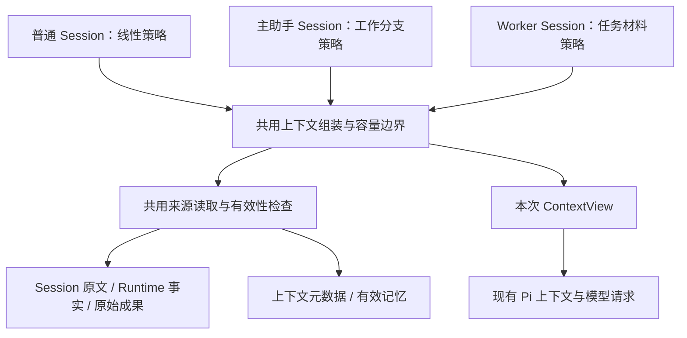

# Phaneris 0.6.3：共用上下文核心与助手分支管理

Status: accepted — 2026-11-09。本稿按用户要求，结合主线/分支、存储统一性、按需读取及普通 Session / Worker 边界的讨论重新设计，替代同日初稿。实施、验收与限制见[实施记录](../process/resident-context-0.6.3-implementation-2026-11-08.md)、[失败矩阵](../verification/resident-context-0.6.3-failure-matrix-2026-11-08.md)与[最终验收报告](../verification/resident-context-0.6.3-final-report-2026-11-09.md)。

版本顺序保持：**0.6.3 共用上下文核心与助手分支管理 → 0.6.4 助手任务管理 → 0.6.5 助手与 Board 并排交互**。

核对基线：Phaneris `aab3af835`；Pizza 固定提交 `ffa72f018e35ec556a71299dfede3fa3884cdbcb`。现状来自源码与此前只读调查；本文的目标结构、策略和验收要求均为待实现方案，不表示已具备相应行为。

## 1. 本次设计裁定

**重新设计共用的上下文核心，由主助手首先使用工作分支策略。普通会话和 Worker 仍是同一种 Session，共用原文存储、来源读取、上下文组装及执行事实。**

用户的 Git 类比用于理解“主线连续、工作隔离、按需恢复、选择性回流”，不以真实 Git 仓库承载会话。重建范围是上下文子系统，不包含重写 Session、Runtime、工具执行器或记忆系统。

| 决策 | 本期方案 | 理由与边界 |
| --- | --- | --- |
| 新设计是否受旧结构约束 | 先定义共同契约，再替换现有助手上下文实现；不要求继续扩充旧 topic / segment 表 | 复用事实和成熟执行能力，不以表结构的历史惯性决定产品行为 |
| 三类会话是否分开存储 | 原文和执行事实继续走共用所有者；上下文元数据也按 workspace / session 统一管理 | 允许选择策略不同，不允许助手形成独立消息库或 Worker 引擎 |
| 是否将消息全部迁入 SQLite | 0.6.3 不迁移原始消息后端，继续共用 JSONL；SQLite 保存结构化上下文元数据 | 当前问题在材料归属、读取与实际请求；改文件格式本身不能解决这些问题。日后如更换后端，应作用于所有 Session |
| 是否保留混合存储 | 保留，但规定唯一事实来源、共同读取入口和请求组装顺序 | 混合介质可以清晰；不能让多个存储各自维护一份可冲突的任务或消息事实 |
| 谁决定串行、并行与话题归属 | 助手在用户授权内判断；Host 执行容量、来源和请求边界 | 上下文分支不是执行位；切换对话不冻结其他工作。完整调度在 0.6.4 |
| 是否增加管理框架 | 只建立必要的引用、分支、检查点、请求视图及少量操作 | 不新增路由模型、Supervisor、常驻监督循环或通用工作流平台 |

本期成功的标志：同一个助手可以自然地处理 A→B→A、多目标输入和晚到回执；实际模型请求只携带所需材料，旧工作可恢复，普通会话与 Worker 的原文、执行和接续行为保持正确。

优先于完整任务管理实施，因为任务修订、回执复核和原授权接续都需要稳定的工作归属与材料边界。先完成这些共同契约，0.6.4 才能在其上接入调度和状态闭环，减少再次改接上下文的工作。

## 2. 现状与需要替换的部分

| 当前事实 | 对新设计的要求 |
| --- | --- |
| 主助手和 Worker 都通过 SessionManager 的共用 Session 创建/持久化能力建立；Worker 是普通 Session | 保留共同会话基础，不能另造 Worker 消息存储 |
| AssistantContextStore 已有 topics、focus、anchors、请求依赖与来源检查 | 可复用来源验证经验；旧 topic 的累计输入语义和助手专属组装逻辑不作为新核心契约 |
| 当前 originals 会累计同议题用户输入，prepare 再将所选原文放回请求 | 改为明确的工作归属、当前有效要求和按需原文；不能只给累计历史加一个分支名 |
| assistant_context_history 能查询历史，现有 focus 主要依赖界面/RPC | 主助手需要真正可调用的上下文管理动作，并能在正常轮次中使用 |
| Pi 的 resident 路径已能替换真实 provider 投影，普通路径已有原生 compact 的恢复保护 | 复用这些接入能力；已有投影替换不等于自动分支、检查点和长程管理已完成 |
| resident 的公开 context policy 仍只允许 compact，普通 handoff 会创建接续 Session | 主助手内部换段保持原 Session；普通会话继续沿用自己的 compact / handoff 行为 |
| prepareDelegatedInput 直接继承主助手整个 activeSegment.dependencies | Worker 改为绑定本次委派实际所需材料，不继承其他工作的依赖 |
| 历史分页和 readSource 的部分路径先 loadSession 全量读入目标 JSONL，再筛选/截取 | 共用读取层要区分磁盘读取、解码、选择和模型注入；分页返回不等于底层已经按需读取 |

此前 02:19:50 +08:00 的真实快照中，一个 Current conversation topic 累计 62 条直接用户输入；D/E 各绑定 64 个来源与 10 个记忆依赖。**依赖数量不是完整正文注入数量**，该样本也不是固定产品规模。D 的具体失效条件未被持久记录，不能据此声称重建上下文必然解决 D/E 全部错误；完整证据保留在[0.6.4 调查](resident-assistant-tasks-0.6.4-plan-2026-11-08.md)。

## 3. 共用核心与三种选择策略

### 3.1 共同模型

以下是最小概念契约，不要求每项都成为新表、独立服务或类。

| 概念 | 保存/表达的内容 | 明确不拥有的事实 |
| --- | --- | --- |
| SourceRef：原始记录引用 | workspace、Session、消息/事件/成果身份、必要范围、内容版本、来源类型 | 不复制原始消息，不把 Worker 报告转成用户授权 |
| ContextBranch：工作分支 | 稳定身份、所属助手/项目、简短目标、要求与修订引用、检查点入口、关联工作引用 | 不维护第二套 todo/done、执行尝试或成果版本 |
| Checkpoint：恢复检查点 | 所属 Session/分支、覆盖范围与截止游标、有效要求引用、已定结论、未决事项、下一步及证据入口 | 不证明工具成功，不授予新权限，不替代原文或当前执行状态 |
| ContextView：本次请求视图 | 本轮输入/事件、选中分支、检查点、实际材料范围与版本、预算、请求身份及省略说明 | 不成为第三份聊天历史，也不允许模型自由改写执行事实 |

长期记忆继续由原 memory 所有者管理，执行状态由 Session / Runtime 管理。一个检查点可属于主线历史段，也可属于工作分支；主线因容量换段不会产生新任务。

分支身份表示“是哪项工作”，段表示“这次接续覆盖哪段上下文”，请求视图表示“这一次模型实际看到了什么”。同一分支可经历多次换段，一个轮次也可涉及多个分支，三者不能继续混成一个 activeSegment。

### 3.2 同一基础，不同策略

| 会话 | 默认材料选择 | 本期行为边界 |
| --- | --- | --- |
| 普通 Session | 当前输入、本会话有效历史/原生压缩结果、适用项目与工具材料 | 保持线性聊天与既有 compact / handoff；不自动建立助手工作分支，不注入助手目录或其他会话全文 |
| 主助手 Session | 当前输入及必要近期主线、有限工作入口、当前所需分支材料、相关记忆和事件 | 稳定身份；自主分支、恢复与换段；不将所有工作长期常驻 |
| Worker Session | 本次任务包、该 Session 的执行历史、后续已送达修订、相关业务材料 | 仍为普通 Session；由委派来源限定任务材料，继续使用共用读取、压缩和 Runtime |

普通会话可使用隐含的线性上下文范围，不必为了统一结构给每个聊天建立分支树。Worker 是执行角色/关联，不新增一种持久化实体。统一策略入口只处理已有的这些需求，不建设可插拔策略框架。

改共用模块会触及普通会话的代码路径，不能承诺技术上“完全没有影响”。本期承诺的是原文格式与既有产品行为保持，且通过专门回归证明。

## 4. 存储：一个事实来源，一条读取路径

### 4.1 存储责任

| 内容 | 本期存储/所有者 | 使用约束 |
| --- | --- | --- |
| 用户、助手、Worker 的可见会话原文及产品元数据 | 共用 SessionProductRepository / JSONL，沿用现有目录定位 | 主助手原文可仍位于 assistant/sessions；目录不同不等于另一个格式、写入器或会话实体 |
| 执行输入、模型/工具效果、尝试、运行状态 | 现有 durable Runtime 数据库与投影 | 事实先提交；上下文引用它，不重新维护执行日志 |
| 工作分支、输入关联、检查点、上下文指针 | workspace 级共用 SQLite 上下文存储，目标位置为 workspace/context.db | 替换 assistant/context.db 的相应职责；按 Session/分支归属，不建立三个角色各自的数据库 |
| 本次请求材料清单 | ContextView，接入现有实际请求/Runtime 记录 | 记录引用、范围、版本、预算及请求关联；不默认再存一份完整 prompt 正文 |
| 长期记忆与退出/纠正记录 | 现有 memory.db 及 Project 所有者 | 不把记忆复制进新的上下文库；读取仍遵守范围和有效性 |
| 委派、控制与回执关联 | 现有 delegation 所有者 | 指向工作分支和原始输入；业务状态仍归 Session |
| 附件与成果 | 原文件与 Artifact 所有者 | 按内容版本引用，不能因同路径就认定内容未变 |
| Pi 对话日志、原生压缩与 provider 投影 | 现有 Pi/SDK | 承载模型现场；不能反向覆盖 Session/Runtime 的业务事实 |

Runtime 生成的会话内容仍可按既有规则投影到 Session 历史；这不赋予两侧独立裁定工具是否执行的权力。工具效果与尝试以 Runtime 为准，产品历史与展示仍由 Session 承载，上下文层只引用它们。

保留 JSONL 是本期对共用原文后端的选择，不是让新模型迁就旧 topic 结构。SQL 查询适合分支、关联和游标；原文与原始成果仍由原所有者提供。以后若证明原文后端需要更换，应在同一个 Repository/Reader 边界覆盖所有 Session，不能仅为助手建设另一套正文库。

### 4.2 读取职责收敛

- 建立共用 SourceReader：按来源身份、版本、范围和游标读取；调用原所有者提供访问/遗忘判定，不让上下文库成为新的权限所有者。
- 历史回查、分支恢复、记忆来源展开和 Worker 材料准备共用这一读取契约。助手恢复自身上下文通过该入口，不以直接遍历应用数据库作为常规读取协议。
- 基本访问检查在拥有该边界的一层完成，向内传递已验证的类型和值；提交模型结果时仍核验实际依赖是否发生相关变化。
- 检索结果只是目录或片段，需明确已读范围、总范围、缺失和后续游标。看见引用、完成索引、拿到摘要，都不等于读过全部原文。
- 先使用共用 Session 缓存和增量元数据消除一次准备中的重复全量加载。确需定位大文件时，在原文所有者边界补可重建索引；索引失效只触发重建或明确缺失，不产生第二份权威正文。
- 正文缓存有容量与淘汰规则，退出工作集可释放预展开材料；不能通过常驻所有分支的完整历史来宣称实现按需读取。必要的在途执行材料仍由对应 Session 持有。
- 首次加载/恢复可能需要扫描文件，应单独计量。常态精确回读不能每次重新解析整段历史并重算所有消息哈希；全量重建也不能伪装成按需读取。

不新增向量库、全文副本或第三套日志。共用读取入口面向模型上下文及来源取用，不要求顺带重写所有 UI 历史浏览代码。

## 5. 模型读取与请求组装顺序

这里的顺序是 Host 的材料选择协议，不是要求模型机械地先调若干工具。已明确的目标可直接准备；需要识别或展开时，由同一助手在正常工具循环中选择。

| 顺序 | 本轮处理 | 常驻/展开规则 |
| --- | --- | --- |
| 1. 固定当前事实 | 本轮用户输入或类型化事件、workspace/Session、有效规则与执行能力 | 当前输入与必要规则必须保留；事件不冒充新的用户指令 |
| 2. 提供定位线索 | 必要近期主线、当前指向、有限工作目录、相关待处理事项 | 目录分页/搜索，披露未展开数量；不全量注入所有分支摘要 |
| 3. 选择工作范围 | 使用显式归属，或由助手识别新工作、原工作补充、多目标和普通交流 | 允许多分支；歧义影响操作时只澄清目标 |
| 4. 恢复必要材料 | 所选分支的最新适用要求、检查点、截止点后的增量、相关 Session 当前事实 | 未选工作保留入口；不能继承旧分支全部工具输出 |
| 5. 按需展开证据 | 原始消息片段、成果、记忆细节及业务来源 | 使用统一 Reader；长结果有范围、游标和版本；不以摘要代替关键约束原文 |
| 6. 固定实际请求 | 组合、去重、检查有效性与预算，绑定 ContextView，再交给 Pi | 实际 provider 请求与清单一致，SDK 不得悄悄追加已退出分支的旧正文 |

新话题尚未确定归属时，先给当前输入和有限定位材料；不能为了让模型选分支而先加载所有候选分支。管理动作返回后，在下一次模型调用前重新组装被选择的材料。这可能占用同一轮中的一次工具/模型往返，不增加常驻分类模型，也不承诺所有路由零额外调用。

必要规则、用户当前输入、仍适用的关键约束和未结算工具关联不能被“相关性”静默过滤。相关记忆按范围和本轮需求取用；正文读入后仍受统一预算管理，不能以工具返回的名义绕过容量边界。

读取与注入分别验收：记录来源文件/数据库读取范围、解码量、选中材料量，以及实际请求 token/估算值。缩短 prompt 不等于磁盘按需读取，分页 API 也不等于上下文隔离。

## 6. 主助手如何管理工作分支

### 6.1 归属与操作

用户看到的仍是同一条连续主对话。原始输入只保存一次；分支引用消息及必要片段，同一输入可归属多项工作。项目范围用于隔离规则与材料，同一项目可以有多个独立工作，不能用 projectId 替代分支身份。

助手回复、工具结果和后续读取也保留所属请求与工作引用，不能只给用户消息分类。一次回复涉及 A/B 时，可关联多个分支并按内容范围回读；无法准确划分的部分保留共同来源标记，不把整条混合回复默认常驻到每个分支。

主助手通过现有 CONTEXT 工具边界获得少量操作，准确 schema 在 C0 固定：

| 操作 | 作用 | Host 必须固定的边界 |
| --- | --- | --- |
| 查找/选择 | 查目录，选择一个或多个工作；恢复必要检查点和增量 | workspace、分支版本、本轮输入/事件及材料范围 |
| 创建/关联 | 为独立目标建立分支，或把补充/纠正关联回原工作 | 稳定身份、原始消息引用、有效要求的修订关系 |
| 保存恢复点 | 保存有界结论、未决事项、下一步和证据入口 | 已提交来源的覆盖游标；模型不能自报不存在的执行结果 |
| 退出工作集 | 使分支休眠，保留可恢复入口 | 退出只影响上下文，不取消 Worker、不删除原文、不关闭任务 |

历史正文读取继续复用共用 Reader，不为每个分支复制一组搜索、记忆或执行工具。操作复用既有请求身份与版本检查，避免一次模型重复调用建立多个相同分支。

| 情况 | 应有行为 |
| --- | --- |
| 新的独立目标 | 新建工作分支；是否创建执行 Session 由任务需要决定 |
| 同一工作的补充/纠正 | 更新原工作的要求关联；保留来源，不将旧要求与新要求并列当成同时生效 |
| 普通聊天 | 保留必要主线连续性；不为每句交流创建分支或 Worker |
| “继续刚才的报告” | 按现有指向或目录恢复；多个合理目标且会改变操作时才询问 |
| 一句话同时讨论 A、B | 为两项建立明确关联，分别准备所需材料，不强制一消息一分支 |
| 用户纠正分支归属 | 修正关联与后续视图；不改原话，也不假装已撤销错误归属期间发生的工具效果 |
| 完成/暂离某项工作 | 保存恢复点并退出活动材料；任务完成状态取自原所有者 |

工作目录是有限的可恢复索引，不是另一份让模型手写的任务账本。界面只扩展现有上下文详情，提供当前材料、分支入口、来源及关联纠正，不建设 Git 图形浏览器，也不把管理分支变成用户每次发言的前置操作。

### 6.2 晚到结果与前台连续性

A 的 Worker 在讨论 B 时完成，回执依靠原始委派、分支和输入身份进入 A。助手处理 A 所需材料后，继续 B 的对话；不能把 A 的成果写成 B 的要求，也不能把事件附着到最新一条无关用户消息。

后台事件的处理顺序沿用现有输入/事件准入，显式用户指向优先保留。一个临时 ContextView 可处理其他分支事件，不必改写用户当前关注的工作。主助手在同一 Session 的提交仍按 Runtime 顺序进行；这不是对所有 Worker 设置一个全局执行位。

## 7. Worker 的上下文契约

**Worker 继续是普通 Session。主助手的工作分支保存工作连续性，Worker Session 保存执行历史；二者通过现有委派引用连接。**

分支可以没有 Worker，也可以关联多个 Worker。同一 Worker 的后续委派仍有各自输入与原目标引用；不能仅凭 parentSessionId 或最新用户消息推断当前任务来源。

每次委派准备一个有界任务包，放入既有委派输入，不另建任务正文库：

- 原工作分支、原始用户输入与适用修订的引用；范围、验收要求和必要上下文。
- 本任务实际选用的来源/成果/记忆及版本；后续通过工具展开的材料按实际使用追加依赖。
- 现有执行配置、权限上限、配置版本、委派/目标 Session/输入身份。
- 结果和问题应返回的原始归属；复用已有回执与成果引用。

主助手切换 B、压缩主线或让 A 分支休眠，不改变 A Worker 的有效材料。用户修订 A、撤销相关来源或收紧实际执行权限，仍需按真实影响更新或阻止相应请求，不能用冻结快照绕过撤权。

Worker 自身的长上下文继续使用普通会话策略及现有 compact / handoff；handoff 保持原工作链和结果归属。Worker 的结果默认只回流摘要、问题和成果引用，主助手复核时按需读取原结果，完整工具过程不回灌主线。

0.6.3 交付任务包裁剪、依赖范围和回执归属，并验证主线切换不误伤 Worker；自主并行、运行中控制、修订送达、授权内后续派发、review→done 的完整闭环交给 0.6.4。

## 8. 检查点、主线记录与长期记忆

检查点至少保留：当前目标与关键要求的来源、已确认结论及证据、未决事项、下一步、关联 Session/成果入口、覆盖到的消息/事件游标和材料版本。多来源有各自截止位置，不能用一个“生成时间”代表所有来源已覆盖。

分支检查点可由助手在正常管理轮次中生成，Host 校验引用和覆盖边界；这只能保证来源结构正确，语义保真仍需验收。段内压缩继续使用 Pi；可引用已有压缩产物及其覆盖，不再启动第二个后台摘要模型重复压缩同一历史。

| 内容 | 归属 | 默认加载 |
| --- | --- | --- |
| 主线交互及工作结果记录 | 稳定助手 Session | 必要近期内容与有界主线恢复点 |
| 某项工作的恢复材料 | ContextBranch / Checkpoint | 恢复该工作时加载 |
| 原始执行过程与成果 | Worker Session / Runtime / Artifact | 需要复核或排障时按需读取 |
| 可跨工作复用的偏好、事实和经验 | 既有 workspace / Project 记忆 | 按适用范围检索，不自动加载全部 |

“记忆属于主线”表示同一个助手能找到各项工作，不表示所有分支过程必须进入长期记忆。分支目录也不是一条无限增长的记忆。只有满足现有记忆准入的事实才提炼为长期记忆；工作完成摘要、任务进度和临时假设不自动转为永久事实。

恢复先取检查点，再结合截止点后的增量和当前有效要求；关键决定回指原文。检查点重整不能无限摘要套摘要；应从仍适用的原始要求和事实校正，避免遗漏纠正或强化早期误解。撤权、遗忘和来源缺失须贯穿摘要的依赖链，旧检查点不能成为重新注入已退出材料的旁路。

## 9. 长上下文与真实换段

### 9.1 容量处理顺序

1. **选择材料。** 未选分支退出正文；旧要求被明确替代后只保留必要历史入口，相关性不能只按时间或热度判断。
2. **收起长过程。** 已用过的工具结果保留身份、必要结论和原文入口；原始结果仍可回读。收起不等于重新执行工具。
3. **段内压缩。** 复用 Pi 原生 compact 和已验证覆盖边界，保留近期原文、必要要求及工具调用/结果配对。
4. **建立恢复点并换段。** 材料结构需要重整时，在稳定主助手 Session 内切换真实 provider 上下文；普通会话不被改为助手分支模式。

预算使用当前模型的有效窗口、固定规则、工具 schema、输出预留及工具增长余量；估算与供应商实际用量分别记录。模型切换后重新计算。具体阈值在 C0 基线后确定，不以固定消息数或未经验证的统一百分比代替容量管理。

Host 负责硬边界，模型负责语义选择。必要内容确实放不下时，先按已有契约压缩/分步取用；仍无法形成有效请求则明确报告范围或容量问题，不能静默裁掉用户要求后声称已接续。

### 9.2 提交、并发与恢复

- 输入/事件与原执行事实先持久提交，再准备引用它们的检查点和新视图；不要求跨 JSONL、Runtime、SQLite 建立分布式事务。
- 换段固定 Session、所选工作、源游标、上下文修订及触发输入。新视图准备成功后再提交活动指针；同一 Session 复用现有单写入边界。
- 模型主动选择分支属于合法管理动作，在当前工具回执结算后的下一请求生效；不能因此丢弃整轮已合法完成的内容。
- 在途工具结果仍归原请求。未结算或效果未知的工具沿用 Runtime 恢复规则，换段不重放命令，也不通过新分支绕过阻塞。
- 准备期间的新消息、取消和晚到结果保留各自身份与顺序，按截止点后的增量接回；新取消/纠正不能被旧摘要覆盖。
- 重启恢复最后提交的指针并核对来源。未提交切换可幂等重试；准备失败可继续使用仍有效且容量允许的旧视图，否则报告明确问题，不能自动全量注入旧历史。
- 有效性只检查本请求实际材料及摘要的来源依赖，不把主助手全局焦点变化当作所有 Worker 的失效原因。相关撤权或配置变化仍需生效。

失败应返回具体类别、受影响来源/配置版本、请求边界和可恢复动作，例如来源不可用、修订冲突、权限变化、容量不足、检查点覆盖缺口。用现有请求/错误记录承载诊断，不新建诊断平台；0.6.3 的诊断接入也不冒充已查明历史 D 的根因。

## 10. 与普通会话、0.6.4、0.6.5 的范围边界

| 问题 | 0.6.3 交付 | 后续归属 |
| --- | --- | --- |
| 普通会话存储与上下文 | 共用 Reader/Assembler 接入；原文格式、线性上下文、compact / handoff 保持 | 若未来更换消息后端，所有 Session 一起评估 |
| 助手多个工作与长主线 | 自主分支、多目标归属、分层读取、检查点、安全换段与恢复 | 本期必须完成 |
| Worker 是否另一套 Session | 沿用普通 Session、共同存储和执行；任务包与回执有明确工作归属 | 本期明确并验证 |
| A–F/A2 全局串行与任务安排 | 上下文允许多个工作，不新增全局锁；提供独立材料边界 | 0.6.4 修正队列、容量、依赖、真实并行与任务现场 |
| D/E 失效 | 窄化材料依赖，提供准确失效诊断，验证无关切换隔离 | 0.6.4 完成配置变更一致性与执行接续；D 仍需复现 |
| 复核后仍 todo | 检查点读取 Session 当前事实，不能自行缓存另一个 done | 0.6.4 将结果、复核和业务状态收口接到同一 Session |
| Kanban 与普通 subtask | 不改 parentSessionId，不把上下文分支变成卡片 | 0.6.4 只提升助手直接子工作的展示，普通 P→Q 与 A→A1 仍收纳 |
| 助手与 Board 并排 | 提供已有详情可显示的上下文信息 | 0.6.5 完成既定并排交互，不提前重建 Board |

上下文休眠、Session 归档、任务暂停/结束、记忆遗忘是不同动作。本期不把这些动作合成一个“关闭分支”。也不实现 Git merge/rebase/cherry-pick、真实 worktree、跨 workspace 分支、完整分支树 UI 或独立 Goal/Task 库。

## 11. 实施顺序与改动落点

这是中等偏大的上下文子系统重建。相比初稿增加了共同契约、三类策略接入与回归；减少了对旧 topic 累计语义的继续修补。没有测量依据，暂不给工期或 token 节省比例。

| 阶段 | 交付与顺序 | 完成门槛 | 相对工作量 |
| --- | --- | --- | --- |
| C0：契约与失败基线 | 先写失败矩阵；固定四个核心概念、原文/执行所有权、输入归属、读取和请求预算口径；采集三类 Session 样本 | 能分别观察 I/O、材料清单与实际 provider 请求；旧错误可复现，未知原因单列 | 中 |
| C1：共用核心纵向接通 | 建立共用 Reader、Assembler 与上下文元数据；普通线性、助手、Worker 使用同一契约，先保持既有选择行为 | 三类 Session 的原文、工具配对、压缩/接续与重启回归通过；无新消息库 | 中 |
| C2：工作分支闭环 | 创建/选择/关联/退出、检查点与原文恢复；按顺序组装；同步接入 Worker 任务材料和回执归属 | 同一助手自主 A→B→A，多目标输入及晚到结果正确；实际请求无无关分支正文 | 中至大 |
| C3：容量与安全换段 | 分层预算、长结果收起、Pi compact 衔接、换段提交、新输入/工具竞争与崩溃恢复；精确失效原因 | 长主线可接续；不丢要求、不重复外部效果；撤权与无关切换分别正确 | 大 |
| C4：完整验收与收敛 | 真实主助手/Worker、多轮长任务、普通会话与 UI 回归；清理被替换的旧组装路径，验证数据升级/恢复 | 第 13 节场景和实际请求证据齐全；正式路径只有一个组装入口 | 中 |

C1 只是可验证的过渡阶段，不能作为 0.6.3 完成；C2 必须形成实际使用闭环后再扩大容量/恢复覆盖。Worker 的上下文接入不能留到最后，避免助手分支完成后再次改其归属契约。0.6.4 不重复设计这些机制，只消费本期提供的分支、来源、任务包和视图。

| 代码区域 | 计划职责 |
| --- | --- |
| server-core/sessions 与共用上下文模块 | 原文 Reader、组装入口、Session 策略接入、上下文持久化与换段协调 |
| resident-assistant/context-store / service | 拆出通用职责；仅保留助手的分支选择、记忆/事件接入和工具适配，替换旧累计注入路径 |
| shared / session-tools-core 契约 | 来源与上下文 DTO、管理动作、引用边界；验证在拥有边界的一层完成 |
| durable-runtime / pi-agent-server | 引用已提交事实，精确 provider 投影、原生 compact 衔接及请求证据；不重建 Runtime |
| SessionManager 委派与回执路径 | 本任务材料、来源修订、结果归属及 handoff 引用 |
| 既有上下文详情 UI | 展示当前工作/材料、恢复入口与关联纠正；复用原组件 |

## 12. 数据转换与上线边界

新模型不要求保留旧 topic / segment schema，也不为旧消息专门建立长期双轨逻辑。保留原始 Session 与 Runtime 是共同事实来源的选择；既有派生上下文则按一次性、最小范围转换处理。

- 实施前在隔离副本上备份并验证转换：旧 topic 可转为工作入口与来源引用；未完成归类的历史仍可通过原 Session 查询，不全量调用模型重分类。
- 旧 segment 清单是当时的请求证据，不包装成新模型已经生成的有效检查点。旧摘要缺少足够来源或覆盖时，恢复应回读原文并建立新检查点。
- 新元数据启用后，同一 Session 的上下文只有一个权威写入入口，三类策略共用组装入口；旧助手上下文库仅作转换来源或历史证据，不双写两套可变分支状态。不同 Session 仍可独立运行。
- 普通 Session 不批量改写正文，不新增助手目录注入；既有 Worker、parentSessionId、输入/结果/尝试和 handoff 身份保留。
- 备份需包含新上下文元数据及既有记忆退出记录；索引可重建，用户关联纠正、检查点和 suppression 不是可随意删除的缓存。
- 升级或恢复失败要明确指出不可用范围。回退使用经过验证的备份/版本组合，不承诺旧版本直接理解新 schema，也不允许借旧快照复活已撤权材料。

本次只改规划文档，不转换、删除或重写真实 Work 数据。

## 13. 先行失败矩阵与验收产物

实施前将下表固定成可执行的失败场景，再写代码。优先隔离 E2E；若必须隔离验证某模块，先写其失败方式。不能只用工具返回的 fixture 证明模型会自主管理分支。

| 场景 | 必须观察到的结果 |
| --- | --- |
| 普通会话线性接续 | 多轮指代、工具配对、compact、handoff、重启与原文回读正确；未注入助手分支/记忆目录 |
| 三类会话共用存储 | 助手、普通会话、Worker 均由共同原文所有者读写；分支操作未产生正文副本或第二套执行状态 |
| 新工作与补充 | 模型自主分开独立目标，同一任务纠正留在原工作；没有重复切分循环 |
| A→B→A | 用户无需重述；恢复 A 的最新要求与结果；路由后的业务请求没有无关 B 正文 |
| 多目标与同项目多工作 | 一条输入关联 A/B；同项目不同目标不混用；目录分页不令较早工作无法找到 |
| workspace / 项目边界 | 同名工作不串用；恢复、检索、缓存与晚到事件校验真实归属，项目材料只在适用范围进入请求 |
| 混合回复与分支材料 | A/B 共用一条回复时保留来源与范围；后续恢复 A 不默认重新注入整段 B 的讨论与工具结果 |
| 指向含糊与关联纠正 | 必要时澄清；用户纠正后按新关联准备，不改写原话、不伪称已撤销旧工具效果 |
| 长历史精确回读 | 返回范围与版本准确；热路径不反复完整解析同一历史；首次加载/索引重建单独记录 |
| 选择与 SDK 请求一致 | 清单中退出的分支正文不从 Pi journal/旧摘要重新进入请求；检查工具结果路径也受预算约束 |
| Worker 独立材料 | A Worker 不继承 B 来源或整个主线依赖；主助手切话题/压缩/休眠不使其失效 |
| 晚到结果 | 讨论 B 时 A 回来仍归 A，读取真实执行状态；处理后可继续 B，无原目标错绑 |
| 休眠、恢复与任务状态 | 分支无需常驻 SDK/额外模型请求；正文缓存可释放；恢复不重跑工具，休眠不暂停任务，检查点不制造 done |
| 长主线与反复压缩 | 实际请求保持在有效预算内；关键要求、后续纠正与未决事项可恢复，原文可定位 |
| 断点内有多来源更新 | checkpoint 各来源覆盖准确，截止后的新结果/新输入可补回，不以时间戳丢弃内容 |
| 切换时输入/取消/在途工具 | 新输入不丢不重投；取消不被旧摘要覆盖；未知效果不重放；工具配对不破坏 |
| 撤权、遗忘、来源变化 | 原文、记忆、旧检查点与派生摘要均遵守当前有效性；只阻塞真正依赖该材料的范围 |
| 模型变更与容量失败 | 窗口重新计算；没有静默裁掉必要约束；失败可说明原因和恢复位置 |
| 切换/迁移崩溃 | 恢复最后已提交视图，未提交操作可重试；无重复消息、第二个助手或双写分支状态 |
| 普通 subtask 与 Worker handoff | parent 关系、原收纳与工作入口不变；上下文分支不成为 Board 卡片 |
| 真实模型行为 | 真实助手会使用选择/恢复动作，真实 Worker 按所需材料执行；语义保真、额外往返、延迟和成本有对照证据 |

验收产物至少包含：隔离样本与复现命令、源码/配置基线、输入/分支/Session/请求身份、读取范围与计量、脱敏材料清单、实际请求对照、覆盖游标、错误原因、工具重复执行检查及机器可读结果。固定回路用于验证竞态和故障恢复，真实模型样本用于验证自主行为；两类结论分别报告。

容量与性能阈值在 C0 按代表样本固定，在修改实现前留下对照口径。数据缺失标为未测，不预先承诺节省比例。界面截图只能辅助证明入口可用，不能代替模型请求、来源和执行证据。

## 14. 参考取舍与关联依据

### 14.1 Pizza 与 Git 类比

2026-11-08 已通过 GitHub 只读接口检查 Pizza 固定提交；源码选段保留在本地 `.cache/reference/pizza-ffa72f018e35/`。未安装或运行 Pizza，源码机制不等于其完整产品体验已获验证。

| 已确认机制 | 采用之处 | 调整/限制 |
| --- | --- | --- |
| session_split 从当前用户消息建立新边界，同轮重复有保护 | 模型有真实管理动作，Host 固定输入边界 | Phaneris 保持稳定助手 Session；不按每个新话题创建主助手身份 |
| SessionDescriptor 通过事件范围、摘要与父/来源引用描述会话 | 按引用保存分支和恢复点 | 不照搬另一个 EventStore/Reactor，也不复制所有父历史 |
| historyTree / jump / fork / continuation | 旧工作可以恢复并继续 | 本期只做必要查找与恢复，不实现完整 Git 操作集或树状界面 |
| hybrid compaction 先遮蔽旧长结果，再摘要 | 材料选择与结果收起先于容量压缩 | 原结果按引用回读，不能因占位文本诱导重跑有副作用的工具 |
| 记忆索引与按需展开 | 长期助手知道入口，细节有需要才读 | 沿用当前 workspace/Project 记忆所有者，不复制人格/日记系统 |
| tell 异步受理、独立执行与回复回流 | 执行现场与主线分开，回执带原归属 | 使用现有 Session/委派机制，不扩展跨 workspace 权限 |

固定提交原文：[session_split](https://github.com/pizza-agent/pizza/blob/ffa72f018e35ec556a71299dfede3fa3884cdbcb/src/core/tools/session-split.ts)、[切分边界](https://github.com/pizza-agent/pizza/blob/ffa72f018e35ec556a71299dfede3fa3884cdbcb/src/core/extensions/session-context.ts)、[描述符](https://github.com/pizza-agent/pizza/blob/ffa72f018e35ec556a71299dfede3fa3884cdbcb/src/core/projection/types.ts)、[历史恢复](https://github.com/pizza-agent/pizza/blob/ffa72f018e35ec556a71299dfede3fa3884cdbcb/src/core/projection/session-manager.ts)、[压缩引擎](https://github.com/pizza-agent/pizza/blob/ffa72f018e35ec556a71299dfede3fa3884cdbcb/src/core/compaction/compaction-engine.ts)、[主助手指导](https://github.com/pizza-agent/pizza/blob/ffa72f018e35ec556a71299dfede3fa3884cdbcb/src/core/agent/main-agent.ts)、[tell](https://github.com/pizza-agent/pizza/blob/ffa72f018e35ec556a71299dfede3fa3884cdbcb/src/core/tools/tell.ts)。

Git 只提供工作方式类比：主线连续、分支隔离、检查点、按需恢复、选择性回流。分支结论冲突须看来源和适用条件，不能文本 merge 成共同事实；Git worktree 仍只在代码文件隔离确有需要时使用，不成为上下文存储后端。

### 14.2 本地源码与关联计划

- [0.6.4 助手任务管理](resident-assistant-tasks-0.6.4-plan-2026-11-08.md)：A–F/A2、D/E、todo 与 Kanban 的实测调查；接入本期契约。
- [0.6.5 助手与 Board 并排交互](resident-assistant-board-0.6.5-plan-2026-11-07.md)：既定核心交互与暂不实施边界保持。
- [0.6.x 路线](resident-assistant-0.6-roadmap-2026-11-03.md)：当前版本映射以第 13.1 节及各版本计划为准。
- [SessionProductRepository](../../packages/server-core/src/sessions/product-repository.ts)、[共用 Session 存储](../../packages/shared/src/sessions/storage.ts)、[原文分页读取](../../packages/server-core/src/sessions/session-history.ts)：原文所有权与当前 I/O 边界。
- [context-store](../../packages/server-core/src/resident-assistant/context-store.ts)、[现有 topic / segment 契约](../../packages/session-tools-core/src/resident-context-contracts.ts)：本期需要拆分和替换的职责。
- [Runtime canonical context](../../packages/server-core/src/durable-runtime/coordinator.ts)、[Pi 投影收敛](../../packages/pi-agent-server/src/canonical-model-context.ts)、[Pi 请求入口](../../packages/pi-agent-server/src/index.ts)：事实、provider 现场与原生压缩接入。
- [SessionManager](../../packages/server-core/src/sessions/SessionManager.ts)、[Pi 绑定](../../packages/server-core/src/runtime-adapters/pi-driver.ts)、[context policy](../../packages/shared/src/agent/context-policy.ts)：Session 身份、委派、准入、配置与换段边界。
- [助手 service](../../packages/server-core/src/resident-assistant/service.ts)、[工具能力](../../packages/session-tools-core/src/assistant-capabilities.ts)、[memory-store](../../packages/server-core/src/resident-assistant/memory-store.ts)：事件、实际可调用动作、来源和派生有效性。
- [现有上下文 fixture](../../scripts/verification/fixtures/resident-assistant-context.ts)：可复用受控回归基础，不代表模型自主分支和本期新方案已实现。
