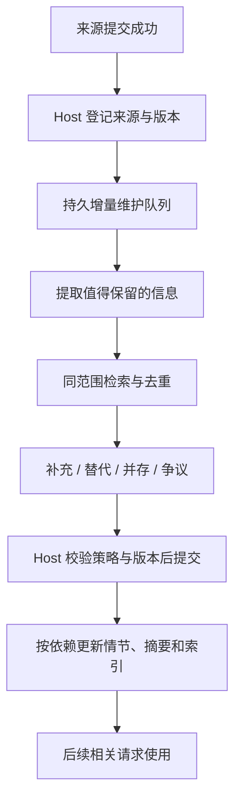

# 常驻助手权限、内置记忆与知识接入：最终实施计划

Status: accepted — P0–P5 代码实施及本机 Windows 隔离验收已完成：21 个工作流、351 组场景通过。真实 Work 数据迁移、已安装客户端替换及发行未执行；证据与具体边界见[实施记录](../process/resident-assistant-native-rollout-2026-11-05.md)。

日期：2026-11-05，Asia/Shanghai。

本文是本轮讨论的统一实施依据，收敛助手权限、委派可靠性、内置记忆、Project、知识库及 `.phaneris` 布局。前两份[腾讯与权限调研](assistant-autonomy-memory-hub-analysis-2026-11-05.md)、[Hermes 与个人记忆设计](personal-native-memory-and-knowledge-design-2026-11-05.md)保留为研究依据；涉及近期产品形式、目录及能力边界时以本文为准。[既有常驻助手路线图](resident-assistant-0.6-roadmap-2026-11-03.md)中与本轮无关的身份、委派、成果和消息渠道契约继续适用。新增[委派、回执与 Source 现场诊断](../verification/resident-assistant-dispatch-receipt-source-investigation-2026-11-05.md)作为优先级调整的证据。

计划阶段已结束，用户已要求完整实施。开发默认串行，先冻结失败场景再实现，按阶段保留可重复验证的产物；进度见[完整实施记录](../process/resident-assistant-native-rollout-2026-11-05.md)，不能将计划获准等同于功能完成。

本轮根据用户截图新增[助手工作总览与交付物改版计划](../design/resident-assistant-overview-redesign-2026-11-05.md)：默认当前事项、历史独立分页、最终成果与过程产物分开认定；作为 P1c 在目录迁移和自动记忆改造前实施。

## 1. 已确定的产品决定

| 决定 | 实施约束 |
| --- | --- |
| 面向个人使用，记忆采用内置方案 | 基本能力不依赖 TencentDB 服务、Docker、Proxy 或独立向量数据库 |
| 一个 workspace 一个长期助手 | 身份、记忆与后台维护不跨 workspace 自动合并 |
| 助手有完整的基本只读能力 | 可以直接读文件、列目录、搜索内容和查询已授权知识源；简单查看不必创建 Worker |
| 助手可按需连接已授权 Source | 自主发现、在会话中激活并调用允许的能力；连接不扩大数据范围或写权限 |
| 委派具有可恢复的执行与交付闭环 | 默认串行，单个待处理任务不冻结无关工作；续作、成果和通知保留明确归属 |
| 助手工作总览区分当前与历史 | 历史独立搜索/分页，默认不将全部历史委派铺在侧栏 |
| 交付物按任务成果认定 | 文件写入或 Artifact 存在不等于最终交付；过程文件留在任务详情，原文件不因展示清理被删除 |
| 助手可自主维护记忆 | 策略内的提炼、去重、更新、冷却和明确纠错无需逐条人工确认 |
| 助手记忆库只有主助手有代理侧访问权 | 普通会话及 Worker 不可自行查询；Host 维护服务和用户管理界面按自身职责访问 |
| Worker 可获得任务需要的材料 | 由助手选取并通过 Host 校验后派发，不因此取得记忆库查询权 |
| Project 保留项目事实与资料 | 不把项目全文再次沉淀到工作区通用记忆，不维护两份独立可写的同一事实 |
| 知识库沿用 Sources | 继续支持 MCP、API、本地目录；补知识路由、引用与更新感知 |
| 助手自己的会话与记忆都归入 `assistant/` | 助手会话、记忆、上下文、委派按生命周期分开；普通与 Worker 会话仍归 `sessions/` |
| 复用现有 Session、Runtime 和权限机制 | 物理目录分开不等于新建会话引擎、执行引擎或审批引擎 |
| 团队与外部记忆平台不进入近期范围 | 不做 Team、成员、共享市场、通用多 Provider 平台；保留清楚的模块边界即可 |

## 2. 目标与完成标准

用户正常与助手讨论、交办和纠错，助手能够查看必要文件、找回历史、使用相关项目与知识材料，并自动留下有价值的经验。用户无需日常维护一张逐条审批清单，也无需手工开启新会话才能让纠正生效。

本计划完成后，必须能够观察到：

1. 用户要求查看文件时，助手能在可读范围内直接打开、搜索、核对并引用结果。
2. 明确长期偏好、可靠观察和适用的低风险归纳可自动保存，且有真实提交回执。
3. 只有助手能查询助手长期记忆；普通会话不自动继承它，Worker 只获得本任务材料。
4. 用户更正或要求忘记后，下一模型请求和受影响的 Worker 后续材料不再使用旧内容。
5. Project 的决定仍在 Project 中维护，助手能够按问题找到而不重复记账。
6. 已授权知识源能在相关时被使用，答案可以回到原文；资料变化或不可用能被正确表达。
7. 目录迁移后历史、附件、成果、来源、委派和重启恢复保持连续，身份没有变化。
8. 委派无需用户手工补一句才能启动或回报；排队、等待决定、执行异常、完成及交付分别可核对，恢复不重复执行已完成操作。
9. 「更多」工作总览可直接看当前事项与最终成果；历史增长不挤占首屏，辅助脚本、临时文件与中间稿不自动进入交付物主列表。

## 3. 当前实现与实际缺口

| 部分 | 已有基础 | 本次需要完成 |
| --- | --- | --- |
| 主助手角色 | 白名单、Host 二次检查、独立 prompt、工作协调工具 | 修正过度收紧：本地读取与检索在注册和执行阶段均可用 |
| 权限模式 | safe / ask / guarded / allow-all，Worker 父级 clamp | 角色能力、任务授权与记忆准入分别表达，不再让“当前有用户轮次”替代具体授权 |
| 委派与交付 | 持久 work/inbox、Runtime 事件、输入身份、后续活动及交付物投影 | 隔离队列阻塞，贯通上下文失效、续作归属、终态和通知恢复 |
| 工作总览与成果展示 | 非模态可调宽面板、任务列表、Artifact 预览 | 当前/历史分别查询与组织，成果用途认定、版本归并、按需详情，避免全量轮询与过程文件误收录 |
| 助手记忆 | SQLite、来源 hash、revision、幂等、时效、争议、替代与 suppression | 自动准入、后台维护、语义重复识别、及时失效和精简摘要 |
| 历史 | 本地 Session、普通历史索引、提取 checkpoint | 提取不再只靠当前轮次顺手处理；助手自身与普通/Worker 来源统一登记并保留归属 |
| Project | 独立 MEMORY.md、追加工具、资料目录与说明 | 增加受控读取、文件来源引用、项目导航与去重；不复制项目全集 |
| 知识库 | Sources 支持 MCP/API/local、自动会话激活回调，MCP resources/prompts 可用 | 主助手发现/激活/只读接入、知识用途与项目关联、结果定位及更新处理 |
| 目录 | 会话统一在 `sessions/`，记忆在 workspace 的 `memory/`；上下文与委派已在 `assistant/` | 统一位置解析与迁移，收拢助手专属数据 |

文件读取的当前根因已定位：`resident-role.ts` 白名单没有普通读取与搜索能力，Pi 子进程注册工具时据此过滤，Host 在 pre-tool-use、durable prepare 等入口再次据此阻止。`assistant_memory_read` 只能读受控的历史消息来源，不是通用文件读取工具。切换到 allow-all 也不会扩展角色工具集。

### 3.1 委派与 Source 的实测补充

2026-11-05 现场确认：`261105-mild-river` 只有派发输入，委派为 accepted，Runtime 事件为 0；前序 `261105-light-canyon` 的 needs_attention 命中工作区队列的全局阻塞条件。前序执行发生上下文失效、没有最终回复，却得到 Runtime complete；用户后来直接继续已产出最终回复，原委派仍未收口。`261105-rapid-sand` 也存在后续直接输入已完成、委派仍 accepted 的分叉。

这三项分别涉及调度、上下文恢复与执行归属，不能一概解释成权限太紧。已产生的 result_ready 在该助手样本中均有 delivered 记录，尚不能认定所有通知丢失。Source 则确属角色能力缺口：主助手在进入现有自动激活链之前即被白名单拒绝。观察、代码依据和未验证边界见[现场诊断](../verification/resident-assistant-dispatch-receipt-source-investigation-2026-11-05.md)；修复先于目录迁移与记忆扩展。

### 3.2 工作总览的实测补充

用户截图显示旧任务持续占据侧栏、过程文件混入交付物。当前 useResidentPanel 每次刷新会循环拉完历史委派并请求 workspace 全部 Artifact，ResidentWorkPanel 再展示全部 work 及相关 Session 的非 discarded 产物；完成时文件登记也未区分用途。因此需要同时调整查询、成果认定和布局，不能只缩短行高或在前端截取前几条。具体依据见[侧栏改版计划](../design/resident-assistant-overview-redesign-2026-11-05.md)。

## 4. 权限与自主范围

### 4.1 主助手直接具备的能力

| 能力 | 默认执行方式 | 约束 |
| --- | --- | --- |
| 读取文本/代码文件、附件及资料片段 | 主助手直接执行 | 既有可读范围内无需逐次确认，保留路径、读取范围与内容身份 |
| 列目录、按文件名查找、搜索文件内容 | 主助手直接执行 | 有界结果、分页和范围；不为搜索打开任意 shell |
| 查看已支持的图片和文档内容 | 使用已有读取、预览或解析能力 | 格式不支持时明确说明；大型解析或批处理可委派 |
| 查当前 workspace 历史、记忆、项目、成果与工作状态 | 主助手直接执行 | 保留来源、时效、状态和原所有者 |
| 查询已授权知识源、读取原文 | 主助手直接执行 | 采用有明确只读效果的能力，不凭工具名含 read/search 就放行 |
| 发现来源、连接本会话所需 Source | 主助手请求，Host 执行连接 | 仅既有允许启用且认证就绪的来源；连接后仍逐次检查真实工具效果 |
| 策略内维护记忆、组织情景、更新派生摘要 | 主助手或 Host 受限维护任务 | 走同一记忆领域策略、版本事务和变更回执 |
| 委派、查看进展、接收并交付结果 | 主助手执行 | 不把队列接收当完成，不替用户接受成果或批准原请求 |

工具可发现、可调用、实际生效和有证据回执必须一致。原生工具及别名以实际注册定义为准，不能只在一个白名单中加入展示名称。动态 Source 工具仍要检查当前连接、启用范围与效果。

主助手读取本次任务的一两个文件、查看报告或核对来源，是基础理解能力。只有阅读规模、解析成本或持续执行会妨碍交互时才委派；不以固定工具次数强迫委派，也不把“保持响应”解释为不能接触资料。

### 4.2 通过 Worker 完成的工作

工作文件写入、代码修改、shell、应用操作、外部写入、批量资料处理和持续调研复用 Worker。执行自主性取决于用户已授权目标与效果、工作区/项目规则、模式上限、工具能力及预算。

同一授权范围内允许自行安排步骤、检查、修复和有界重试；当前要求已覆盖的动作不反复确认。任务外的新目标、权限扩大、未知外部效果和超出预算需要新的决定。更换模型或数据来源也不能静默扩大费用和处理范围。

### 4.3 保留现有权限引擎

- safe / ask / guarded / allow-all 继续控制执行，不新增“超级助手模式”。
- Worker 权限不能超过父级上限；主助手不能通过委派绕过自身任务授权。
- 任务授权引用保留来源、范围、目标效果、期限/预算、版本与撤销状态；先复用现有 Session/Runtime/decision 边界补足，不建立平行审批系统。
- 授权是 Host 事实。记忆中的“以前允许过”、Skill、知识源或内部报告不能授予权限。
- 对本次已明确的记忆学习范围，后续维护不需要每轮出现新的直接用户消息。

### 4.4 助手独享记忆的含义

| 主体 | 助手记忆库访问 |
| --- | --- |
| 主助手 | 可在当前 workspace 通过专用接口读写 |
| 普通会话 | 不暴露工具、不自动注入；伪造名称或直接调用也被 Host 拒绝 |
| Worker | 不得自行搜索或枚举记忆库；只使用派发的相关材料包 |
| Host 维护任务 | 以内部受限主体执行，有来源、策略与预算，不获得通用执行权限 |
| 用户管理界面 | 用户可以查看、修订、暂停和遗忘；UI 访问与模型工具访问分开校验 |

这是产品访问契约。原生文件读取要遵守受保护的助手状态路径规则；通用 shell 在同一 OS 用户下的严格文件隔离，必须由真实执行沙箱/文件代理等保证，不能靠目录或命令字符串匹配宣称已经实现。完整 OS 级隔离不作为本期已具备能力；若后续要求即使任意 shell 也不能读取助手目录，该要求需由实际隔离方案单独验收。

### 4.5 Source 主动激活

区分配置存在、工作区允许启用、凭据就绪、会话选中、连接成功、工具注册与实际调用授权。用户已配置并授权的来源，主助手可在任务相关时主动选择、连接和使用，无需用户每次手动勾选或 @mention。

- 复用 SourceManager、SessionManager 的激活回调和现有权限检查，补齐发现与显式会话激活入口；工具尚未注册时也应有可达路径。
- 连接仅选择现有配置的服务，不自动新建来源、换端点、扩大凭据范围或重新启用用户全局关闭的来源。
- 激活 MCP 服务可能同时发现读写工具；主助手只注册并允许符合自身角色和当前授权的效果，不因连接成功便获得所有工具权限。
- source_test 的默认 autoEnable 可能改变全局配置，不能将其直接放行作为会话连接的替代。
- 连接中取消、撤权或配置变化后，调用前重新检查最新权限与连接状态；失败回滚本次新增的会话状态，分别报告需认证、被禁用、连接失败和效果被拒绝。

### 4.6 委派、续作与回执

复用现有 delegation、Session、Runtime、work projection 和 deliverables，补足它们之间的契约，不新建第二套调度或成果系统。

1. **调度**：默认串行；真实活跃执行与等待决定/恢复分开。任务停止后，待处理状态只阻塞自身及存在冲突的资源，不无限占据全工作区执行槽。未确定原执行已结束前不能仅按显示状态释放槽位。
2. **状态可解释**：accepted 表示已排队；显示等待原因、阻塞任务与可行操作。Runtime 结束不等于成果完成，准备阶段错误也必须贯通终态，不能用 complete 掩盖上下文失效。
3. **安全续作**：上下文或材料变动时记录具体依赖与原因，在原授权内重新准备并有界续作；撤权、能力缺失、未知效果则明确停下。已提交工具回执继续有效，不重放已有副作用。
4. **身份关联**：保留 delegation → input → run/attempt → continuation → result 关系。用户在 Worker 直接继续时，确定属于原任务则关联；无法确定则独立呈现后续活动。已排队输入遇到独立用户执行时先核对，不允许队列后来再重复启动原工作。
5. **成果归属**：已取消任务保持取消，后续工作独立归属；不能取同 Session 最后一条回复覆盖原任务。成果、失败和待决定通知分别产生持久事件。
6. **交付恢复**：保留进入收件箱、模型处理、ack、最终回复持久化和交付引用。中断后有界重投并幂等消费；用户无需额外发消息触发。ack/delivered 不代表用户接受成果，也不批准原权限请求。
7. **Host 负责推进**：队列恢复、唤醒和事件重投由 Host 驱动，模型读状态用于判断与解释；不依赖助手持续轮询，不通过重复派发来“恢复”旧任务。

现场数据的恢复与产品修复分开：先核对任务仍有效、用户自行完成情况和副作用，再由正常 Host 流程处理；不批量改数据库状态以解锁。

### 4.7 工作总览与交付物

「更多」面板改为**当前、交付物、历史**三个视图，共用一个主内容区域；待处理事项优先，消息渠道收为紧凑状态与管理入口。保留非模态、可调宽及助手页生命周期。当前行突出任务、状态和主要动作，模型、耗时、配置与执行记录按需展开。未解决事项不因年久或关闭面板便消失，已交付旧结果进入可搜索历史。

Artifact 仍保存全部可追溯产物，交付物则是经过任务目标、结构化最终结果、Host 来源/版本校验与主助手核对后的成果投影。最终成果、配套材料、过程产物分别组织；不按扩展名判定，也不以“文件被写入”“状态为 ready”或“最终回复提到路径”直接认定。用户要求脚本、数据或配置模板时，它们可以是最终交付；原地配置修改与纯文字任务也可以只交付结果摘要与证据。

复用现有 Artifact ID/revision 与任务来源，不另建文件库。默认显示同一成果最新已交付版本，旧版可查；不确定历史用途保留在过程记录，不批量升级为成果。移出交付物列表不删除文件，也不等于接受、取消任务或清除审计。

当前、历史、交付物在 Host 查询层限定范围并分页，详情按需加载；事件更新与有界补查替代反复拉取全部历史。详细布局、交互、兼容与实现依据见[专项改版计划](../design/resident-assistant-overview-redesign-2026-11-05.md)。

## 5. `.phaneris` 目录与数据归属

所有路径继续从现有配置根和 workspace root 推导，支持 `PHANERIS_CONFIG_DIR`；不在业务模块硬编码用户主目录。以下是默认根的目标布局：

```text
.phaneris/
├─ config.json
├─ preferences.json
├─ credentials.enc
└─ workspaces/
   └─ <workspace>/
      ├─ assistant/
      │  ├─ sessions/
      │  │  └─ <assistant-session-id>/
      │  │     ├─ session.jsonl
      │  │     ├─ attachments/
      │  │     └─ ...已有会话自有文件
      │  ├─ memory/
      │  │  └─ memory.db
      │  ├─ context.db
      │  └─ delegations.db
      ├─ sessions/
      │  └─ <普通或 Worker-session-id>/
      ├─ projects/
      │  └─ <project>/
      │     ├─ config.json
      │     ├─ MEMORY.md
      │     └─ assets/
      ├─ sources/
      ├─ skills/
      └─ runtime/
```

### 5.1 生命周期与所有权

- `assistant/sessions/` 只存主助手自身的会话；当前仍是每 workspace 一个逻辑主助手，不能因复数目录创建重复身份。
- `assistant/memory/` 与助手会话并列，不能挂在某个 Session 内；换段、会话恢复或清理不连带删除长期记忆。
- `context.db` 保存议题、材料依赖与上下文连续性；`delegations.db` 保存委派和收件箱等协调事实，均不是可随意清理的临时文件。
- 普通与 Worker 会话继续放 `sessions/`；Worker 的执行来源、成果和重试证据不搬成助手私有聊天。
- 项目、Sources、Skills、Runtime 及用户工作文件继续归原系统。Runtime 审计不因为会话产品目录移动就迁成一份新的助手运行库。
- SQLite 的 WAL/SHM 是存储生命周期的一部分；不能运行中只移动主 `.db` 文件。

### 5.2 同一 Session 机制，两种存储位置

统一位置解析由 Host/Session 存储层根据可信的会话身份与 `sessionKind` 决定。创建、列取、加载、附件、预览、分支/导入导出、SDK 文件、持久队列、文件监视及删除等调用方使用同一解析结果。

普通会话列表默认只列普通域；Host 启动与助手恢复必须能发现助手域。按 ID 读历史、成果或记忆来源时，不能只搜索旧 `sessions/`。身份不能由模型传入目录、由文件夹名称猜测或由 prompt preset 单独授予。

同一 workspace 内保持 `sessionId/messageId`、记忆 ID/revision、委派与成果身份稳定。引用以身份定位，物理目录不作为长期身份。

## 6. 记忆的内容与四层映射

| 层级 | 本项目中的含义 | 处理原则 |
| --- | --- | --- |
| L0 原始经历 | Session、原始输入、工具结果、成果与文件来源 | 原系统持有；记忆维护不复制第二个聊天主库 |
| L1 原子 | 有价值的事实、决定、经验 | 有来源、范围、条件、时间与可用状态 |
| L2 情节 | 某项工作的背景、关键决定、条件和证据入口 | 按需要聚合，不复制项目或任务状态机 |
| L3 协作摘要 | 与本 workspace 有关的稳定工作背景和协作习惯 | 从有效证据生成，精简、可更新，不能成为新权限或另一套人格权威 |

这是组织方式，不是强制逐层流水线。明确偏好可直接进入带来源的摘要；项目内容可以始终留在 Project；知识文档可以直接检索，不必先变成记忆。

现有 Preferences 与适用 AGENTS.md 保持显式所有权。workspace 学习不得自动写进全局 Preferences/AGENTS.md，间接带到其他 workspace；也不默认推断心理动机、人格原型或价值标签。

记忆语义层级与读取深度分开命名。检索预览、正文、原文证据是展开层次，不继续与 L0/L1/L2 编号混用。

## 7. 来源与记录契约

### 7.1 保留现有结构化基础

继续使用现有 MemoryRecord 的稳定 ID、revision、workspace/project、kind、basis、来源、有效期、争议、替代关系与 suppression。新增字段只服务于确切需求，不预建通用知识图谱。

重点补充：

| 信息 | 目的 |
| --- | --- |
| 来源作者与证据类型 | 区分用户陈述、工具观察、模型归纳、外部材料 |
| Host 维护回执 | 记录执行主体、策略版本、来源版本、动作与结果 |
| 派生依赖 | 情节/摘要依赖哪些原子或原文版本，用于失效与重建 |
| 提取进度与预算状态 | 分别表达发现、可读、已处理、失败与未完成；不把索引进度当作记忆完成 |

不要把模型自报的置信度小数作为自动生效依据；不要把自动生效写成用户已确认。

### 7.2 来源引用逐步扩展

当前来源仅支持 Session/message。按接入顺序增加以下受类型约束的引用：

1. Session/message + 内容身份，保留直接用户、内部投递和工具结果归属。
2. Project MEMORY.md 的可定位内容范围、内容身份及所属项目。
3. Artifact ID/revision 与原所有者。
4. 已授权 Source 的 URI/文档标识、正文位置及可取得的版本。

上游没有版本时，记录读取时间与内容 hash，不编造修改时间。仅用整个文件 hash 会因追加而使全部旧引用失效，应结合范围/片段身份处理；既有消息级遗忘标记的范围不能因切片而被缩小或绕过。

历史记录、摘要、Worker 转述引用同一原始来源时，不视为多个独立证据。外部资料里的命令或作者观点不能变成用户指令、偏好或批准。

## 8. 自动学习、修订与冲突

### 8.1 统一准入策略

| 内容 | 自动处理 |
| --- | --- |
| 明确长期偏好、明确纠正 | 校验原话及范围后生效；历史直接用户陈述无需重新说一遍 |
| 有版本的执行结果、检查与成果观察 | 自动记录为观察；不代表用户接受或业务完成 |
| 有证据、低风险的工作归纳 | 可作为背景使用，持续保留 inferred 属性 |
| 一次性要求、原始日志、大段正文、无增量的重复总结 | 不进入长期记忆，留原始历史或当前任务 |
| 证据不足、范围不清、影响较大的推断 | 候选/待复核；与当前工作相关时再处理，不制造日常审批负担 |
| 同范围、同条件、有效时间重叠的未决矛盾 | 记录争议，缺少依据时不选胜者 |

`candidate` 不再等于所有模型归纳永久等待人工激活。已有候选按新策略逐批评估，不批量一键改 active。工具、UI、RPC 和后台任务共用同一领域策略，不靠不同 prompt 各自判断授权。

学习设置在 workspace 既有配置中表达，避免另造配置文件：本方案的推荐默认是自动学习；同时提供仅按明确要求记忆、暂停学习。已有显式停用选择在升级时继续有效，缺失/损坏配置不能扩大数据处理范围。首次启用或范围改变时说明纳入的历史/项目范围，之后不逐条审批。

记忆使用开关与学习设置分开：暂停学习停止新提炼，关闭使用停止后续召回与注入，两者都不声称删除已保存数据。历史可进入检索和增量评估范围，但不在启动时全量调用模型；外部知识库正文也不因来源已连接就自动纳入全库学习。

### 8.2 增量维护链路



- 触发包括稳定轮次、明确纠正、里程碑和空闲维护；长会话不必等结束。
- 普通、主助手、Worker 的有效来源统一登记，保留各自作者与用途，不把内部回报当用户原话。
- 有字数/token、模型调用、费用、时间和重试预算；没有新增材料不重复抽取。
- 前台输入优先；维护只具备必要的记忆与只读能力，不能获得 shell、外发或自行扩权。
- 模型返回结构化建议，Host 执行事务。记录提交后才推进 checkpoint，旧快照结果不得覆盖新纠正。
- 成功来自真实回执；“我记住了”而未提交属于失败，不显示为已保存。
- 使用已配置、经策略选择的连接与模型。内置本地存储不等于所有推理都在本机；不得为维护静默增加新供应商或上传全库。

### 8.3 冲突裁决

先比较主体、项目、条件、有效时间和事实对象，再判断矛盾。互补信息可形成新修订；明确纠正建立替代关系；不同条件或不同时段可以并存。最近写入、访问次数和多次模型转述都不自动增加真实性。

去重/裁决服务失败时可以保留待裁决观察，不自动覆盖旧结论，不将全部新增当作已经解决冲突。摘要不能反向成为其自身事实的独立验证来源。

## 9. 退出、遗忘与长驻上下文

| 操作 | 含义 | 自动化边界 |
| --- | --- | --- |
| 移出当前工作集 | 本轮不再需要 | 自主，不改变长期事实 |
| dormant | 冷却，默认不注入 | 可逆自主维护；相关时可查 |
| expired | 明确有效期结束 | 自动停止当当前事实使用 |
| superseded | 被同范围新决定替代 | 明确证据下自主，保留关系 |
| invalidated | 已被证据否定 | 清晰证据下自主，否则争议 |
| forgotten | 用户要求不再记住 | 对象明确后执行，不要求再去管理面点确认；范围歧义时澄清 |
| 物理删除 | 删除原文、修订或备份 | 独立数据管理动作，列明范围与可恢复性 |

用户说“先不用这条”不能擅自解释为永久遗忘。访问低频不等于无效；活动任务仍需遵守的明确约束不能被容量淘汰静默移除。

遗忘至少覆盖记忆正常读取、提取、派生摘要、检索投影、缓存与后续材料包。原始对话仍按原保留策略存在；语义遗忘不等于物理擦除，也不能撤回模型供应商已经收到的旧内容。

长驻助手通过现有 Context Segment 有界重组。每次模型请求及 Worker 后续使用前校验依赖；纠正/遗忘使旧材料失效，阻止受影响的在途结果作为新事实交付。未变化的块可利用缓存，不能为保持缓存继续发送已退出材料。不要求用户通过手工 `/new` 才让记忆更新生效。

## 10. Project：保留原所有权，按需接续

### 10.1 保存、索引、提炼、注入分开

| 动作 | 计划 |
| --- | --- |
| 完整保存项目历史与资料 | 继续由 Project、Session、Artifact 负责 |
| 对允许内容建立搜索投影 | 可以较完整，增量推进并报告覆盖 |
| 全量提炼成助手通用记忆 | 不做，只保留必要经验与接续导航 |
| 每轮加载项目全集 | 不做，按任务取用 |

### 10.2 一份项目事实，一个可写权威

项目专属决定、惯例、约束和经验继续经现有项目写入路径进入对应 Project；主助手获得该路径的受控产品能力，不需 Worker 仅为追加一条记忆而运行。它不等于获得任意文件写入权限。

助手服务可以登记项目 MEMORY.md 的来源、建立索引、生成导航和短摘要，但不能独立修改一份同义事实后反向覆盖项目文件。已在项目中表达的内容保留引用即可，不再当作新的通用事实。

当前 project_memory_append 在 safe 模式被普通工具规则阻止；实施要将“内部项目记忆维护”与“修改用户工作文件”的效果明确区分，在批准的学习策略内调用同一项目服务。不能只开放工具而遗漏模式与 Host 回调检查。

已有 projectId MemoryRecord 逐项保留来源与兼容读取，以逻辑条目及来源关系去重；本期不自动删除或批量迁移成另一权威。如果将来要让结构化数据库接管项目记忆，另做所有权交接，不允许文件与库同时独立主写。

### 10.3 助手携带什么

携带项目名称、用途、入口、相关决定所在、必要接续背景，以及 Task/Artifact 的权威引用。任务状态读取现有系统；情节不另造任务状态机。

例：“Phaneris 首期个人使用、不做团队功能”归该项目；不能自动泛化成用户对所有项目的偏好。跨项目迁移方法先检验条件，再决定是否记录为一般经验。

项目 MEMORY.md 当前的头尾裁剪继续作为预算保护与兼容手段，但不能代替相关性搜索和当前性筛选；重要条目在被裁掉的中间区域仍需可检索与回查。

## 11. 知识库：沿用 Sources，补齐知识体验

### 11.1 来源组织

在现有 Sources 上补少量知识用途信息，不再建第二套连接与凭据系统：资料说明、适用 workspace/Project、实际搜索/读取能力、允许范围、当前可用状态和可回原文的引用。

用户建立并授权的知识关联可以持久使用，助手相关时自行选择少量来源，并按第 4.5 节主动激活当前会话；无需每轮重新配置。仅安装或发现来源不等于获得读取权，也不自动启用所有服务。

### 11.2 查询与正文

- 既有 MCP 知识库有成熟搜索时直接调用，不全库抓取再造向量库。
- 只有目录/资源读取时如实使用，不把资源发现说成全文检索。
- 本地目录先使用有界文件查找与搜索；PDF/图片等需要可用解析，文件名不证明正文已理解。
- 资料明确时直接读；历史接续先查项目/历史；多来源问题才组合检索。不开启每条消息遍历所有库的固定流程。
- 结果保留 sourceId、URI/路径、标题、位置、读取时间/版本、截断与覆盖；不同后端原始分数不直接相加。
- 无匹配、索引未完成、无权限、未认证和故障分别表达。

### 11.3 知识与记忆的关系

知识正文留在原库。助手可记住研究背景、资料与项目的关联、用户明确采纳的决定及原文入口；不把文档观点提炼成用户信念，不把每次读过的内容都持久化为记忆。

源文档更新、失权或删除后，相关缓存与派生材料重新校验。语义遗忘与知识库原件移除分开；若用户希望某项信息在所有来源中都不再使用，按明确的来源/事实范围执行抑制，不承诺删一条记忆就完成全局擦除。

## 12. 检索、情节与上下文组装

推荐顺序：可信 workspace/主体边界 → 可见性、suppression 与当前性 → 项目/实体/条件/时间定位 → 相关性检索 → 来源去重与必要多样性 → 本轮预算 → 原文按需展开。

先改善中文词法、短词、别名、精确标识与全文索引，再用真实漏检样本决定向量投入。向量是可选增强，失联仍有词法路径；引入不同排序时采用排名融合等可解释方式，不混加不兼容分数。

情节包含目标背景、关键决定、条件、相关原子与来源；协作摘要只从有效证据派生。两者记录依赖与版本，有界、可重建；来源或原子失效后及时更新。不为每个对话强行生成一个情节，也不因容量压力合并不同项目或相反条件。

记忆和知识是带出处的背景材料，不因注入位置稳定而升级为系统指令。普通会话不自动接收助手全文；Worker 材料包保留本任务所需内容、有效条件、来源及依赖，不复制工作区全部画像。

## 13. 迁移、兼容与恢复

### 13.1 目录迁移范围

| 当前位置 | 目标位置 | 保持的身份 |
| --- | --- | --- |
| `<workspace>/memory/` | `<workspace>/assistant/memory/` | 记忆 ID、revision、请求幂等、来源及 suppression |
| `<workspace>/sessions/<resident-id>/` | `<workspace>/assistant/sessions/<resident-id>/` | Session/message、附件、草稿、成果及 SDK/分支关联 |
| `assistant/context.db`、`assistant/delegations.db` | 原位置 | 上下文、委派、事件游标及关联身份 |
| 普通/Worker Session、Project、Sources、Runtime | 原位置 | 原所有权与生命周期 |

### 13.2 迁移协议

1. **预检与清单。** 解析实际配置根和 workspace 身份，发现旧/新目录、数据库 owner、助手身份与引用；校验最终路径在目标范围内，处理 Windows 大小写、分隔符和链接路径。目标存在不同数据时停止该迁移，不选最近修改的一份覆盖。
2. **停写与一致快照。** 在 workspace Host 边界阻止并发迁移和第二写入者，暂停维护、等待持久队列落盘，关闭相关句柄后取得一致快照；正确处理 SQLite WAL，不复制一个正在写的裸主库。
3. **准备新位置。** 保留可恢复源快照与迁移 manifest，迁移整个助手会话内容及记忆库；不触碰用户项目与工作目录文件。准备状态不作为第二活动权威。
4. **验证依赖。** 核对 ID、消息/附件/成果及已知 hash、数据库完整性、suppression、游标、SDK 会话恢复与路径字段。使用受控路径映射处理搬迁字段，不能对历史正文全局替换旧路径。
5. **单一切换。** 提交新位置与迁移完成事实，Host 重新加载同一助手，下一次读写只使用新权威。旧数据仅作为明确的恢复副本，不同时接受写入。
6. **恢复与兼容。** 中断从 manifest 的阶段继续；旧安装可先通过明确的兼容位置读取。兼容解析不能每次无条件同时读写两份，也不能把未发现助手当成新建助手的理由。
7. **源清理与回滚。** 迁移验收前不永久删除旧源。清理按明确清单和用户已授范围执行；需要新增删除/重写范围时先展示具体变更再确认。新版本已经产生写入后，不允许仅切回旧目录或旧备份而丢掉新纠正、授权撤销和遗忘标记。

数据库升级采用兼容字段/表和明确 schema 版本。既有 active 不批量重分类，既有候选不批量激活；索引可重建，用户纠正、修订、提取回执与 suppression 不当缓存清除。

### 13.3 备份与导出

workspace 完整备份覆盖助手目录、相关 Session、Project、Runtime 及必要来源配置，并明确外部目录原件不随配置自动备份。运行中备份使用一致快照机制。

普通 Session 导出不夹带助手全库记忆。助手历史导出与工作区完整备份有不同范围；跨 workspace 导入历史不自动创建助手身份或授予原权限。恢复旧备份后先处理当前有效的退出/撤销事实，再开放记忆检索。

## 14. 故障与降级

| 故障 | 预期行为 |
| --- | --- |
| 普通读取失败/文件变化 | 保留具体来源与错误；有界重试或重新定位，不声称已读完 |
| 文档格式无法解析 | 展示实际能力；使用已支持解析或委派，不将路径当正文 |
| 委派待决定或等待恢复 | 保留具体阻塞原因与执行证据，隔离无关任务；不自动批准原请求 |
| 上下文失效、准备失败或无最终回复 | 正确标注执行结果，在授权内重新准备；不伪称完成、不重放未知效果 |
| 后续输入完成但原委派未收口 | 按执行身份核对续作与成果归属，独立工作不冒充旧任务成功 |
| 收件箱处理或交付中断 | 事件保留、幂等重投和恢复，不能静默转为永久等待，也不重新执行 Worker |
| 最终成果用途或历史归属不确定 | 保留产物与原执行，留在任务详情供核对，不冒称已交付、不物理清理 |
| 面板加载/分页/刷新失败 | 保留已知条目与明确覆盖，显示错误；不将未加载历史当作空列表或覆盖新 workspace 数据 |
| 提取模型失败、格式错误、预算耗尽 | 不半提交，保留真实进度与可恢复任务，前台继续 |
| 去重/裁决不可用 | 留待裁决观察，不覆盖旧事实 |
| 词法分词/向量依赖不可用 | 使用可用路径，准确报告能力下降与覆盖 |
| L2/L3 更新失败 | 有效的原子和原文仍可用；旧摘要依赖已失效则停止使用 |
| MCP 未认证、失联或撤权 | 区别无结果；不绕道旧缓存或自动开放其他未授权源 |
| 记忆数据库不可用 | 当前讨论与独立任务继续，明确长期回忆不可用，不编造连续性 |
| 迁移中断或目标冲突 | 不清空或覆盖，保留 manifest、源快照和明确恢复入口 |

## 15. 实施阶段与落点

以下为依赖顺序，不是日历工期或已完成版本。阶段内完成必要回归后再进入下一项；不擅自开启并行开发。

| 阶段 | 实施包 | 主要落点 | 退出条件 |
| --- | --- | --- | --- |
| P0 | 冻结契约与失败矩阵 | 队列/续作/交付、角色/效果边界、学习策略、位置解析与迁移规范、来源类型 | 现场模式已转为隔离 fixture，实施前场景、可观察结果和产物格式齐备 |
| P1a | 修复委派启动、恢复与回执 | delegation、Runtime settlement、上下文保护、continuation、work projection、deliverables、inbox | 单任务挂起不冻结无关工作；错误不伪称完成，续作与成果归属准确，重启不重复执行或漏交付 |
| P1b | 修正主助手读取与 Source 自主接入 | resident-role、Pi 注册与 Host 检查、原生文件工具、Source 发现/会话激活/只读路由 | 无需 Worker 或手动激活即可真实读取已授权资料；写入边界与当前权限未扩大 |
| P1c | 工作总览与成果认定改版 | 当前/历史/交付物查询契约、结构化结果与 Artifact 用途、ResidentWorkPanel/useResidentPanel、共享 UI 与设计说明 | 当前不堆积旧任务，历史按需查；过程文件不冒充最终成果，版本与任务归属准确；UI 和有界数据读取通过验收 |
| P2 | 助手目录统一与迁移 | config/Session paths、存储枚举与持久队列、附件/成果/SDK/监视、备份恢复 | 旧数据迁移及中断恢复通过；同一身份、唯一权威，无原文引用断裂 |
| P3 | 内置自动记忆闭环 | memory-store/service、事件登记、持久维护队列、工具/RPC/后台同源策略、context dependencies | 自动保存与退出、重启恢复、纠错立即生效、候选不积压成逐条审批 |
| P4 | Project 与相关回忆 | 项目读取/追加、文件来源、项目导航、跨会话去重、中文全文、情节与协作摘要 | 一份事实一个主写入口；项目约束可召回，不泛化或跨范围注入 |
| P5 | 知识源体验与综合验收 | Source 知识用途、项目关联、只读搜索/read、原文引用与更新感知 | 已有 MCP/本地资料可被相关任务自然使用，出处与覆盖可核对 |

向量、指定目录的大规模索引、自动 Skill 沉淀、选定资料 Wiki 和 CodeGraph 属于有真实需求后再扩展的能力；不阻塞基本只读、内置记忆和现有知识库接入。

### 15.1 实施时需同步的契约

- `resident-role.ts`、工具注册/说明与 Host 实际检查一致，撤销“所有实质读取均需委派”的过紧表达。
- 修正 inferred 永久等待人工确认、非当前用户轮次不能维护、user_stated 只允许当前输入等与新准入冲突的限制。
- `MemoryMaintenance` 的现有候选 checkpoint 约束与新自动准入一并更新，不能保存成功后仍要求结果必须是 candidate 才可推进。
- 项目记忆内部产品写入与文件编辑分清；Source discovery、读取权限与实际连接保持一致。
- 委派状态、Runtime 终态、显式续作关系、成果投影和 inbox 消费一致；保留已有取消边界，不用最后一条回复猜归属。
- Source 会话激活与全局启用分清；连接成功后仍按角色、当前权限、真实工具效果重新判定。
- 文件发现、Artifact 生命周期、成果用途和交付状态分清；查询范围、分页与面板分组一致，不能只靠前端隐藏全量数据。
- 工作总览改版同步 PRODUCT.md / DESIGN.md 的该面板说明及 i18n，沿用现有主题、共享组件和可访问交互，不顺带重做全应用侧栏。
- 路径解析器的所有调用方统一，不能新目录写入、旧目录监视或只在一个入口找助手。
- 本计划实施时同步架构、用户说明和功能状态；旧研究保留为历史，不作为相反行为的依据。

## 16. 实施前失败矩阵与验证产物

以下是实施前必须展开为可复现 fixture 的场景清单，不代表测试已经运行。

| 编号 | 场景 | 必须观察的结果 |
| --- | --- | --- |
| R01 | 助手打开用户指定文件并定位段落 | 注册、发现、Host 检查和实际读取均成功，有来源与范围，无 Worker |
| R02 | 助手列目录、按名查找、中文搜索 | 有界结果可继续展开，短词和路径处理正确 |
| R03 | safe/ask/guarded/allow-all 下只读与写入对照 | 只读可用；允许读取没有放开写文件、shell或外部写入 |
| R04 | 主助手尝试调用未授权效果的 MCP 工具 | 按真实效果与范围拒绝，不因命名似只读而放行 |
| R05 | 普通会话/Worker 猜工具名或直接请求助手记忆 | Host 拒绝；不只依赖 UI 隐藏或 prompt |
| R06 | Worker 接收任务材料后试图枚举全库 | 已选材料可用，全库访问仍拒绝；材料带来源依赖 |
| W01 | 前序 needs_attention，后续无关任务已 accepted | 原执行结束后可按默认串行启动后续任务；真实冲突仍受限，界面准确显示阻塞原因 |
| W02 | accepted 只有派发输入、没有 Runtime 事件 | 显示排队而非运行；Host 自动推进，无需用户进入 Worker 再发一句 |
| W03 | model/tool prepare 因材料或能力变化失败 | 记录具体失效原因，SDK 错误贯通 Runtime/委派；授权内重新准备，已完成工具不重放 |
| W04 | 原执行无最终回复，用户直接继续后完成 | 显式归属续作或标记独立活动，成果可交付；不能永久停在旧状态或任意回填 |
| W05 | accepted 的 Session 被用户直接启动并完成 | 核对输入消费与执行身份，旧队列项不再导致重复执行 |
| W06 | 取消后同会话继续、多个输入合并、上下文 handoff | 原取消保持不变，成果按真实输入/执行关联，不认领其他输入的最终回复 |
| W07 | 结果产生、通知入库、admission、ack、回复持久化各边界退出 | 重启后无重复 Worker 副作用；事件可重投，交付幂等，有准确来源与引用 |
| W08 | 主助手忙碌、通知处理失败、attention 或投递失败 | Host 有界恢复与可见错误；不靠新用户消息或模型轮询，通知不永久静默搁置 |
| U01 | 大量历史委派，少量当前任务 | 初始请求与渲染有界，当前优先；历史独立搜索/分页，不循环取完全部 work 或 workspace Artifact |
| U02 | 当前事项较多，含旧的待决定/待恢复/待交付任务 | 当前分页且剩余范围明确；未解决事项不按时间静默隐藏，计数口径准确 |
| U03 | 一份最终报告与多个验证脚本、日志、中间稿 | 主列表只有认定的最终成果，配套与过程内容各有入口，来源可回查 |
| U04 | 用户明确要求脚本、JSON 数据或配置模板；另一次只要求修改配置 | 前者按任务意图可交付，后者交付修改摘要与证据；不用扩展名黑名单猜用途 |
| U05 | 纯文字完成、最终回复仅提到路径、候选归属不明 | 文本结果正常交付，无需虚构文件；提及路径或未核实候选不自动晋升为成果 |
| U06 | 同一成果多次修订、草稿/冲突、取消后独立续作 | 默认最新已交付版本，旧版可查；草稿不替换交付版，后续成果不冒认旧任务 |
| U07 | 历史 Artifact 无用途声明，用户移出交付物列表 | 保留原文件/产物/审计，已知交付事实可恢复；不批量标最终，不因移出而删除 |
| U08 | 交付文件外部修改、移动、删除或版本引用失效 | 如实显示变化与可用性，预览版本一致，不把新的内容冒充旧交付版本 |
| U09 | 分页中状态变化、刷新失败、关闭、切 workspace、重新连接 | 无重复漏项或旧响应回填；选择、焦点、滚动与失败提示正确，关闭后停止读取 |
| U10 | 宽度边界、亮暗模式、较大 UI scale、长标题和键盘操作 | 三视图与预览可用，当前事项可辨认，无横向溢出/嵌套滚动；Esc/返回恢复焦点，主对话保持可操作 |
| M01 | 无管理面操作，明确长期偏好或可靠观察出现 | 自动提交，下一相关任务可召回，回执可验证 |
| M02 | 一次性要求、助手建议或外部作者观点 | 不变成长期偏好、用户决定或授权 |
| M03 | 无关用户消息恰好在候选晋升前出现 | 不据此伪称用户批准；按准入策略保留 provenance |
| M04 | 同范围纠正与旧提取任务竞争 | 新结论有效，旧快照不能覆盖或重新生成旧事实 |
| M05 | 不同项目、条件与有效时间下相似陈述 | 保留正确并存/替代语义，不机械按新旧覆盖 |
| M06 | 冷却、到期、替代、失效和永久遗忘分别触发 | 各有对应状态、原因和召回行为，不混成删除 |
| M07 | 遗忘后重启、重建索引、回查旧原文与恢复旧备份 | 正常读取和派生材料不复活，抑制记录持续有效 |
| M08 | 同一长消息多个事实、只遗忘其中一个 | 精度和实际抑制范围准确；新切片不绕过旧消息级抑制 |
| M09 | 主助手与 Worker 已使用的材料被更正/遗忘 | 下一请求重建，旧结果不作为新事实交付，不要求手工新会话 |
| M10 | 提取、写入、确认 checkpoint 之间中断或重复事件 | 无半提交与重复记录，可恢复真实进度 |
| M11 | 暂停学习、关闭记忆使用、权限撤销 | 三种语义分别生效，不误称已删除旧数据 |
| P01 | 项目文件、助手摘要和 Worker 报告表达同一事实 | 不重复记账，不制造独立证据数量 |
| P02 | Project MEMORY.md 追加、纠正、外部编辑与超长内容 | 变化可发现，重要中间条目仍可定位，不从旧快照覆盖 |
| P03 | 从项目 A 切到 B 或请求跨项目比较 | 取用范围准确，项目约定不泛化成全局用户偏好 |
| K01 | 已授权 MCP 有搜索与原文读取 | 主助手可直接使用，结果可打开原文，不重新全库导入 |
| K02 | 来源只有 resources 清单，无全文搜索 | 如实列取读取，不声称已全文检索 |
| K03 | URI 更新、文档移动、失权或源服务故障 | 缓存/摘要重新校验，错误和无结果分开 |
| K04 | 大型 PDF/图片/截断预览 | 不以发现代替解析，不以预览代替全部证据；预算与未读范围清晰 |
| K05 | 已配置、允许启用、已认证，但本会话未激活的 Source | 主助手可发现并主动连接，动态工具注册与 Host 检查一致，实际只读调用成功 |
| K06 | Source 全局关闭、未认证或端点不可用 | 分别返回真实原因，不静默全局启用、不换来源扩大范围 |
| K07 | 激活中取消、撤权、配置变化，或服务含写入工具 | 回滚本次新增状态并重检；连接不放开外部写入或过期调用 |
| D01 | 旧助手与 memory 迁到新目录 | ID/revision/来源/附件/成果/SDK/委派保持连续，唯一身份 |
| D02 | SQLite 有 WAL、存储句柄或队列尚未关闭 | 先一致停写/快照，不仅搬裸库，不丢最后提交 |
| D03 | 同时存在旧/新助手目录或冲突身份 | 按 manifest/owner处理或明确停止，不静默覆盖、新建或双写 |
| D04 | 迁移各阶段退出并重启 | 可恢复，不删除未迁数据；无半迁移状态被当作正常空库 |
| D05 | 新目录文件变化、按 ID 回查、备份和普通导出 | 监视/读取一致；完整备份包含助手域，普通导出不泄漏全库 |
| D06 | 配置根覆盖、Windows 大小写/空格/路径分隔符 | 所有入口使用同一解析，最终路径不逃逸范围 |
| F01 | 维护模型/检索依赖/记忆库分别不可用 | 按第 14 节降级，前台响应，未知不包装成成功 |

### 16.1 验证方式

先写独立失败矩阵和 fixture，再实现；优先复用现有 Delegation、Memory、History、Extraction、Context、Structure、Native、Deliverables 与 UI 工作流，不在实现完成后补镜像式单元测试。W01–W08、U01–U10 和 K05–K07 必须进入真实 Host/Runtime/Session/Source/RPC 流程，不能只模拟一个回调便宣称端到端通过。面板产物还应记录有界请求次数/返回量、视图匹配身份与具体成果版本，配合截图和键盘路径验证信息层级。

每阶段产物至少包含：隔离数据根、输入与来源、实际工具/权限结果、模型请求选材、记忆修订与维护回执、迁移/重启前后核对、失败边界和带 hash 的 manifest。UI 变更保留截图和 trace；测试数据不使用用户运行目录。

确定性工作流验证机制与恢复，真实模型对照验证回忆质量。比较有来源的正确回忆、无关/过期误注入、约束遗漏、重复确认、纠错生效、前台响应与维护成本；先建立基线，不承诺未经测量的提升百分比。

## 17. 完成定义与明确的后续项

本期完成定义是 P0–P5（含 P1a/P1b/P1c）的契约与 E2E 闭环全部通过：委派能启动、恢复并可靠交付，工作总览区分当前/历史/最终成果，助手能直接看资料并主动连接已授权 Source，内置记忆能自主维护，项目事实不重复，知识源可自然使用，新目录及旧数据连续性已验证。目录整齐、记忆条数增加或模型说自己记住，都不单独构成完成。

后续项包括外部 Memory Provider、团队共享、完整 OS 执行隔离、全量知识治理平台、通用 Wiki/CodeGraph 与大规模自动技能整理。只有实际需求和验收条件明确后才进入计划，不以本稿作为提前建设这些能力的授权。

## 18. 依据与复核入口

### 本项目

- [工作总览与交付物专项改版](../design/resident-assistant-overview-redesign-2026-11-05.md)，含截图问题、实现依据、用途契约、布局与验收范围

- [现有常驻助手架构](resident-assistant-0.6-roadmap-2026-11-03.md)、[当前开发与验证记录](../process/resident-assistant-followup-2026-11-05.md)、[Session 生命周期契约](session-storage.md)
- [角色与白名单](../../packages/shared/src/agent/resident-role.ts)、[Pi 工具注册](../../packages/pi-agent-server/src/index.ts)、[Host 工具检查](../../packages/shared/src/agent/pi-agent.ts)
- [本次现场诊断](../verification/resident-assistant-dispatch-receipt-source-investigation-2026-11-05.md)、[委派与收件箱](../../packages/server-core/src/resident-assistant/delegation.ts)、[Runtime 终态](../../packages/server-core/src/durable-runtime/execution/host.ts)、[Source 激活前检查](../../packages/shared/src/agent/core/pre-tool-use.ts)
- [会话位置](../../packages/shared/src/sessions/paths.ts)、[会话存储与枚举](../../packages/shared/src/sessions/storage.ts)、[助手身份恢复](../../packages/server-core/src/sessions/SessionManager.ts)
- [记忆服务](../../packages/server-core/src/resident-assistant/service.ts)、[记忆存储](../../packages/server-core/src/resident-assistant/memory-store.ts)、[历史与提取](../../packages/server-core/src/resident-assistant/history-extraction.ts)、[上下文依赖](../../packages/server-core/src/resident-assistant/context-store.ts)
- [记忆契约](../../packages/session-tools-core/src/memory-contracts.ts)、[维护契约](../../packages/session-tools-core/src/memory-maintenance-contracts.ts)、[工具定义](../../packages/session-tools-core/src/tool-defs.ts)
- [项目记忆与资料](../../packages/shared/src/projects/storage.ts)、[项目 prompt](../../packages/shared/src/prompts/system.ts)、[Sources](../../packages/shared/src/sources/types.ts)、[MCP 来源访问](../../packages/server-core/src/sources/mcp-source-tool-callbacks.ts)
- [既有记忆验证入口](../../scripts/verification/resident-assistant-memory-workflow.ts)、[原生执行验证入口](../../scripts/verification/resident-assistant-native-workflow.ts)、[历史验证入口](../../scripts/verification/resident-assistant-history-workflow.ts)、[上下文验证入口](../../scripts/verification/resident-assistant-context-workflow.ts)

### 已核对的外部设计

- 腾讯固定版本 `2002196f2d7c22ea267cfcaf67c5a6fa861df681`：[项目与四层资产](https://github.com/TencentCloud/TencentDB-Agent-Memory/blob/2002196f2d7c22ea267cfcaf67c5a6fa861df681/README_CN.md)、[混合候选召回](https://github.com/TencentCloud/TencentDB-Agent-Memory/blob/2002196f2d7c22ea267cfcaf67c5a6fa861df681/MemoryCore/src/core/tools/l1-candidate-recall.ts)。采纳增量提取、候选去重、中文检索和分层展开的设计，不引入团队控制面或默认 Proxy。
- Hermes 固定版本 `ed1afb082eb3e46cf2edae9d8f68fb67b09ee4df`：[内置记忆](https://github.com/NousResearch/hermes-agent/blob/ed1afb082eb3e46cf2edae9d8f68fb67b09ee4df/tools/memory_tool_store.py)、[原始历史回查](https://github.com/NousResearch/hermes-agent/blob/ed1afb082eb3e46cf2edae9d8f68fb67b09ee4df/tools/session_search_tool.py)、[后台复盘](https://github.com/NousResearch/hermes-agent/blob/ed1afb082eb3e46cf2edae9d8f68fb67b09ee4df/agent/background_review.py)。采纳精简常驻内容、历史回查及方法资产分工，不照搬冻结到新会话或后台变更一律人工审核。
- [Claude 项目知识检索](https://support.claude.com/en/articles/11473015-retrieval-augmented-generation-rag-for-projects)、[连接器与 MCP](https://support.claude.com/en/articles/11176164-use-connectors-to-extend-claude-s-capabilities)、[AnythingLLM 资料接入](https://docs.anythingllm.com/chatting-with-documents/introduction)。作为知识接入形态依据，不将这些产品的限制、效果宣传或参数直接当作本项目实现。

外部项目均为静态源码/官方资料审查；本计划未运行它们，也没有真实模型质量验证结果。
