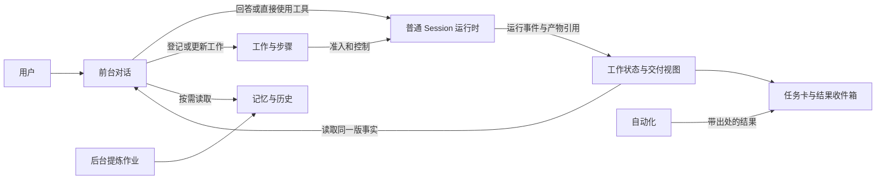

# Phaneris 工作区助手重构方案

Status: proposed — 2026-11-18 工作区助手评审稿，保留性能预算、落地顺序与退出旧路径的设计依据。

2026-11-18 · 第一版历史稿。现场证据保留供复核，角色定义、架构和实施顺序已由[《Phaneris Personal Agent · 统一任务协调助手重构方案》](personal-agent-task-coordinator-2026-11-18.md)取代。

**建议把常驻助手做成一个能直接工作的对话入口。** 用户可以跟它聊天、让它完成一件小事，也可以把一项跨天的工作交给它。需要跨轮推进时，系统保存这项工作的目标、约束、未完成事项和交付物。需要独立执行时，再启动普通 Session。用户始终可以在同一个入口说“你好”“A 别停”“把后面的补上”或“全部暂停”，每句话都有自己的对象和生效范围。

三个架构决定值得先评审。

1. **一个前台对话。** 最新的人类输入决定这次回复要解决什么。查历史、连接数据源、后台整理记忆、子任务跑完，各自拥有独立的事件身份。
2. **一项工作可以有多个执行者。** 助手与用户共同维护工作内容，调度器接受、执行和停止步骤。所有已承诺的步骤都能查到，包括尚未获得执行位的步骤。
3. **执行事实由系统提供。** 用户和模型看到同一份带时间的运行状态。是否已排队、运行过什么工具、哪些产物已核验、终止是否生效，都有对应记录。模型负责解释和判断交付质量。

## 1. 从真实使用倒推产品要求

主要样本为工作区助手会话 `261105-copper-cloud`，从 11 月 5 日首次使用到 11 月 18 日 09:59:34 的终止回复，共 2,407 条消息记录，另有一行文件头。记录包含工具、隐藏事件和运行续接，不能把所有 `user` 类型记录都算作用户发言。下文时间均为北京时间。涉及执行事实时，以对应工具回执及 Worker 原始记录校对助手的说法。

| 用户实际要做的事 | 现场记录 | 新设计必须实现的行为 |
|---|---|---|
| 交付一个画着鹈鹕骑车的 HTML | 11 月 5 日从 01:43 起，一件小事演变成选模型、重新委派、用户手动启动和诊断派单 | 当前权限允许时，助手直接写文件、打开核验、交付可用链接。一件小事可以一次做完 |
| 建立长期协作记忆，接收其他会话的成果 | 11 月 5 日用户指出 Worker 已完成却没收到反馈，提出将自动化结果发给助手。11 月 8 日又明确要求一批事实全部留作全局记忆，助手仍围绕项目归属和候选资格反复确认 | 用户可以指定记忆范围、查看原文和纠正记录。任务和自动化可以把结果可靠送到助手，由用户选择何时阅读 |
| 临时触发双联推送，招呼语改成“下午好” | 11 月 17 日 13:24 起，同一类上下文选择被“上次效果未确认”拦下 22 次。13:36 用户说明已另开 Session 启动，改为要求诊断刚才的错位 | 找到对应工作定义，只对本次运行改招呼语。接到“我已经启动”后停止补触发，接下来的“继续”承接诊断 |
| 隔天打招呼并重新测试 | 11 月 18 日 09:21 用户说“你好”，助手查历史后回答前一天的故障。该轮第二次模型请求的 usage 记录了 46,181 个输入 token。09:22 用户说明重新测试，回复又带出了 Day 72 | 一句招呼得到一句招呼。新一天仍记得用户，但旧任务只在用户提及、查看进度或有应送达的结果时出现 |
| 做高品质养老市场深度调研 | 09:29 的原始需求指定重养老、轻医疗，重居住、餐饮和活动，由助手设计维度。09:38 明确用于投资判断及行业报告，同意分篇文件和自包含 HTML。首次委派获接收前已有 43 条工具记录，其中 14 条报错，用时 306 秒 | 助手负责研究设计；补充用途与交付要求后，更新整项工作并传给相关执行者。用户关心的第一项可见进展应是研究安排及开工事实 |
| 保留 A、解除 B/C/D 的等待、补发后续任务 | A 的原始 Session 在 09:34:54 已完成 WebSearch，09:35:02 已完成 WebFetch。09:41 助手却说 A 没有工具调用。09:50 用户再次明确两项都要做，此后到下一条人类指令前有 53 条工具记录，23 条查工作，唯一一次补发 E 被拒；09:52 却对已提交的 A 应用了重配置 | 一条消息可包含多个要求。保留 A 的运行身份，修改等待中的步骤，补发后续工作；分别显示是否落地。某一步失败时，其余独立步骤继续 |
| 先暂停，再改为终止所有相关任务 | 09:58 的暂停回合里，回执分别出现三个 `cancelled` 和一个 `pause_requested`，回复标题却是“已暂停”。随后用户明确改为终止，B 最后收到 `cancelled`。最终回复引用的调度统计取自在取消 B 之前，且工作列表还有下一页 | 暂停保留恢复能力，终止关闭后续执行。批量命令有明确范围、逐项结果和统一时点；尚在停止中的项要原样显示 |

11 月 18 日 09:57:03 的回执尤其有区分度。B 是 `submitted` 且 `isProcessing=true`，D 等待 source，A 和 C 等待文件范围。全局 `occupied=2`。助手在 09:57:31 报告“2 个真在跑”。这里同时存在**调度占位、正在执行、等待原因**三种事实，给模型更多历史并不能使它们等价。11 月 17 日的分钟级迟滞有历史快照支持，11 月 18 日的 306 秒则覆盖多次模型往返、工具操作和错误恢复。两组数字不能合并归因为某个函数或模型供应商。

## 2. 当前设计为什么会把简单需求放大

| 实现边界 | 源码和记录能确认的行为 | 重构决定 |
|---|---|---|
| 用户输入与运行续接 | 来源已有类型。一次养老需求后，两次 source 激活各生成带原文和后缀、带新消息 ID 的隐藏续接，来源标为 `runtime_continuation`。准备要求又校验原始直接输入、引用和作用域，现场连续遭遇拒绝 | 前台消息保存一次。工具环境改变只续接同一输入下的尝试，宿主持有原始引用 |
| 语义理解与执行手续 | 准备上下文、持久/本轮要求、逐字目标引用、配置目录、Worker 回执版本分别有约束。模型要把用户已经说清的话再次翻译成这些控制参数。一处重述不匹配便可能使目标明确的任务无法执行 | 模型表达目标、步骤、依赖、交付和变更。来源身份、版本比较、幂等、模型配置及资源许可由软件承担 |
| 长期记忆与当前注意力 | 维护工作通过隐藏输入进入同一个常驻 Session。系统已区分来源、限制权限；前台仍可能在查询历史后把旧问题作为回答对象。单次错误无法反推出维护事件是唯一原因 | 后台维护拥有独立执行上下文。前台按问题取记忆和历史。查到的旧请求只能作为证据 |
| 调度与运行观测 | 委派调度在一定权限/状态组合下，按已启用 source 名称交集报告独占。文件范围另外参与冲突判定。默认并发值为 4；占位计数还包含保留的执行位。Worker 活动投影可只显示 `requesting`，此前已完成的工具另有原始记录 | 清楚区分资源、能力、并发额度和实际进展，按同一时点生成运行视图，保存最后一次已完成活动 |
| 前台读取成本 | 历史定位已有后台预热，冷态仍有同步扫描路径。常驻入口会分页拉取工作、再列产物，展开时每 5 秒刷新，收起且可见时每 15 秒刷新。历史报告还记录了修复前的扫描放大 | 给对话、任务列表、历史搜索各自规定读取范围。前台延迟、界面刷新和供应商时间分别量测 |

现有实现已经解决了一些真实问题，例如区分输入来源、保留未知效果、校验产物版本。这些性质值得保留。把它们继续暴露成模型每轮必做的业务流程，会让用户再次承担系统内部协调成本。源码定位见文末。

## 3. 一次普通对话怎样运行

**短对话直接走普通 Agent 循环。** 收到人类输入后，宿主持久化原文、附件、引用的消息或工作，以及输入来源。提供简短的协作偏好、近期可见对话和当前可用能力。助手可以直接回答，也可以在实际权限内读、写、检索、使用工具和验证产物。无需先创建工作、切分话题、派 Worker 或做一次独立的意图分类推理。

**长工作按需建立。** 用户要求跨轮跟进、需要后台执行或并行、存在多项交付或未来验收时，助手登记一项“工作”。短事执行中发现需要长时间处理，也能把已完成步骤和当前产物接入同一项工作。用户可以继续和助手聊别的；工作完成后，结果进入收件箱，必要时产生一条带出处的通知。

**有指代时才找对象。** 用户在任务卡上回复，直接使用该卡的工作 ID；引用上一条答复，就沿引用找到其问题和未完成项。纯文本“继续”先看最近一条公开交流中仍有效的承诺。“今天重新测试”开启新的对话主题。“昨天那个报告继续做，顺便告诉我 A 怎么了”可以同时恢复一项工作并回答进度。后台完成事件、时间接近、语义相似度都不能单独授予继续执行的权限。多个对象均合理、选错会改变实际工作时，只问能消除歧义的那个问题。普通讨论仍可先回答。

**对复合指令逐项兑现。** 对涉及工作的消息，助手一次给出与原始消息关联的变更，包括需回答的问题、需保留的现状、要新增或修改的步骤及一次性约束。宿主回传每项的已应用、待执行或具体障碍。答复引用这些结果。未完成的独立事项留在工作里，下一轮不会因为用户追问原因而消失。简单问候不生成这套结构。

**按对象处理打断。** 用户的直接输入立即进入前台。询问状态允许后台执行继续；补充要求只更新受影响的工作和步骤；“我已自己做了”撤回那一项待执行效果；“暂停”或“终止”在解析目标后优先进入调度器。与已明确目标冲突的旧动作，在调用外部工具前再次检查工作版本。用户改聊别的事情不会取消已经授权的后台工作。

## 4. 持久化什么，由谁说了算

以下是逻辑对象；首版可在现有服务进程中实现。关键在于每个事实只有一个写入方。

| 对象 | 唯一负责方 | 必要内容 |
|---|---|---|
| 对话输入与回应 | 对话服务 | 谁说的、原文、附件、引用、接收顺序、回应了哪次输入。Worker 和自动化带各自的来源 |
| 工作与步骤 | 工作服务 | 目标、约束及来源、交付形式、当前方案版本、步骤、依赖、未决项、验收条件。一步可以原地更新并保留历史 |
| 执行尝试与效果 | 运行时 | 对应步骤/尝试、动作是否获准、是否已发出、何时观测到结果、重试和停止情况。一次重试可有新尝试，仍归属原步骤 |
| 交付物 | 产物服务 | 文件或文本结果、版本、生产者、证据、核验结论。多个 Worker 的中间件可单独查阅，只有通过验收的最终产物进入交付 |
| 记忆与设置 | 记忆服务、工作区配置各管一类事实 | 偏好和事实保留指定范围、证据、版本及更正记录。模型、连接、思考强度等明确执行默认值写入有类型的设置，调度器直接读取 |

工作服务用一次本地事务提交方案变更、待调度步骤和待发送事件。运行时通过稳定的步骤/尝试标识接收，事件消费者按序号去重，重启后从游标恢复。对话只存工作、状态及产物的引用；界面与模型共用一份读取接口。一次网络中断后再次查询，能看到原操作到了哪里。外部服务已接收却丢失反馈时，记录“结果待核对”；能用服务方回执核对就核对，缺乏依据时保留未知，只阻止会重复该效果的动作。

模型侧只需要面向业务的操作，例如“保存或修改这一项工作的安排”“查看这项工作的状态”“暂停这些步骤”“读取这份产物”“查找证据或记住这条偏好”。宿主在调用边界附上可信输入、作用域、步骤 ID、版本、执行配置和操作身份。并发更新不同步骤可以合并；两次修改同一步且语义冲突时返回具体差异。模型无法通过引用旧消息、Worker 回报或工具文本扩大授权。来源可验证说明谁提出了要求；目标理解仍可能出错，可见的工作内容、用户纠正以及端到端验收负责发现这种偏差。

以“保留 A、解开 B/C/D、补发 E–H”为例，一次方案变更应包含 A 的保留约束、对三个已有步骤的修订、四项新增步骤，以及这些新增项关联的原分工。宿主用同一版工作快照一次提交有效计划，给每个新增步骤分配持久 ID。调度动作随后分别生效；D 仍在等设备也不妨碍 E 入队。重送同一次提交读取同一回执。用户后来改变 E 的研究范围，修订的是已有 E；运行中的旧尝试可报告已完成的活动，只有与当前验收条件兼容的产物才能用于最终汇总。

**直接执行的权限边界。** 前台从当前工作区、用户授权和实际可用工具中取得能力。Worker 仅继承其步骤所需的资料和能力，可独立使用获准的检索及文件工具。用户的长期身份、私人历史和其他工作的附件经定向选取后才进入执行上下文。外发、覆盖和删除继续遵守用户既有的授权约定。一次推送的收件人和渠道来自选定的工作定义及本次授权；授权存在但执行结果未知时，通过该次投递身份查询，避免重复发送。

### 上下文与记忆的读取规则

| 何时读 | 读入什么 | 生命周期 |
|---|---|---|
| 每次直接对话 | 本次原文、显式引用、近期公开问答、少量已确认的通用偏好 | 超出近期窗口的对话保留可查原文；压缩时保留用户原意和未决问题的引用 |
| 正在处理某项工作 | 这项工作的当前约束、未完成事项及相关步骤的新状态 | 工作修订后使用新版本。已完成步骤保留结果引用，工具输出按需展开 |
| 用户问“以前如何决定”“我是谁” | 在允许的来源范围内检索相关原文或记忆，注明覆盖范围 | 当前回合使用。用户指定保存时，按其选定范围写入并回读 |
| 用户委托从历史建立长期记忆 | 独立作业读取指定历史，区分已索引、已阅读、已提炼及待处理 | 可暂停、重启、查看进度。明确指定的全局记忆保存为工作区助手通用记忆；跨工作区可见性需要另有明确授权 |

一次性招呼语随本次推送结束；“本报告用于投资判断”随这项工作持续；“以后派发固定用这个模型和思考强度”进入执行设置。模型遇到无法使用的既定配置时，指出实际缺失的能力或连接，能排队的其他步骤照常入队。推断出来的偏好保留来源并允许修正。撤回或失去访问权的证据即时退出后续读取，必要时将依赖它的结论标为待复核。

## 5. 调度、控制与交付

**先接受工作，再分配运行资源。** 一个计划可以一次提交八个独立步骤和一个汇总步骤。步骤以稳定 ID 入队，调度器只在有空位且依赖满足时启动执行。并发设置来源（工作区设置或产品默认）、额度、保留席位、实际运行数、就绪待运行数和依赖阻塞数分别可查。用户允许并行意味着独立步骤可以并行；启用的并发额度仍然是资源约束。它只改变步骤什么时候启动。

**把资源冲突缩小到发生冲突的操作。** 普通网页检索可并发；共享读访问可并行；操作同一桌面、不可共享的外部设备、写同一目标文件才获取对应资源。连接器提供操作级能力和并发说明，无法确认其并发性质的操作使用隔离实例或对该操作保守串行。每个研究步骤默认有自己的产物目录和只读输入快照，汇总步骤读取已发布版本。列在可用工具里的 source 不应自动锁住每个获得该 source 的 Worker。跨来源的真实配额另行限流。

**控制是有语义的命令。** 等待中的步骤原地修改资源或输入；运行中的步骤通过补充消息接收新要求。确须重新启动时，说明将中断的尝试并保留已有产物。“保持 A”约束会阻止本次变更触碰 A 的执行配置。“暂停”先冻结范围内新准入，未启动项保留在队列，运行项到达可停边界后保留恢复点。“终止”关闭后续准入、重试及汇总，等待已发出的效果结算，保留历史和已有文件。范围在命令受理时展开，记录所含工作/步骤和新的控制版本。更新版本可将暂停升级为终止；旧回执仍能补记，但不能恢复旧目标。面板提供同一控制接口的直接入口。

**进度来自同一版快照。** 每项显示“已排队 / 运行中 / 等什么和等谁 / 正在停止 / 已暂停 / 已终止 / 待验收 / 已完成 / 失败”，附最后活动、最后成功工具、观测时刻、数据是否完整。失联就显示上次观测时刻和未知部分。一次汇总直接返回范围内的完整计数和版本，明细可以分页。助手查询“正在做什么”时读取它，用户展开任务卡可以看到同一条证据。任何“已补发”“已暂停”“已完成”的表述，都有对应状态或交付记录。

**完成要回到用户的交付要求。** Worker 报告结果时关联原始步骤、证据与产物版本。工作服务唤醒依赖步骤或安排该项工作的质量复核，结果重复送达只处理一次。需要人工验收的工作停在待验收；已授权助手验收的工作由助手打开实际文件，按要求检查后交付。养老报告需检查案例覆盖、投资口径、成本证据、分篇与 HTML 的完整性。证据不足的维度注明缺口。自动化沿用原有触发和投递授权，仅将结果引用送到指定收件箱；来自后台的信息不会替用户发起新目标。

## 6. 把 11 月 18 日的对话在新系统里走一遍

| 输入或事件 | 应发生的变化 | 用户可以核对什么 |
|---|---|---|
| “你好”“今天是新的一天” | 直接回应当下，等待用户给新的测试内容 | 无旧任务开工，无历史故障长答复 |
| 提出养老调研，交给助手设计维度 | 建立一项研究工作。记录重养老轻医疗、居住/餐饮/活动、案例数量与深度等原始要求。市场、空间经济、运营、不同机构案例可拆开；只有需要综合各份成果的工作添加依赖。并行依既有授权或用户决定开启 | 看得到研究范围、案例筛选思路、计划和已受理步骤。未知成本留空或标注推算依据 |
| 补充“投资判断及行业研究报告”，确认分篇文件和 HTML，同时询问并发 | 一次更新用途、验收条件和受影响执行者，同时从调度器读取并发配置和实际运行数 | 得到并发问题的直接答复；汇总任务携带已同意的格式和用途 |
| “A 正在跑……补发后续……解开 B/C/D 的限制” | 固定 A 的原尝试；给未启动步骤分配独立输出和恰当能力；一次补录 E–H，已有同一逻辑步骤则沿用。确实需要的桌面资源仍按操作排队。独立的补发可以先成功 | A 的 ID、尝试及原有工具记录可对照；B/C/D 各有变更结果或真实阻塞；E–H 各有队列记录。配置已固定时不再提问 |
| 某个 Worker 先完成，用户正在谈别的事 | 将产物挂到养老工作，唤醒其依赖步骤；产生带归属的结果通知 | 点击通知能看成果，正在聊的话题继续 |
| “暂停所有任务”，随后“不，终止所有任务” | 在此研究上下文内控制整项研究及尚未启动的后续步骤。显式要求“整个工作区”时扩展至相应工作区。并发发来的旧计划具有旧版本，不能新开工 | 同一终止快照列出已终止、仍在停止及结果待核对的数量；能查已生成文件。没有待核对效果时才能报告全部收敛 |

这里假设 E–H 是用户要求补发时已经商定的剩余研究分工。实现必须保存当时的实际分工和后续修订；模型在回话中换了一套 E–H 标题，也应能发现变化，防止任务漏掉或重复。

## 7. 性能预算与观测

以下是**提议的首版验收目标**。先在同一台 Windows 机器、同版客户端、同一脱敏工作区记录现版和普通 Session 的基线，分别测冷启动和热态。不存在可用实测的项目保留空值。外部模型首 token、工具服务延迟与本地处理分别记录。

| 路径 | 提议验收口径 |
|---|---|
| 普通问候，自输入到首个供应商请求发出 | 热态本地处理 P95 ≤ 250 ms。零后台记忆调用、零工作管理工具、零历史全文扫描；对照普通 Session 分别记录系统提示、工具 schema、材料和缓存 token |
| 任务状态查询、暂停受理 | 工作区内通过索引查询和本地事务受理，热态 P95 ≤ 200 ms。另报停止生效时间和仍待核对的效果数 |
| 长历史增长 | 在相同工作状态下回放约 2,400 条及十倍规模记录；比较读取字节、数据库查询、事件循环延迟和 UI 帧耗时。普通问候和查看单项工作不触发全量历史/产物读取 |
| 界面刷新 | 面板初次只读当前工作和第一页。后续订阅带序号的增量；断线补读缺口，缺口过大则重取有界快照。空闲可见面板不周期性遍历所有工作及产物 |
| 时间花在哪里 | 每次输入关联“接收、上下文就绪、请求发出、首 token、命令入队、Worker 开始、结果落库、界面可见”。分别报告 P50、P95、样本数、冷/热、环境和失败次数 |

上下文预算先保留用户原文及必要附件，按需加入当前工作、相关记忆和已选证据。大结果保留可读取的引用。遇到材料超过窗口时，分段读取或提示具体缺口；无关历史增长不能挤掉当前要求。新消息落库时一并建立按 ID 的定位，全文索引可以异步滞后。旧档案缺少定位时在后台重建，前台说明该份原文正在准备。工作看板使用独立状态投影，历史索引故障时仍可暂停任务和查看已有回执。

## 8. 怎样落地，怎样退出旧路径

建议在工作区级开关后建立一条独立的新助手入口。首版沿用普通 Session 的模型及工具执行、现有权限、运行回执和产物版本体系；长期身份绑定工作区。只为助手的工作和交付建立一套写入路径。已有 Tasks 的 DAG 继续负责固定流程。助手调用已有流程时只登记一个引用其 run ID 的步骤，节点依赖仍由 TaskRunner 推进，进度和停止经适配器回传。临时研究分工由工作服务调度，二者经过同一个运行准入边界，每个节点只有一个执行所有者。

| 顺序 | 实施边界 | 到此可独立验证的结果 |
|---|---|---|
| 0 · 留下旧版基线 | 用公开可提交的脱敏场景重放问候、历史续接、推送、养老调研、暂停/终止。私有原文留在本机。旧版、同模型普通 Session、新助手使用相同输入和执行环境 | 得到输入、调用、耗时、任务变化和最终文件；旧行为与失败可复核 |
| 1 · 前台对话和简单交付 | 接通普通 Agent 的对话与工具能力；将真实输入和内部事件分流。最小记忆接口支持明确写入、按范围读取和更正 | 问候、单文件生成、查历史、一次性约束均从真实 UI 入口跑通。无需启动第二个 Session |
| 2 · 一项可交付的长工作 | 打通工作存储、方案变更、排队、独立执行、结果回收和用户可打开的交付物。共用观测与命令接口，完成暂停、终止、崩溃恢复 | 单个研究工作能从需求走到交付。运行中插话、补发步骤和进程重启均能保留事实，不产生重复执行 |
| 3 · 并发与跨天连续性 | 接入操作级资源控制、工作范围内的结果通知、后台历史提炼、自动化投递和面板增量更新 | 养老案例完整走通，次日可恢复；前台问候和控制操作满足性能预算 |
| 4 · 受控切换 | 先在隔离副本影子读取，对比同一时点的工作数、已结算效果和产物。新工作区试用后，再按工作区切换入口；影子模式不派发、不外发 | 同一工作只有一个写入者。回退演练、历史可读、在途处置和权限验证通过后再切默认入口 |

**旧数据处理。** 保留历史 Session、普通 Worker 原文、产物版本及原始回执的读取链接。明确设定的偏好和执行配置经来源核对后导入，保留原作用域；推断记忆按需检索。旧焦点、准备记录和未结算回执不自动变成活动工作。切换时列出在途清单，已运行的任务由旧执行者结算，新入口只读其状态；明确移交的排队项以稳定映射接管并撤销旧准入。无法证明旧执行权已释放的项保持待核对。

**回滚与退役。** 回滚先冻结新工作准入，在途任务由原所有者结算或可核对地移交；旧入口以只读方式展示新版已接受的工作，防止重派。对话原文和交付物持续可读。通过约定的试用与恢复验收后，移出新助手路径上的模型手工 `select/prepare`、前台维护回合、逐项手填回执版本、按已启用 source 整项互斥、全量轮询。删除旧数据、变更现有生产工作或退役旧代码应单独评审。

## 9. 以用户结果作为发布门槛

先固定失败条件，再实施。确定性回放验证身份、并发、恢复和状态；另用当前实际模型从桌面入口运行完整自然语言场景，揭示模型即使拿到合法工具也会选错对象的问题。两类结果分别报告。

| 场景 | 判失败条件 |
|---|---|
| 问候、讨论与小文件 | 你好触发旧故障诊断；“为什么”导致任务变更；鹈鹕 HTML 无法打开或缺少指定图形 |
| 继续与纠正 | 用户自己触发后助手又外发推送；“继续”恢复已撤回的执行；“下午好”写回定时任务模板 |
| 长期记忆、模型设置与附件 | 明确的全局记忆被强行分进虚构项目；按来源回查失败；一次性要求出现在其他工作；固定 Worker 配置仍需逐次确认；Worker 获得无关个人历史 |
| 同一请求跨 source 激活 | 将两次激活计为三次人类授权；产生重复研究工作或重做已结算的动作；要求用户重复输入原句 |
| 养老调研与追问 | 保留 A 的指令之后 A 被重配、停止或重派；B/C/D 缺少处理结果；E–H 仅出现在回复里；并发额度限制了可登记的步骤数；用途、居住/餐饮/活动重点、案例深度或 HTML 交付要求丢失 |
| 运行状态和控制竞态 | 将占位数说成活动 Worker 数；把空白活动字段解释为从未调工具；分页当全量；将正在停止报为已停；暂停导致不可恢复的取消；终止后旧事件触发新效果 |
| 崩溃、投递与交付 | 在受理后、外部调用后或结果写入后模拟断电重启，出现重复外发、遗漏已接受步骤、成果无人接收或用未知效果冒充成功；文件未核验便宣告完成 |

每次验收保存脱敏输入、屏幕可见对话、按序的工作与运行事件、上下文各部分 token 数、分段耗时、最终文件及其版本。养老场景做两条独立回放：一条严格复现当日暂停和终止，另一条从补发完成处分叉、允许跑到交付并打开 HTML 及分篇文件。核验人员可以从同一输入重跑，逐项对照用户要求。没有真实模型和打开产物的证据时，只能报告本地协议验收通过。

## 证据定位

- **原始对话。** 本机 Work 工作区 `assistant/sessions/261105-copper-cloud/session.jsonl`。推送临时要求 `msg-1794893081723-cf7ad682ca79`，撤回执行并转为诊断 `msg-1794893785074-57e84da0b265`，养老调研 `msg-1794965377867-d1f51d916a6c`，用途与交付 `msg-1794965886300-958390ab3b3a`，保留 A 与补发 `msg-1794966440965-2e43194d53e5`，两项都做 `msg-1794966628880-31d01faa7a6a`，暂停和终止分别为 `msg-1794967113242-b16b03d6c202`、`msg-1794967124202-335f63bbe1ef`。计数按截止回复之前的消息记录逐条统计。首次派发耗时从研究原始输入到 A 的首条 accepted 回执；43 条不含该回执。53 条的区间自“两项都做”到“暂停所有任务”之前。
- **独立执行证据。** Worker `261118-sleek-moss` 的 `msg-1794965694785-fba5849ece2d` 与 `msg-1794965702109-71c827ed5464` 分别为上述 WebSearch、WebFetch 完成记录。运行快照能说明观察当时的情况，历史原文才回答“此前是否执行过”。
- **源码基线。** 核对工作树 HEAD `eecf8b3ba`；线上会话所用安装包的精确构建身份未经核验。输入、续接和委派准入见 [SessionManager](../../packages/server-core/src/sessions/SessionManager.ts)、[输入来源契约](../../packages/server-core/src/sessions/input-contracts.ts)、[工作准备](../../packages/server-core/src/context/work-preparation.ts) 和[委派契约](../../packages/session-tools-core/src/delegation-contracts.ts)。
- **执行、调度和进度。** [委派调度与计数](../../packages/server-core/src/resident-assistant/delegation.ts)、[容量默认值和文件范围](../../packages/server-core/src/resident-assistant/delegation-scheduling.ts)、[Worker 控制](../../packages/server-core/src/resident-assistant/worker-controls.ts)、[活动投影](../../packages/server-core/src/resident-assistant/work-projection.ts)、[现有 Tasks 执行器](../../packages/server-core/src/tasks/TaskRunner.ts)、[结果清单](../../packages/server-core/src/resident-assistant/task-results.ts)。
- **上下文与性能。** [常驻角色契约](../../packages/shared/src/agent/resident-role.ts)、[原文定位与预热](../../packages/server-core/src/context/source-reader.ts)、[入口面板刷新](../../apps/electron/src/renderer/components/resident-assistant/useResidentSnapshot.ts)。11 月 17 日的历史故障计时与后来隔离验证的性能结果按各自版本理解，见[历史时序证据](../../analysis/resident-assistant-architecture-postmortem-2026-11-17.md)和[隔离验证记录](../verification/resident-work-continuity-implementation-2026-11-17.md)。

