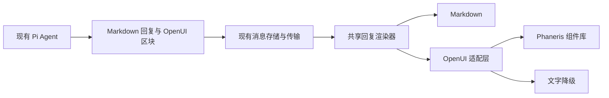

# OpenUI 回复呈现接入评估与规划

Status: proposed — 待评审；用户仅授权评估与文档落盘，未授权原型、依赖安装或功能实施。

日期：2026-10-13（Asia/Shanghai）。项目核对基线：`main`，`22ebef6ef02dd421af3c7cb9a3a4c5bf8142da04`，Phaneris 0.3.1 / Pi SDK 1.1.0。源码观察以当时工作区为准，工作区存在其他未提交变更。

OpenUI 核对范围：官方文档、GitHub 仓库、2026-10-12 的 Lang 1.0 发布记录和 npm 发布包元数据；仓库 `main` 当时为 `78e762b45a997d5c2decc3aecad5306ee97f76e7`。本次未安装 OpenUI，未执行产品构建、模型生成实验或产品 E2E；文档门禁检查不代表接入验收。

本提案的状态与后续安排在[唯一实施价值登记表](../process/implementation-value-register-2026-10-13.md)维护。本文描述候选方案与启用条件，不另建实施队列，也不改变既有 R01–R07、条件触发项或发布门槛。

> 后续材料（2026-10-14，均为文档，未实施）：本文 §4.1、§7、§9.1 中被标注为未知的成本与兼容性项目已由[接入实测证据记录](../verification/openui-adoption-evidence-2026-10-14.md)实测记录；技术展开见[目标架构与实施设计](../architecture/openui-intelligent-ui.md)。两者都不改变本文的 proposed 状态与决定表。

## 1. 评估结论

**技术上可接入，建议将 OpenUI 定位为可选的回复呈现层，先验证有限场景的收益，再决定是否采用。** 当前证据支持技术路线可行；尚不足以证明中文回复质量、模型生成稳定性、性能和维护成本优于现有能力。

OpenUI 的核心流程是：应用注册 React 组件及参数契约，模型生成 OpenUI Lang，解析器和 Renderer 将其转成组件界面。组件库、提示词生成和渲染器可以接入已有 Agent 与模型提供方。[官方接入说明](https://www.openui.com/docs/build-agents/ui-generation)

预期收益集中在信息组织、数据可视化和局部交互。事实准确性、证据、论证和完整性仍由原有生成与验证流程保障；组件丰富程度本身不构成质量提升证据。

推荐采用：核心运行时、自定义 Phaneris 组件库、Markdown 与 UI 区块混排、按需启用、完整文字降级。

当前不建议全量替换回复渲染，也不建议把 OpenUI 的聊天状态、模型路由或工具执行作为新的产品权威。既有 Pi、Runtime、权限、Artifact 和 Page 边界继续有效。

## 2. 用户需求与收益范围

目标用户在对话中阅读研究、比较方案、理解数据或制定计划。成功应表现为更快找到结论、比较差异、理解关系和完成必要操作，同时保留来源、正文和数据。

| 回复场景 | 预期价值判断 | 候选呈现 | 使用条件 |
| --- | --- | --- | --- |
| 数据分析、统计报告 | 高，待对照验证 | 指标、趋势图、明细表、来源组合 | 存在真实可验证数据，图表比文字更有帮助 |
| 多方案评估、产品比较 | 高，待对照验证 | 对比矩阵、分组详情、关键差异 | 现有表格无法充分表达组合关系或局部详情 |
| 计划、流程、阶段性任务 | 中高，待对照验证 | 步骤、时间线、依赖与验收条件 | 展示有助于理解顺序；展示不等于创建或批准任务 |
| 研究综述、知识解释 | 有条件 | 保留正文，辅以结构图和局部展开 | 关键结论、限制和来源无需切换视图即可读到 |
| 简短回答、长篇写作 | 低 | Markdown 正文 | 不因启用能力而强制增加卡片、标签或分页 |
| PDF、Word、表格等交付物 | 有限 | 现有 Artifact 与文件预览 | UI 展示不能当作最终文件已生成或写入的证据 |
| 持久化小应用、动态仪表盘 | 不属于首轮范围 | 现有 Page 流程 | 不把一次回复扩展成第二套小应用平台 |

这些价值等级是定性推断，不是实测分数。没有数据时，不编造转化率、效率提升比例、可靠性或工期。

## 3. 已核对的项目基础

| 当前源码观察 | 对接入的影响 | 证据 |
| --- | --- | --- |
| 根依赖使用 React 19、TypeScript 和 Zod 4 | 与当前 OpenUI 发布包声明在规格层面兼容；实际构建仍待验证 | [根 package.json](../../package.json) |
| Markdown 已按围栏语言处理 datatable、spreadsheet、Mermaid、HTML、PDF、图片、Markdown 和 LaTeX 等内容 | 可以沿用现有富内容区块入口，增量挂载 OpenUI Renderer | [Markdown.tsx](../../packages/ui/src/components/markdown/Markdown.tsx) |
| ResponseCard 已承载正文、结构化补充内容、复制、Markdown 视图和批注 | 存在现成承载位置；原有操作也构成必须保持的契约 | [TurnCard.tsx](../../packages/ui/src/components/chat/TurnCard.tsx) |
| ResponseCard 流式正文有节流，另有分块 StreamingMarkdown；MarkdownProps 当前未包含 isStreaming | 流式状态必须贯通；不能仅根据围栏是否闭合推断整个消息已结束 | [TurnCard.tsx](../../packages/ui/src/components/chat/TurnCard.tsx)、[StreamingMarkdown.tsx](../../apps/electron/src/renderer/components/markdown/StreamingMarkdown.tsx) |
| WebUI 复用 Electron 的 App 和 renderer | 共享实现有利于覆盖桌面与 WebUI，平台动作仍需分别验证 | [WebUI App](../../apps/webui/src/App.tsx)、[WebUI Vite 配置](../../apps/webui/vite.config.ts) |
| 分享查看器通过共享 SessionViewer 和 TurnCard 展示会话 | 新区块需要只读模式、缺失本地资源时的降级及旧消息兼容 | [SessionViewer.tsx](../../packages/ui/src/components/chat/SessionViewer.tsx) |
| Message 与 StoredMessage 的 content 为字符串；outputBlocks 当前服务轨迹明细 | 围栏原型可沿用 content；不能直接把轨迹字段改作回复 UI 状态仓 | [message.ts](../../packages/core/src/types/message.ts)、[JSONL 存储](../../packages/shared/src/sessions/jsonl.ts) |
| PlatformContext 已抽象 URL、文件、剪贴板和读取等平台能力 | 组件通过现有宿主入口操作，不自行旁路到系统 API | [PlatformContext.tsx](../../packages/ui/src/context/PlatformContext.tsx) |
| 系统提示词已区分回复、预览、Artifact 和 Page | 新能力需要明确适用条件；已有文件与小应用流程不重建 | [system.ts](../../packages/shared/src/prompts/system.ts) |

项目已有表格、图形与预览能力。OpenUI 的新增价值主要是受控的组合呈现和局部交互，需与增强现有 Markdown 的方案比较。

## 4. OpenUI 版本、依赖与外部服务

### 4.1 核对版本

| 包或契约 | 本次核对值 | 规划处理 |
| --- | --- | --- |
| `@openuidev/react-lang` | 1.0.0 | 候选渲染运行时，后续验证时固定版本 |
| `@openuidev/lang-core` | 1.0.0 | 候选规格、提示词与解析核心，和 react-lang 成套验证 |
| `@openuidev/react-ui` | 0.18.0 | 预置 UI 库，仅作为参考；推荐路线采用自己的组件 |
| Zod peer | `^3.25.0 || ^4.0.0` | 与项目 Zod 4 声明兼容，尚未做真实安装验证 |
| Lang 1.0 发布 | 2026-10-12，上海时间 | 重大版本刚发布，稳定性与回归风险需要专门验证 |

依据：[Lang 1.0 发布记录](https://github.com/thesysdev/openui/releases/tag/%40openuidev/react-lang%401.0.0)、[react-lang 发布包](https://registry.npmjs.org/@openuidev%2Freact-lang/1.0.0)、[lang-core 发布包](https://registry.npmjs.org/@openuidev%2Flang-core/1.0.0)、[react-ui 发布包](https://registry.npmjs.org/@openuidev%2Freact-ui/0.18.0)。

部分在线文档仍标注 v0.5。后续不能只复制网站示例：以固定发布版的 API、语言规则和类型为准，核心包、前端 Renderer 与后端生成规格一起升级。1.0 的入口规则也要求尽早输出 root；没有可用入口时可能显示空白。[发布说明](https://github.com/thesysdev/openui/releases/tag/%40openuidev/react-lang%401.0.0)

### 4.2 推荐依赖边界

- 共享 UI 层使用 react-lang，后端规格与提示词处理使用 lang-core；不另建独立聊天框架或通用组件平台。
- 采用自定义组件时可以省略 react-ui。其预置库还带有聊天状态、图表、表格和其他 UI 依赖，需避免形成两套风格与维护入口。[自定义聊天接入](https://www.openui.com/docs/build-agents/custom-chat-ui)
- 后端只消费从组件定义生成的规格，不导入 React 组件。规格生成与一致性检查属于构建流程候选，不在运行时重复手工维护。[规格生成说明](https://www.openui.com/docs/build-agents/ui-generation)
- 本路线保留现有 Pi 模型调用，使用本地生成的完整提示词。Gateway、Autofix 和云监控属于独立选择，首轮不纳入；若以后需要，应另评估数据传输、费用、账户与故障恢复。

### 4.3 许可与遥测

OpenUI 仓库采用 MIT。许可层面未见接入阻碍，分发时须保留相应版权与许可声明；传递依赖仍按项目现有审计流程检查。[LICENSE](https://github.com/thesysdev/openui/blob/78e762b45a997d5c2decc3aecad5306ee97f76e7/LICENSE)

官方说明安装遥测默认开启，运行时遥测默认关闭。后续依赖安装与 CI 建议统一设置 `OPENUI_TELEMETRY_DISABLED=1`，不启用运行时或云观测上传。此处仅记录候选配置，本次未修改环境或 CI。[遥测说明](https://www.openui.com/docs/openui-lang/telemetry)

开发版 react-lang 自动挂载 DevTools，源码包含 CDN 加载行为。后续需验证与 Electron CSP、本地开发和生产构建的关系，不能为调试控件宽泛放松 CSP。[开发工具引导源码](https://github.com/thesysdev/openui/blob/78e762b45a997d5c2decc3aecad5306ee97f76e7/packages/react-lang/src/devtoolsBootstrap.ts)

## 5. 推荐接入方案

### 5.1 数据流与所有权

| 领域 | 候选职责 | 边界 |
| --- | --- | --- |
| `packages/ui` | 组件库、Renderer 适配、区块展示、错误与文字降级 | 模型只能选择注册组件；风格由现有主题和组件决定 |
| `packages/shared` 的提示词与产品适配 | 序列化规格、启用条件、输出规则 | 后端不引入 React；不以全局 UI 指令覆盖现有文件与权限规则 |
| 产品消息契约与存储 | 原文、区块版本、未来交互状态的持久化与恢复 | 保留模型原始输出；状态元数据不能替换权威执行事实 |
| Electron / WebUI / Viewer | 宿主能力、显示模式与权限衔接 | 查看器只读；操作通过既有入口处理 |
| Runtime Kernel / Host | 沿用既有执行、恢复、交付与记账 | OpenUI 解析或 UI 点击不能自行推进执行状态 |

所有权约束来自[Runtime 边界](../architecture/durable-runtime-boundary.md)、[领域所有权](../architecture/governance-domain-ownership.md)和[主题宿主契约](theme-hosts-and-rollout.md)。

### 5.2 Markdown 与 UI 混排

首次原型建议增加 `openui-lang` 围栏处理，正常文字继续使用 Markdown，Lang 原文保留在现有 content 中。最小原型无需替换消息传输协议，但正式采用前仍需冻结版本、降级和重放契约。

官方提示词源码包含围栏混排模式，但默认场景偏向界面创建与增量编辑。应借鉴其语法并定制回复规则，不能直接照搬“只输出改变的语句”的模式。[固定版提示词源码](https://github.com/thesysdev/openui/blob/%40openuidev/react-lang%401.0.0/packages/lang-core/src/parser/prompt.ts)

回复区块的候选规则：

1. 每个区块是一棵自包含的完整树，root 优先输出，不能依赖上一条消息中的变量或界面实例。
2. 首轮用于最终助手回复；工具结果和外部文本中的同名围栏不得自动取得组件或动作能力。
3. 同一新 Renderer 覆盖 Markdown 的 minimal/full 模式；不形成两个逐渐分叉的实现。
4. 流式状态来自消息链路；保持消息、区块和组件身份稳定，避免每个增量引发重挂载。
5. 保留普通 Markdown 路径及功能开关；关闭能力后的历史内容仍可阅读。
6. 旧客户端能存储围栏不等于能渲染 UI。必须通过完整文字快照或明确的降级契约保障阅读，不能只剩 DSL。

### 5.3 首批组件与视觉约束

| 语义组件候选 | 用途 | 首轮限制 |
| --- | --- | --- |
| Reply / Section | 组织结论、正文和分节 | 阅读顺序明确；结论与关键限制不藏在交互后面 |
| Metric | 指标、单位、口径与时间 | 数据有来源；缺失值不显示为零 |
| Comparison | 比较维度、方案和差异 | 优先复用表格能力；内容不能因窄窗口被不可达地截断 |
| Steps | 阶段、依赖与验收条件 | 展示计划，不触发任务创建或计划接受 |
| Chart | 基础趋势与比较 | 保留可读数据、单位、日期和来源；不只靠颜色区分 |
| Sources | 数据或结论来源 | 链接走现有 URL 处理；来源与对应内容可关联 |
| Tabs / Disclosure | 次级详情的局部展开 | 仅在真实信息结构需要时采用，完整内容可复制和降级 |

组件使用现有语义 token、字体、密度、明暗主题、焦点和 motion 约束；首轮不允许模型输出任意 CSS、全局布局、脚本或宿主 API 调用。不为新增区块改变整个聊天界面。

### 5.4 模型输出策略

- 在能力开启且场景适合时，向模型提供对应组件规格和有效示例。首次仅对明确的展示、比较或可视化需求启用。
- 同一次现有模型调用选择 Markdown 或适当 UI 区块；不默认新增独立分类或美化调用。
- 组件定义为规格的单一来源，自动生成并检查一致性；仅改变 Zod 字段顺序也可能改变位置参数契约，需要版本审查。
- 首轮关闭 UI 侧工具工作流和界面增量编辑规则，不向 Renderer 提供通用 toolProvider 或 MCP 客户端。提示词限制是生成引导，执行边界仍由宿主保障。
- 展示数字和图表前沿用现有数据获取与核对流程；不能为了构成界面补造数字、步骤状态或来源。

## 6. 降级、状态与交互契约

### 6.1 完整文字与错误恢复

OpenUI 可能产生未知组件、错误属性、缺失引用或截断输出；局部可渲染并不证明内容完整。[官方可靠性说明](https://www.openui.com/docs/openui-lang/reliability)

候选处理必须区分生成中的暂缺数据和结束后的真实错误。对最终空白、关键数据缺失或版本不支持，展示完整可读内容；错误边界不能仅回退为代码块并宣称成功。

文字降级需覆盖结论、全部必要数据、单位、条件和来源。可通过受控组件的确定性文字序列化和独立文字快照实现，具体封装在原型后冻结。未知组件不能靠故障后临时总结保证不丢内容；本地无法恢复时，应保留原文并明确标记展示不完整。

复制操作输出可读正文与来源；源码查看保留 Lang 原文，两者用途清晰。不得使用渲染 DOM 的可见文本替代完整内容，因为折叠或分页内容可能尚未挂载。

若以后引入模型修复，需要次数、延迟和费用边界，并经过现有调用与记账流程；首轮不能因每个流式解析告警触发重复模型请求。

### 6.2 状态与历史

Renderer 提供 `initialState`、`onStateUpdate` 等接口，持久化仍是应用的职责。[历史与状态说明](https://www.openui.com/docs/build-agents/conversation-history)

正式引入输入状态前，应冻结以下字段的产品契约：稳定区块身份、语言版本、组件库版本、文字降级、有限状态及其修订关联。具体字段名和存储位置待原型结果裁定，不在本次文档新增类型。

状态归属消息和具体区块，切换会话、重连、重启、分支与历史查看时不能串用。UI 状态属于产品元数据，不能改写已提交的模型原文或 Runtime 事实。更改组件契约需要旧内容兼容或明确降级路径。

### 6.3 动作与权限

首轮只处理展示、切换和展开等局部交互。后续可以将追问按钮接入现有用户消息入口；按钮标签、所选区块与表单值要作为用户动作准确记录，避免只向模型发送没有语境的“提交”。

涉及文件、任务、外部发送或来源服务的操作，需要现有产品命令、参数校验、授权和 Runtime 记账。模型生成的动作不能自行扩大权限；Artifact 接受、计划接受和 Page 发布仍使用各自既有流程。

分享查看器不得恢复原会话的操作权限。纯展示和本地视图切换可用；需要原工作区、账户或特权能力的按钮应禁用或隐藏并提供可读说明。[Renderer 与动作接口](https://www.openui.com/docs/openui-lang/renderer)

## 7. 工程风险与必须验证的事项

| 风险 | 观察或不确定性 | 后续约束 |
| --- | --- | --- |
| 新版本与文档不同步 | 已观察到 Lang 1.0 与文档 v0.5 标注并存 | 固定发布版，示例与生成规格和 Renderer 成套校验 |
| 流式空白、抖动、状态丢失 | 尚未在项目上实测 | root 优先；贯通 isStreaming；稳定 key；保留现有节流；最终错误有降级 |
| 无效内容被剪除 | 官方允许部分结构降级或丢弃 | 验证关键数据完整性，不能仅检查是否出现 DOM |
| Schema 被当作完整安全边界 | 核对源码可见结构与类型校验；不等于所有业务约束已执行 | 独立限制长度、数量、嵌套、数值、URL、资源与来源；必要时显式 safeParse |
| 宿主能力被旁路 | React 组件运行在现有 renderer，不能等同 iframe 隔离 | 白名单组件、最小宿主入口、不提供通用工具执行器 |
| 复制、批注、编辑与导出退化 | 现有操作基于 Markdown 和消息身份 | 文字序列化、稳定定位、源码视图明确；必要时适配 Tiptap，不能假定其自动支持新围栏 |
| 分享与本地资源缺失 | Viewer 不拥有原工作区文件和授权 | 可携带快照与完整文字；缺失数据明确降级；操作只读 |
| 包体与构建开销 | 发布包元数据不是实际生产 bundle | 懒加载候选；生产图与现有预算比较；不预设体积收益 |
| 提示词与会话成本 | 组件说明、UI 描述和降级文字会占上下文，实际增量未知 | 使用有限组件；按需提供；测量相同任务的输入、输出、修复与总费用 |
| 长会话与模型差异 | 中文、各模型、连续修改均未实测 | 用实际模型组合和多次生成验证；与已有压缩及轨迹契约一起检查 |
| 第三方默认行为 | 安装遥测与开发工具加载已有源码依据 | 后续显式配置并验证；不隐式启用云服务或放宽 CSP |

结构校验依据：[固定核对版 validation.ts](https://github.com/thesysdev/openui/blob/78e762b45a997d5c2decc3aecad5306ee97f76e7/packages/lang-core/src/parser/validation.ts)。本规划不把类型声明兼容、官方示例运行或浏览器截图推断为正式客户端全链路通过。

## 8. 分阶段候选工作与进入条件

下表是评审用候选顺序，不是实施授权、排期或工期承诺。任何阶段启动均需用户后续明确授权，并在唯一登记表中更新状态与范围；按既有规则单任务推进。

| 阶段 | 候选工作 | 预期产物 | 进入下一阶段的条件 |
| --- | --- | --- | --- |
| P0：验证价值 | 选取真实数据报告、方案比较和阶段计划；比较当前回复、增强现有 Markdown、OpenUI；先固定失败矩阵和模型实验口径 | 相同输入与数据的对照材料、成本与性能记录、收益裁定 | 至少在目标场景证明更易理解或操作；数据与来源不丢；新增成本可接受 |
| P1：只读接入 | 共享组件库、围栏处理、主题适配、区块版本与完整文字降级、功能开关 | 可重放的只读展示及三类宿主 E2E 证据 | 桌面、WebUI 和 Viewer 可用；原有回复与查看路径保持正确 |
| P2：补齐生命周期 | 流式状态、复制、批注、必要编辑适配、重启恢复、分支与历史兼容 | 真实操作 E2E 与可复验产物 | 旧回复可阅读，完整内容可复制，批注与状态不串用，失败不会静默丢内容 |
| P3：有限交互 | 后续追问、有限输入状态与产品命令衔接 | 动作记录、权限与恢复验收 | 用户输入和操作来源可追踪；没有权限旁路或重复副作用 |

P1 必须已有可用降级和流式基本处理，P2 是生命周期的完整验收，不能先把半成品全量启用后再补可靠性。P3 属于额外候选范围，不因为只读试点通过而自动获批。

P0 若证明增强现有 Markdown 已能取得相同收益，应优先保留成本更低的方案。若 OpenUI 的价值成立，但特定模型不稳定，可缩小组件或启用范围；不能用无限修复掩盖没有净收益。

## 9. 先行失败矩阵与验收计划

以下失败方式在代码之前登记，全部产品验证仍未执行。后续优先真实 E2E；只有隔离验证确有必要时，才在实现前补齐其失败方式与验证计划。

| ID | 失败场景 | 必须验证的结果 |
| --- | --- | --- |
| OU01 | 模型发明组件、缺属性或属性类型错误 | 显式记录错误；关键内容可读，不以局部成功掩盖缺失 |
| OU02 | root 缺失、位于末尾、引用缺失或输出截断 | 生成中与结束后处理不同；最终不留下无解释的空白 |
| OU03 | 多个区块互相引用、只输出增量 patch | 拒绝不自包含的回复块或完整降级；重载结果不依赖旧实例 |
| OU04 | 高频增量、反复布局改变、流式中切换视图 | 组件身份稳定，滚动与选择可用；未完成时不开放特权动作 |
| OU05 | 超长内容、大数组、深层嵌套、循环引用或异常数值 | 有限资源处理，不冻结宿主；限制值在原型后有据设定 |
| OU06 | 图表数值、单位、日期、缺失值或来源不一致 | 与固定源数据逐项核对；缺失不变成零，推算明确标注 |
| OU07 | URL、资源或动作参数携带危险内容 | 经过现有安全与权限入口，未知组件和参数不扩大能力 |
| OU08 | 工具结果、外部文本带同名围栏 | 不能取得最终助手回复的交互权限或通用执行器 |
| OU09 | 折叠、分页、标签页隐藏了内容 | 复制和文字降级含完整内容与来源，关键结论在阅读路径可达 |
| OU10 | 选中文本批注、保存、重载或分支 | 定位稳定，不丢批注、不关联到其他区块或会话 |
| OU11 | 切换会话、重连、重启和重新生成 | 状态归属正确，恢复不改写模型原文与 Runtime 事实 |
| OU12 | 旧客户端、旧组件库或功能关闭 | 历史内容可读或明确降级；不只有不可理解的 DSL |
| OU13 | Viewer 没有原文件、来源连接或操作权限 | 快照与文字可读；不发起原工作区动作，缺失资源明确说明 |
| OU14 | 浅色、深色、窄窗口、触摸与键盘操作 | 内容不被不可达地裁切；焦点、对比度和非颜色表达可用 |
| OU15 | 模型修复失败、连续解析告警或用户取消 | 不形成无限修复，不重复发送，不产生未记账调用 |
| OU16 | 开发工具、遥测或云配置进入正式构建 | 外联行为与声明一致；CSP、身份与现有构建预算继续生效 |
| OU17 | Markdown 源码视图、编辑器或文件导出不认识围栏 | 保留原文并有可读降级；不宣称文件格式已获得原生支持 |
| OU18 | 后续交互按钮重复点击、过期参数或权限改变 | 可追踪到具体消息和用户动作，走已有校验；不重复产生副作用 |

### 9.1 收益对照口径

| 维度 | 验证方式 | 不采用的成功口径 |
| --- | --- | --- |
| 理解与比较 | 同一真实内容，核对结论、关键差异、限制和数据是否更容易找到 | 仅因卡片更多或视觉更复杂就判定提升 |
| 内容完整性 | 对照固定源数据与文字基线，核对数值、单位、来源和必要条件 | 出现任意组件即视为完整 |
| 生成可靠性 | 固定模型与组件版本，代表性中文请求重复生成，区分有效、降级、缺失与空白 | 将官方基准直接当作本项目可靠性 |
| 延迟与成本 | 记录首个可读内容、完整可用界面、输入/输出 token、修复次数与总费用 | 用另一种 UI 描述格式的 token 对比推断比 Markdown 更省 |
| 产品操作 | 真实复制、批注、展开、重启、分享与键盘流程 | 截图或 build/smoke 通过替代全链路验收 |
| 可维护性 | 组件契约变更、旧消息重放、后端规格一致性与回滚 | 首次 demo 成功替代长期兼容能力 |

质量、性能与成本门槛需在 P0 基线测量后明确，再决定是否正式采用；本次不填没有证据的目标百分比或工期。

### 9.2 后续验收产物

若后续获准验证，产物至少应包含：固定输入和数据、原始模型回复、包与组件契约版本、宿主与模型信息、E2E 操作记录、截图、错误与降级日志、成本/性能记录、未覆盖范围和重跑说明。纳入现有 verification 机制，引用源码与构建基线，不新建平行验收权威。

本次只形成文档。未创建上述产品验收产物，也未运行本矩阵。

## 10. 待评审决定与退出条件

| 决定 | 当前建议 | 尚待证据或授权 |
| --- | --- | --- |
| 是否投入验证 | 有条件开展有限只读试点 | 用户后续授权 P0；本次只有规划落盘授权 |
| 首次场景 | 数据报告、方案比较、阶段计划 | 选定真实样本，固定同一数据与输出质量口径 |
| 依赖路线 | Lang 核心与自定义 Phaneris 组件 | 固定版真实安装、构建和宿主兼容验证 |
| 生成入口 | 既有 Pi 请求，Markdown 与自包含区块混排 | 场景启用策略和提示词负担的对照结果 |
| 正式消息契约 | 原文与产品 UI 元数据分开；版本与降级明确 | 区块封装、完整文字来源、状态字段和兼容策略在原型后冻结 |
| 默认启用 | 暂不全量开启 | 目标场景证明收益且生命周期验收完成 |
| 云服务、UI 侧工具与写操作 | 首轮不纳入 | 如有实际需求，另定范围、费用、数据与授权契约 |

退出本提案的条件：增强现有 Markdown 已获得相同收益；组件生成或完整性无法在有限修复内稳定；阅读、复制、批注和历史兼容退化；或成本与维护负担超过经验证的收益。退出后保留评估证据，停止新增运行依赖，不改变既有回复与文件能力。

## 11. 核心信源与后续维护

所有外部观察为 2026-10-13 的核对结果。网页、npm latest 和 main 都可能变化；后续实施重新固定版本，以同一契约验证，不自动沿用“最新”结论。

| 信源 | 用途 |
| --- | --- |
| [Getting Started](https://www.openui.com/docs/getting-started) / [GitHub 仓库](https://github.com/thesysdev/openui) | 用户指定的评估对象与总体接入入口 |
| [Set up UI generation](https://www.openui.com/docs/build-agents/ui-generation) | 既有 Agent、组件规格与本地提示词生成 |
| [Custom chat UI](https://www.openui.com/docs/build-agents/custom-chat-ui) | 保留自有聊天界面、自定义组件与动作衔接 |
| [Defining Components](https://www.openui.com/docs/openui-lang/defining-components) | 组件声明、参数顺序、组合与提示词策略 |
| [Renderer](https://www.openui.com/docs/openui-lang/renderer) / [Reliability](https://www.openui.com/docs/openui-lang/reliability) | 流式、错误、交互与可靠性边界 |
| [Conversation history](https://www.openui.com/docs/build-agents/conversation-history) | 原始 UI 内容、用户动作与应用自有状态持久化 |
| [Lang 1.0 release](https://github.com/thesysdev/openui/releases/tag/%40openuidev/react-lang%401.0.0) | 发布版本、入口规则和配套升级要求 |
| [固定版 Renderer 源码](https://github.com/thesysdev/openui/blob/%40openuidev/react-lang%401.0.0/packages/react-lang/src/Renderer.tsx) | 以实际发布接口核对文档说明 |
| [Telemetry](https://www.openui.com/docs/openui-lang/telemetry) / [LICENSE](https://github.com/thesysdev/openui/blob/78e762b45a997d5c2decc3aecad5306ee97f76e7/LICENSE) | 默认外联行为、关闭方式与许可要求 |

| 日期 | 文档变化 |
| --- | --- |
| 2026-10-13 | 形成接入评估、候选架构、阶段进入条件、先行失败矩阵及采用/退出标准；登记为待评审提案，未实施 |
| 2026-10-14 | 追加实测证据与目标架构两份文档的指引；本文结论、决定表与状态未改动 |
