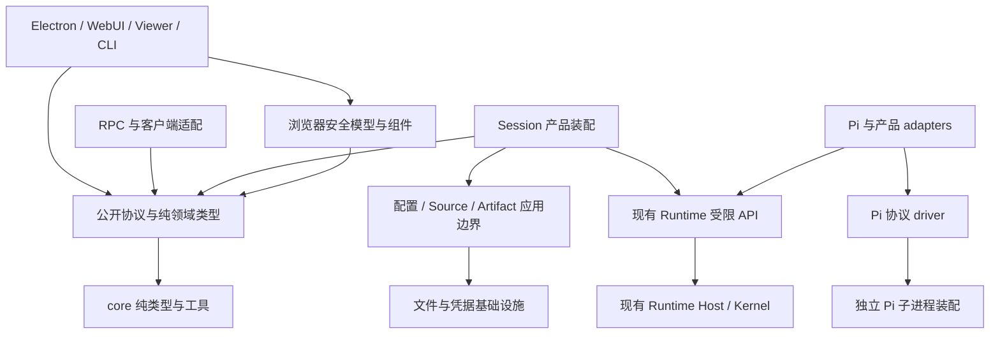

# Phaneris 架构与代码治理实施计划

状态：**implemented — G0–G8 的仓库内治理已实施；最终本地验收与外部平台限度见完整台账**。
当前执行结果：[完整实施台账](./governance-completion-2026-10-11.md)。历史裁定：[首轮](./governance-first-wave-2026-10-11.md)、[第二轮](./governance-second-wave-2026-10-11.md)；本轮[先行失败矩阵](../verification/governance-completion-failure-matrix.md)。
日期：2026-10-11（Asia/Shanghai）。
核实于：`8e5bf13b3f393dc776f6c17057eb5d0fb05f2dda`，扫描开始时工作区干净。
范围：已有功能的架构边界、状态所有权、代码质量、数据安全、验证、构建和文档治理。
依据：[完整扫描与验证证据](../verification/results/architecture-code-governance-2026-10-11/README.md)。

## 1. 推荐实施方向

下一阶段把重点放在**可独立演进的模块边界，以及能阻止边界重新退化的验证机制**。

近期已经完成一次有效的清理：Runtime Kernel/Host 独立边界、首轮工具初始化、安全限流/请求体限制、依赖声明、Playground 打包清理和主题一致性都已有实现与证据。新的治理计划承接这些成果，不重新执行历史方案。

推荐顺序：

1. 建立统一治理台账，修正文档状态，隔离验收输出，补齐 CI 的环境和证据保存。
2. 优先处理仍有数据破坏风险的插件提交/回滚残余，再处理认证持久化与异常归属。
3. 收缩 `shared/config` 的混合职责，明确纯契约与 Node 存储边界，消化根清单借用和循环引用。
4. 分开治理 Pi 子进程装配、SessionManager 产品装配，以及客户端平台接口；每次只迁移一个状态所有者。
5. 将同一组端到端场景用于结构变更和构建分发验收，形成长期维护规则。

首轮建议先实施 **G0、G1、G2a**，约 5–9 个工程日，产出一套可靠的实施底座和插件事务修复证据。后续各包仍须在开工前复核基线与失败矩阵。

## 2. 本次扫描的范围与真实基线

本节及 §3–4 保留实施前扫描事实，包含当时未运行的检查和当时仍存在的问题。实施后的结果、新增回归修复及尚未覆盖的环境，以[完整台账](./governance-completion-2026-10-11.md)及其验收证据为准；不把历史数字更新成“当时已经通过”。

### 2.1 扫描覆盖

| 维度 | 本次结果 | 口径 |
| --- | ---: | --- |
| 受版本控制文件 | 3,125 | 全部记录路径、分类、大小和内容哈希 |
| Markdown | 195 | 包含 `docs/` 的 101 份，以及包 README、维护说明、内置用户指南、release notes |
| Workspace | 13 | 根清单另计，共 14 个 `package.json` |
| 源码/脚本/样式等 | 2,272 文件 / 480,919 行 | 包含测试、资源脚本和开发工具 |
| `src` 非测试源码 | 1,482 文件 / 341,378 行 | 包含开发 Playground，不等于发布代码量 |
| 测试与夹具 | 571 文件 | 不是测试用例数，也不是覆盖率 |
| TS/JS AST 解析 | 1,462 模块 / 8,148 个字面量引用点 | 复用仓库现有 import graph；5,907 个引用点解析到本地模块 |
| 声明的 workspace 依赖 | 27 条 | 包间无环；历史 overview 的 25 条已过期 |

文档均做了目录、标题、章节、状态、未完成项和链接入口扫描；重点深入阅读架构 ADR、两轮全项目评估、10 月清理计划、依赖关系、插件计划、性能记录、验证矩阵及 CI/发布说明。用户指南和研究附件用于核对范围与契约，不把其中每项设想都升级为本轮待办。

代码采用全库盘点与 AST 扫描，再定向追踪 Runtime、配置/凭据/插件、RPC、Pi 装配、客户端启动、消息适配器、工具沙箱、构建和 CI 的关键路径。本次不是逐行安全审计，也不宣称复现了全部历史问题。

### 2.2 实际运行结果

环境：macOS x86_64，Bun 1.4.2，Node v24.16.0；资源工具的 Python/uv pin 为 3.12.15 / 0.12.22。

| 检查 | 结果 | 结论限度 |
| --- | --- | --- |
| `validate:ci` | 通过；87 项既有 Bun 测试和文档工具 smoke 通过 | 类型检查覆盖所有成员；lint 的成员覆盖仍只有 electron/shared/ui |
| `test:critical` | 通过；193 项既有测试 | 另有 Runtime 工作流 15 项、真实进程崩溃 8 项、门禁拒绝 23 处违规 |
| WebUI 认证隔离回归 | 15 pass / 0 fail | loopback 服务；不是公网部署或跨进程撤销验收 |
| `build:smoke` | 通过 | 五个生产入口和独立 server 分发目录 import 通过；不是安装器验收 |
| staging 后 `bundle:report --check` | 通过 | renderer 初始 JS 4,279,927 B / 71 chunks；main 21,441,491 B；Pi 14,004,547 B |
| Runtime / architecture 门禁 | 通过 | Runtime 违规 0；未声明子路径 0；WebUI 仍有 3 条已列基线例外 |
| `identity:check:strict` | **退出 1** | 152 处未分类标识，分布于 67 文件；常规身份漂移检查通过 |

`validate:ci` 的绿灯与严格身份检查的红灯并不矛盾：前者没有启用严格残留策略。兼容协议、provider 名称、来源署名与真正的品牌残余必须逐项分类，不能全局替换字符串。

未运行：`validate:full`、性能基准、Docker、Windows/Linux 安装器、签名、公证、远程 Actions 检查、最新外部依赖安全公告和真实 provider/IM 调用。相应工作仅以静态事实或历史证据列入计划，不标记完成。

### 2.3 质量信号

| 信号 | 实测基线 | 应如何使用 |
| --- | --- | --- |
| ESLint warning | 120：Hooks 95、localStorage 17、无效 disable 8 | 按行为风险分类，再逐文件归零；先阻止新增 |
| `any` / `as any` | AST 291 / 113 | 优先处理 transport、preload、CLI 和 Pi 协议边界，不以总数机械评判 |
| 模块循环候选 | 含类型引用 16 组；剔除显式 type-only 后 6 组 | 先区分 barrel、编译擦除、真实值依赖；未全部完成语义复核 |
| 最大值引用循环候选 | `shared` 的 16 个模块 | 涉及 config、credentials、sessions、sources、workspaces、automations、plugins |
| 根清单借用候选 | 39 个 workspace–依赖对 | 成员未在 deps/dev/peer/optional 声明，根清单有声明；不是 39 个死依赖 |
| WebUI 源码闭包 | 1,012 模块；46 项 shim | 有防新增门禁，仍依赖 Electron renderer 源码和启动顺序 |
| main 包预算余量 | 58,509 B / 上限 21,500,000 B | 结构改造必须持续比较产物；不能默认「拆文件会减包体」 |

## 3. 历史文档如何进入新台账

后续治理的执行队列统一由本计划维护。原文保留历史版本、决策和失败记录；原文中的「当前」「OPEN」仅在对应时点有效。

| 历史材料 | 本次裁定 | 接入方式 |
| --- | --- | --- |
| [2026-10-10 系统清理](./system-cleanup-optimization-plan-2026-10-10.md) | A/B/C/D/E/F/H 已实施；G 未实施 | G 的 storage/Pi 切口纳入 G3/G5；不重做 A–F |
| [2026-10-06 排序规划](./workstream-sequencing-2026-10-06.md) | 正文仍写「尚无代码改动」；初始化竞态和 Runtime 边界已有后续实现 | 修正状态；九服务方案保留职责分析价值，不能当作当前实施指令 |
| [项目深度分析](./Phaneris_Project_Deep_Analysis.md) | 部分安全项已修；SessionManager/shared 膨胀、异常策略、撤销持久化仍值得治理 | 已实现项关闭；仅将源码再次核实的项转入 G2/G3/G6 |
| [2026-08-31 路线图](./project-assessment-and-roadmap-2026-08-31.md) | 类型检查、CI、身份等多个描述已经变化；总状态仍为未开始 | 作为治理来源；逐条映射为完成/残余/待复核/延后，停止维护第二套执行路线 |
| [依赖关系分析](../dependencies/dependency-graph-2026-10-06.md) | 死声明/子路径/两处内部边已处理；hoisting 归属和 lock 孤儿未完全处理 | G4 接剩余归属，G8 接构建/锁文件；不能重复删除 peer 提供者 |
| [插件计划](./plugin-system-review-and-roadmap.md) | 三个原 P0 的主修复已落地；备份清理回滚和凭据清理仍在原控制流中 | G2a 只接数据完整性残余；新的安装产品流程继续延后 |
| [Durable ADR](../architecture/durable-agent-runtime.md) / [boundary](../architecture/durable-runtime-boundary.md) | 边界已实现，ADR 中仍残留「not implemented」段落 | 修正文档矛盾；现有 T1/T2 与 Host 所有权作为硬约束 |
| [目标 Runtime 架构](../architecture/durable-agent-runtime-target-architecture.md) | Deferred；激活条件没有因本次扫描自动成立 | 继续延后分布式 lease、通用 admission、自动 continuation、filesystem transaction |
| [性能实施记录](./performance-implementation-2026-09-10.md) | 第一轮优化已实施；旧失败/测量属于历史；main 15 MB 是目标而非现行门禁 | 保留预算，复测后决定结构优化，不再次盲拆 chunk |
| [原始代码审计](../archive/code-audit-2026-08-01.md) | OPEN/PARTIAL、优先级和威胁模型均需重新核实 | 每个旧项建立裁定；只有复现或明确源码证据才能进入当前缺陷队列 |
| [发布检查表](../release-readiness.md) / [品牌 B 阶段](../architecture/phaneris-phase-b-brand-identity.md) | 部分正文仍称身份未改或服务指向上游；现行身份为 Phaneris，服务端点为 null，telemetry 关闭 | G0 刷新事实；G8 区分可构建、可安装、可签名和可发布 |
| 功能设计与研究：日历/Gantt、Memory、GPUIX、Run 扩展、agentic interception | 存在开放设想，但不是治理的自动待办 | 保留原设计与触发条件，不进入本轮功能开发 |

台账每项字段：`ID / 风险 / 核实于 SHA / 事实来源 / 状态 / 所有者角色 / 前置依赖 / 验收场景 / 证据路径 / 回退方式 / 关闭或延后理由`。状态固定为 proposed、ready、in-progress、verified、deferred、superseded；历史记录本身不因旧描述而成为缺陷。

## 4. 实施前问题台账与优先级

首轮关闭范围：GOV-01 的插件事务残余、GOV-02 的 Runtime 验证输出、GOV-11 的检查覆盖、GOV-14 的文档入口均已本地验证；GOV-03 的 uv/上传/PR 构建已接线且通过本地配置门禁，远端执行仍待验收。完整回归另发现并修复了分支 Runtime 视图与资源释放遗漏，记入首轮台账；不代表 GOV-07 的 SessionManager 拆分已完成。

优先级按数据损失/执行正确性、外部边界、验证可复现性、改动耦合排序。文件行数仅帮助定位。

| ID | 当前事实与证据 | 判定 | 工作包 |
| --- | --- | --- | --- |
| GOV-01 | [plugins/install.ts](../../packages/shared/src/plugins/install.ts) 的 L477–484 在安装 `try` 内删除备份，catch 又删除目标再恢复；源凭据在 [sources/storage.ts](../../packages/shared/src/sources/storage.ts) L151 起即时清理 | **P1：已核实控制流风险**；本次没有故障注入复现 | G2a |
| GOV-02 | 三个 `test:critical` workflow 固定写入历史证据目录；本次实跑改动 12 个 tracked 文件 | **P1：已实测验证副作用** | G1 |
| GOV-03 | `full-validation` 无 setup-uv，却执行含文档工具的 `validate:full`；验证 workflow 无 artifact upload；server integration 仅手动触发 | **P1：已核实 CI 配置缺口**；没有声称远程 job 已失败 | G1/G8 |
| GOV-04 | [storage.ts](../../packages/shared/src/config/storage.ts) 3,395 行、121 个顶层 export；混合配置文件、workspace/session 操作、连接迁移、主题和凭据；位于 16 模块循环候选中 | **P1：明确职责耦合**；循环运行影响需分类 | G3 |
| GOV-05 | [transport/types.ts](../../packages/server-core/src/transport/types.ts) L12 起为 string channel + any args；codec 检查 envelope，不统一检查 args 的领域语义 | **P1：契约保障不足**；许多 handler 已有本地验证，不能称全仓完全无校验 | G4 |
| GOV-06 | WebUI aliases/include 指向 Electron renderer；[App.tsx](../../apps/webui/src/App.tsx) 必须先设置 `window.electronAPI` 才 lazy-load；门禁仅允许现有 3 条例外 | **P1：宿主耦合和隐式初始化契约**；本次生产构建通过 | G7 |
| GOV-07 | [SessionManager](../../packages/server-core/src/sessions/SessionManager.ts) 11,322 行、206 个方法、40 个字段；`buildSessionAgent` 单方法 1,668 行 | **P2：产品装配仍集中**；Runtime 执行边界已经成立 | G6 |
| GOV-08 | [Pi 入口](../../packages/pi-agent-server/src/index.ts) 2,844 行；初始化、工具/模型装配、RPC pending、事件、停止等共享模块状态；跨 shared 有 30 个引用点，其中 17 个值引用 | **P2：子进程内职责/生命周期耦合**；跨进程隔离本身应保留 | G5 |
| GOV-09 | AppShell 4,189 行、FreeFormInput 2,525 行、ChatDisplay 2,379 行；95 条 Hooks warning；输入组件存在静态循环候选 | **P2：交互状态和依赖风险**；warning 不全是已复现 stale closure | G7 |
| GOV-10 | [auth.ts](../../packages/server-core/src/webui/auth.ts) 的撤销集合仅在内存；WS upgrade 未见统一 Origin 策略；异常总兜底继续运行 | **P1/P2：跨重启认证与故障归属残余**；具体暴露依部署配置复核 | G2b/G2c |
| GOV-11 | lint 仅 3 个成员；shared 主要是解析配置；构建/verification TS 脚本并未被 typecheck:scripts 全覆盖 | **P2：检查范围与命名不一致** | G1/G4 |
| GOV-12 | 根级直接依赖借用仍有 39 对；Pi 对 shared 的相对路径绕过子路径声明检查；包内 cycles 未受新增约束 | **P2：可追踪依赖边界不足** | G3/G4/G5 |
| GOV-13 | Docker 使用浮动 `oven/bun:1.4-slim`；patchedDependencies 的 patches 未在首次 install 前 COPY；Pi 构建命令与包脚本不同 | **P2：静态构建可复现风险**；本次未构建 Docker | G8 |
| GOV-14 | 当前文档有互相矛盾的实施状态；server-core README 仍称 session/domain 留在 electron；shared CLAUDE.md 仍漏 guarded、引用旧 Claude 路径 | **P2：维护入口误导** | G0 |

## 5. 目标边界和长期约束

先在现有 workspace 内形成明确的源码边界。只有出现独立消费者、可独立测试/打包的职责及明确迁移收益，才讨论新增 workspace。

以下图表示**允许的依赖方向**，不是部署拓扑：

实施规则：

- Runtime Host 继续唯一拥有 active run、generation、取消、输入交付与执行队列；Kernel 继续拥有 durable 事实。Session、Task、UI 和 compatibility JSONL 不能接回执行权。
- 产品状态、进程内资源和 durable 事实分别有唯一写入所有者。抽取服务不传整个 `ManagedSession`、`SessionManager` 或全局可变 context。
- 纯类型/schema/归一化函数不读磁盘、不取 credential、不加载 agent；需要环境数据时由外层读取后传入。
- 平台能力通过有限接口提供。保留 `window.electronAPI` 的兼容适配，再逐步迁移调用点；不一次性重写全部客户端。
- 公开 exports 表示可依赖的契约；相对跨包路径、barrel 和动态 import 同样受边界检查。
- 一条 PR 只改变一个状态所有者、一个契约切口或一类已复现缺陷；结构移动和语义修复分开提交。
- 不通过扩大 allowlist、修改预算、放松失败断言或跳过 pre-push 来关闭事项。

## 6. 工作包与实施步骤

估算均为单人有效工程日，含设计、验证、review 修正，不含外部证书/服务等待。合计约 **37–60 工程日（8–12 个工程周）**；属于当前范围估算，应在首轮后按实际迁移成本重估。对未知故障复现和跨平台问题另留约 20% 缓冲，不将估算当交付日期承诺。

### G0 · 治理台账与文档裁定（1–2 日）

**前置**：本次扫描证据。
**范围**：本计划、docs 索引、architecture overview/ADR、历史计划的头部状态、package README/CLAUDE、CONTRIBUTING。

1. 给 §3 每个来源建立逐项映射，标注已完成、残余、未复核、延后及替代文档。
2. 修正 durable ADR 的 implemented/not implemented 矛盾、旧服务指向上游的描述、server-core 实际 scope、workspace 27 条边和 guarded 模式说明。
3. 所有现行维护入口补上适用范围和源码 SHA；历史正文只加裁定链接，不抹去原失败记录。
4. CONTRIBUTING 的 SSH 443、`codex/` 分支约定和测试先行要求与 AGENTS 对齐。
5. 指标从扫描结果引用或生成，避免维护多份手抄版本/计数。暂不引入新的文档管理平台。

**验收**：台账每项有源码/证据及明确状态；`check:docs` 通过；现行入口不再把完成事项写成待实施。审核者按链接可找到该项的最后裁定。
**回退**：只回退文档/索引变更，保留原记录和证据。

### G1 · 可重复验证、CI 环境与检查范围（2–4 日）

**前置**：G0 的台账和场景 ID。
**第一优先切口**：现有三个 Runtime workflow 的证据输出。

1. 将现有 workflow 默认输出改为 `.cache/verification/<run-id>/`；提供显式 `--output-dir`，归档到 docs 时必须主动指定。数据库与 JSON 同目录，运行失败也保留诊断。
2. 为运行结果统一元数据：源码 SHA、源码 dirty 状态、锁文件哈希、平台/架构、运行时版本、命令、场景 ID、退出码、产物清单/哈希及未覆盖项。
3. 从已有 `test:critical`、`build:smoke`、verification workflow 整理一份场景注册表；复用现有入口，不再建平行的测试 runner。缺少脚本/场景、执行数为零、跳过必须明确失败或注明原因。
4. 给执行文档工具的 job 补齐同一 uv/Python pin；CI 用 `always()` 上传报告/失败截图/崩溃数据库。PR 运行关键离线 E2E 和相关生产 build；main 运行全量与包体检查。含真实付费服务的检查单独触发。
5. 明确每个成员和工具目录的 typecheck/lint/build/行为验证覆盖；扩展 `typecheck:scripts` 到实际维护的 build/check/verification 入口，必要时按 runtime 分 tsconfig。
6. lint 先覆盖遗漏成员和 scripts，并建立按文件/规则/说明记录的 warning 棘轮。存量债务可登记，新 warning 不能被总数抵消。规则共享后迁移，不强迫所有包采用 React 规则。

**失败矩阵先写**：输出覆盖历史文件、并发运行撞目录、零用例假绿、缺 uv、空缓存、mock 跨进程污染、成功/失败均丢 artifact、脚本改名却仍通过。
**验收**：连续两次及两次并发运行不产生 tracked 文件变更；产物可按 manifest 复核；人为移除一个入口/产物会使检查失败；CI 的真实平台结果可下载并关联 SHA。
**回退**：恢复 runner 接线或 job，保留原验证命令和运行产物；不屏蔽失败场景。

### G2 · 现有正确性与外部边界残余（5–8 日，分三组 PR）

#### G2a：插件提交、回滚、提交后清理

**优先于其他结构迁移**。先将已有安装流程分成 stage、commit、rollback、post-commit cleanup，明确提交点；不实现插件市场、新导入入口或永久安装注册表。

- 备份删除失败只能留下待清理项，不触发对已提交新资源的破坏性回滚。
- 回滚只恢复仍有可验证备份的资源；不能因备份已经清理而删除唯一存活目标。
- 凭据删除延迟到整笔资源变更提交成功之后；失败安装保留旧凭据与配置。
- 复核现有 slug 守卫、共享 provider 卸载保护、索引/缓存失效，不扩大为新的 plugin 语义设计。

**先行 E2E**：在临时 workspace 注入 copy/rename/index/audit/backup cleanup/credential cleanup 失败；同时含新增与覆盖资源；前后 config/guide/SKILL/credential hash 可比较。进程中断恢复若现有机制不能保证，要明确停放/人工恢复范围，不声称形成跨文件系统 ACID。
**验收**：每个失败点没有误删旧资源；提交后清理失败不倒退成功；真实旧插件替换与卸载路径通过，产物含资源快照和清理状态。
**回退**：回退代码前核对安装是否存在中间状态；不删用户工作区、不清空凭据。

#### G2b：认证与会话边界

- 用真实进程重启 E2E 验证 logout 后 cookie 仍不能重放；明确认证存储作用域和写入失败策略，再实现撤销持久化。
- 为 cookie 认证的 WS upgrade 建立 Origin 策略，覆盖同源、受信代理和显式远程配置；无 Origin 的 bearer/CLI 路径单独裁定。不能盲加 localhost 白名单导致远程客户端失效。
- 补已有安全证据的未覆盖场景：实际 CLI/server 启动且 token 默认不出 stdout、跨 IP 失败预算、chunked body 上限、trusted proxy 的实际限流键。
- secret rotation、cookie 前缀改动只在兼容与部署方案明确后实施，不与持久化修复绑成一笔。

**验收**：登出→杀进程→重启→旧 cookie 拒绝；非法 Origin 的 cookie upgrade 拒绝；既有合法本地/远程/CLI 登录通过；日志不含测试 token。若跨版本会话失效不可避免，写明升级影响。
**回退**：不使用更旧、会复活已撤销会话的版本作为无条件自动回退；提供兼容存储或明确的全部 session 失效演练。

#### G2c：异常归属与生命周期

- 梳理 Electron/server 兜底 `unhandledRejection` 的来源。已处理取消、展示 observer 错误、SDK 故障、Runtime commit 故障有不同处理方式。
- 在资源所有者处处理失败；全局 handler 只做最后诊断和受控收口。持久化故障不得继续接收新执行，也不能把未知 effect 当失败后重试。
- 复用现有 Host stop/cleanup/RuntimeCommitFailure，禁止新增第二套运行状态或自动恢复后台重试。

**验收**：注入未处理 promise、写入失败、子进程退出和迟到回调；应用不会假报成功、丢 recovery evidence 或偷偷重启第二条执行路径；有界退出且日志能定位原始原因。
**回退**：按故障来源分别回退处理分支；涉及未收敛 operation 时先停服/保留证据。

### G3 · config/storage 与 shared 的内部领域边界（4–7 日）

**前置**：G1 的 config/migration E2E；G2a 不再共用源资源提交修改。

1. 为 `storage.ts` 的 121 个 export 建立职责和消费者表。至少区分 config 文件读写、defaults、appearance、LLM connections、workspace/session 选择、一次性 migration、bundled assets。
2. 先分离纯类型/schema/normalize 与 I/O；`validators.ts` 的文件加载与 schema 不再通过同一入口进入浏览器。
3. 再迁移配置访问。`storage.ts` 暂时保留兼容 re-export；实际写入只有一个实现，旧入口不得形成另一份 config cache 或读写状态。
4. 顺序迁移 appearance/defaults → connections → workspace/session integration → migrations。迁移顺序、标记和凭据处理与已有版本兼容。
5. 对 16 模块循环候选做逐边裁定：内部代码避免 import 自己的 barrel；读取其他领域的数据改为外层组合或窄 port，不能通过 `lazy require` 隐藏环。

**先行 E2E**：旧配置升级两次、损坏 JSON、并发设置更新、credential 不可用、不同 `PHANERIS_CONFIG_DIR`、无 bundled assets、Windows 路径、运行中更新连接后重建/热刷新。
**验收**：新旧入口对同一 fixture 输出等价；config/credential/migration 的唯一写入者有门禁；纯入口实际 import 不读盘/不加载 agent；目标循环逐组消除或有已核实的保留理由，不能新增真实领域循环。
**回退**：保留旧 exports 和数据格式；不借拆分改变 config schema。若发现现有语义错误，单独列缺陷与兼容方案。

### G4 · 公共契约、类型边界与依赖归属（4–6 日）

**前置**：G3 的纯类型/schema边界；可提前做只读登记。

1. 先为 protocol、browser-safe modules、Node services、运行时 adapters 定义 allowed-import 规则。扩展现有解析图门禁，不只检查包名称子路径；相对跨包与 barrel 绕行同样检查。
2. 从现有 `RPC_CHANNELS`、routing、DTO、channel maps 整理一份方法契约表，包含 args/result/event、路由/所有权、运行时验证及兼容分类。先覆盖 session 输入/停止、文件/transfer、plugin、credential 等高风险方法。
3. 用 typed handler/client port 和入口的 `unknown` 校验替换边界 any。内部业务类型可复用，避免另写一套 DTO/schema。对有局部验证的 handler 保留其语义，统一重复部分。
4. 明确 RPC timeout 只是放弃响应、未取消 effect 的现状。只在已有所有者提供取消能力时接线；客户端不能因超时自动重试 mutating RPC。
5. 裁定 39 个根清单借用候选：运行时依赖归消费包，UI 框架 peer 与根 provider 各守其职责，根保留仓库工具。一次只改一组，同步 clean install/build，不顺手升级版本。
6. 生成可核对的契约清单；语言中立 schema 仅在选定的运行时 schema 可无损导出且有消费者时生成，不启动 GPUIX 迁移。

**先行 E2E**：错误 args、错误 workspace/owner、旧字段/未知字段、旧协议 minor、过大 payload、超时后 effect 仍未收敛、重连重放、binary 编解码；对门禁加入故意的跨层/相对/barrel 违规。
**验收**：高风险 method 契约表无未分类项；错误输入在副作用前拒绝；新旧客户端 fixture 可互通；目标 transport/preload/CLI 边界 any 归零或只留明确的第三方 adapter；根借用候选每一对有归属裁定，新借用失败。
**回退**：保持 wire 字符串及 codec 兼容；修改 DTO 必须版本化/双读。不要改 `__craftRpcType` 等现存协议标记来消除身份 warning。

### G5 · Pi 子进程的装配与请求生命周期（4–7 日）

**前置**：G1、G4 的协议/边界验证；承接旧清理计划 G 的第二个切口。

1. 为 index 的全局变量建立唯一所有者表：SDK session、模型/auth 配置、tool catalog、pending request、durable accounting、diagnostics、shutdown。
2. 入口仅做 boot、消息分派和组装；依次抽取 transport/pending requests、session lifecycle、tool/model composition、event adaptation。
3. 提供有限接口与不可变配置快照，不能把全部 globals 搬进一个 `RuntimeContext` 后到处传。
4. 保留 Bedrock/OAuth/default stream 的必要注册副作用，顺序显式；PI stdout 只传协议，日志走 stderr。
5. 对跨 shared 的 30 个引用点分类：纯契约/纯配置计算可保留明确路径；宿主存储、credential authority、agent lifecycle 不可隐式进入子进程。不得以声明整个 shared 根包掩盖耦合。

**先行 E2E**：真实 Pi JSONL 子进程 + loopback provider；first prompt 工具就绪、重复 init/ready、prompt/steer/abort、late response、MCP 工具更新、credential refresh、length/error、T1/T2 失败、shutdown/父进程断管。
**验收**：独立生产 bundle 在临时配置目录启动；首轮与后续工具集合在同配置下等价；pending request 终结恰好一次；杀进程后未知模型/工具 effect 不被重放；所有注册副作用在打包路径仍成立。
**回退**：按模块接线回退，协议先兼容再迁移；涉及 durable admission/version 的旧二进制需先核对读取能力。

### G6 · SessionManager 剩余产品职责与装配边界（5–8 日）

**前置**：G3、G5 稳定；Runtime boundary 门禁和独立执行继续为硬前提。

1. 对 206 个方法、40 个字段按产品元数据、配置/source 上下文、agent/tool 配置、展示/附件、compatibility persistence、Task/automation/product integration 分类。
2. 第一切口是 `buildSessionAgent`：生成配置快照，显式组装权限/工具 callbacks；产物交给已有 Pi driver/Host。builder 不获得 chat/stop/dispose，不写活动执行槽位。
3. 第二切口是 Session 产品状态 repository 与 Context/source resource ownership；回调只获得必要查询/命令，不捕获整个 manager。
4. 保留 `ISessionManager` 外部兼容 facade。允许部分产品职责继续组合在入口，独立运行收益不足的部分暂不抽取。
5. 用依赖门禁约束新模块不能反向访问 facade、Runtime 内部 store/coordinator 或可变 ManagedSession。

**先行 E2E**：新会话首轮工具、运行中刷新 source/model、历史会话 lazy load、idle eviction 并发 flush、发送/排队/取消、Task 结束、输入 unknown、utility 迟到结果、workspace cleanup。
**验收**：组装服务可在不实例化 SessionManager 的入口构建并完成配置验证；Host 状态只有既有所有者写；RPC sendMessage/ACK 等待语义、UI/Task 完成语义与 compatibility flush 保持；Runtime 独立 Pi/crash 证据继续通过。
**回退**：facade 接线可逐切口回退；涉及活动 run 先停止/排空辅助任务并核验恢复证据，不热切回旧执行所有者。

### G7 · 客户端宿主接口与交互状态治理（8–12 日）

**前置**：G4 的公开契约；独立于后端装配改造安排，避免同次变更跨全部层。

1. 定义 renderer 的有限 platform ports：RPC、文件/预览、窗口/browser、preferences、clipboard/notification。分别组装 Electron 和 WebUI adapter；旧 electronAPI 是兼容外壳。
2. 显式 `initializeClient(platform)` 后才能挂载业务 App；加入真实 browser boot 断言。能力缺失有已有错误/不可用路径，不用 no-op shim 假装成功。
3. 浏览器消费者逐条改为 pure subpath，优先清还 architecture baseline 中 3 条例外。审查 46 个 shim 的可达用途；只删除已无真实消费者的 shim。
4. Hooks warning 按 subscriptions/timers/cleanup、workspace/session switching、翻译函数、稳定 setter、交互 async 分类。先用 E2E 复现高风险，再修依赖与资源所有权；不用盲目加依赖造成订阅或请求循环。
5. AppShell 优先抽导航/会话订阅状态，FreeFormInput 优先抽输入提交与草稿状态；ChatDisplay/TurnCard 只处理已识别的 owner/循环和重复逻辑，不整轮重写 UI。
6. localStorage 17 条先区分临时缓存与持久偏好，明确 Electron/WebUI 的实际存储需求再调整规则。不得把 WebUI 的合法浏览器存储强制迁到不存在的本地文件路径。

**先行 E2E**：Electron + WebUI 同场景夹具；冷启动、延迟 adapter、断线重连、workspace 切换、语言切换、输入/permission/plan/cancel、长会话 history merge、文件预览、reduced motion；包含 420px/1280px 两档布局。
**验收**：浏览器正常路径不执行 Node/Electron stub；初始先后顺序可被场景捕捉；两个宿主输出相同领域事件；无新增 Hooks warning，已整改文件零 warning；截图、console/error/RPC 调用轨迹与 perf 对照可复核。
**回退**：逐 port/状态切口保留兼容 adapter；视图接线回退不改 session 事实或偏好数据。新增 shared-renderer workspace 的必要性到此阶段结束再决定。

### G8 · 构建、依赖锁与分发维护（4–6 日）

**前置**：G1 产物 manifest；G4 的依赖归属先收敛高风险部分。

1. 列各分发目标的 manifest→lock→build→resource staging→package 输入；Docker/standalone/desktop 复用同一 Pi/worker 构建命令，避免手写分叉。
2. 验证 Docker install 前的 patches 输入，固定与根一致的 Bun pin，执行干净镜像构建和无外部 provider 的 boot/RPC smoke。镜像最小化、权限收窄按实测单列，不能随其他结构变更顺手改用户数据权限。
3. 在独立干净 checkout 做 frozen install；对 lock 孤儿/多版本只移除已确认不再可达的节点，保留 peer/optional/平台包和修补记录，不直接重写 lock 来追求节点数。
4. 保留 main 21,500,000 B、renderer 4,800,000 B 门禁；记录真实前后产物、初始图、冷启动/长会话数据。main 接近上限时先定位重依赖来源，不上调门槛掩盖增量。
5. 将签名/安装器/更新链路与本机 build smoke 分层，沿用已有打包校验与 [release readiness](../release-readiness.md)；对外发布仅在相应分发目标证据完整后成立。
6. 身份残余按来源署名、provider 契约、读兼容、write 路径、用户可见残余分类；严格模式只允许有理由的兼容项。当前 null 服务保持明确不可用，不新增托管服务或遥测功能。

**先行 E2E**：空缓存安装、patched dep 缺失、Pi/worker 资源缺失、生产目录移出源码树后启动、Windows/macOS/Linux 路径、临时 profile 的安装/升级/备份/恢复；已有 workspace 数据只用经允许的脱敏副本。
**验收**：目标平台构建与离线 boot 有对应 SHA/manifest；删一项必要资源明确失败；资源版本/哈希一致；无开发 Playground 入口；budgets 不退化。性能以同机多次采样和原有阈值裁定。
**回退**：代码、lock、runtime、subprocess bundle 和资源作为同一分发单元回退；先评估数据格式/恢复记录，不混装新旧运行时。

## 7. 工作依赖与 PR 顺序

| 波次 | 工作包 | 退出标准 |
| --- | --- | --- |
| 0：建立执行底座 | G0 → G1 → G2a | 台账可靠；复跑不覆盖历史；插件失败不误删 |
| 1：收敛基础边界 | G2b/G2c、G3 → G4 | 外部边界故障可复现；config 唯一读写源；公开契约与依赖归属受约束 |
| 2：收敛装配与客户端 | G5 → G6；G4 → G7 | Pi/Session 产品装配可独立验证；客户端有显式平台入口 |
| 3：分发与维护收口 | G8，并回归前述工作包 | 干净构建/资源/平台证据齐备；指标没有靠扩大基线通过 |

文档裁定、依赖登记和 G8 的只读分发矩阵可提前做。涉及同一 config/credentials、Pi 协议或 SessionManager 所有权的实施必须串行；每个后端切口先合并并留下可复现证据，再进入下一个。波次完成以退出标准为准，不以周次为准。

建议首轮 PR：

| PR | 范围 | 具体产物 |
| --- | --- | --- |
| 01 | G0 | 历史裁定表、现行入口状态修正、AGENTS/CONTRIBUTING 对齐 |
| 02 | G1 的证据输出 | 三个现有 workflow 的 output-dir、独立运行目录、manifest、失败产物 |
| 03 | G1 的 CI 环境 | uv pin、产物 upload、场景缺席检查、当前检查覆盖表与 warning 棘轮 |
| 04 | G2a 的失败场景先行 | 插件各提交点的失败矩阵和真实文件/凭据夹具，记录当前失败 |
| 05 | G2a 的控制流修复 | commit/rollback/post-commit cleanup 分离；复跑 PR04 场景 |
| 06 | G3 的第一切口 | storage 职责/消费者/owner 表、纯 schema/type 入口；旧 exports 兼容 |

PR04→05 是设计/实现先后关系；同一提交也可以包含先写出的失败验证和后续实现，但不能先改代码再补同构单测。

## 8. 验收系统与产物标准

遵循 [AGENTS.md](../../AGENTS.md)：**先写失败方式与验证入口，再写生产实现；优先 E2E，不在实现后补单测**。保留有价值的现有 tests，不为了「只做 E2E」删除已保护事务/恢复语义的资产。

| 场景组 | 必需路径 | 主要用于 |
| --- | --- | --- |
| V01 启动与装配 | 空配置/旧配置、首轮工具、五个生产入口 | G1/G3/G5/G8 |
| V02 执行与停止 | prompt、steer、permission、queue、cancel、子进程退出 | G2c/G5/G6/G7 |
| V03 Durable 故障 | T1 前/后、effect 后、T2 后、乱序、parked、迟到 utility | G2c/G5/G6 |
| V04 配置与资源 | migration、source/plugin 覆盖/失败、凭据、Windows 路径 | G2a/G3/G4 |
| V05 协议与认证 | 错误 args/owner、binary、timeout、Origin、logout/restart | G2b/G4 |
| V06 客户端等价 | Electron/WebUI、断线/切 workspace/语言、history merge/输入/预览 | G7 |
| V07 分发与恢复 | clean install、必要资源缺失、独立分发 boot、backup/restore | G8 |

优先复用 [verification 脚本目录](../../scripts/verification/)、[Runtime 失败矩阵](../verification/durable-runtime-boundary-failure-matrix.md)、现有 packaged-client 和 performance 入口。生产源码定向场景比手写仿真 UI 或纯文本源码断言更重要；fixture provider 可用于离线执行，但要写明不覆盖真实第三方服务行为。

每个工作包交付：

1. 实施前 owner/依赖/契约表与 failure matrix；关键缺陷的旧实现失败证据。
2. 改动对应的端到端/进程验证入口，明确 skip/未覆盖项。
3. 结果 JSON、日志、必要截图或数据库/资源快照，附 hash manifest、SHA、环境和重跑命令。
4. 适当的类型、lint、边界与生产构建检查；工作包收口跑 `validate:ci`、`test:critical`，跨构建边界增加 `build:smoke`/bundle，数据迁移增加恢复演练。
5. 与该项一致的文档裁定、兼容说明和回退步骤。

推送只到 origin，使用 SSH 443，保留 pre-push；同步远程时不使用 `--tags`。本计划本次没有创建分支、提交或推送。

## 9. 可衡量的收口标准

| 目标 | 基线 | 本轮完成定义 |
| --- | --- | --- |
| 历史与现行事实一致 | 多处语义矛盾，链接检查仍通过 | §3 所有来源有逐项裁定；现行维护入口与源码一致 |
| 可复跑且不污染源码 | critical 复跑改动 12 个文件 | 日常验证零 tracked 变更，运行 manifest 可复核，失败证据保留 |
| lint 真正覆盖仓库 | 3 个成员；120 warnings | 成员/tooling 覆盖清楚；无新增 warning；改动文件先归零，剩余逐项有理由 |
| 浏览器平台边界 | 1,012 模块闭包、3 例外、隐式 bootstrap | 明确 client initialization；3 例外消除或经实际 E2E证实并限界；新增违规必失败 |
| config 职责与循环 | 121 exports，16 模块值循环候选 | 纯/I/O 分开；唯一 writer；循环逐组有裁定且不新增；目标领域循环消除 |
| 协议信任边界 | transport any/string；分散校验 | 高风险方法明确 args/result/owner/验证；错误输入在 effect 前拒绝；兼容 fixture 通过 |
| Pi / Session 产品装配 | 2,844 / 11,322 行入口 | 限定模块可独立组装验证；不传全局可变对象；Host 所有权不倒退 |
| 依赖与身份归属 | 39 借用对、152 未分类标识 | 每对/每项有裁定；新债务门禁失败；不破坏 peer/provider/历史 wire |
| 构建与性能 | main 仅余 58,509 B；已有性能预算 | 产物预算不放宽，平台 clean build/boot 可复核；性能变化有同口径数据 |

本轮不承诺所有大文件变成某个行数、所有 any 清零、所有循环都消失或所有包体达到历史理想目标。治理成效以所有权、边界、错误行为和验证可重复性判定。

## 10. 风险、实施裁定与停止条件

| 风险 | 控制方式 | 必须停止或重新设计的情况 |
| --- | --- | --- |
| 抽取后仍共享一个大 context | 先列唯一 owner；限制 snapshot/port；新增 gate | 新模块需要整个 ManagedSession/manager 或大量反向 callback 才能工作 |
| 结构改造夹带语义变化 | 分 PR，保留旧行为 E2E；缺陷单列 | 迁移后关键事件/ACK/queue/权限语义无法解释地变化 |
| 借重构删除 compatibility cache | 保留 shadow/audit；按 read model 单独切换 | legacy/canonical parity 不可证明，或 unknown effect 被推断为未执行 |
| 盲改 Hooks 触发请求循环 | 先行为复现；对 subscriptions/async owner 验证 | 请求次数、订阅次数或取消/切换行为失控 |
| 放大包体或冷启动 | 每阶段比较产物；性能按同机重复采样 | 超既有硬预算，或稳定超已有性能阈值且无法归因 |
| 跨平台结论依赖本机 | 平台 manifest 和真实构建/临时 profile E2E | 某平台未跑却试图宣称平台完成 |
| 治理框架本身扩大维护负担 | 扩展现有 gate/runner，仅新增必要元数据 | 为每个工作包另建 runner、发布架构平台或重做日志仪表盘 |

到相应阶段才需要裁定的选择：认证持久化作用域/升级失效策略、RPC 兼容窗口、客户端 port 的能力缺失语义、必要时的新 workspace 边界、可公开分发的平台/签名渠道。先提交具体 ADR、兼容样本与验证证据，再作这些决定；本次规划不需要先补齐这些信息才能交付。

## 11. 延后事项与重新评估条件

- **新功能**：日历/Gantt 交互扩展、决策功能默认启用、completion-rate、插件导入/市场、agentic action/hook 补实现、Memory、更多 IM 平台。仍可修现有数据损失与错误行为；不借治理扩展产品能力。
- **权限政策变更**：Task 的 allow-all 默认、Guarded 判定调优属于策略设计；本轮记录其现状与验证，不未经单独裁定改变默认。
- **Runtime v2 大型能力**：自动 continuation、effect registry 的新产品功能、分布式 lease、多 agent/workspace 事务。只在 target ADR 的激活条件和真实需求满足后重启设计。
- **完全退休 session/Pi compatibility 存储**：需独立 parity 指标、可逆迁移和恢复证据，不作为拆文件附带动作。
- **整体前端迁移或一次性拆 shared 为多个包**：内部边界稳定、独立消费者/打包收益成立后再评估；GPUIX 研究保持研究状态。
- **追加性能架构重写**：只有 profiling 显示既有 p95/内存/退出 flush 预算持续超限，才考虑 normalized store、append-only journal 或更深 worker 拆分。
- **大范围版本升级**：另走依赖审计和升级记录。治理中发现具体 advisory 可进入缺陷处理，但没有当前外部证据时不重放 8 月漏洞数字。

## 12. 本次交付状态

已完成：文档盘点、全库文件/AST 扫描、关键路径核对、指定现有检查复跑、本计划与可复跑证据归档、docs 索引接入。

G0/G1/G2a 的底座、插件事务与 Runtime 资源释放由[首轮](./governance-first-wave-2026-10-11.md)完成；G2b/G2c 的认证与有界故障收口由[第二轮](./governance-second-wave-2026-10-11.md)完成。G3–G8 已接续实施：配置唯一 writer 与纯入口、RPC 高风险契约、依赖/公开路径/值循环门禁、Pi 与 Session 产品 owner、客户端显式初始化和交互资源所有权、共同构建/clean install/离树分发及严格身份裁定。逐项关闭理由、实测缺陷、回退及残余由[完整台账](./governance-completion-2026-10-11.md)记录。

原有预算与失败断言保留；历史 SHA/结果不被重跑覆盖。Docker 虚拟机在本机受硬件限制未能启动，Linux CI 接线已实现；Windows/Linux 原生、签名/安装更新、远端 CI/代理/线上账户仍是对应公开分发前置条件。共享 renderer 源码、保留的三组循环和其他已分类 lint 债务并未被宣称消失。§2–4 的历史问题表不再作为未执行队列。
