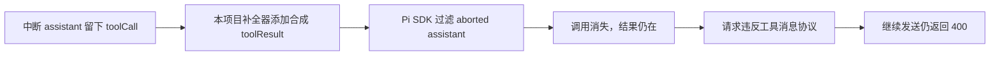

# 启动白屏与会话中断：调查与修复记录

调查：2026-10-27 至 2026-10-28。本文时间均为北京时间；证据 JSON 保留原始 UTC/epoch 时间。

文中 `.cache/` 路径均相对仓库根目录，指向未提交的本地调查与验证产物；源码使用可移植的仓库相对链接。

**实施状态（2026-10-28）：按用户要求收敛为三处最小修复，已完成源码修改及构建。原第六、七节的扩展方案已撤回，不作为后续待办；没有新增门禁、诊断系统或架构层。安装目录尚未替换。**

| 已完成修复 | 验证结果 |
| --- | --- |
| RPC 消息 ID 在缺少 `randomUUID` 时使用安全随机字节生成 UUID | 真实 Electron 的 `about:blank` 中握手、请求、序列确认均正常，无未捕获异常：结果（`.cache/startup-crash-investigation-2026-10-27/transport-replay-fixed.json`） |
| 页面加载恢复忽略子框架与取消导航，限制重试次数 | iframe 失败后主页面内存标记保留；主页面首次失败恢复一次，后续失败不循环重载：结果（`.cache/startup-crash-investigation-2026-10-27/subframe-replay-fixed.json`） |
| 不为 SDK 会丢弃的 aborted/error 消息补工具结果 | 原会话两次中断边界均无孤立结果：离线重放（`.cache/startup-crash-investigation-2026-10-27/context-replay-fixed.json`）；现有 Pi 中断续聊端到端流程 10 项通过：结果（`.cache/verification/durable-continuation-pi-7SFp9j/manifest.json`） |

相关现有测试 29 项通过；server-core、pi-agent-server、Electron 类型检查通过。下文调查数据保留修复前口径。同步全库检查的启动耗时及历史白屏直接触发点仍属于本次修复的已知边界。

**结论：已复现三个功能缺陷，并测得一个显著启动瓶颈。当前启动白屏的故障位置已经确认，但最初导航为什么停在空白文档，以及下午两次运行中白屏的直接触发点，仍缺少历史证据。不能把这些问题全部归结为同一个“崩溃”。**

| 问题 | 结论强度 | 影响 |
| --- | --- | --- |
| 预加载阶段依赖 `crypto.randomUUID()` | 现场定位＋隔离 Electron 复现 | 空白文档的非安全上下文缺少该方法，WebSocket 已打开却发不出握手，反复超时 |
| 子框架加载错误触发整窗重新加载 | 安装版端到端复现 | 一个 iframe 失败即可清掉主页面内存状态，干扰整个工作界面 |
| 中断消息的工具结果补全与 SDK 过滤顺序冲突 | 原始会话离线重放复现 | 第二次中断后形成孤立工具结果，后续请求持续被 API 拒绝 |
| 创建窗口前同步全库完整性检查 | 源码确认＋生产数据库只读实测 | 2,152,574,976 字节数据库的一次检查耗时 29,019.7 ms，启动期间没有可见阶段反馈 |
| 运行期白屏缺少正式版诊断 | 源码与历史日志确认 | 无法追溯两次白屏究竟是导航重载、渲染崩溃、卡顿还是其他原生故障 |

最初调查阶段没有修改产品代码、生产配置、原始会话或数据库内容，没有重放工具或调用模型。调查脚本及证据位于 `.cache/startup-crash-investigation-2026-10-27`。后续源码修复及隔离验证见上表；仓库原有未提交改动保持原状。

**调查对象与现场边界**

- 安装版 Phaneris **0.5.1**，Electron **44.9.0**，故障主进程 **48028**、渲染进程 **35288**。
- 安装目录：`C:\Users\dotty\AppData\Local\Programs\Phaneris`。
- 会话：`C:\Users\dotty\.phaneris\workspaces\Work\sessions\261027-jade-carbon`。
- 安装版 main、preload、renderer HTML 与调查时仓库现有 dist 逐字节相同；关键源文件及安装产物哈希见 `.cache/startup-crash-investigation-2026-10-27/source-identities.json`。不能将其他尚未构建的工作区改动视作正在运行的产品。
- 现场取证使用本地诊断接口及短暂 CDP 附着，读取状态后解除附着。未重新加载或修改故障窗口。原进程后来于 **10 月 27 日 21:33:14** 正常退出；10 月 28 日继续调查时它已不存在。
- 隔离复现使用同一安装版可执行文件、独立配置根和空工作区，不连接生产服务或使用生产凭据。调试器可能改变启动时序，因此干净配置启动成功不能证明偶发故障已经消失。

**一、当前启动失败：明确停在 React 之前**

10 月 27 日 21:09:17 主进程启动，约 21:09:53 渲染进程才创建。21:31:51 的保存现场仍为：

| 观察项 | 结果 |
| --- | --- |
| 主进程、渲染进程 | 均存活；主进程计时器可正常执行 |
| Electron 窗口 | `isLoading() = true`、`isCrashed() = false`、`getURL() = ''` |
| 文档 | `location.href = about:blank`，没有 `#root`，没有加载应用 HTML |
| 主世界与预加载隔离世界 | `isSecureContext = false`，`crypto.randomUUID` 为 `undefined`，`crypto.getRandomValues` 可用 |
| 本地连接 | 指向 `ws://127.0.0.1:62117`，反复 `Handshake timeout`，保存现场时 attempt 为 19 |
| 渲染端已有错误 | 20 条 `Uncaught` 指向安装版 `bootstrap-preload.cjs:51042`，该行正是 `crypto.randomUUID()` |

证据：`.cache/startup-crash-investigation-2026-10-27/live-startup.json`。这里不是已经加载聊天页面后渲染量过大，也没有证据显示该现场发生了 OOM。

[WsRpcClient](../../packages/server-core/src/transport/client.ts#L442) 在 `ws.onopen` 中直接调用浏览器全局 `crypto.randomUUID()`，没有处理能力缺失造成的同步异常。请求 ID 与序列确认 ID 也有同类调用，分别位于该文件第 190、873 行。浏览器 `randomUUID()` 有安全上下文要求；这与现场实测一致，参见 [MDN 文档](https://developer.mozilla.org/en-US/docs/Web/API/Crypto/randomUUID)。

在隔离安装版 Electron 中，将真实项目 `WsRpcClient` 放入 `about:blank`，连接一个本地测试 WebSocket：

| 条件 | 已建立的 socket | 收到的握手 | 结果 |
| --- | ---: | ---: | --- |
| 原始能力环境 | 1 | 0 | `TypeError: crypto.randomUUID is not a function`，随后握手超时 |
| 仅在隔离测试页补入 UUID 能力 | 累计 2 | 累计 1 | 第二次连接立即发出握手 |

证据：`.cache/startup-crash-investigation-2026-10-27/transport-replay.json`。测试用固定返回值仅用于单变量验证，不是产品实现方案。

**归因限制：**这证明了当前现场的握手失败机制，但尚未证明该异常导致最初的文件导航停滞，或修好 UUID 就一定能让那次窗口完成导航。两者必须分别设验收条件。安装版在独立干净配置中能完成文件导航、连接和界面呈现，说明资源普遍缺失不是现有证据支持的解释；不能据此排除旧配置、缓存、恢复路径或特定时序。

**二、已复现的运行期缺陷：子页面失败会重载整个应用**

[window-manager.ts](../../apps/electron/src/main/window-manager.ts#L400) 的 `did-fail-load` 处理只接收错误码和说明，没有区分 `isMainFrame`；正式版分支直接再次 `loadFile(index.html)`，也没有重试上限。

隔离测试中，正常应用窗口内加载一个不存在的本地 iframe，实测：

1. 子框架报告 `ERR_FILE_NOT_FOUND (-6)`，`isMainFrame = false`。
2. 同一个处理器立即触发主框架对 `index.html` 的完整导航。
3. 主页面测试标记从 `preserve-this-shell` 变为不存在，证明主页面内存状态被清掉。

证据：`.cache/startup-crash-investigation-2026-10-27/subframe-replay.json`。应用确有 Office、HTML、Page 等 iframe 使用场景；该测试证明故障处理范围错误，不代表已确认下午两次白屏都由某个特定预览触发。JavaScript 内部异常或普通资源请求失败，也不能一概等同于 `did-fail-load`。

这一处理还有第二个风险：主文档持续加载失败时，正式版会再次加载同一路径，缺少明确停止条件。应由窗口加载控制器区分主框架失败、子框架失败、取消导航和旧导航迟到事件；不能在任意加载错误上重置整个界面。[Electron 的事件说明](https://www.electronjs.org/docs/latest/api/web-contents#event-did-fail-load)提供了相应的框架和导航信息。

**三、会话两次中断的时间线与恢复失败**

用户确认下午的现象为窗口卡住、白屏或无响应。存储证据记录的是随后的退出与中断，不是最初白屏时刻。

| 时间（10 月 27 日） | 确认的事件 | 解释边界 |
| --- | --- | --- |
| 15:58:30.748 | PID 31496 收到应用退出请求，窗口数为 0 | 不能由此认定用户最初主动终止任务；也可能是遇到白屏后关闭窗口 |
| 15:58:30.801 / .832 | SDK 落盘 `aborted`；Runtime 记录 `interrupted` | 清理流程导致运行中断；中断消息只有思考，没有工具调用 |
| 15:58:31.122 | 应用以 code 0 退出 | 不是日志所记录的主进程异常退出 |
| 16:01:05 起 | 同一 SDK 会话继续正常执行工具 | 第一次中断没有造成后面的同类协议错误 |
| 16:06:20.953 | PID 11392 收到应用退出请求，窗口数为 0 | 仍未记录白屏发生原因 |
| 16:06:20.996 / 16:06:21.008 | SDK 落盘 `aborted`；Runtime 记录 `interrupted` | 这次中断消息含一个尚未实际派发的 PowerShell toolCall |
| 16:06:21.317 | 应用以 code 0 退出 | 后端走了正常清理流程 |
| 16:19:51–16:21:32 | SDK 连续记录 6 次同类 API 400；界面历史记录 5 条 error | 最后一次输入对应多个运行尝试，不能把两个计数混用 |

注意：SDK message 的 `timestamp` 是该次生成开始时间，15:58:14.031 和 16:06:18.265 不是中断落盘时间。上表采用 journal 行时间和 Runtime 提交时间。详见 `.cache/startup-crash-investigation-2026-10-27/session-timeline.json`。

明确的 API 错误为：

```text
Messages with role 'tool' must be a response to a preceding message with 'tool_calls'
```

问题调用 ID：`call_00_uZ18RtUwBkqtCpu1hFsK9868`。该会话的 124 次实际工具派发都有对应结果；查询没有发现这个 ID 的工具派发或结果，也没有待结算工具。这是尚未派发的中断输出，不能当作已经执行但结果丢失的工具。

根因链如下：



- [phaneris-resource-loader.ts](../../packages/pi-agent-server/src/phaneris-resource-loader.ts#L106) 在 `context_with_system` 中调用补全器。
- [canonical-model-context.ts](../../packages/pi-agent-server/src/canonical-model-context.ts#L88) 对所有 assistant toolCall 补结果，没有先区分 `error/aborted` 和已提交派发。
- Pi SDK transform-messages.js（`node_modules/@earendil-works/pi-ai/dist/api/transform-messages.js:178`） 随后跳过 `error/aborted` assistant，但继续保留 toolResult。
- 已核对安装版 Pi bundle 含相同补全逻辑；离线重放使用本机 Pi 1.3.0 的真实 OpenAI Completions 序列化函数。

| 重放边界 | 只用 SDK | 项目补全器 → SDK | 诊断性先过滤中断消息再补全 |
| --- | --- | --- | --- |
| 第一次中断后 | 合法 | 合法 | 合法 |
| 第二次中断后 | 合法 | **出现上述 ID 的孤立合成结果** | 合法 |

证据：`.cache/startup-crash-investigation-2026-10-27/context-replay.json`。最后一列只是验证顺序关系；正式修复不能不分情况地删除所有中断消息，因为其他会话可能已有真实工具副作用和回执。

**四、为什么故障表现为长时间无窗口、白屏与不可追溯**

| 当前机制 | 系统性问题 | 修复要求 |
| --- | --- | --- |
| [创建初始窗口后立刻设置 startupWindowsReady](../../apps/electron/src/main/index.ts#L1444) | “已创建窗口对象”被当成“可用界面” | 分别确认文档、预加载、RPC、界面就绪 |
| [窗口仅在 ready-to-show 时显示](../../apps/electron/src/main/window-manager.ts#L281) | 没有就绪事件就没有正常的可见反馈 | 提前显示独立启动状态；超时必须进入可操作错误状态 |
| [初始化异常仅在没有窗口对象时重新抛出](../../apps/electron/src/main/index.ts#L1546) | 空白窗口也可能让失败被留在后台 | 用已确认的可用状态决定失败处置 |
| render-process-gone 只挂一次且仅写 windowLog | 不能完整监督多次重载后的渲染进程 | 按窗口代际持续监督，并持久化原因和退出码 |
| [正式版关闭 file/console 日志](../../apps/electron/src/main/logger.ts#L65) | 窗口诊断、连接诊断不会留下常规日志 | 保留最小、脱敏、限额轮转的本地稳定性日志 |
| React ErrorBoundary 只在挂载后有效 | 接不住导航未完成、预加载失败、挂载前模块异常 | 建立不依赖 React 和业务连接的错误展示路径 |
| [React Suspense fallback 为 null](../../apps/electron/src/renderer/main.tsx#L110) | 应用模块加载期间可出现纯空白 | 持续显示明确的加载状态，并设置模块加载错误边界 |

Windows Application 日志没有找到对应两次时段的 Phaneris 原生崩溃报告；这不排除 renderer 或 GPU 故障。查到的两条 `LiveKernelEvent` 引用的是 10 月 15 日旧 WATCHDOG dump，不能归因于本次会话。现有日志不足以判断历史白屏是否由 OOM、GPU、导航重载或线程阻塞引起。

**五、启动性能瓶颈：完整性检查阻塞在窗口之前**

代码路径为：`bootstrapServer → SessionManager.initialize → durableRuntime.admin.start → storeFor → PRAGMA integrity_check → 维护/恢复 → createInitialWindows`。

[coordinator.ts:137](../../packages/server-core/src/durable-runtime/coordinator.ts#L137) 每次进程首次打开工作区 store 都执行全库检查；[store.ts:232](../../packages/server-core/src/durable-runtime/store.ts#L232) 使用同步 SQLite 调用。启动还执行备份、checkpoint、清理与 optimize，部分条件下包含 VACUUM。

10 月 28 日以 SQLite `mode=ro`、`query_only=ON` 对现有数据库执行同一完整性检查，结果为 `ok`，耗时 **29.020 秒**。见 `.cache/startup-crash-investigation-2026-10-27/database-integrity-timing.json`。这证实该操作本身足以造成数十秒等待；不是原启动逐阶段 trace，不能将 21:09 的约 36 秒窗口创建延迟全部精确分摊给它，也不能据此解释后续二十多分钟白屏。

不建议把删除数据库、清缓存或 VACUUM 当作本次通用修复。该库完整性检查通过，主要问题是高成本工作的位置、线程和可见性；是否需要容量治理需另测增长与查询成本。

**六、调查时的扩展方案（已撤回，不执行）**

| 顺序 | 实施内容 | 完成标准 |
| --- | --- | --- |
| P0-A：可诊断、可终止的启动 | 统一启动/窗口健康控制器；先接入正式版稳定性日志；修复 UUID 能力依赖和握手异常处理；明确阶段、超时、重试预算 | 任何启动失败都能定位阶段，并出现可操作反馈；没有无限隐身等待或无信息白屏 |
| P0-B：窗口故障隔离 | 修复主/子框架判断；处理导航取消与迟到事件；主文档重试有界；持续监听 renderer/preload/GPU/无响应事件 | iframe 失败只影响对应区域；重建界面不重放后端工具，不丢失已落盘草稿和当前运行身份 |
| P0-C：恢复上下文协议正确性 | 基于已提交的模型/工具事实构造上下文；明确 native 过滤与本地补全过程；在最终 provider messages 边界校验配对 | 原始故障会话的下一次请求结构合法；不会把未派发工具伪装成已执行结果，不会重放真实副作用 |
| P1-A：启动关键路径拆分 | 原生/最小启动界面先显示；数据库检查、备份与维护移出 Electron 主线程；把数据库健康与写入放行分开 | 大库检查仍可完成，主窗口持续响应；未确认健康的数据不被默默放行写入 |
| P1-B：运行期故障闭环 | 可见窗口心跳、主线程延迟和内存记录；重连重建订阅、读取一致快照；故障恢复状态明确可见 | 能区分主线程阻塞、renderer 无响应/退出、GPU 故障、RPC 断线和业务错误 |
| 发布门禁 | 对最终 Windows 安装产物做故障注入与原始会话回放；生成机器可验证证据 | 不能只用类型检查、单元测试或页面存在来宣称启动/恢复已通过 |

具体设计约束：

1. **传输 ID 能力显式提供。** Electron preload 使用可信 Node 加密实现；浏览器端使用可用的安全随机实现，或通过平台适配器注入 ID 工厂。同一入口覆盖握手、请求、确认 ID，不能降级为 `Math.random()` 或为解决问题关闭隔离。`onopen` 的构造/序列化异常应变成明确的本地失败，释放本次计时器与 socket；环境能力错误不应无休止重试。原有暂时性断网重连能力保留。
2. **启动状态由实际确认推进。** 至少区分 `process-started / shell-created / document-committed / preload-ready / rpc-ready / ui-ready / failed`，带启动 ID、窗口代际和耗时。`ui-ready` 应由有可见错误路径的界面发回确认，而不是创建窗口后直接赋值。按阶段设置可取消期限；迟到事件不能复活旧窗口或清掉新状态。
3. **故障恢复按所属组件处理。** 子框架失败交回预览组件；主框架真实失败才进入窗口恢复。自动恢复最多进行一次受控尝试，再失败就显示独立错误页或原生提示，提供重试、诊断导出和退出入口。页面恢复与 Runtime 的运行状态分开；刷新界面不能隐式取消或重新派发模型/工具。
4. **消息修复以真实派发证据为依据。** 尚未派发的半截 toolCall 不进入 provider 协议；已有 T1/T2 的调用与结果必须成对保留。未知效果保持明确的未知状态。允许的“结果未知”协议占位不能写成业务成功/失败回执。结合 run/operation 身份处理重复 ID、迟到结果和并行批次，不能仅凭全会话同名 ID 移动结果。
5. **既有会话修复可预览、可回退。** 先对该会话副本生成上下文投影差异并验证；正式修复使用附加式 context edit/恢复记录，保留原 journal、usage 与工具证据。不要直接重写原 JSONL、清空 Runtime 或自动重跑 PowerShell。真实会话修改在实施时按用户协作约定单独展示摘要。
6. **数据库检查保持正确性。** 不简单删除完整性检查，也不把 `quick_check` 宣称为等价替代。将检查与维护交给明确拥有数据库连接的 worker/进程；Electron 主线程先显示状态。完整性策略、上次成功检查标记、异常退出后的强制检查和只读/禁写状态一起设计。后台检查或备份需要一致快照/WAL 语义，不能直接复制活动数据库文件。最终是否将整个 Runtime 独立进程化，由响应性数据决定，当前不必扩大为全面架构重写。
7. **诊断默认本地持久化。** 最小字段包含版本/构建、启动 ID、PID、窗口角色/代际、阶段、错误码/栈、连接状态、renderer 退出原因、可见性、内存和延迟。限制频率、大小和保留量，排除 token、消息正文、文件内容及供应商完整请求。捕获 `preload-error`、主框架加载失败、`render-process-gone`、`unresponsive/responsive`、子进程退出；主线程自身完全阻塞时，单靠主线程计时器不足以监督，必要时由独立诊断进程记录。最小化/后台窗口不能误判为卡死。

**七、调查时拟议的扩展验收矩阵（已撤回，不作为门禁）**

下表为拟实施门禁，不是已完成测试。所有注入都在隔离配置/数据副本进行，真实工具由可核对的本地测试服务替代；先固定失败条件，再实现修复。

| 用例 | 失败注入 / 场景 | 必须得到的结果与证据 |
| --- | --- | --- |
| 初始空白上下文 | `randomUUID` 缺失但安全随机能力存在 | 握手、普通请求、序列确认均正确；无未捕获异常，保留 wire 摘要 |
| 启动就绪 | 启动中连续再次打开应用、最小化/恢复 | 只交接给健康窗口，或显示启动状态；状态图和窗口数一致 |
| 主文档失败 | HTML/入口 chunk 缺失或加载一直不完成 | 有界失败、错误可见、重试数受控；没有递归加载风暴 |
| 子框架失败 | iframe 本地缺失、Page 协议错误 | 主文档无完整导航，草稿/选中会话/运行身份不变 |
| 预加载异常 | IPC 引导失败、能力构造失败 | 通过主进程记录与展示，不能依赖 React 才能报错 |
| renderer 故障 | 隔离 renderer crash、卡顿、恢复后再次 crash | 每次故障均有记录；恢复预算有效；后端任务不重复执行 |
| RPC 断线 | 启动前后断开并恢复本地服务 | UI 状态明确，订阅与快照恢复；不能只证明 TCP 打开 |
| 第一次中断边界 | thinking-only aborted | 下一次消息合法，保留审计历史 |
| 第二次中断边界 | aborted 中包含未派发工具调用 | 不产生孤立结果、不调用真实工具；原始会话回放通过 |
| 已有副作用 | 派发后中断、结果迟到/重复、并行工具部分完成 | 按 T1/T2 收敛，已完成副作用执行次数保持一次，未知状态可核对 |
| 上下文变化 | 压缩、分支、切换 provider、重复调用 ID | 最终 provider messages 仍满足该协议的配对与顺序要求 |
| 大库启动 | 当前约 2.15 GB 数据规模副本、慢磁盘、维护并发 | 主窗口可见且持续响应；输出分阶段耗时、主线程延迟、检查结论 |
| 工作流长跑 | 在会话副本重复文件生成、Office/HTML 预览与界面切换 | 记录内存、窗口事件和恢复状态；不能出现未经解释的主框架重载 |
| 最终安装版 | 正常冷/暖启动、升级后旧 profile、损坏缓存副本 | 保存可重复脚本、阶段日志、截图/录像、校验摘要；不得以清空用户配置作为通过条件 |

建议先定一轮 **30 次受控启动**作为初始回归门禁，并覆盖上表不同状态；这是拟定测试量，不是已经得到的故障率结论。延迟门槛依据同机基线约定，报告 P50/P95 与最大值，不虚构修复后的性能收益。

**八、本轮验证产物与复核方式**

| 产物 | 内容 |
| --- | --- |
| `.cache/startup-crash-investigation-2026-10-27/failure-matrix.md` | 诊断前列明的失败场景 |
| `.cache/startup-crash-investigation-2026-10-27/live-startup.json` | 已退出故障进程的窗口、realm、连接及错误缓存 |
| `.cache/startup-crash-investigation-2026-10-27/transport-replay.json` | 真正 Electron 非安全上下文的握手复现与单变量对照 |
| `.cache/startup-crash-investigation-2026-10-27/subframe-replay.json` | 安装版子框架故障导致主页面重载 |
| `.cache/startup-crash-investigation-2026-10-27/session-timeline.json` | 无对话正文的中断、错误、派发与退出时间线 |
| `.cache/startup-crash-investigation-2026-10-27/context-replay.json` | 原始 SDK 历史的三种处理顺序对照 |
| `.cache/startup-crash-investigation-2026-10-27/database-integrity-timing.json` | 只读完整性检查结果与计时 |
| `.cache/startup-crash-investigation-2026-10-27/startup-probe.json` | 两次干净配置启动至初始 React 根挂载；不是整套业务验收 |
| `.cache/startup-crash-investigation-2026-10-27/source-identities.json` | 安装产物及关键源码哈希 |
| `.cache/startup-crash-investigation-2026-10-27/manifest.json` | 本轮主要证据与脚本的文件校验清单 |

从仓库根目录可重复执行（安装路径及原始会话需仍存在）：

```powershell
$env:PHANERIS_PROBE_EXECUTABLE = 'E:\Phaneris\.cache\startup-crash-investigation-2026-10-27\fixed-runtime\Phaneris.exe'
bun run .cache/startup-crash-investigation-2026-10-27/replay-context.ts
bun run .cache/startup-crash-investigation-2026-10-27/replay-transport.ts
bun run .cache/startup-crash-investigation-2026-10-27/probe-subframe.ts
```

脚本现已复用于修复验证，写入单独的 `*-fixed.json` 并在断言失败时返回非零状态；原始缺陷证据保持不变。`fixed-runtime` 为安装版的隔离副本，覆盖了本次新构建的 main、preload 与 Pi 子进程产物。原 `manifest.json` 记录调查阶段文件，未包含本次修复验证及脚本调整。安装版调试启动曾使用 `--inspect=0` 与 `--debug` 组合而被 Node 以 DEP0062/exit 9 拒绝；失败产物另存，后续成功复现未使用该组合，不能将这次诊断启动错误归入用户原始故障。

**归因边界**：现有历史证据不足以确认最初文件导航停滞的原因及下午两次白屏的直接触发点。本次已修复三个可复现缺陷，不宣称历史两次白屏已经被完全解释。
